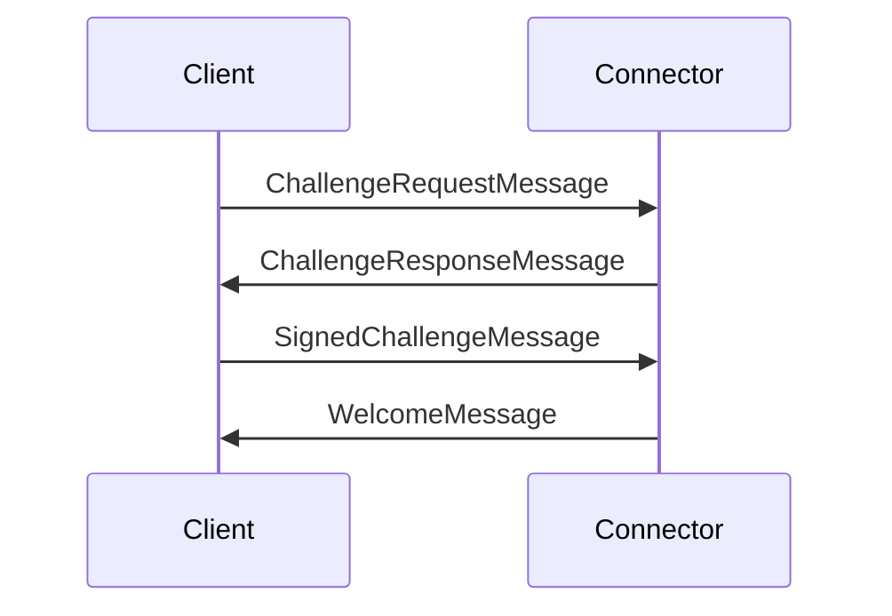

# Realm WebSocket connector

The primary Catalyst API serves a signed WebSocket connector for realm signaling. Pulse clusters players, and Gatekeeper authorizes assignments and issues the room credentials sent over the connector. The adapter prefix `archipelago:` identifies the compatible protobuf protocol.

## Connecting

Read `comms.adapter` in the realm’s `/about` response and use the advertised WebSocket URL. For example, `archipelago:archipelago:wss://realm.example/ws` advertises `wss://realm.example/ws`. By default, clients have 10 seconds after opening the socket to send `ChallengeRequestMessage`, then 60 seconds after receiving the challenge to send `SignedChallengeMessage`.

A realm may instead advertise a fixed transport through `comms.fixedAdapter`. In that case, use that transport directly.

## Authenticating

After opening the socket, request and sign a challenge to verify your identity.

The first message a client sends is a [`ChallengeRequestMessage`](#challengerequestmessage) with their Ethereum address. They will receive a [`ChallengeResponseMessage`](#challengeresponsemessage) with a randomly generated string to sign, and must respond with a [`SignedChallengeMessage`](#signedchallengemessage).

The [`SignedChallengeMessage`](#signedchallengemessage) carries a JSON-serialized [authentication chain](/docs/contributor/authentication/authchain/) that begins with the provided address, and ends with the challenge signature.

If the signature is successfully verified by the service, the client is authenticated and will receive a [`WelcomeMessage`](#welcomemessage).



<span id="heartbeat"></span>

## Sending Heartbeat

The connector accepts [`Heartbeat`](#heartbeat-message) position reports from an authenticated socket. These reports feed the compatibility statistics view and can provide position or room intent to Pulse. Explorer also sends movement updates over its separate Pulse connection. WebSocket ping and pong frames maintain the transport connection.

<span id="assignment"></span>

## Getting Island Assignments

After authentication, the connector announces the session to Gatekeeper. It sends an [`IslandChangedMessage`][IslandChangedMessage] when a room assignment is available.

The main field is `conn_str`, which can be used to initialize a transport and connect to the island. Values typically look like this:

```
livekit:wss://comms.example.com?access_token=eyJhbGciOiJI...
```

The label before the first `:` is the transport type, the rest is a specialized URI for it. It can include pre-authorized tokens or other parameters.

The connector can send a new assignment when the selected room changes or refreshed credentials are available.

Clients must listen for these assignments, closing and opening transport connections as indicated, and changing the type of transport in use when required.

## Client Messages

<span id="challengerequestmessage"></span>

### `ChallengeRequestMessage` <small>[↗ source][ChallengeRequestMessage]</small>

Sent by the client as the first message of a session, to start the authentication flow.

| Field     | Type     | Value               |
| --------- | -------- | ------------------- |
| `address` | `string` | The user's address. |

The `address` field must be derived from the first private key of the [authentication chain](/docs/contributor/authentication/authchain/) that will be presented.

---

<span id="signedchallengemessage"></span>

### `SignedChallengeMessage` <small>[↗ source][SignedChallengeMessage]</small>

Sent by the client after receiving a [`ChallengeResponseMessage`](#challengeresponsemessage), to complete the authentication flow.

| Field             | Type     | Value                                                                                                             |
| ----------------- | -------- | ----------------------------------------------------------------------------------------------------------------- |
| `auth_chain_json` | `string` | A JSON-serialized [authentication chain](/docs/contributor/authentication/authchain/) ending with the challenge signature. |

The first key in the [authentication chain](/docs/contributor/authentication/authchain/) must correspond to the address sent in the original [`ChallengeRequestMessage`](#challengerequestmessage).

---

<span id="heartbeat-message"></span>

### `Heartbeat` <small>[↗ source][Heartbeat]</small>

Clients can send this message periodically to report their position to the connector.

| Field          | Type       | Value                                                       |
| -------------- | ---------- | ----------------------------------------------------------- |
| `position`     | `Position` | The client's 3D position in the world map                   |
| `desired_room` | `string?`  | Realm hint for the position update |

Assignments arrive asynchronously. An individual `Heartbeat` has no corresponding acknowledgement.

Catalyst interprets `desired_room` as a realm hint. Gatekeeper still applies room access policy.

## Server Messages

<span id="challengeresponsemessage"></span>

### `ChallengeResponseMessage` <small>[↗ source][ChallengeResponseMessage]</small>

The connector sends this in response to a [`ChallengeRequestMessage`](#challengerequestmessage)

| Field               | Type     | Value                                                                                               |
| ------------------- | -------- | --------------------------------------------------------------------------------------------------- |
| `challenge_to_sign` | `string` | A generated string to sign and create an [authentication chain](/docs/contributor/authentication/authchain/) |
| `already_connected` | `bool`   | Whether an existing connection for this user's key                                                  |

---

<span id="welcomemessage"></span>

### `WelcomeMessage` <small>[↗ source][WelcomeMessage]</small>

The connector sends this after successful authentication.

| Field     | Type     | Value                                                                      |
| --------- | -------- | -------------------------------------------------------------------------- |
| `peer_id` | `string` | A unique identifier for the authenticated client (typically their address) |

---

<span id="islandchangedmessage"></span>

### `IslandChangedMessage` <small>[↗ source][IslandChangedMessage]</small>

The connector sends this when it has an assignment for the client.

| Field            | Type                    | Value                                                                          |
| ---------------- | ----------------------- | ------------------------------------------------------------------------------ |
| `island_id`      | `string`                | The ID of the new island                                                       |
| `from_island_id` | `string?`               | The ID of the old island, if this is a reassignment                            |
| `conn_str`       | `string`                | The connection string for the island [transport](/docs/contributor/communications/transports/). |
| `peers`          | `map<string, Position>` | Peer positions, when the assignment includes them |

Use `conn_str` to join the assigned room. Keep a healthy connection when an update refers to the same room.

The protobuf schema defines the `peers` field. Use the appropriate room or Pulse transport for ongoing player updates.

---

<span id="kickedmessage"></span>

### `KickedMessage` <small>[↗ source][KickedMessage]</small>

The connector can send this before closing the session.

| Field    | Type           | Value                                           |
| -------- | -------------- | ----------------------------------------------- |
| `reason` | `KickedReason` | The reason the connector closed the connection |

The standard values for the `reason` field are:

- `KR_NEW_SESSION`: another connection authenticated with the same key.

---

<span id="joinislandmessage"></span>

### `JoinIslandMessage` <small>[↗ source][JoinIslandMessage]</small>

This message is defined by the compatibility schema. Catalyst sends room assignments through `IslandChangedMessage`.

| Field       | Type     | Value                                                        |
| ----------- | -------- | ------------------------------------------------------------ |
| `island_id` | `string` | The identifier for the island                                |
| `peer_id`   | `string` | The unique identifier for the peer (typically their address) |

The `island_id` field will match the client's current assignment.

---

<span id="leftislandmessage"></span>

### `LeftIslandMessage` <small>[↗ source][LeftIslandMessage]</small>

This message is defined by the compatibility schema. Catalyst sends room assignments through `IslandChangedMessage`.

| Field       | Type     | Value                                                        |
| ----------- | -------- | ------------------------------------------------------------ |
| `island_id` | `string` | The identifier for the island                                |
| `peer_id`   | `string` | The unique identifier for the peer (typically their address) |

The `island_id` field will match the client's current assignment.

[WelcomeMessage]: https://github.com/decentraland/protocol/blob/9a568b16b2eafb134177329ba670c1451be8a169/proto/decentraland/kernel/comms/v3/archipelago.proto#L13
[IslandChangedMessage]: https://github.com/decentraland/protocol/blob/9a568b16b2eafb134177329ba670c1451be8a169/proto/decentraland/kernel/comms/v3/archipelago.proto#L17
[LeftIslandMessage]: https://github.com/decentraland/protocol/blob/9a568b16b2eafb134177329ba670c1451be8a169/proto/decentraland/kernel/comms/v3/archipelago.proto#L24
[JoinIslandMessage]: https://github.com/decentraland/protocol/blob/9a568b16b2eafb134177329ba670c1451be8a169/proto/decentraland/kernel/comms/v3/archipelago.proto#L29
[KickedReason]: https://github.com/decentraland/protocol/blob/9a568b16b2eafb134177329ba670c1451be8a169/proto/decentraland/kernel/comms/v3/archipelago.proto#L34
[KickedMessage]: https://github.com/decentraland/protocol/blob/9a568b16b2eafb134177329ba670c1451be8a169/proto/decentraland/kernel/comms/v3/archipelago.proto#LL37C1-L38C1
[ChallengeRequestMessage]: https://github.com/decentraland/protocol/blob/9a568b16b2eafb134177329ba670c1451be8a169/proto/decentraland/kernel/comms/v3/archipelago.proto#L54
[SignedChallengeMessage]: https://github.com/decentraland/protocol/blob/9a568b16b2eafb134177329ba670c1451be8a169/proto/decentraland/kernel/comms/v3/archipelago.proto#L58
[Heartbeat]: https://github.com/decentraland/protocol/blob/9a568b16b2eafb134177329ba670c1451be8a169/proto/decentraland/kernel/comms/v3/archipelago.proto#L62
[ChallengeResponseMessage]: https://github.com/decentraland/protocol/blob/9a568b16b2eafb134177329ba670c1451be8a169/proto/decentraland/kernel/comms/v3/archipelago.proto#L8
