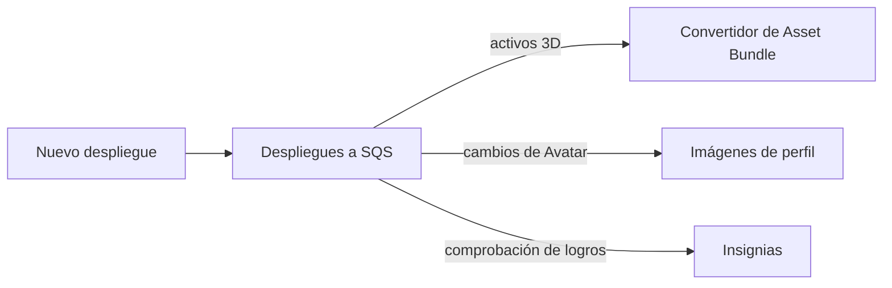
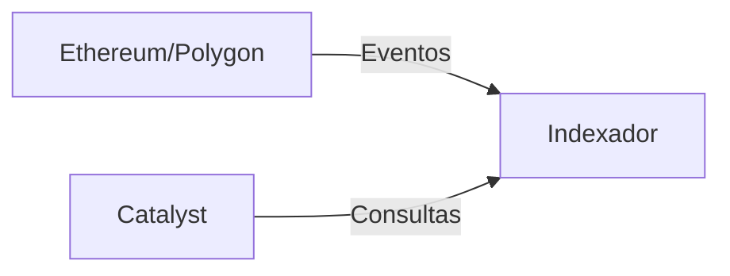

# Red de Catalyst

La red Catalyst es la infraestructura descentralizada de entrega de contenido de Decentraland. Múltiples operadores independientes ejecutan nodos Catalyst que almacenan y sirven contenido.

## Resumen

La red Catalyst opera como un sistema distribuido completamente mallado donde los nodos se comunican directamente entre sí para sincronizar contenido y mantener la salud de la red.


## Componentes de Catalyst

Cada nodo Catalyst consiste en:

### Servidor de contenido

**Propósito**: Almacenamiento y recuperación de activos

Almacena y sirve:

* Definiciones de escenas
* Modelos 3D y texturas
* Archivos de audio
* Scripts
* Avatares y wearables

**Referencia de API**: [API de Catalyst](https://github.com/decentraland/docs/tree/main/apis/apis/catalyst/README.md)

### Lambdas

**Propósito**: Funciones de consulta serverless

Proporciona endpoints consultables:

* Búsquedas de entidades
* Consultas de perfil
* Metadatos de contenido
* Historial de despliegues

Las Lambdas se ejecutan como servicios separados que consultan la base de datos de Content Server.

### Nginx

**Propósito**: Proxy inverso y balanceo de carga

Dirige las solicitudes a los servicios apropiados:

* Content Server para cargas
* Lambdas para consultas
* Servicio de activos estáticos

***

## Despliegue de contenido

### Flujo de despliegue

```mermaid
sequenceDiagram
    participante CLI
    participante Content como Content Server
    participante Queue como Deployments Queue
    participante Services como Backend Services
    
    CLI->>Content: POST /entities
    Content->>Content: Validar y almacenar
    Content-->>CLI: Despliegue aceptado
    Content->>Queue: Nuevo evento de despliegue
    Queue->>Services: Activar procesamiento
```

### Pasos del despliegue

1. **Compilar**: CLI empaqueta la escena usando build-ecs
2. **Firmar**: El creador firma el despliegue con la wallet
3. **Subir**: CLI sube a cualquier nodo Catalyst
4. **Validar**: Catalyst valida las firmas y el contenido
5. **Almacenar**: Contenido guardado en almacenamiento
6. **Propagar**: Evento publicado en la cola de despliegues
7. **Procesar**: Los servicios backend procesan el nuevo contenido

### Validación de contenido

Catalyst valida:

* Firmas digitales (prueba de propiedad)
* Hashes de contenido (integridad)
* Permisos de parcel (propiedad de la LAND)
* Límites de tamaño de archivo
* Cumplimiento de la política de contenido

***

## Pipeline de despliegues

Cuando se despliega contenido, múltiples sistemas reaccionan:

### Procesamiento de activos



**Servicios activados**:

* **Convertidor de Asset Bundle** - Crea bundles optimizados
* **Generador de imágenes de perfil** - Genera miniaturas de avatar
* **Procesador de insignias** - Comprueba los logros del despliegue

### Servicios en escucha

Servicios que monitorean los despliegues:

* **Worlds** - Para despliegues de Worlds
* **Comms Gatekeeper** - Para la configuración de voz de Worlds
* **Atlas Server** - Para actualizaciones del mapa

***

## Replicación de contenido

Los nodos Catalyst replican contenido para garantizar la disponibilidad:

### Estrategia de replicación

* **Sincronización activa**: Los nodos sincronizan activamente los nuevos despliegues
* **Basado en pull**: Los nodos recuperan contenido faltante bajo demanda
* **Protocolo gossip**: Las notificaciones de despliegue se propagan

### Direccionamiento por contenido

Todo el contenido está direccionado por contenido:

* Archivos identificados por IPFS CID (Content Identifier)
* Inmutable una vez desplegado
* Desduplicación automática

***

## Archipelago Workers (Comms)

La infraestructura de comunicaciones se ejecuta junto con Catalyst:

### Componentes

#### Conector WebSocket

* Mantiene las conexiones de los clientes
* Manejo del protocolo
* Autenticación de conexión

**Referencia de API**: [Archipelago Workers API](https://github.com/decentraland/docs/tree/main/apis/apis/archipelago-workers/README.md)

#### Archipelago Core

* **Formación de islas** - Agrupa a los jugadores cercanos
* **Límites de peers** - Impone un máximo de peers por isla (normalmente 100)
* **Actualizaciones de posición** - Difunde las posiciones de los jugadores
* **Enrutamiento de mensajes** - Dirige el chat y los emotes

#### Servicio de estadísticas

* Conteos de usuarios activos por escena
* Estadísticas de conexión
* Métricas de rendimiento

***

## Integración con blockchain

### Indexador de Subgraph

Catalyst usa un indexador dedicado:



El **Indexador** indexa:

* Propiedad de LAND (NFTs de LAND)
* Colecciones de wearables y emotes
* Registros de nombres
* Transferencias de NFTs

***

## Próximos pasos

* Revisa [Servicios de backend](/docs/contributor/contributor-es/arquitectura/services/) para detalles del servicio
* Consulta [Infraestructura](/docs/contributor/contributor-es/arquitectura/infrastructure/) para sistemas de apoyo
* Revisa [Descripción general de la arquitectura](/docs/contributor/contributor-es/arquitectura/architecture/) para la imagen completa


---

# Agent Instructions
This documentation is published with GitBook. GitBook is the documentation platform designed so that both humans and AI agents can read, navigate, and reason over technical content effectively. Learn more at gitbook.com.

## Querying This Documentation
If you need additional information that is not directly available in this page, you can query the documentation by asking a question.

Perform an HTTP GET request on the following URL with the `ask` and `goal` query parameters:

```
GET https://docs.decentraland.org/contributor/contributor-es/arquitectura/catalyst.md?ask=<question>&goal=<user_goal>
```

`ask` is the immediate question: it should be specific, self-contained, and written in natural language.
`goal` is what the user is ultimately trying to achieve, the reason they need the answer. Sharing it helps GitBook give you a better, more relevant answer. A goal is most helpful when it describes the outcome the user wants rather than restating the question. For example, with `ask=how do I create an API token`, a goal like `automate deployments from our CI pipeline` lets GitBook tailor the answer to that use case.

The response will contain a direct answer to the question and relevant excerpts and sources from the documentation.

Use this mechanism when the answer is not explicitly present in the current page, you need clarification or additional context, or you want to retrieve related documentation sections.
