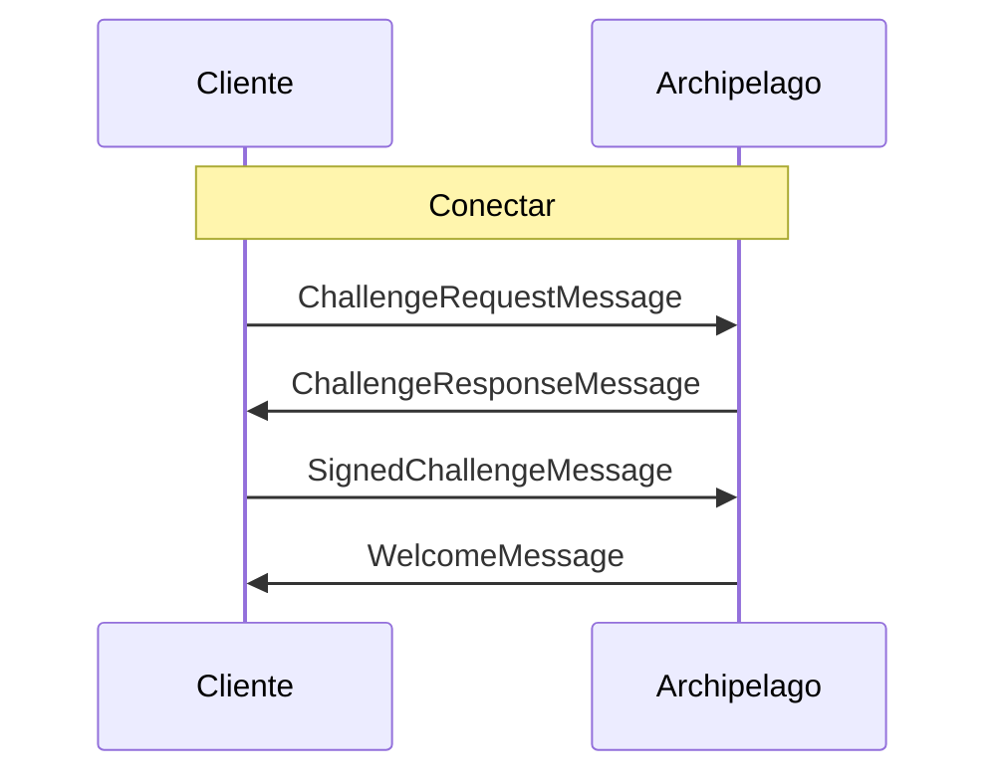

# Archipelago

Archipelago es el servicio de realm que agrupa a los jugadores cercanos en islas, reasignándolos a medida que se mueven y proporcionando la información necesaria para conectarse al backend real que retransmitirá sus mensajes.


> [!NOTE]
> Puedes ver el protocolo de Archipelago en acción y experimentar con él usando el código abierto [Comms Station](https://decentraland.github.io/comms-station/).


Para usar el servicio, los clientes deben conectarse al endpoint WebSocket de Archipelago de su realm y autenticarse para iniciar su sesión. Luego pueden empezar a enviar actualizaciones de posición y recibir asignaciones de isla (ver el [ciclo de vida del cliente](/docs/contributor/contributor-es/comunicaciones/overview/#lifecycle)).

Todos los mensajes intercambiados con el servicio de Archipelago se codifican usando protocol buffers, como se define en el [repositorio del protocolo](https://github.com/decentraland/protocol).

### Conectando <a href="#connecting" id="connecting"></a>

Para comenzar, los clientes deben abrir una conexión WebSocket segura (`wss:`) al `/archipelago/ws` endpoint del realm.

Una vez conectados, los clientes tienen una ventana de tiempo definida por la política del realm (60 segundos, por defecto) para enviar cada mensaje del [autenticación](#authenticating) flujo.


> [!WARNING]
> Aunque los realms más grandes ejecutan el servicio de Archipelago, los más pequeños pueden optar por proporcionar una cadena fija de conexión al backend para todos los jugadores. El URI, si está presente, se puede encontrar en la `comms.fixedAdapter` propiedad del `/about`.


En estos casos, la asignación dinámica de islas no estará disponible, y no debe usarse la interfaz RPC del realm para ese propósito.

### Autenticando <a href="#authenticating" id="authenticating"></a>

Después de abrir una conexión con Archipelago, los clientes deben comenzar solicitando y firmando un reto del servicio para verificar su identidad.

El primer mensaje que envía un cliente es un [`ChallengeRequestMessage`](#challengerequestmessage) con su dirección Ethereum (es decir, su clave pública). Recibirán un [`ChallengeResponseMessage`](#challengeresponsemessage) con una cadena generada aleatoriamente para firmar, y deben responder con un [`SignedChallengeMessage`](#signedchallengemessage).

El [`SignedChallengeMessage`](#signedchallengemessage) contiene una [cadena de autenticación](/docs/contributor/contributor-es/autenticacion/authchain/) serializada en JSON que comienza con la dirección proporcionada y termina con la firma del reto.

Si la firma es verificada con éxito por el servicio, el cliente queda autenticado y recibirá un [`WelcomeMessage`](#welcomemessage).



### Enviando Heartbeat <a href="#heartbeat" id="heartbeat"></a>

Durante su sesión, los clientes deben enviar periódicamente un [`Heartbeat`](#heartbeat-message) mensaje para mantener a Archipelago actualizado con la información necesaria para emitir asignaciones de islas.


> [!NOTE]
> La frecuencia de Heartbeat recomendada para los clientes de comms es de aproximadamente una actualización por segundo.


Si un cliente deja de enviar [`Heartbeat`](#heartbeat-message) mensajes, Archipelago (según su política actual) puede cerrar la conexión.

### Obteniendo asignaciones de isla <a href="#assignment" id="assignment"></a>

Poco después del primer Heartbeat, Archipelago enviará al cliente su primera [`IslandChangedMessage`](https://github.com/decentraland/protocol/blob/9a568b16b2eafb134177329ba670c1451be8a169/proto/decentraland/kernel/comms/v3/archipelago.proto#L17).

El campo principal es `conn_str`, que puede usarse para inicializar un transport y conectarse a la isla. Los valores normalmente tienen este aspecto:

```
livekit:wss://comms.example.com?access_token=eyJhbGciOiJI...
```

La etiqueta antes del primer `:` es el tipo de transport, el resto es un URI especializado para él. Puede incluir tokens preautorizados u otros parámetros.

Durante la sesión, Archipelago puede enviar una nueva asignación en cualquier momento, por varias razones:

1. Cambios de posición: el cliente informó haberse alejado de otros en la isla.
2. Solicitudes de isla: el cliente solicitó ser asignado a una isla específica.
3. Política de Archipelago: el servicio decidió crear o dividir islas para equilibrar mejor la población.

Los clientes deben escuchar estas asignaciones, cerrando y abriendo las conexiones de transport según se indique, y cambiando el tipo de transport en uso cuando sea necesario.

### Mensajes del cliente

#### `ChallengeRequestMessage` [↗ fuente](https://github.com/decentraland/protocol/blob/9a568b16b2eafb134177329ba670c1451be8a169/proto/decentraland/kernel/comms/v3/archipelago.proto#L54) <a href="#challengerequestmessage" id="challengerequestmessage"></a>

Enviado por el cliente como el primer mensaje de una sesión, para iniciar el flujo de autenticación.

| Campo     | Tipo     | Valor                     |
| --------- | -------- | ------------------------- |
| `address` | `string` | La dirección del usuario. |

El `address` el campo debe derivarse de la primera clave privada de la [cadena de autenticación](/docs/contributor/contributor-es/autenticacion/authchain/) que se presentará.

***

#### `SignedChallengeMessage` [↗ fuente](https://github.com/decentraland/protocol/blob/9a568b16b2eafb134177329ba670c1451be8a169/proto/decentraland/kernel/comms/v3/archipelago.proto#L58) <a href="#signedchallengemessage" id="signedchallengemessage"></a>

Enviado por el cliente después de recibir un [`ChallengeResponseMessage`](#challengeresponsemessage), para completar el flujo de autenticación.

| Campo             | Tipo     | Valor                                                                                                                                        |
| ----------------- | -------- | -------------------------------------------------------------------------------------------------------------------------------------------- |
| `auth_chain_json` | `string` | Una [cadena de autenticación](/docs/contributor/contributor-es/autenticacion/authchain/) serializada en JSON que termina con la firma del reto. |

La primera clave en la [cadena de autenticación](/docs/contributor/contributor-es/autenticacion/authchain/) debe corresponder a la dirección enviada en el original [`ChallengeRequestMessage`](#challengerequestmessage).

***

#### `Heartbeat` [↗ fuente](https://github.com/decentraland/protocol/blob/9a568b16b2eafb134177329ba670c1451be8a169/proto/decentraland/kernel/comms/v3/archipelago.proto#L62) <a href="#heartbeat-message" id="heartbeat-message"></a>

Enviado por el cliente a intervalos regulares (normalmente una vez por segundo), para actualizar a Archipelago sobre su posición y/o solicitar una asignación de isla.

| Campo          | Tipo       | Valor                                                       |
| -------------- | ---------- | ----------------------------------------------------------- |
| `position`     | `Position` | La posición 3D del cliente en el mapa del mundo             |
| `desired_room` | `string?`  | El ID de una isla a la que el cliente quisiera ser asignado |

El primer `Heartbeat` mensaje que envía un cliente va seguido rápidamente por un [`IslandChangedMessage`](#islandchangedmessage) de Archipelago. Sin embargo, las actualizaciones posteriores son independientes de las asignaciones de isla. Los clientes no deben esperar que se responda a un `Heartbeat` .

Cuando el `desired_room` parámetro se incluye, el servicio intentará satisfacer la solicitud, pero no se garantiza una reasignación a esa isla. Depende de la política de Archipelago (p. ej. límites en la población de la isla).

### Mensajes del servidor

#### `ChallengeResponseMessage` [↗ fuente](https://github.com/decentraland/protocol/blob/9a568b16b2eafb134177329ba670c1451be8a169/proto/decentraland/kernel/comms/v3/archipelago.proto#L8) <a href="#challengeresponsemessage" id="challengeresponsemessage"></a>

Enviado por Archipelago como respuesta a un [`ChallengeRequestMessage`](#challengerequestmessage)

| Campo               | Tipo     | Valor                                                                                                                        |
| ------------------- | -------- | ---------------------------------------------------------------------------------------------------------------------------- |
| `challenge_to_sign` | `string` | Una cadena generada para firmar y crear un [cadena de autenticación](/docs/contributor/contributor-es/autenticacion/authchain/) |
| `already_connected` | `bool`   | Si una conexión existente para la clave de este usuario                                                                      |

***

#### `WelcomeMessage` [↗ fuente](https://github.com/decentraland/protocol/blob/9a568b16b2eafb134177329ba670c1451be8a169/proto/decentraland/kernel/comms/v3/archipelago.proto#L13) <a href="#welcomemessage" id="welcomemessage"></a>

Enviado por Archipelago después de una autenticación exitosa.

| Campo     | Tipo     | Valor                                                                         |
| --------- | -------- | ----------------------------------------------------------------------------- |
| `peer_id` | `string` | Un identificador único para el cliente autenticado (normalmente su dirección) |

***

#### `IslandChangedMessage` [↗ fuente](https://github.com/decentraland/protocol/blob/9a568b16b2eafb134177329ba670c1451be8a169/proto/decentraland/kernel/comms/v3/archipelago.proto#L17) <a href="#islandchangedmessage" id="islandchangedmessage"></a>

Enviado por Archipelago cuando el cliente es reasignado a una isla.

Descripción.

| Campo            | Tipo                    | Valor                                                                                                     |
| ---------------- | ----------------------- | --------------------------------------------------------------------------------------------------------- |
| `island_id`      | `string`                | El ID de la nueva isla                                                                                    |
| `from_island_id` | `string?`               | El ID de la isla anterior, si se trata de una reasignación                                                |
| `conn_str`       | `string`                | La cadena de conexión para la isla [transport](/docs/contributor/contributor-es/comunicaciones/transports/). |
| `peers`          | `map<string, Position>` | Descripción.                                                                                              |

Los clientes que reciben un `IslandChangedMessage` deben finalizar su conexión al backend de la isla y conectarse al proporcionado en `conn_str`.

El `peers` el campo contiene las identidades y posiciones actuales de todos los peers en la isla, para que los clientes puedan poblar su conjunto inicial. A partir de este punto, deben basarse en los mensajes recibidos a través del [transport](/docs/contributor/contributor-es/comunicaciones/transports/) de la isla para obtener actualizaciones de posición.

***

#### `KickedMessage` [↗ fuente](https://github.com/decentraland/protocol/blob/9a568b16b2eafb134177329ba670c1451be8a169/proto/decentraland/kernel/comms/v3/archipelago.proto#LL37C1-L38C1) <a href="#kickedmessage" id="kickedmessage"></a>

Enviado por Archipelago antes de cerrar una conexión.

| Campo    | Tipo           | Valor                                           |
| -------- | -------------- | ----------------------------------------------- |
| `reason` | `KickedReason` | La razón de Archipelago para cerrar la conexión |

Los valores estándar para el `reason` campo son:

* `KR_NEW_SESSION`: otra conexión se autenticó con la misma clave.

***

#### `JoinIslandMessage` [↗ fuente](https://github.com/decentraland/protocol/blob/9a568b16b2eafb134177329ba670c1451be8a169/proto/decentraland/kernel/comms/v3/archipelago.proto#L29) <a href="#joinislandmessage" id="joinislandmessage"></a>

Enviado por Archipelago cuando un peer es asignado a la isla del cliente.

| Campo       | Tipo     | Valor                                                      |
| ----------- | -------- | ---------------------------------------------------------- |
| `island_id` | `string` | El identificador de la isla                                |
| `peer_id`   | `string` | El identificador único del peer (normalmente su dirección) |

El `island_id` el campo coincidirá con la asignación actual del cliente.

***

#### `LeftIslandMessage` [↗ fuente](https://github.com/decentraland/protocol/blob/9a568b16b2eafb134177329ba670c1451be8a169/proto/decentraland/kernel/comms/v3/archipelago.proto#L24) <a href="#leftislandmessage" id="leftislandmessage"></a>

Enviado por Archipelago cuando un peer es eliminado de la isla del cliente.

| Campo       | Tipo     | Valor                                                      |
| ----------- | -------- | ---------------------------------------------------------- |
| `island_id` | `string` | El identificador de la isla                                |
| `peer_id`   | `string` | El identificador único del peer (normalmente su dirección) |

El `island_id` el campo coincidirá con la asignación actual del cliente.


---

# Agent Instructions
This documentation is published with GitBook. GitBook is the documentation platform designed so that both humans and AI agents can read, navigate, and reason over technical content effectively. Learn more at gitbook.com.

## Querying This Documentation
If you need additional information that is not directly available in this page, you can query the documentation by asking a question.

Perform an HTTP GET request on the following URL with the `ask` and `goal` query parameters:

```
GET https://docs.decentraland.org/contributor/contributor-es/comunicaciones/archipelago.md?ask=<question>&goal=<user_goal>
```

`ask` is the immediate question: it should be specific, self-contained, and written in natural language.
`goal` is what the user is ultimately trying to achieve, the reason they need the answer. Sharing it helps GitBook give you a better, more relevant answer. A goal is most helpful when it describes the outcome the user wants rather than restating the question. For example, with `ask=how do I create an API token`, a goal like `automate deployments from our CI pipeline` lets GitBook tailor the answer to that use case.

The response will contain a direct answer to the question and relevant excerpts and sources from the documentation.

Use this mechanism when the answer is not explicitly present in the current page, you need clarification or additional context, or you want to retrieve related documentation sections.
