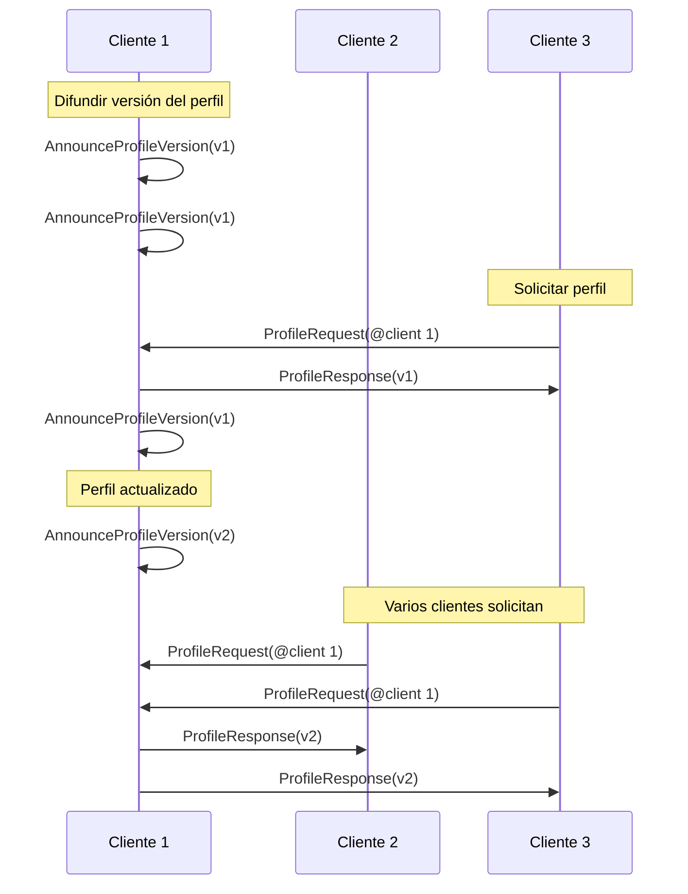

# Mensajes

Los mensajes en comms son datos binarios *paquetes*, serializados usando [protocol buffers](https://github.com/protocolbuffers/protobuf). Transportan chat de texto y voz, actualizaciones de posición, cambios de perfil y otras interacciones en tiempo real.


> [!NOTE]
> Puedes ver el protocolo de comms en acción y experimentar con él usando el código abierto [Comms Station](https://decentraland.github.io/comms-station/).


Todas las definiciones de mensajes están disponibles en el [repositorio del protocolo](https://github.com/decentraland/protocol), y cada tipo de mensaje a continuación tiene un enlace a su declaración.

#### `Packet` [↗ source](https://github.com/decentraland/protocol/blob/c48ea0aa00d8173084571552463a6a05a7f49636/proto/decentraland/kernel/comms/rfc4/comms.proto#L8) <a href="#packet" id="packet"></a>

El `Packet` la estructura es el contenedor de todos los mensajes.

| Campo     | Tipo   | Valor                                                                                                                                                                                              |
| --------- | ------ | -------------------------------------------------------------------------------------------------------------------------------------------------------------------------------------------------- |
| `mensaje` | `enum` | <p>Uno de <code>Chat</code>, <code>Voz</code>, <code>Posición</code>, <code>AnnounceProfileVersion</code>,<br><code>ProfileRequest</code>, <code>ProfileResponse</code>, o <code>Scene</code>.</p> |

### Chat de texto y voz

Los clientes chatean difundiendo mensajes de texto y clips de audio a todos los pares conectados (normalmente jugadores en la misma isla).

Solo dos `Packet` tipos están involucrados, uno para cada caso de uso. En circunstancias típicas, los clientes difunden estos mensajes a todos los demás clientes en su isla, que es el grupo de jugadores cercanos con los que pueden interactuar.

***

#### `Chat` [↗ source](https://github.com/decentraland/protocol/blob/c48ea0aa00d8173084571552463a6a05a7f49636/proto/decentraland/kernel/comms/rfc4/comms.proto#L56) <a href="#chat" id="chat"></a>

Envía un mensaje de chat de texto a otros clientes.

| Campo       | Tipo     | Valor                             |
| ----------- | -------- | --------------------------------- |
| `mensaje`   | `string` | Texto del mensaje                 |
| `timestamp` | `double` | Marca de tiempo UTC del remitente |

***

#### `Voz` [↗ source](https://github.com/decentraland/protocol/blob/c48ea0aa00d8173084571552463a6a05a7f49636/proto/decentraland/kernel/comms/rfc4/comms.proto#L66) <a href="#voice" id="voice"></a>

Envía una muestra de voz codificada a otros clientes.

| Campo             | Tipo     | Valor                                                 |
| ----------------- | -------- | ----------------------------------------------------- |
| `encoded_samples` | `bytes`  | Datos de audio codificados                            |
| `codec`           | `enum`   | Solo `VC_OPUS` (no se admiten otros códecs por ahora) |
| `index`           | `uint32` | Un contador incremental establecido por el remitente  |

El `codec` el campo es un `enum` valor. No se admiten códecs personalizados.

### Movimiento

Los clientes que controlan avatares envían y reciben actualizaciones de posición dentro de su isla, con el fin de sincronizar el movimiento y la postura entre los jugadores.

***

#### `Posición` [↗ source](https://github.com/decentraland/protocol/blob/c48ea0aa00d8173084571552463a6a05a7f49636/proto/decentraland/kernel/comms/rfc4/comms.proto#L20) <a href="#position" id="position"></a>

Actualiza a otros clientes sobre la posición y la orientación de un avatar.

| Campo                                                                                                               | Tipo     | Valor                                                |
| ------------------------------------------------------------------------------------------------------------------- | -------- | ---------------------------------------------------- |
| <p><code>position\_x</code><br><code>position\_y</code><br><code>position\_z</code></p>                             | `float`  | Posición del avatar en el mapa del mundo             |
| <p><code>rotation\_x</code><br><code>rotation\_y</code><br><code>rotation\_z</code><br><code>rotation\_w</code></p> | `float`  | Cuaternión de rotación del avatar                    |
| `index`                                                                                                             | `uint32` | Un contador incremental establecido por el remitente |

Los clientes normalmente envían `Posición` actualizaciones con una frecuencia baja (como una vez cada 1 o 2 segundos), y cambian a una frecuencia alta (varias veces por segundo) cuando se mueven o interactúan.


> [!NOTE]
> Al enviar actualizaciones de posición, la velocidad suele ser mejor que la fiabilidad. El rendimiento percibido es mejor cuando la entrega es más rápida, incluso si un `Posición` mensaje se descarta o se reordena ocasionalmente. Algunos transportes (p. ej. [LiveKit](/docs/contributor/contributor-es/comunicaciones/tipos-de-transporte/livekit/)) pueden cambiar entre modos rápido y fiable por mensaje.


Se recomiendan las emisiones de baja frecuencia como una solución simple para entregar actualizaciones a clientes que perdieron temporalmente la conectividad o no lograron recibir un mensaje mientras se unían a la isla.

El `index` El campo es un contador incremental, establecido por el remitente para que los receptores puedan ordenar las actualizaciones que llegan fuera de orden.

### Compartición de perfiles

Los clientes dentro de una isla pueden solicitar la información del avatar de otros jugadores, para renderizar sus avatares, mostrar sus nombres e imágenes, etc.

Dado que los cambios de perfil son raros (en comparación con las actualizaciones de posición, por ejemplo), el sistema está diseñado para simplificar la tarea de mantener una caché local de perfiles y solo obtener perfiles cuando sea necesario.

Hay 3 [`Packet`](#packet) tipos involucrados: un [`ProfileRequest`](#profilerequest)/[`ProfileResponse`](#profileresponse) par usado por los clientes para compartir perfiles bajo demanda, y el [`AnnounceProfileVersion`](#announceprofileversion) mensaje para indicar a sus pares cuál es la versión más reciente, para que puedan decidir si solicitarla.

Los clientes normalmente difunden `AnnounceProfileVersion` mensajes periódicamente, además de inmediatamente cuando su perfil cambia.



***

#### `AnnounceProfileVersion` [↗ source](https://github.com/decentraland/protocol/blob/c48ea0aa00d8173084571552463a6a05a7f49636/proto/decentraland/kernel/comms/rfc4/comms.proto#L34) <a href="#announceprofileversion" id="announceprofileversion"></a>

Indica a otros clientes que hay una [entidad de perfil](/docs/contributor/contributor-es/contenido/tipos-de-entidad/profiles/) que pueden solicitar.

| Campo             | Tipo     | Valor                                                         |
| ----------------- | -------- | ------------------------------------------------------------- |
| `profile_version` | `uint32` | Un número de versión que se incrementa con cada modificación. |

Los receptores que almacenan perfiles en caché pueden usar el `profile_version` número para decidir si su copia local está actualizada o si necesitan enviar una [`ProfileRequest`](#profilerequest).

***

#### `ProfileRequest` [↗ source](https://github.com/decentraland/protocol/blob/c48ea0aa00d8173084571552463a6a05a7f49636/proto/decentraland/kernel/comms/rfc4/comms.proto#L41) <a href="#profilerequest" id="profilerequest"></a>

Solicita un perfil de una versión especificada a un peer concreto.

| Campo             | Tipo     | Valor                                   |
| ----------------- | -------- | --------------------------------------- |
| `address`         | string   | La dirección identificadora del perfil. |
| `profile_version` | `uint32` | La versión del perfil deseada.          |

Los receptores pueden responder con [`ProfileResponse`](#profileresponse) mensajes para proporcionar el perfil solicitado.

***

#### `ProfileResponse` [↗ source](https://github.com/decentraland/protocol/blob/c48ea0aa00d8173084571552463a6a05a7f49636/proto/decentraland/kernel/comms/rfc4/comms.proto#L46) <a href="#profileresponse" id="profileresponse"></a>

Envía un perfil en respuesta a un [`ProfileRequest`](#profilerequest).

| Campo                | Tipo     | Valor                                                                            |
| -------------------- | -------- | -------------------------------------------------------------------------------- |
| `serialized_profile` | string   | Entidad de perfil serializada en JSON.                                           |
| `base_url`           | `uint32` | URL base para un endpoint del sistema de archivos, recomendada por el remitente. |

El `serialized_profile` El campo contiene la serialización en JSON de una [entidad de perfil](/docs/contributor/contributor-es/contenido/tipos-de-entidad/profiles/).

Si el remitente quiere recomendar un servidor de contenido para descargar entidades referenciadas en su perfil (como wearables), puede establecer el `base_url` campo como sugerencia. Los clientes son libres de usar o ignorar esta URL.


---

# Agent Instructions
This documentation is published with GitBook. GitBook is the documentation platform designed so that both humans and AI agents can read, navigate, and reason over technical content effectively. Learn more at gitbook.com.

## Querying This Documentation
If you need additional information that is not directly available in this page, you can query the documentation by asking a question.

Perform an HTTP GET request on the following URL with the `ask` and `goal` query parameters:

```
GET https://docs.decentraland.org/contributor/contributor-es/comunicaciones/messages.md?ask=<question>&goal=<user_goal>
```

`ask` is the immediate question: it should be specific, self-contained, and written in natural language.
`goal` is what the user is ultimately trying to achieve, the reason they need the answer. Sharing it helps GitBook give you a better, more relevant answer. A goal is most helpful when it describes the outcome the user wants rather than restating the question. For example, with `ask=how do I create an API token`, a goal like `automate deployments from our CI pipeline` lets GitBook tailor the answer to that use case.

The response will contain a direct answer to the question and relevant excerpts and sources from the documentation.

Use this mechanism when the answer is not explicitly present in the current page, you need clarification or additional context, or you want to retrieve related documentation sections.
