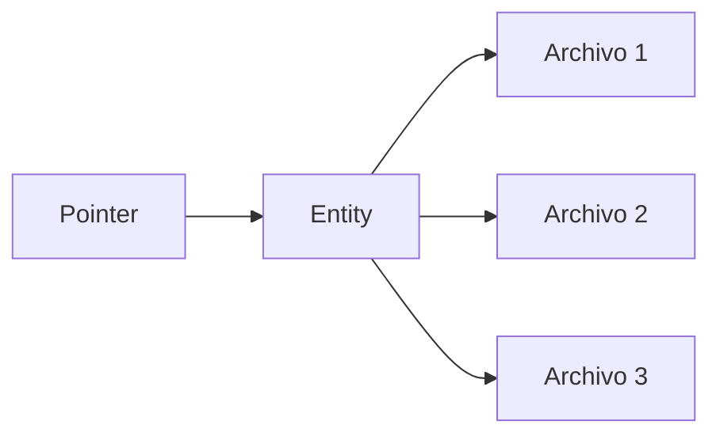

# Resumen

Todo lo que puedes encontrar dentro del mundo virtual de Decentraland está alojado en una red distribuida de servidores conocidos como Catalysts, que proporcionan (entre otras cosas) la API de contenido. Son el medio por el cual los clients suben y descargan contenido.

La API completa del Catalyst está disponible en [su propia referencia](https://decentraland.github.io/catalyst-api-specs/). Aquí nos centraremos en comprender cómo se organiza el contenido y cómo puede descubrirse y descargarse.

Todos los conceptos importantes mencionados a continuación se describen con más detalle en sus propias páginas.

### Files, Entities, Pointers

Hay tres capas en el sistema de contenido de Decentraland: [archivos](/docs/contributor/contributor-es/contenido/file-system/) se empaquetan dentro de [entities](/docs/contributor/contributor-es/contenido/entities/), y las Entities se descubren usando [pointers](/docs/contributor/contributor-es/contenido/pointers/).



[Files](/docs/contributor/contributor-es/contenido/file-system/) se almacenan en un sistema de archivos descentralizado similar a IPFS, y se sincronizan automáticamente entre servidores de contenido. Se identifican mediante una cadena ID única que se calcula a partir del contenido del archivo, y tanto el identificador como el contenido son **inmutables**. No existe tal cosa como actualizar un archivo. En su lugar, se suben archivos de reemplazo y se eliminan los archivos obsoletos.

[Entities](/docs/contributor/contributor-es/contenido/entities/) son paquetes atómicos de archivos y representan contenido real que se encuentra en el mundo, como escenas y wearables. Tienen al menos un archivo, llamado *manifest*, con una descripción general y metadata. Al igual que los archivos individuales que contienen, son inmutables e identificadas mediante una cadena única y determinista. Todas las Entities tienen un owner, que posee las claves privadas necesarias para administrarlas.

[Punteros](/docs/contributor/contributor-es/contenido/pointers/) son referencias estables que pueden resolverse al ID de una Entity. Cuando la Entity se reemplaza (es decir, el owner sube un nuevo paquete y el anterior se elimina), los archivos y metadatos contenidos son diferentes y también lo son sus identificadores, pero los pointers siguen siendo los mismos y se redirigen a la nueva versión.

### Snapshots

Los servidores de contenido también alojan archivos grandes de newline-delimited-JSON con resúmenes de todas las Entities activas (es decir, las que actualmente están referenciadas por pointers) en un momento determinado. Estos se llaman [instantáneas](/docs/contributor/contributor-es/contenido/snapshots/), y pueden usarse para explorar todo el contenido disponible.


---

# Agent Instructions
This documentation is published with GitBook. GitBook is the documentation platform designed so that both humans and AI agents can read, navigate, and reason over technical content effectively. Learn more at gitbook.com.

## Querying This Documentation
If you need additional information that is not directly available in this page, you can query the documentation by asking a question.

Perform an HTTP GET request on the following URL with the `ask` and `goal` query parameters:

```
GET https://docs.decentraland.org/contributor/contributor-es/contenido/overview.md?ask=<question>&goal=<user_goal>
```

`ask` is the immediate question: it should be specific, self-contained, and written in natural language.
`goal` is what the user is ultimately trying to achieve, the reason they need the answer. Sharing it helps GitBook give you a better, more relevant answer. A goal is most helpful when it describes the outcome the user wants rather than restating the question. For example, with `ask=how do I create an API token`, a goal like `automate deployments from our CI pipeline` lets GitBook tailor the answer to that use case.

The response will contain a direct answer to the question and relevant excerpts and sources from the documentation.

Use this mechanism when the answer is not explicitly present in the current page, you need clarification or additional context, or you want to retrieve related documentation sections.
