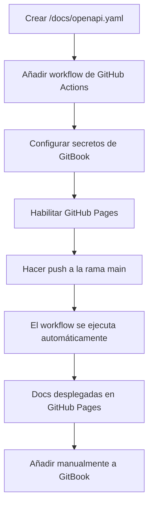
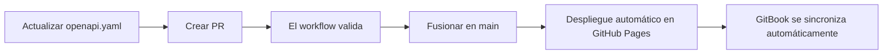

# Documentación de la API

Esta página cubre los estándares para documentar APIs usando especificaciones OpenAPI en todos los servicios de Decentraland.

## Objetivos

Nuestro enfoque de documentación de API garantiza:

* **Estandarización** - Especificaciones OpenAPI consistentes en todos los servicios
* **Automatización** - Validación, agrupación y despliegue mediante GitHub Actions
* **Centralización** - Toda la documentación del servicio se publica a través de GitBook
* **Responsabilidad** - La documentación reside en el repositorio de cada servicio
* **Accesibilidad** - Referencias de API actualizadas y amigables para colaboradores

***

## Estructura del repositorio

Cada repositorio de servicio DEBE incluir un `/docs` directorio con la siguiente estructura:

```bash
/docs
  openapi.yaml        # Fuente de verdad (OpenAPI 3.1)
  openapi.json        # Generado automáticamente en CI para Hugo/renderers
  index.html          # Documentación independiente generada automáticamente (opcional)
```

### Requisitos de archivos

#### `openapi.yaml`

* **DEBE** ser el archivo fuente canónico
* **DEBE** usar la especificación OpenAPI 3.1
* **PUEDE** tener un prefijo que identifique el servicio (por ejemplo, `worlds-openapi.yaml`)
* **PUEDE** dividirse en `components/` o `examples/` directorios si es necesario

#### `openapi.json`

* Generado automáticamente durante CI/CD
* Usado por Hugo y otros renderers
* No editar manualmente

#### `index.html`

* Documentación independiente generada automáticamente
* Construido usando Redocly
* Desplegado en GitHub Pages

***

## Estándares de OpenAPI

Al escribir `openapi.yaml`, sigue estas convenciones para garantizar consistencia y claridad.

### Resumen del endpoint

**DEBE** debe reflejar la ruta real del endpoint:

```yaml
# ✅ Bueno: Ruta de endpoint clara
paths:
  /world/{world_name}/about:
    get:
      summary: /world/{world_name}/about
      description: Recupera información sobre un world específico
      
# ❌ Malo: Resumen genérico
paths:
  /world/{world_name}/about:
    get:
      summary: Obtener información del world
```

### ID de operación

**DEBE** incluye el nombre del servicio para una unicidad global:

```yaml
# ✅ Bueno: ID de operación con prefijo de servicio
operationId: worldsContentServer_getWorldAbout

# ✅ Bueno: Otro ejemplo
operationId: socialService_getFriends

# ❌ Malo: Genérico, podría entrar en conflicto
operationId: getAbout
```

**Convención de nombres**: `{serviceName}_{operationDescription}`

* Usa camelCase
* Sé descriptivo pero conciso
* Incluye el contexto del método HTTP cuando sea útil (por ejemplo, `createUser`, `deleteParcel`)

### Versionado

**DEBE** usa versionado semántico (`MAJOR.MINOR.PATCH`) en `info.version`:

```yaml
openapi: 3.1.0
info:
  title: Worlds Content Server API
  version: 1.2.0  # Versionado semántico
  description: API para gestionar Worlds de Decentraland
```

**Reglas para incrementar versiones**:

* **MAJOR**: Cambios incompatibles (cambios de API no compatibles)
* **MINOR**: Nueva funcionalidad (compatible hacia atrás)
* **PATCH**: Correcciones de errores (compatible hacia atrás)

### Etiquetas y agrupación

**DEBE** usa tags para agrupar endpoints relacionados:

```yaml
tags:
  - name: Worlds
    description: Operaciones de gestión de Worlds
  - name: Deployments
    description: Operaciones de despliegue de Worlds
  - name: Health
    description: Endpoints de comprobación de estado

paths:
  /worlds:
    get:
      tags:
        - Worlds
      summary: /worlds
      operationId: worldsContentServer_listWorlds
      
  /worlds/{world_name}/about:
    get:
      tags:
        - Worlds
      summary: /worlds/{world_name}/about
      operationId: worldsContentServer_getWorldAbout
```


> [!NOTE]
> Las operaciones se agrupan por tag en la navegación de GitBook. Agrupa los endpoints relacionados bajo el mismo tag para una mejor organización.


### Ejemplo completo

```yaml
openapi: 3.1.0
info:
  title: Social Service API
  version: 2.1.0
  description: API para gestionar interacciones sociales en Decentraland
  contact:
    name: Decentraland Contributors
    url: https://decentraland.org

servers:
  - url: https://social.decentraland.org
    description: Servidor de producción
  - url: https://social.decentraland.zone
    description: Servidor de staging

tags:
  - name: Friends
    description: Gestión de amigos
  - name: Blocked Users
    description: Operaciones de bloqueo de usuarios

paths:
  /friends:
    get:
      tags:
        - Friends
      summary: /friends
      operationId: socialService_getFriends
      description: Devuelve una lista de los amigos del usuario autenticado
      parameters:
        - name: limit
          in: query
          schema:
            type: integer
            default: 50
            maximum: 100
        - name: offset
          in: query
          schema:
            type: integer
            default: 0
      responses:
        '200':
          description: Respuesta exitosa
          content:
            application/json:
              schema:
                type: object
                properties:
                  friends:
                    type: array
                    items:
                      $ref: '#/components/schemas/Friend'
        '401':
          description: No autorizado

components:
  schemas:
    Friend:
      type: object
      required:
        - address
        - createdAt
      properties:
        address:
          type: string
          description: Dirección Ethereum del amigo
        createdAt:
          type: string
          format: date-time
          description: Cuándo se estableció la amistad
```

***

## Desarrollo local

### Previsualizar la documentación localmente

Usa Redocly CLI para previsualizar tu documentación OpenAPI:

```bash
# Generar documentación HTML
yarn redocly build-docs docs/openapi.yaml -o docs/index.html

# Luego abre docs/index.html en tu navegador
```

### Añadir a package.json

Añade un script de compilación para mayor comodidad:

```json
{
  "scripts": {
    "build:api": "redocly bundle docs/openapi.yaml -o docs/openapi.json --ext json && redocly build-docs docs/openapi.yaml -o docs/index.html",
    "preview:api": "redocly preview-docs docs/openapi.yaml"
  }
}
```

### Instalar Redocly CLI

```bash
# Usando npm
npm install -g @redocly/cli

# Usando yarn
yarn global add @redocly/cli
```

### Validar la especificación OpenAPI

```bash
# Valida tu especificación
redocly lint docs/openapi.yaml

# Agrupar y validar
redocly bundle docs/openapi.yaml
```

***

## Configuración de automatización

### Paso 1: Configura los secretos de GitBook

Para publicar especificaciones API en GitBook, añade estos secretos a tu repositorio:

**Settings → Secrets and variables → Actions → New repository secret**

| Nombre del secreto        | Descripción                         | Dónde encontrarlo               |
| ------------------------- | ----------------------------------- | ------------------------------- |
| `GITBOOK_ORGANIZATION_ID` | El ID de tu organización de GitBook | GitBook Settings → Organization |
| `GITBOOK_TOKEN`           | Token de API de GitBook             | GitBook Settings → API Tokens   |


> [!WARNING]
> Estos secretos DEBEN configurarse para que el workflow automatizado publique en GitBook.


### Paso 2: Añadir workflow de GitHub Actions

Crea `.github/workflows/build-api-docs.yml` en tu repositorio:

```yaml
name: build-app-docs

on:
  push:
    branches: [main]
    paths:
      - 'docs/**'
  pull_request:
    paths:
      - 'docs/**'

jobs:
  build:
    uses: decentraland/platform-actions/.github/workflows/apps-docs.yml@main
    with:
      api-spec-file: 'docs/openapi.yaml'
      output-file: 'docs/index.html'
      output-directory: './docs'
      api-spec-name: '{service-name}-api'  # por ejemplo, 'social-service-api'
      node-version: '20'
    secrets: inherit
```

**Parámetros**:

* `api-spec-file`: Ruta a tu especificación OpenAPI (normalmente `docs/openapi.yaml`)
* `output-file`: Dónde generar la documentación HTML
* `output-directory`: Directorio para los archivos de salida
* `api-spec-name`: Nombre único para tu especificación API (usado en GitBook)
* `node-version`: Versión de Node.js a usar

**Este workflow hará**:

1. ✅ Validar la especificación OpenAPI
2. ✅ Agrupar la especificación en un solo archivo
3. ✅ Generar documentación HTML estática usando Redocly
4. ✅ Desplegar automáticamente en GitHub Pages
5. ✅ Publicar la especificación en GitBook (si los secretos están configurados)

### Paso 3: Habilitar GitHub Pages

Configura GitHub Pages en tu repositorio:

1. Ve a **Settings → Pages**
2. En **Build and deployment**:
   * Configura **Source** como **GitHub Actions**
3. Asegúrate de que exista un entorno llamado **github-pages**
4. Guardar configuración

Después de la primera ejecución exitosa del workflow, tu documentación estará disponible en:

* **Docs HTML**: `https://decentraland.github.io/<repo>/index.html`
* **Especificación OpenAPI**: `https://decentraland.github.io/<repo>/openapi.yaml`
* **JSON agrupado**: `https://decentraland.github.io/<repo>/openapi.json`


> [!TIP]
> Estas URLs seguirán siendo válidas mientras el repositorio exista y GitHub Pages esté habilitado.


***

## Añadir a GitBook

Una vez desplegada tu documentación API, añádela a la documentación centralizada de GitBook.

### Adición manual (proceso actual)

1. Navega al espacio de GitBook
2. Ve a la **Referencia de API** sección
3. Haz clic en **Add API Reference**
4. Ingresa los detalles de tu servicio:
   * **Nombre**: El nombre de tu servicio (p. ej., "Social Service")
   * **URL de OpenAPI**: `https://decentraland.github.io/{repo-name}/openapi.yaml`
5. Guardar

### Funciones de integración de GitBook

GitBook hará automáticamente:

* Analizar tu especificación OpenAPI
* Generar documentación API interactiva
* Crear navegación de endpoints basada en tags
* Proporcionar la funcionalidad "Try it"
* Mantener la documentación sincronizada cuando actualices la especificación

***

## Flujo completo de configuración

### Configuración inicial



### Actualizaciones continuas



***

## Buenas prácticas

### Calidad de la documentación

* **Sé descriptivo**: Escribe resúmenes y descripciones claras
* **Proporciona ejemplos**: Incluye ejemplos de request/response
* **Documenta los errores**: Describe todas las posibles respuestas de error
* **Usa components**: Reutiliza esquemas mediante `$ref` para evitar duplicación
* **Añade descripciones**: Cada parámetro, propiedad y respuesta debe tener una descripción

### Ejemplo con buenas prácticas

```yaml
paths:
  /users/{address}/friends:
    get:
      tags:
        - Friends
      summary: /users/{address}/friends
      operationId: socialService_getUserFriends
      description: |
        Recupera una lista paginada de amigos para el usuario especificado.
        Devuelve las direcciones de los amigos y los metadatos, incluido cuándo se estableció la amistad.
      parameters:
        - name: address
          in: path
          required: true
          description: Ethereum address of the user (0x-prefixed)
          schema:
            type: string
            pattern: '^0x[a-fA-F0-9]{40}$'
          example: '0x1234567890abcdef1234567890abcdef12345678'
        - name: limit
          in: query
          description: Número máximo de amigos a devolver (1-100)
          schema:
            type: integer
            minimum: 1
            maximum: 100
            default: 50
        - name: offset
          in: query
          description: Número de amigos a omitir para la paginación
          schema:
            type: integer
            minimum: 0
            default: 0
      responses:
        '200':
          description: Lista de amigos recuperada correctamente
          content:
            application/json:
              schema:
                $ref: '#/components/schemas/FriendsResponse'
              example:
                friends:
                  - address: '0xabcdef...'
                    createdAt: '2024-01-15T10:30:00Z'
                total: 42
                offset: 0
                limit: 50
        '400':
          description: Formato de dirección no válido
          content:
            application/json:
              schema:
                $ref: '#/components/schemas/Error'
              example:
                error: 'Formato de dirección no válido'
                code: 'INVALID_ADDRESS'
        '404':
          description: Usuario no encontrado
          content:
            application/json:
              schema:
                $ref: '#/components/schemas/Error'
```

### Reutilización de esquemas

```yaml
components:
  schemas:
    Error:
      type: object
      required:
        - error
        - code
      properties:
        error:
          type: string
          description: Mensaje de error legible por humanos
        code:
          type: string
          description: Código de error legible por máquina
        details:
          type: object
          description: Contexto adicional del error
          
    PaginatedResponse:
      type: object
      required:
        - offset
        - limit
        - total
      properties:
        offset:
          type: integer
          description: Número de elementos omitidos
        limit:
          type: integer
          description: Máximo de elementos por página
        total:
          type: integer
          description: Número total de elementos disponibles
```

### Esquemas de seguridad

```yaml
components:
  securitySchemes:
    BearerAuth:
      type: http
      scheme: bearer
      bearerFormat: JWT
      description: Token JWT obtenido del endpoint de autenticación

security:
  - BearerAuth: []
```

***

## Validación y controles de calidad

### Validación previa al commit

Añade un hook pre-commit o una comprobación de CI:

```yaml
# .github/workflows/validate-api-spec.yml
name: Validar especificación de API

on: [pull_request]

jobs:
  validate:
    runs-on: ubuntu-latest
    steps:
      - uses: actions/checkout@v3
      - uses: actions/setup-node@v3
        with:
          node-version: '20'
      - run: npm install -g @redocly/cli
      - run: redocly lint docs/openapi.yaml
```

### Reglas comunes de validación

* Todas las rutas tienen operation IDs
* Todas las operaciones tienen tags
* Todos los parámetros tienen descripciones
* Todas las respuestas están documentadas
* Se proporcionan ejemplos
* Los esquemas están referenciados correctamente

***

## Solución de problemas

### El workflow falla

**Problema**: el workflow de GitHub Actions falla

**Soluciones**:

* Revisa los logs del workflow en busca de errores de validación
* Ejecutar `redocly lint docs/openapi.yaml` localmente
* Verifica las rutas de archivo en la configuración del workflow
* Asegúrate de que los secrets estén configurados correctamente

### GitHub Pages no funciona

**Problema**: la documentación no aparece en la URL de GitHub Pages

**Soluciones**:

* Verifica que GitHub Pages esté habilitado en la configuración del repositorio
* Comprueba que el workflow se haya completado correctamente
* Espera unos minutos para que GitHub Pages se actualice
* Verifica el `github-pages` entorno existe

### GitBook no se sincroniza

**Problema**: GitBook no muestra la documentación de API actualizada

**Soluciones**:

* Verifica que los secrets de GitBook sean correctos
* Comprueba que la URL de OpenAPI sea accesible
* Activa manualmente una actualización en GitBook
* Verifica que la especificación de OpenAPI sea válida

***

## Migración desde documentación existente

Si ya tienes documentación de API:

1. **Exportar a OpenAPI**: Convierte la documentación existente al formato OpenAPI 3.1
2. **Validar**: Usa `redocly lint` para asegurar el cumplimiento
3. **Añadir workflow**: Configura la automatización de GitHub Actions
4. **Probar**: Verifica que la documentación se compile y se despliegue correctamente
5. **Actualizar enlaces**: Dirige los enlaces antiguos de la documentación a la nueva URL de GitHub Pages
6. **Archivar la documentación antigua**: Conserva la documentación antigua como referencia durante la transición

***

## Próximos pasos

* Revisa los [Componentes bien conocidos](https://github.com/decentraland/docs/tree/main/contributor/contributor-guides/well-known-components/README.md) estándares para la implementación de API
* Consulta [Estándares de prueba](/docs/contributor/contributor-es/guias-para-colaboradores/testing-standards/) para las directrices de prueba de API
* Consulta ejemplos de API existentes en los [Referencia de API](https://docs.decentraland.org) sección

## Estándares relacionados

* [Gestión de dependencias](/docs/contributor/contributor-es/guias-para-colaboradores/dependency-management/) - Gestionar dependencias de npm y peerDependencies
* [Componentes bien conocidos](https://github.com/decentraland/docs/tree/main/contributor/contributor-guides/well-known-components/README.md) - Arquitectura WKC para servicios
* [Estándares de prueba](/docs/contributor/contributor-es/guias-para-colaboradores/testing-standards/) - Patrones de prueba para servicios

## Recursos

* **Especificación de OpenAPI**: [spec.openapis.org](https://spec.openapis.org/oas/latest.html)
* **Redocly CLI**: [redocly.com/docs/cli](https://redocly.com/docs/cli/)
* **Integración de API de GitBook**: [docs.gitbook.com](https://docs.gitbook.com)
* **Repositorio Platform Actions**: [github.com/decentraland/platform-actions](https://github.com/decentraland/platform-actions)


---

# Agent Instructions
This documentation is published with GitBook. GitBook is the documentation platform designed so that both humans and AI agents can read, navigate, and reason over technical content effectively. Learn more at gitbook.com.

## Querying This Documentation
If you need additional information that is not directly available in this page, you can query the documentation by asking a question.

Perform an HTTP GET request on the following URL with the `ask` and `goal` query parameters:

```
GET https://docs.decentraland.org/contributor/contributor-es/guias-para-colaboradores/api-documentation.md?ask=<question>&goal=<user_goal>
```

`ask` is the immediate question: it should be specific, self-contained, and written in natural language.
`goal` is what the user is ultimately trying to achieve, the reason they need the answer. Sharing it helps GitBook give you a better, more relevant answer. A goal is most helpful when it describes the outcome the user wants rather than restating the question. For example, with `ask=how do I create an API token`, a goal like `automate deployments from our CI pipeline` lets GitBook tailor the answer to that use case.

The response will contain a direct answer to the question and relevant excerpts and sources from the documentation.

Use this mechanism when the answer is not explicitly present in the current page, you need clarification or additional context, or you want to retrieve related documentation sections.
