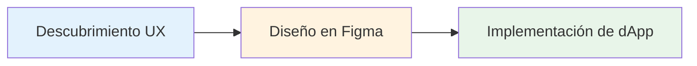

# Resumen del proceso

Nuestro proceso de desarrollo garantiza que lo diseñado sea lo que se construye. El trabajo fluye a través de tres etapas distintas con entregables y responsabilidades claras en cada paso.

## Etapas del flujo de trabajo



Cada etapa se apoya en la anterior, garantizando alineación desde el concepto hasta el código.

***

## Descubrimiento UX

La etapa de UX establece la base de todo lo que sigue. Requisitos claros en esta etapa evitan cambios costosos más adelante.

### Entregables requeridos

#### Objetivo y alcance

**DEBEN** definir:

* **Objetivo de negocio** - ¿Qué problema estamos resolviendo?
* **Usuario objetivo** - ¿Para quién es esto?
* **Métricas de éxito** - ¿Cómo medimos el éxito?
* **Restricciones** - Limitaciones técnicas, de cronograma o de recursos

**Ejemplo**:

```
Objetivo: Permitir a los usuarios navegar y filtrar sus parcelas de tierra de manera eficiente
Objetivo: propietarios de tierras con más de 10 parcelas
Éxito: el 80% de los usuarios puede encontrar una parcela específica en menos de 10 segundos
Restricciones: Debe funcionar en móvil; no se permiten cambios en el backend
```

#### Flujos de interacción

**DEBEN** mapear los recorridos del usuario de extremo a extremo:

* **Todos los casos de uso** - Rutas primarias y secundarias del usuario
* **Casos límite** - Estados vacíos, usuarios por primera vez, errores
* **Rutas alternativas** - Diferentes maneras de lograr los objetivos
* **Ayudas visuales** - Wireframes o diagramas de flujo cuando sea útil

**Ejemplo**:

```
Flujo principal:
1. El usuario hace clic en "My Land"
2. El sistema carga las parcelas
3. El usuario aplica el filtro
4. Los resultados se actualizan de inmediato

Casos límite:
- El usuario no tiene parcelas → Mostrar estado vacío con CTA
- El filtro no devuelve resultados → Mostrar mensaje "sin resultados"
- La carga tarda >2 s → Mostrar skeleton loaders
```

#### Estados de UI

**DEBERÍA** especificar todos los estados de los componentes:

* **Inactivo** - Estado predeterminado
* **Cargando** - Obtención o procesamiento de datos
* **Error** - Operaciones fallidas
* **Vacío** - No hay datos disponibles
* **Éxito** - Operaciones exitosas
* **Deshabilitado** - Acciones no disponibles

**DEBERÍA** describir la recuperación ante errores:

* ¿Qué sucede cuando ocurre un error?
* ¿Cómo pueden los usuarios reintentarlo o resolverlo?
* ¿Qué información necesitan los usuarios?

#### Seguimiento de analítica

**DEBEN** acordar el seguimiento en esta etapa:

* **Eventos** - Qué acciones rastrear
* **Propiedades** - Qué datos capturar
* **Propiedades del usuario** - Atributos relevantes del usuario
* **Objetivos de conversión** - Métricas clave de éxito

**Ejemplo**:

```
Eventos:
- parcel_filter_applied { filter_type, filter_value }
- parcel_selected { parcel_id, source }
- parcel_transfer_initiated { parcel_id }

Propiedades:
- user_parcel_count
- filter_used (boolean)
- time_to_result (ms)
```

### Entregables recomendados

#### Intención de accesibilidad

**DEBERÍA** describir:

* **Flujos de teclado** - Orden de tabulación y atajos
* **Orden de foco** - Progresión lógica del foco
* **Etiquetas para lector de pantalla** - Etiquetas y descripciones ARIA
* **Contenido alternativo** - Texto para imágenes, iconos, gráficos

**Ejemplo**:

```
Navegación con teclado:
- Tab: Navegar por los filtros
- Enter: Aplicar el filtro seleccionado
- Escape: Cerrar el desplegable del filtro
- Teclas de flecha: Navegar por las opciones del filtro

Lector de pantalla:
- "Filtrar por: dirección del propietario. Escribe para buscar o seleccionar de la lista"
- "3 parcelas encontradas que coinciden con tus filtros"
```

#### Legibilidad de accesibilidad

**DEBERÍA** asegurar:

* **Contraste de color** - Ratios mínimos WCAG AA
  * Texto normal: 4.5:1
  * Texto grande (18 pt o más): 3:1
  * Componentes de UI: 3:1
* **Tamaño del texto** - Legible en tamaños predeterminados
* **Objetivos interactivos** - Objetivos táctiles mínimos de 44×44 px

#### Elementos interactivos de UI

**DEBERÍA** definir estados para todos los elementos interactivos:

* **Habilitado** - Estado interactivo predeterminado
* **Deshabilitado** - Estado no interactivo
* **Hover** - Al pasar el mouse (escritorio)
* **Presionado/Activo** - Durante la interacción
* **Foco** - Estado de foco del teclado

**DEBERÍA** especificar la retroalimentación del usuario:

* Cambios visuales en la interacción
* Indicadores de carga
* Mensajes de éxito/error
* Retroalimentación háptica (móvil)

***

## Diseño en Figma

Los diseñadores DEBEN comenzar desde nuestra [biblioteca de Figma](https://www.figma.com/design/tsyaDSedcsVZ8iM9N0McT2/DCL-UI2), que refleja los componentes de Material UI y usa el tema de Decentraland definido en UI2.


> [!WARNING]
> No se deben usar colores, tamaños o estilos especiales. Puede haber excepciones, pero DEBEN justificarse en la especificación y aprobarse durante la revisión.


### Estándares requeridos

#### Usar la biblioteca de Figma de Decentraland

**DEBEN** usar componentes de MUI cuando exista un equivalente:

* Primero revisa la biblioteca de componentes de MUI
* Usar variantes y estilos de Decentraland
* No crear versiones personalizadas de componentes existentes

**Si no existe un elemento de UI requerido:**

1. Comprueba si puede componerse a partir de componentes existentes
2. Si no, propone un componente personalizado (ver [Componentes personalizados](/docs/contributor/contributor-es/guias-para-colaboradores/estandares-de-ui-web/custom-components/))
3. Documenta la justificación en la especificación
4. Obtén aprobación durante la revisión de diseño

#### Colores

**DEBEN** vincular los estilos de color de Figma con los nombres del tema de UI2:

```tsx
import { dclColors } from 'decentraland-ui2';

// Figma "Rareza / Único" → Código
dclColors.rarity.unique

// Figma "Primario / Principal" → Código
theme.palette.primary.main

// Figma "Texto / Secundario" → Código
theme.palette.text.secondary
```

**Fuente de verdad**: [colors.ts](https://github.com/decentraland/ui2/blob/master/src/theme/colors.ts)

#### Tipografía

**DEBEN** usar variantes definidas:

Variantes disponibles:

* `h1`, `h2`, `h3`, `h4`, `h5`, `h6` - Encabezados
* `subtitle1`, `subtitle2` - Subtítulos
* `body1`, `body2` - Texto del cuerpo
* `button` - Texto del botón
* `caption` - Leyendas
* `overline` - Texto overline

**Referencias**:

* [Fuente de tipografía](https://github.com/decentraland/ui2/blob/master/src/theme/typography.ts)
* [MUI Typography](https://mui.com/material-ui/react-typography/)
* [Sistema tipográfico de Material Design](https://m2.material.io/design/typography/the-type-system.html#type-scale)

**Ejemplo de mapeo**:

```
Figma "H1" → <Typography variant="h1">
Figma "Body 1" → <Typography variant="body1">
Figma "Caption" → <Typography variant="caption">
```

#### Puntos de interrupción

**DEBEN** diseña para estos puntos de quiebre:

| Nombre | Ancho  | Dispositivo típico |
| ------ | ------ | ------------------ |
| `xs`   | 768px  | Móvil              |
| `sm`   | 991px  | Tableta            |
| `md`   | 1024px | Escritorio pequeño |
| `lg`   | 1280px | Escritorio         |
| `xl`   | 1500px | Escritorio grande  |

**Source**: [index.ts](https://github.com/decentraland/ui2/blob/master/src/theme/index.ts)

**Buenas prácticas**:

* Diseña mobile-first (comienza en `xs`)
* Muestra los puntos de quiebre clave en los frames de Figma
* Documenta el comportamiento responsive
* Prueba en los bordes del viewport (767px, 768px, etc.)

#### Radio de borde y paletas

**DEBEN** usar los valores definidos por el tema:

* No introduzcas nuevos valores de radio de borde
* No crees nuevos roles de paleta
* Las excepciones requieren justificación en la especificación y aprobación

**Valores del tema**:

```tsx
theme.shape.borderRadius // Radio predeterminado
theme.palette.primary    // Colores primarios
theme.palette.secondary  // Colores secundarios
theme.palette.error      // Colores de error
theme.palette.text       // Colores de texto
theme.palette.background // Colores de fondo
theme.palette.divider    // Colores divisores
```

#### Esquemas de color

**Si la pantalla admite varios esquemas de color:**

**DEBEN** proporciona:

* Qué esquema se aplica (ver [colorSchemes.ts](https://github.com/decentraland/ui2/blob/master/src/theme/colorSchemes.ts))
* Vista previa del modo claro
* Vista previa del modo oscuro
* Documentación sobre cómo cambiar de esquema en Storybook

**Ejemplo**:

```
Esquemas admitidos: claro, oscuro
Predeterminado: preferencia del sistema
Alternar: menú de Configuración → Apariencia
Storybook: usa el control "Theme" en la barra de herramientas
```

### Selección de componentes

**DEBERÍA** reutilizar componentes preparados:

1. **Primero revisa MUI** - ¿MUI tiene este componente?
2. **Revisa UI2** - ¿Existe una variante de Decentraland?
3. **Compón si es posible** - ¿Puedes combinar componentes existentes?
4. **Personalizado como último recurso** - Seguir [Componentes personalizados](/docs/contributor/contributor-es/guias-para-colaboradores/estandares-de-ui-web/custom-components/) procesar

***

## Implementación de dApp

Los desarrolladores implementan los diseños usando componentes de UI2 y siguiendo nuestros [Estándares de estilo y tematización](/docs/contributor/contributor-es/guias-para-colaboradores/estandares-de-ui-web/styling-and-theming/) .

### Lista de verificación de implementación

* [ ] Comienza con el componente de UI2 si está disponible
* [ ] Usa un componente de MUI con el tema de Decentraland si no existe un equivalente en UI2
* [ ] Sigue [Estándares de estilo y tematización](/docs/contributor/contributor-es/guias-para-colaboradores/estandares-de-ui-web/styling-and-theming/) los estándares
* [ ] Implementa todos los estados de la especificación UX
* [ ] Añade el seguimiento analítico según se especifique
* [ ] Prueba en todos los puntos de quiebre
* [ ] Verifica la navegación con teclado
* [ ] Comprueba el contraste de color
* [ ] Prueba con lector de pantalla
* [ ] Gestiona los estados de carga y error
* [ ] Añádelo a Storybook si es un componente reutilizable

### Flujo de implementación de componentes

```
1. Revisa UI2 para el componente
   ↓
2. ¿Lo encontraste? → Úsalo
   ↓
3. ¿No lo encontraste? → Revisa MUI
   ↓
4. ¿Está en MUI? → Úsalo con el tema de Decentraland
   ↓
5. ¿Necesitas personalización? → Consulta la guía de Componentes personalizados
   ↓
6. Implementa siguiendo los estándares de estilo
   ↓
7. Añádelo a Storybook (si es reutilizable)
```

### Puntos de control de calidad

Antes de marcar la implementación como completa:

1. **Coincidencia visual** - Coincide con Figma píxel a píxel en puntos de quiebre clave
2. **Cumplimiento del tema** - Todos los valores del tema de UI2
3. **Estados implementados** - Todos los estados especificados por UX funcionan
4. **Accesibilidad** - Navegación con teclado, estados de foco, etiquetas ARIA
5. **Analítica** - Los eventos se disparan según lo especificado
6. **Responsivo** - Funciona en todos los puntos de quiebre
7. **Rendimiento** - Sin re-renderizados innecesarios
8. **Pruebas** - Las pruebas del componente pasan
9. **Storybook** - Se añaden stories (si es reutilizable)
10. **Revisión de código** - Aprobado por los mantenedores

***

## Mejores prácticas de handoff

### De UX a diseño

* Documento de requisitos claro
* Flujos de usuario con anotaciones
* Diagramas de estados para interacciones complejas
* Especificaciones de eventos analíticos

### De diseño a desarrollo

* Archivo de Figma con el modo dev activado
* Especificaciones de componentes
* Notas sobre comportamiento responsive
* Mapeo de tokens de color y tipografía
* Anotaciones de accesibilidad
* Enlace a los requisitos de UX

### Durante la implementación

* Revisiones periódicas entre diseñador y desarrollador
* Retroalimentación temprana sobre limitaciones técnicas
* Revisiones iterativas en hitos clave
* Revisión final antes de fusionar

***

## Próximos pasos

* Aprende sobre [Componentes personalizados](/docs/contributor/contributor-es/guias-para-colaboradores/estandares-de-ui-web/custom-components/) para crear nuevos components
* Revisa [Estándares de estilo y tematización](/docs/contributor/contributor-es/guias-para-colaboradores/estandares-de-ui-web/styling-and-theming/) para detalles de implementación
* Consulta [Guía de migración](/docs/contributor/contributor-es/guias-para-colaboradores/estandares-de-ui-web/migration/) si estás trabajando con components UI1


---

# Agent Instructions
This documentation is published with GitBook. GitBook is the documentation platform designed so that both humans and AI agents can read, navigate, and reason over technical content effectively. Learn more at gitbook.com.

## Querying This Documentation
If you need additional information that is not directly available in this page, you can query the documentation by asking a question.

Perform an HTTP GET request on the following URL with the `ask` and `goal` query parameters:

```
GET https://docs.decentraland.org/contributor/contributor-es/guias-para-colaboradores/estandares-de-ui-web/process-overview.md?ask=<question>&goal=<user_goal>
```

`ask` is the immediate question: it should be specific, self-contained, and written in natural language.
`goal` is what the user is ultimately trying to achieve, the reason they need the answer. Sharing it helps GitBook give you a better, more relevant answer. A goal is most helpful when it describes the outcome the user wants rather than restating the question. For example, with `ask=how do I create an API token`, a goal like `automate deployments from our CI pipeline` lets GitBook tailor the answer to that use case.

The response will contain a direct answer to the question and relevant excerpts and sources from the documentation.

Use this mechanism when the answer is not explicitly present in the current page, you need clarification or additional context, or you want to retrieve related documentation sections.
