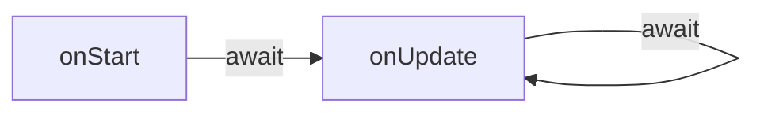

# Ejecución

El runtime trata [las scenes](/docs/contributor/contributor-es/contenido/tipos-de-entidad/scenes/) como módulos típicos de Node. Una vez que el sandbox está configurado (es decir, cuando todos los [globals](/docs/contributor/contributor-es/tiempo-de-ejecucion-de-la-escena/globals/) se inyectan y [modules](https://github.com/decentraland/docs/tree/main/contributor/runtime/modules/README.md) están listos para ser cargados), el código de la scene se evaluará para que pueda poblar el objeto [exports](/docs/contributor/contributor-es/tiempo-de-ejecucion-de-la-escena/globals/#module) .

El host tomará dos métodos de `exports`: [`onStart`](#onstart) (opcional) y [`onUpdate`](#onupdate) (obligatorio).

```ts
type Exports = {
  onStart?: () => Promise<void>;
  onUpdate: (deltaSeconds: number) => Promise<void>;
};
```

Durante el ciclo de vida de una scene, el runtime garantizará que las llamadas a estos métodos nunca se realicen de forma concurrente. El Promise devuelto `Promise` siempre se esperará antes de que la scene reciba una nueva llamada.




> [!NOTE]
> La sincronización eficaz y de alto rendimiento entre las scenes individuales y el motor de renderizado del juego es un asunto complejo. Puedes encontrar lecciones de la implementación de la Foundation en [ADR-148](https://adr.decentraland.org/adr/ADR-148).


#### `onStart` <a href="#onstart" id="onstart"></a>

El ciclo de vida de una scene comienza con el método asíncrono `onStart` . Es el lugar para realizar inicializaciones únicas que deben completarse antes de la primera llamada a [`onUpdate`](#onupdate) se haga.

```ts
onStart(): Promise<void>
```

Las scenes deben usar esta llamada para solicitar cualquier estado preexistente del runtime (como los [basic entities](/docs/contributor/contributor-es/tiempo-de-ejecucion-de-la-escena/basic-entities/)) y realizar su propia configuración inicial.

La exportación `onStart` se recomienda para todas las scenes (y se hace automáticamente al usar el SDK), pero no es obligatoria por protocolo. El método puede faltar o devolver un Promise resuelto inmediatamente `Promise`.

#### `onUpdate` <a href="#onupdate" id="onupdate"></a>

Mientras una scene se ejecuta activamente, el método asíncrono `onUpdate` se invocará periódicamente por el runtime para reportar el paso del tiempo. Este es el corazón de la scene: en cada llamada sucesiva, las entities pueden actualizarse, procesarse el input, reproducirse animaciones, enviarse mensajes, mostrarse UI, etc.

```ts
onUpdate(deltaSeconds: number): Promise<void>
```

El `deltaSeconds` parámetro es el número fraccionario de segundos transcurridos desde la última llamada a `onUpdate` fue iniciada por el runtime (independientemente de cuándo el `Promise` se resolvió).

Dado que `onUpdate` las llamadas nunca se superpondrán, la secuencia de `deltaSeconds` produce una línea temporal coherente.

En circunstancias ideales, las scenes tienen la oportunidad de ejecutarse `onUpdate` antes de que se renderice cada frame. Sin embargo, dependiendo de los recursos disponibles, las scenes que ejecutan una carga pesada pueden no resolver sus `Promise` a tiempo para el siguiente frame. Cada scene es independiente en este aspecto: las implementaciones ligeras de `onUpdate` pueden invocarse varias veces en el mismo período que una sola llamada que consume mucho tiempo en otra scene.

Ver [ADR-148](https://adr.decentraland.org/adr/ADR-148) para más detalles.

### Ejecución de varias scenes

El World Explorer no solo debe soportar la ejecución de varias scenes en sandbox, sino que debe hacerlo en todo momento. Hay dos razones para ello:

Primero, cuando los jugadores exploran el World, su vista se extiende más allá de los límites geográficos de la scene en la que están. Las scenes cercanas (hasta una distancia arbitraria o configurable) deben estar en ejecución para generar el contenido que los jugadores deberían poder ver.

Segundo, las scenes no solo se ejecutan dentro de sus propios límites no superpuestos. También pueden apilarse unas sobre otras, afectando el área alrededor del jugador pero proporcionando distinta funcionalidad.

Este es el caso de dos tipos de scenes en particular: la Avatar Scene y las experiencias portátiles.

#### La Avatar Scene <a href="#avatarscene" id="avatarscene"></a>

Desde el momento en que el jugador entra en el World, comienza a ejecutarse una scene global encargada de renderizar los avatares de otros jugadores.

Esta scene no está limitada por fronteras geográficas y puede mostrar sus entities (así como widgets de UI para comunicación) independientemente de la ubicación del jugador.

#### Experiencias portátiles

Decentraland permite que los Wearables tengan su propio comportamiento, que se ejecuta en su propio contexto de scene. Estas scenes están centradas en el jugador y pueden enriquecer la experiencia añadiendo entities o mostrando widgets de UI.

Comienzan a ejecutarse cuando el wearable se equipa, y se detienen cuando se retira.


---

# Agent Instructions
This documentation is published with GitBook. GitBook is the documentation platform designed so that both humans and AI agents can read, navigate, and reason over technical content effectively. Learn more at gitbook.com.

## Querying This Documentation
If you need additional information that is not directly available in this page, you can query the documentation by asking a question.

Perform an HTTP GET request on the following URL with the `ask` and `goal` query parameters:

```
GET https://docs.decentraland.org/contributor/contributor-es/tiempo-de-ejecucion-de-la-escena/execution.md?ask=<question>&goal=<user_goal>
```

`ask` is the immediate question: it should be specific, self-contained, and written in natural language.
`goal` is what the user is ultimately trying to achieve, the reason they need the answer. Sharing it helps GitBook give you a better, more relevant answer. A goal is most helpful when it describes the outcome the user wants rather than restating the question. For example, with `ask=how do I create an API token`, a goal like `automate deployments from our CI pipeline` lets GitBook tailor the answer to that use case.

The response will contain a direct answer to the question and relevant excerpts and sources from the documentation.

Use this mechanism when the answer is not explicitly present in the current page, you need clarification or additional context, or you want to retrieve related documentation sections.
