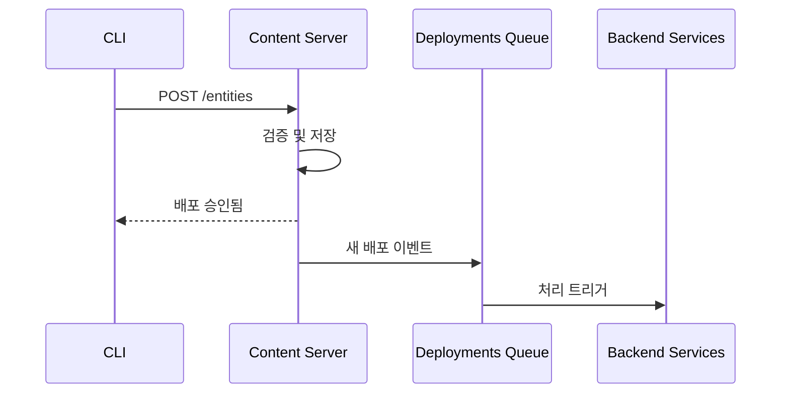
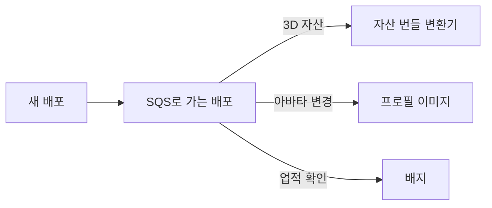
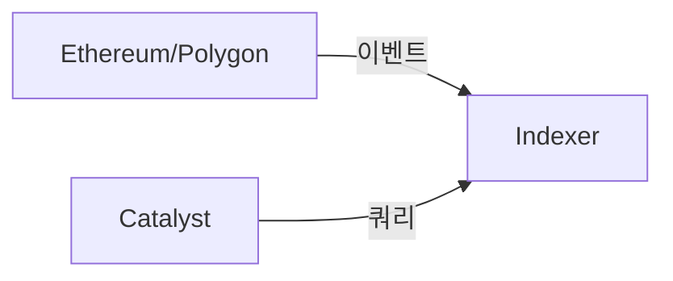

# Catalyst 네트워크

Catalyst 네트워크는 Decentraland의 분산형 콘텐츠 전송 인프라입니다. 여러 독립 운영자가 콘텐츠를 저장하고 제공하는 Catalyst 노드를 운영합니다.

## 개요

Catalyst 네트워크는 노드들이 서로 직접 통신하여 콘텐츠를 동기화하고 네트워크 상태를 유지하는 완전 메시형 분산 시스템으로 운영됩니다.


## Catalyst 구성 요소

각 Catalyst 노드는 다음으로 구성됩니다:

### 콘텐츠 서버

**목적**: 자산 저장 및 검색

다음을 저장하고 제공합니다:

* 씬 정의
* 3D 모델 및 텍스처
* 오디오 파일
* 스크립트
* 아바타 및 착용 아이템

**API 참조**: [Catalyst API](https://github.com/decentraland/docs/tree/main/apis/apis/catalyst/README.md)

### Lambdas

**목적**: 서버리스 쿼리 함수

조회 가능한 엔드포인트를 제공합니다:

* 엔터티 검색
* 프로필 쿼리
* 콘텐츠 메타데이터
* 배포 기록

Lambdas는 Content Server의 데이터베이스를 조회하는 별도 서비스로 실행됩니다.

### Nginx

**목적**: 리버스 프록시 및 로드 밸런싱

요청을 적절한 서비스로 라우팅합니다:

* 업로드용 Content Server
* 쿼리용 Lambdas
* 정적 자산 제공

***

## 콘텐츠 배포

### 배포 흐름



### 배포 단계

1. **컴파일**: CLI가 build-ecs를 사용해 씬을 번들링
2. **서명**: 제작자가 지갑으로 배포에 서명
3. **업로드**: CLI가 아무 Catalyst 노드에나 업로드
4. **검증**: Catalyst가 서명과 콘텐츠를 검증
5. **저장**: 콘텐츠가 저장소에 저장됨
6. **전파**: 이벤트가 배포 큐에 게시됨
7. **처리**: 백엔드 서비스가 새 콘텐츠를 처리함

### 콘텐츠 검증

Catalyst가 다음을 검증합니다:

* 디지털 서명(소유권 증명)
* 콘텐츠 해시(무결성)
* 파셀 권한(토지 소유권)
* 파일 크기 제한
* 콘텐츠 정책 준수

***

## 배포 파이프라인

콘텐츠가 배포되면 여러 시스템이 반응합니다:

### 자산 처리



**트리거된 서비스**:

* **자산 번들 변환기** - 최적화된 번들을 생성합니다
* **프로필 이미지 생성기** - 아바타 썸네일을 생성합니다
* **배지 처리기** - 배포 업적을 확인합니다

### 수신 대기 서비스

배포를 모니터링하는 서비스:

* **월드** - 월드 배포용
* **Comms Gatekeeper** - 월드 음성 구성용
* **Atlas 서버** - 지도 업데이트용

***

## 콘텐츠 복제

Catalyst 노드는 가용성을 보장하기 위해 콘텐츠를 복제합니다:

### 복제 전략

* **능동 동기화**: 노드가 새 배포를 적극적으로 동기화함
* **풀 기반**: 노드가 누락된 콘텐츠를 필요 시 가져옴
* **Gossip 프로토콜**: 배포 공지가 전파됨

### 콘텐츠 주소 지정

모든 콘텐츠는 콘텐츠 주소 지정 방식입니다:

* 파일은 IPFS CID(콘텐츠 식별자)로 식별됨
* 배포 후에는 변경 불가
* 중복 제거 자동화

***

## Archipelago Workers(통신)

통신 인프라는 Catalyst와 함께 실행됩니다:

### 구성 요소

#### WebSocket 커넥터

* 클라이언트 연결 유지
* 프로토콜 처리
* 연결 인증

**API 참조**: [Archipelago Workers API](https://github.com/decentraland/docs/tree/main/apis/apis/archipelago-workers/README.md)

#### Archipelago Core

* **아일랜드 형성** - 인근 플레이어를 그룹화
* **피어 제한** - 아일랜드당 최대 피어 수를 강제(일반적으로 100)
* **위치 업데이트** - 플레이어 위치를 브로드캐스트
* **메시지 라우팅** - 채팅과 이모트를 라우팅

#### 통계 서비스

* 씬별 활성 사용자 수
* 연결 통계
* 성능 지표

***

## 블록체인 통합

### 서브그래프 인덱서

Catalyst는 전용 인덱서를 사용합니다:



이 **인덱서** 다음을 색인합니다:

* 토지 소유권(LAND NFT)
* 착용 아이템 및 이모트 컬렉션
* 이름 등록
* NFT 전송

***

## 다음 단계

* 검토 [백엔드 서비스](/docs/contributor/contributor-ko/architecture/services/) 서비스 세부 정보는
* 참고 [인프라](/docs/contributor/contributor-ko/architecture/infrastructure/) 지원 시스템은
* 확인 [아키텍처 개요](/docs/contributor/contributor-ko/architecture/architecture/) 전체 그림은


---

# Agent Instructions
This documentation is published with GitBook. GitBook is the documentation platform designed so that both humans and AI agents can read, navigate, and reason over technical content effectively. Learn more at gitbook.com.

## Querying This Documentation
If you need additional information that is not directly available in this page, you can query the documentation by asking a question.

Perform an HTTP GET request on the following URL with the `ask` and `goal` query parameters:

```
GET https://docs.decentraland.org/contributor/contributor-ko/architecture/catalyst.md?ask=<question>&goal=<user_goal>
```

`ask` is the immediate question: it should be specific, self-contained, and written in natural language.
`goal` is what the user is ultimately trying to achieve, the reason they need the answer. Sharing it helps GitBook give you a better, more relevant answer. A goal is most helpful when it describes the outcome the user wants rather than restating the question. For example, with `ask=how do I create an API token`, a goal like `automate deployments from our CI pipeline` lets GitBook tailor the answer to that use case.

The response will contain a direct answer to the question and relevant excerpts and sources from the documentation.

Use this mechanism when the answer is not explicitly present in the current page, you need clarification or additional context, or you want to retrieve related documentation sections.
