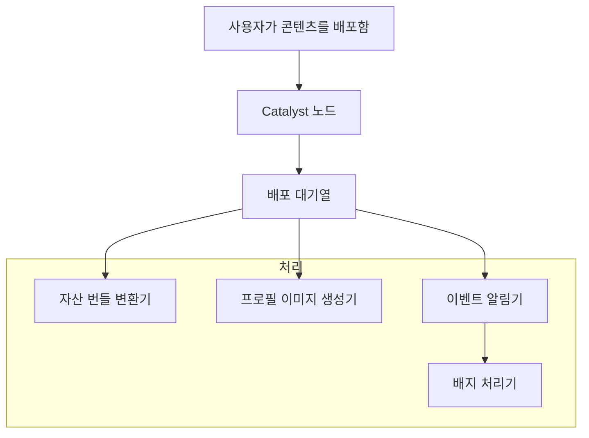

# 백엔드 서비스

이 페이지는 모든 Decentraland 백엔드 서비스, 그 아키텍처상의 역할, 그리고 생태계 내에서 이들이 어떻게 상호작용하는지에 대한 종합적인 개요를 제공합니다. 자세한 API 사양과 엔드포인트는 다음을 참조하세요: [API 참조](https://github.com/decentraland/docs/tree/main/apis/README.md) 섹션.

## 서비스 아키텍처

Decentraland의 백엔드는 논리적 계층으로 조직된 분산형 마이크로서비스로 구성됩니다:

* **분산형 계층** - Catalyst 네트워크와 콘텐츠 전송 인프라
* **실시간 통신 계층** - 서비스 검색 및 P2P 통신
* **기능 서비스** - 사용자 대상 기능(콘텐츠, 경제, 게임화)
* **핵심 서비스** - 필수 플랫폼 인프라(인증, 마켓플레이스, 알림)

***

## 분산형 계층

### 카탈리스트

**목적**: 분산형 콘텐츠 전송 네트워크

Catalyst 네트워크는 Decentraland 콘텐츠 인프라의 기반을 이룹니다. 각 Catalyst 노드는 다음을 제공하는 완전한 서버입니다:

* **콘텐츠 서버** - 엔티티 저장 및 조회(씬, 프로필, 웨어러블)
* **Lambdas 서비스** - 유틸리티 엔드포인트 및 콘텐츠 쿼리
* **통신 서버** - 실시간 메시지 전송

**아키텍처 역할**: Catalyst 노드는 지리적으로 분산되어 있으며 허가 없이 운영됩니다. 이 네트워크는 중앙 제어 없이 콘텐츠 이중화와 가용성을 제공합니다.

**주요 통합**:

* Realm Provider - 노드 가용성을 알림
* Asset Bundle Registry - 배포 시 에셋 최적화를 트리거
* Archipelago Workers - 섬/클러스터 데이터 제공

**API 참조**: [Catalyst API](https://github.com/decentraland/docs/tree/main/apis/apis/catalyst/README.md)

### Lamb2

**목적**: Lambda 유틸리티 및 서버리스 함수

Lamb2는 Content Server를 보완하는 콘텐츠 소비 및 쿼리용 유틸리티 엔드포인트를 제공합니다:

* \- 씬 집계 및 필터링
* \- 대체 경로를 포함한 프로필 쿼리
* \- 상태 및 헬스 체크

**아키텍처 역할**: Content Server의 원시 엔티티 접근 위에 편의 계층으로 동작하며, 클라이언트가 일반적으로 필요로 하는 더 상위 수준의 쿼리 패턴을 제공합니다.

**API 참조**: [Lamb2 API](https://github.com/decentraland/docs/tree/main/apis/apis/lamb2/README.md)

***

## 실시간 통신 계층

### Realm Provider

**목적**: 서비스 검색 및 렐름 선택

Realm Provider는 모든 Decentraland 클라이언트의 진입점입니다. 다음을 기반으로 지능형 렐름 선택을 구현합니다:

* **지리적 최적화** - 사용자를 가장 가까운 Catalyst 노드로 라우팅
* **상태 모니터링** - 비정상 또는 과부하 노드를 필터링
* **용량 추적** - 렐름별 실시간 사용자 수 제공
* **인기 씬 집계** - 모든 렐름에서 인기 있는 위치를 식별

**아키텍처 역할**: 사용 가능한 인프라에 대한 단일 진실 소스입니다. 클라이언트는 시작 시 한 번 쿼리하여 모든 서비스 엔드포인트(Catalyst, Comms, BFF)를 발견합니다.

**주요 통합**:

* \- 모든 Catalyst 노드를 주기적으로 폴링
* \- Archipelago 통계 집계
* \- 분산 네트워크의 통합된 보기를 제공

**API 참조**: [Realm Provider API](https://github.com/decentraland/docs/tree/main/apis/apis/realm-provider/README.md)

### Comms Gatekeeper

**목적**: 음성 및 영상 접근 제어

Gatekeeper는 음성 및 영상 채팅을 위한 LiveKit 미디어 서버 접근을 관리합니다:

* **토큰 생성** - 특정 권한이 포함된 시간 제한 접근 토큰을 생성
* **씬 관리** - 씬 관리자 권한 및 차단을 관리
* **스트림 관리** - 라이브 스트리밍 접근과 RTMP 키를 제어
* **개인정보 보호 제어** - 비공개 음성 채팅 권한을 적용

**아키텍처 역할**: 클라이언트와 미디어 인프라 사이의 보안 계층입니다. 유연한 권한 모델(씬 기반, 비공개, 커뮤니티)을 지원하면서 무단 접근을 방지합니다.

**주요 통합**:

* LiveKit - 미디어 서버 접근용 JWT 토큰 발급
* Worlds API - 관리자 권한을 위한 월드 소유권 검증
* Signed Fetch - 지갑 서명을 통해 모든 요청 인증

**API 참조**: [Comms Gatekeeper API](https://github.com/decentraland/docs/tree/main/apis/apis/comms-gatekeeper/README.md)

### Archipelago Workers

**목적**: 통신 클러스터링 및 메시지 라우팅

Archipelago는 근접 기반 클러스터링 프로토콜을 구현하여 근처 플레이어를 "섬"으로 그룹화합니다:

* **WebSocket 전송** - 클라이언트와의 지속적 연결 유지
* **위치 추적** - 플레이어 위치를 실시간으로 모니터링
* **아일랜드 형성** - 거리에 따라 플레이어를 동적으로 그룹화
* **메시지 라우팅** - 메시지를 섬 구성원에게만 전달

**아키텍처 구성 요소**:

* **WebSocket 커넥터** - 클라이언트 연결 및 인증 처리
* **Archipelago Core** - 클러스터링 알고리즘 및 섬 관리를 구현
* **통계 서비스** - 연결 메트릭과 사용자 수 제공
* **NATS 통합** - 위치 업데이트를 게시하고 메시지를 라우팅

**아키텍처 역할**: 메시지 팬아웃을 제한하여 P2P 통신을 최적화합니다. 렐름의 모든 사용자에게 브로드캐스트하는 대신, 메시지는 상호작용 범위 내의 플레이어에게만 도달합니다.

**주요 통합**:

* NATS 메시지 브로커 - 분산 메시지 라우팅
* Realm Provider - 섬 통계 제공
* Places API - 인기 씬의 사용자 수 데이터

**API 참조**: [Archipelago Workers API](https://github.com/decentraland/docs/tree/main/apis/apis/archipelago-workers/README.md)

***

## 기능 서비스

### 월드

**목적**: 메인 그리드 바깥의 격리된 씬 호스팅

월드는 사용자가 격리된 환경에 씬을 배포할 수 있게 합니다:

* **이름이 있는 월드** - 사용자 정의 URL을 통해 접근 가능(예: `world.dclworlds.com`)
* **비공개 월드** - NFT 게이트 액세스 제어
* **월드 권한** - 소유자 관리형 관리자 및 배포 권한

**아키텍처 역할**: Decentraland의 콘텐츠 모델을 고정된 LAND 그리드 너머로 확장합니다. 각 월드는 자체 통신 채널과 접근 제어를 갖춘 독립 실행형 씬입니다.

**주요 통합**:

* NFT 소유권 검증을 위해 블록체인 인덱서에 쿼리
* 실시간 클라이언트 동기화를 위해 월드 업데이트를 NATS에 게시
* 음성 채팅 방을 위해 Comms Gatekeeper와 통합
* 배포 시 에셋 처리 파이프라인을 트리거

**API 참조**: [Worlds API](https://github.com/decentraland/docs/tree/main/apis/apis/worlds/README.md)

### 이벤트

**목적**: 월드 내 이벤트 관리 및 발견

가상 이벤트의 전체 수명 주기를 관리합니다:

* **이벤트 CRUD** - 생성, 업데이트, 일정 관리
* **참가자 추적** - 사용자 참여 및 RSVP
* **디스커버리** - 시간 기반 쿼리 및 필터링
* **알림** - Events Notifier와의 통합

**아키텍처 역할**: 메타버스에 시간적 맥락을 제공합니다. 이벤트는 시간 민감한 경험을 부각하여 사용자 발견과 참여를 촉진합니다.

**API 참조**: [Events API](https://github.com/decentraland/docs/tree/main/apis/apis/events/README.md)

### Places

**목적**: 관심 지점 발견 및 큐레이션

Decentraland 전반의 흥미로운 위치를 집계하고 큐레이션합니다:

* **인기 씬** - 사용자 수를 기반으로 한 실시간 인기
* **추천 장소** - 편집자가 큐레이션한 위치
* **검색 및 필터링** - 태그, 카테고리로 검색
* **POI 메타데이터** - 설명, 썸네일, 좌표

**아키텍처 역할**: 큰 열린 세계에서 발견 문제를 해결합니다. 여러 소스의 데이터를 집계하여 사용자가 매력적인 콘텐츠를 찾을 수 있도록 돕습니다.

**주요 통합**:

* Catalyst - 씬 메타데이터 및 배포 정보
* Archipelago Stats - 씬별 실시간 사용자 수
* Comms Gatekeeper - 렐름 가용성 및 상태

**API 참조**: [Places API](https://github.com/decentraland/docs/tree/main/apis/apis/places/README.md)

### Atlas 서버

**목적**: 지도 데이터 및 parcel 시각화

포괄적인 월드 지도 데이터를 제공합니다:

* **Parcel 소유권** - 블록체인에 인덱싱된 LAND 데이터
* **씬 메타데이터** - 배포된 씬 이름과 좌표
* **지도 타일** - UI 표시용 사전 렌더링된 타일 이미지
* **공간 쿼리** - 좌표 또는 소유자로 parcel 찾기

**아키텍처 역할**: Decentraland의 LAND 그리드에 대한 공간 인덱스를 제공합니다. 지도 UI와 공간 탐색에 필수적입니다.

**API 참조**: [Atlas Server API](https://github.com/decentraland/docs/tree/main/apis/apis/atlas-server/README.md)

### Camera Reel

**목적**: 사용자 생성 스크린샷 관리

사용자 스크린샷과 이미지를 관리합니다:

* **이미지 업로드** - 인증된 이미지 저장
* **갤러리 구성** - 사용자 스크린샷 컬렉션
* **메타데이터** - 씬 위치, 타임스탬프, 태그

**아키텍처 역할**: 사용자 생성 사진을 중심으로 콘텐츠 공유와 소셜 기능을 가능하게 합니다.

**API 참조**: [Camera Reel API](https://github.com/decentraland/docs/tree/main/apis/apis/camera-reel/README.md)

### 탐험 게임

**목적**: 온보딩 게임화 및 튜토리얼

신규 사용자 온보딩을 위한 인터랙티브 퀘스트 시스템:

* **퀘스트 추적** - 튜토리얼 미션 진행
* **챌린지 완료** - 작업 검증
* **보상 통합** - 보상 시스템과 연결

**아키텍처 역할**: 구조화된 목표 지향적 Decentraland 기능 소개를 제공하여 신규 사용자의 진입 장벽을 낮춥니다.

**API 참조**: [Exploration Games API](https://github.com/decentraland/docs/tree/main/apis/apis/exploration-games/README.md)

***

## 핵심 서비스

### 인증 서버

**목적**: 지갑 기반 인증 및 세션 관리

Decentraland의 지갑 우선 인증 모델을 구현합니다:

* **서명 검증** - Ethereum 지갑 서명 검증
* **JWT 토큰 발급** - 세션 토큰 생성
* **토큰 검증** - 보호된 리소스에 대한 토큰 검증
* **세션 수명 주기** - 토큰 갱신 및 만료

**아키텍처 역할**: 분산형 신원 검증을 제공합니다. 사용자는 비밀번호 대신 지갑 서명을 통해 인증하므로 Web3 원칙과 부합합니다.

**인증 흐름**:

1. 클라이언트가 챌린지를 요청
2. 사용자가 지갑으로 챌린지에 서명
3. Auth Server가 서명을 검증하고 JWT를 발급
4. 클라이언트가 이후 API 요청에 JWT를 포함

**API 참조**: [Auth Server API](https://github.com/decentraland/docs/tree/main/apis/apis/auth-server/README.md)

### 소셜 서비스

**목적**: 소셜 그래프 및 커뮤니티 관리

사회적 관계와 커뮤니티를 관리합니다:

* **친구 시스템** - 요청, 승인, 친구 목록
* **차단 목록** - 사용자 차단 및 개인정보 보호
* **커뮤니티** - 그룹 가입 및 발견
* **실시간 상태** - NATS를 통한 친구 온라인/오프라인 알림
* **개인 메시지** - 다이렉트 메시지 인프라

**아키텍처 역할**: Decentraland를 가상 세계에서 소셜 메타버스로 전환하는 소셜 계층을 제공합니다.

**주요 통합**:

* Catalyst Client - 친구의 프로필 데이터 가져오기
* NATS - 친구 상태 업데이트 게시
* Archipelago - 온라인 상태와 위치 쿼리

**API 참조**: [Social Service API](https://github.com/decentraland/docs/tree/main/apis/apis/social-service/README.md)

### Marketplace Server

**목적**: NFT 마켓플레이스 통합

Decentraland의 웨어러블과 이모트 마켓플레이스 백엔드:

* **리스트 쿼리** - 마켓플레이스 아이템 탐색 및 검색
* **거래 내역** - 구매 기록
* **가격 데이터** - 시장 가격과 추세
* **컬렉션 메타데이터** - 웨어러블 및 이모트 컬렉션

**아키텍처 역할**: 온체인 NFT 데이터를 사용자 친화적인 마켓플레이스 UI와 연결합니다. 빠른 쿼리를 위해 블록체인 이벤트를 인덱싱합니다.

**API 참조**: [Marketplace Server API](https://github.com/decentraland/docs/tree/main/apis/apis/marketplace-server/README.md)

***

## 에셋 서비스

### 자산 번들 레지스트리

**목적**: 최적화된 에셋 관리

플랫폼 최적화 에셋 번들의 레지스트리:

* 플랫폼별 에셋 번들 URL
* 버전 관리
* CDN 배포

**API 참조**: [Asset Bundle Registry API](https://github.com/decentraland/docs/tree/main/apis/apis/asset-bundle-registry/README.md)

**시스템 구성 요소**:

* **자산 번들 변환기** - 플랫폼별 번들 생성
* **LOD 생성기** - 수준별 디테일 변형 생성

**프로세스 흐름**:

```mermaid
sequenceDiagram
    참여자 Catalyst
    participant Queue as Deployments Queue
    참여자 Converter as AB Converter
    참여자 Registry
    
    Catalyst->>Queue: 새 배포
    Queue->>Converter: 에셋 처리
    Converter->>Converter: 번들 생성
    Converter->>Registry: 번들 등록
```

### Camera Reel

**목적**: 스크린샷 및 이미지 관리

사용자 생성 콘텐츠 관리:

* 스크린샷 저장
* 이미지 업로드
* 갤러리 구성

**API 참조**: [Camera Reel API](https://github.com/decentraland/docs/tree/main/apis/apis/camera-reel/README.md)

### Credits Server

**목적**: 가상 화폐 및 경제

Decentraland의 가상 크레딧 시스템을 관리합니다:

* **잔액 추적** - 사용자 크레딧 잔액
* **거래 원장** - 크레딧 전송 및 사용
* **구매 통합** - 법정화폐를 크레딧으로 전환
* **블록체인 동기화** - 온체인 잔액을 위해 인덱서에 쿼리

**아키텍처 역할**: 인게임 구매와 기능을 위한 블록체인 토큰보다 진입 장벽이 낮은 화폐 대안을 제공합니다.

**API 참조**: [Credits Server API](https://github.com/decentraland/docs/tree/main/apis/apis/credits-server/README.md)

### 배지

**목적**: 성취 및 게임화 시스템

이벤트 기반 배지 수여:

* **배지 정의** - 사용 가능한 업적
* **사용자 인벤토리** - 사용자별 획득한 배지
* **자동 지급** - 이벤트 트리거 배지 수여

**아키텍처 구성 요소**:

* **Badges API** - 배지 쿼리 및 사용자 인벤토리
* **배지 처리기** - Events Notifier를 수신하여 배지를 부여

**아키텍처 역할**: 업적을 통해 사용자 참여를 게임화합니다. 사용자 활동에 대한 가시성과 인정을 제공합니다.

**API 참조**: [Badges API](https://github.com/decentraland/docs/tree/main/apis/apis/badges/README.md)

### 보상 API

**목적**: 캠페인 기반 NFT 보상 배포

프로모션 NFT 보상 캠페인을 관리합니다:

* **캠페인 관리** - 기간 제한 보상 프로그램
* **자격 검증** - 사용자 자격 확인
* **에어드롭 조정** - 자격이 있는 사용자에게 NFT 배포
* **분석** - 캠페인 참여 추적

**아키텍처 역할**: NFT 보상을 통해 마케팅 캠페인과 사용자 획득을 가능하게 합니다.

**API 참조**: [보상 API](https://github.com/decentraland/docs/tree/main/apis/apis/rewards/README.md)

### Notifications Workers

**목적**: 사용자 알림 전달 시스템

다중 채널 알림 인프라:

* **앱 내 알림** - 알림 인박스 쿼리
* **이메일 알림** - SendGrid 통합
* **푸시 알림** - 모바일 및 데스크톱 알림
* **읽음 상태 추적** - 알림을 읽음/읽지 않음으로 표시

**아키텍처 구성 요소**:

* **알림 인박스** - 사용자 알림을 조회하는 API
* **Notifications Processor** - Events Notifier로부터 알림 생성

**아키텍처 역할**: 친구 활동, 이벤트, 보상, 시스템 업데이트에 대한 적시 알림을 통해 사용자의 참여를 유지합니다.

**API 참조**: [Notifications Workers API](https://github.com/decentraland/docs/tree/main/apis/apis/notifications-workers/README.md)

### Events Notifier

**목적**: 플랫폼 이벤트를 위한 이벤트 버스

하위 작업을 트리거하는 중앙 집중식 이벤트 게시 시스템:

* **사용자 이벤트** - 로그인, 구매, 배포
* **월드 이벤트** - 씬 업데이트, 관리자 작업
* **시스템 이벤트** - 유지보수, 업데이트

**아키텍처 역할**: 이벤트 생성자와 소비자를 분리합니다. 서비스는 누가 이를 처리하는지 알 필요 없이 이벤트를 게시하므로 확장 가능한 아키텍처를 가능하게 합니다.

**하위 통합**:

* Notifications Processor - 사용자 알림 생성
* Badges Processor - 성취 배지 부여
* Rewards API - 캠페인 자격 추적

**API 참조**: [Events Notifier API](https://github.com/decentraland/docs/tree/main/apis/apis/events-notifier/README.md)

***

## 서비스 상호작용 패턴

### 일반적인 통합 패턴

#### Catalyst Client Library

많은 백엔드 서비스는 **Catalyst Client** 라이브러리를 사용하여 분산형 Catalyst 네트워크와 상호작용합니다:

* **소셜 서비스** - 사용자 프로필 데이터 가져오기
* **Events API** - 씬 메타데이터 쿼리
* **Places** - 씬 정보 집계
* **자산 번들 레지스트리** - 배포 이벤트를 수신함

이 라이브러리는 다중 노드 쿼리와 장애 조치 로직을 추상화합니다.

#### NATS 메시지 브로커

실시간 업데이트와 비동기 통신은 NATS를 통해 흐릅니다:

* **소셜 서비스** - 친구 상태 변경을 게시함
* **월드** - 월드 설정 업데이트를 브로드캐스트함
* **Archipelago** - 섬 간 위치 업데이트를 라우팅함
* **Events Notifier** - 플랫폼 이벤트를 게시함

NATS를 사용하면 서비스들이 직접적으로 결합되지 않고 통신할 수 있습니다.

#### 블록체인 인덱서

서비스는 성능을 위해 블록체인이 아닌 인덱서에 쿼리합니다:

* **월드** - NAME NFT 소유권을 검증함
* **Atlas** - LAND 토지 구획 데이터를 가져옴
* **Credits Server** - 토큰 잔액을 확인함
* **보상 API** - 자격 조건을 검증함

직접 블록체인 쿼리는 실시간 API에 너무 느립니다.

### 콘텐츠 배포 파이프라인

사용자가 Catalyst에 콘텐츠를 배포하면, 여러 하위 서비스가 이를 처리합니다:



**파이프라인 단계**:

1. **카탈리스트** - 원시 엔티티 데이터를 저장함
2. **배포 대기열** - 비동기 처리를 트리거함
3. **자산 번들 변환기** - 최적화된 Unity 번들을 빌드함
4. **프로필 이미지 생성기** - 아바타 썸네일을 렌더링함(프로필 엔티티용)
5. **Events Notifier** - 배포 이벤트를 게시함
6. **배지 처리기** - 배포 성과 배지를 확인함

### 서비스 의존성 매트릭스

| 서비스                   | 핵심 의존성                      | 데이터를 제공하는 대상           |
| --------------------- | --------------------------- | ---------------------- |
| 카탈리스트                 | 없음(분산형)                     | 모든 서비스                 |
| Realm Provider        | Catalyst, Archipelago 통계    | 모든 클라이언트               |
| 인증 서버                 | 없음                          | 모든 보호된 서비스             |
| Archipelago Workers   | NATS, LiveKit               | Realm Provider, Places |
| Comms Gatekeeper      | LiveKit, Worlds API         | 클라이언트(토큰 생성)           |
| 월드                    | Catalyst, NATS, 블록체인        | Gatekeeper, 클라이언트      |
| 소셜 서비스                | Catalyst, NATS, Archipelago | 클라이언트                  |
| Places                | Catalyst, Archipelago, 통신   | 클라이언트                  |
| Events Notifier       | 없음                          | 알림, 배지, 보상             |
| 자산 번들 레지스트리           | Catalyst, 배포 대기열            | 클라이언트(최적화된 자산)         |
| Notifications Workers | 이벤트 알림기, SendGrid           | 클라이언트                  |

***

## 관련 문서

### 아키텍처

* [아키텍처 개요](/docs/contributor/contributor-ko/architecture/architecture/) - 전체 시스템 아키텍처
* [Catalyst 네트워크](/docs/contributor/contributor-ko/architecture/catalyst/) - 분산형 콘텐츠 전달
* [인프라](/docs/contributor/contributor-ko/architecture/infrastructure/) - 지원 시스템(NATS, LiveKit, 데이터베이스)

### API 참조

* [API 문서](https://github.com/decentraland/docs/tree/main/apis/README.md) - 전체 API 사양
* [인증](/docs/contributor/contributor-ko/authentication/authchain/) - 지갑 기반 인증 흐름
* [통신](/docs/contributor/contributor-ko/communications/overview/) - 실시간 메시징 프로토콜

### 개발

* [기여자 가이드](/docs/contributor/contributor-ko/contributor-guides/contributor-guides/) - 개발 워크플로
* [테스트 가이드](/docs/contributor/contributor-ko/contributor-guides/testing-standards/testing-services-wkc/) - 서비스 테스트 관행


---

# Agent Instructions
This documentation is published with GitBook. GitBook is the documentation platform designed so that both humans and AI agents can read, navigate, and reason over technical content effectively. Learn more at gitbook.com.

## Querying This Documentation
If you need additional information that is not directly available in this page, you can query the documentation by asking a question.

Perform an HTTP GET request on the following URL with the `ask` and `goal` query parameters:

```
GET https://docs.decentraland.org/contributor/contributor-ko/architecture/services.md?ask=<question>&goal=<user_goal>
```

`ask` is the immediate question: it should be specific, self-contained, and written in natural language.
`goal` is what the user is ultimately trying to achieve, the reason they need the answer. Sharing it helps GitBook give you a better, more relevant answer. A goal is most helpful when it describes the outcome the user wants rather than restating the question. For example, with `ask=how do I create an API token`, a goal like `automate deployments from our CI pipeline` lets GitBook tailor the answer to that use case.

The response will contain a direct answer to the question and relevant excerpts and sources from the documentation.

Use this mechanism when the answer is not explicitly present in the current page, you need clarification or additional context, or you want to retrieve related documentation sections.
