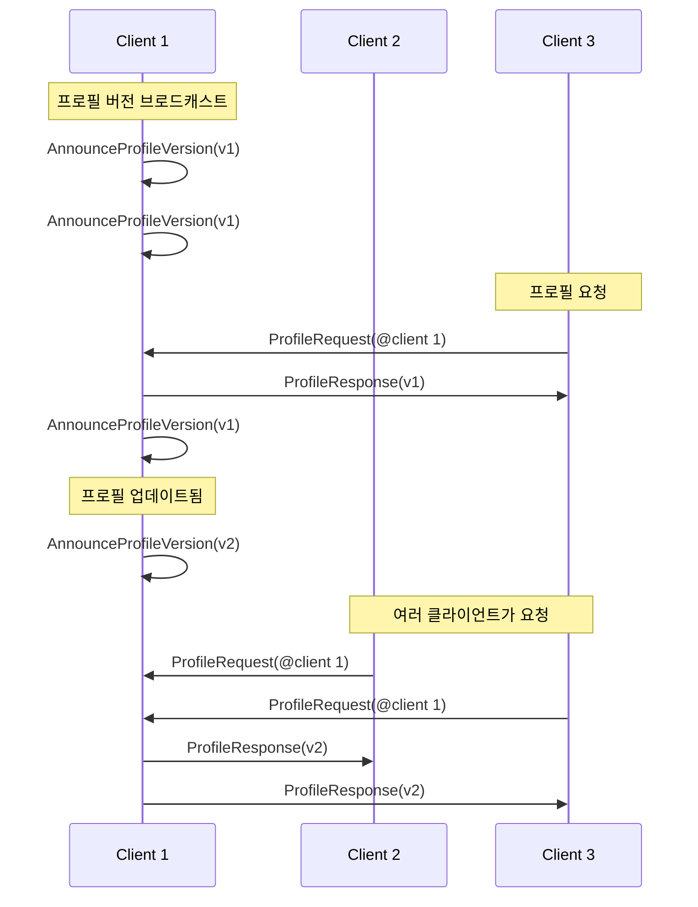

# 메시지

comms의 메시지는 이진 데이터입니다 *패킷*, 프로토콜 버퍼를 사용하여 직렬화되며 [프로토콜 버퍼](https://github.com/protocolbuffers/protobuf). 텍스트 및 음성 채팅, 위치 업데이트, 프로필 변경 및 기타 실시간 상호작용을 전달합니다.


> [!NOTE]
> 오픈소스를 사용하여 comms 프로토콜이 실제로 작동하는 모습을 보고 실험해볼 수 있습니다 [Comms Station](https://decentraland.github.io/comms-station/).


모든 메시지 정의는 [프로토콜 저장소](https://github.com/decentraland/protocol), 그리고 아래의 각 메시지 유형에는 해당 선언으로 연결되는 링크가 있습니다.

#### `패킷` [↗ 소스](https://github.com/decentraland/protocol/blob/c48ea0aa00d8173084571552463a6a05a7f49636/proto/decentraland/kernel/comms/rfc4/comms.proto#L8) <a href="#packet" id="packet"></a>

그 `패킷` 구조는 모든 메시지의 컨테이너입니다.

| 필드    | 유형    | 값                                                                                                                                                          |
| ----- | ----- | ---------------------------------------------------------------------------------------------------------------------------------------------------------- |
| `메시지` | `열거형` | <p>다음 중 하나 <code>채팅</code>, <code>음성</code>, <code>위치</code>, <code>프로필 버전 알림</code>,<br><code>프로필 요청</code>, <code>프로필 응답</code>, 또는 <code>장면</code>.</p> |

### 텍스트 및 음성 채팅

클라이언트는 연결된 모든 피어(보통 같은 섬의 플레이어)에게 텍스트 메시지와 오디오 클립을 브로드캐스트하여 채팅합니다.

단 두 가지 `패킷` 유형이 관련되며, 각 사용 사례마다 하나씩 있습니다. 일반적으로 클라이언트는 이 메시지들을 자신의 섬에 있는 다른 모든 클라이언트에게 브로드캐스트하는데, 이는 상호작용할 수 있는 주변 플레이어 그룹입니다.

***

#### `채팅` [↗ 소스](https://github.com/decentraland/protocol/blob/c48ea0aa00d8173084571552463a6a05a7f49636/proto/decentraland/kernel/comms/rfc4/comms.proto#L56) <a href="#chat" id="chat"></a>

다른 클라이언트에게 텍스트 채팅 메시지를 보냅니다.

| 필드      | 유형            | 값              |
| ------- | ------------- | -------------- |
| `메시지`   | `string`      | 메시지의 텍스트       |
| `타임스탬프` | `배정밀도 부동소수점형` | 발신자의 UTC 타임스탬프 |

***

#### `음성` [↗ 소스](https://github.com/decentraland/protocol/blob/c48ea0aa00d8173084571552463a6a05a7f49636/proto/decentraland/kernel/comms/rfc4/comms.proto#L66) <a href="#voice" id="voice"></a>

인코딩된 음성 샘플을 다른 클라이언트에게 보냅니다.

| 필드                | 유형       | 값                                   |
| ----------------- | -------- | ----------------------------------- |
| `encoded_samples` | `바이트`    | 인코딩된 오디오 데이터                        |
| `코덱`              | `열거형`    | 오직 `VC_OPUS` (현재는 다른 코덱은 지원되지 않습니다) |
| `인덱스`             | `uint32` | 발신자가 설정하는 증가 카운터                    |

그 `코덱` 필드는 하나의 `열거형` 값입니다. 사용자 정의 코덱은 지원되지 않습니다.

### 이동

아바타를 제어하는 클라이언트는 플레이어 간의 이동과 자세를 동기화하기 위해 자신의 섬 안에서 위치 업데이트를 송수신합니다.

***

#### `위치` [↗ 소스](https://github.com/decentraland/protocol/blob/c48ea0aa00d8173084571552463a6a05a7f49636/proto/decentraland/kernel/comms/rfc4/comms.proto#L20) <a href="#position" id="position"></a>

아바타의 위치와 방향을 다른 클라이언트에 업데이트합니다.

| 필드                                                                                                                  | 유형       | 값                |
| ------------------------------------------------------------------------------------------------------------------- | -------- | ---------------- |
| <p><code>position\_x</code><br><code>position\_y</code><br><code>position\_z</code></p>                             | `부동소수점형` | 월드 맵에서의 아바타 위치   |
| <p><code>rotation\_x</code><br><code>rotation\_y</code><br><code>rotation\_z</code><br><code>rotation\_w</code></p> | `부동소수점형` | 아바타 회전 쿼터니언      |
| `인덱스`                                                                                                               | `uint32` | 발신자가 설정하는 증가 카운터 |

클라이언트는 일반적으로 `위치` 업데이트를 낮은 빈도(예: 1\~2초마다 한 번)로 보내며, 이동하거나 상호작용할 때는 높은 빈도(초당 여러 번)로 전환합니다.


> [!NOTE]
> 위치 업데이트를 보낼 때는 일반적으로 신뢰성보다 속도가 더 중요합니다. 전송이 더 빠르면 체감 성능이 더 좋아지며, 설령 `위치` 메시지가 가끔 손실되거나 순서가 바뀌더라도 그렇습니다. 일부 전송 방식(예: [LiveKit](/docs/contributor/contributor-ko/communications/transport-types/livekit/))는 메시지별로 빠른 모드와 신뢰성 모드 사이를 전환할 수 있습니다.


낮은 빈도의 브로드캐스트는 잠시 연결이 끊겼거나 섬에 합류하는 동안 메시지를 놓친 클라이언트에게 업데이트를 전달하는 간단한 해결책으로 권장됩니다.

그 `인덱스` 필드는 수신자가 순서가 뒤바뀌어 도착한 업데이트를 정렬할 수 있도록 발신자가 설정하는 증가 카운터입니다.

### 프로필 공유

섬 안의 클라이언트는 다른 플레이어의 아바타 정보를 요청할 수 있으며, 이를 통해 아바타를 렌더링하고 이름과 사진 등을 표시합니다.

프로필 변경은 드물기 때문에(예를 들어 위치 업데이트와 비교하면), 이 시스템은 로컬 프로필 캐시를 유지하는 작업을 단순화하고 필요할 때만 프로필을 가져오도록 설계되었습니다.

3개의 [`패킷`](#packet) 유형이 관련됩니다: 하나는 [`프로필 요청`](#profilerequest)/[`프로필 응답`](#profileresponse) 클라이언트가 필요할 때 프로필을 공유하는 데 사용하는 쌍, 그리고 [`프로필 버전 알림`](#announceprofileversion) 피어에게 최신 버전이 무엇인지 알려주어 요청할지 여부를 결정하게 하는 메시지입니다.

클라이언트는 일반적으로 `프로필 버전 알림` 메시지를 주기적으로 브로드캐스트하며, 프로필이 변경되면 즉시 브로드캐스트합니다.



***

#### `프로필 버전 알림` [↗ 소스](https://github.com/decentraland/protocol/blob/c48ea0aa00d8173084571552463a6a05a7f49636/proto/decentraland/kernel/comms/rfc4/comms.proto#L34) <a href="#announceprofileversion" id="announceprofileversion"></a>

다른 클라이언트에게 다음이 있음을 알립니다: [프로필 엔티티](/docs/contributor/contributor-ko/content/entity-types/profiles/) 요청할 수 있습니다.

| 필드                | 유형       | 값                      |
| ----------------- | -------- | ---------------------- |
| `profile_version` | `uint32` | 수정할 때마다 증가하는 버전 번호입니다. |

프로필을 캐시하는 수신자는 `profile_version` 이 번호를 사용하여 로컬 사본이 최신인지, 아니면 다음을 보내야 하는지 결정할 수 있습니다. [`프로필 요청`](#profilerequest).

***

#### `프로필 요청` [↗ 소스](https://github.com/decentraland/protocol/blob/c48ea0aa00d8173084571552463a6a05a7f49636/proto/decentraland/kernel/comms/rfc4/comms.proto#L41) <a href="#profilerequest" id="profilerequest"></a>

특정 피어에게 지정한 버전의 프로필을 요청합니다.

| 필드                | 유형       | 값                |
| ----------------- | -------- | ---------------- |
| `address`         | string   | 프로필을 식별하는 주소입니다. |
| `profile_version` | `uint32` | 원하는 프로필 버전입니다.   |

수신자는 다음으로 응답할 수 있습니다: [`프로필 응답`](#profileresponse) 요청된 프로필을 제공하는 메시지입니다.

***

#### `프로필 응답` [↗ 소스](https://github.com/decentraland/protocol/blob/c48ea0aa00d8173084571552463a6a05a7f49636/proto/decentraland/kernel/comms/rfc4/comms.proto#L46) <a href="#profileresponse" id="profileresponse"></a>

다음에 대한 응답으로 프로필을 보냅니다: [`프로필 요청`](#profilerequest).

| 필드                   | 유형       | 값                                  |
| -------------------- | -------- | ---------------------------------- |
| `serialized_profile` | string   | JSON으로 직렬화된 프로필 엔티티입니다.            |
| `base_url`           | `uint32` | 발신자가 권장하는 파일 시스템 엔드포인트의 기본 URL입니다. |

그 `serialized_profile` 필드에는 다음의 JSON 직렬화가 들어 있습니다: [프로필 엔티티](/docs/contributor/contributor-ko/content/entity-types/profiles/).

발신자가 프로필에서 참조하는 엔티티(예: 착용 아이템)를 다운로드할 콘텐츠 서버를 추천하고 싶다면, 다음을 설정할 수 있습니다: `base_url` 필드를 힌트로 사용할 수 있습니다. 클라이언트는 이 URL을 사용하거나 무시할 수 있습니다.


---

# Agent Instructions
This documentation is published with GitBook. GitBook is the documentation platform designed so that both humans and AI agents can read, navigate, and reason over technical content effectively. Learn more at gitbook.com.

## Querying This Documentation
If you need additional information that is not directly available in this page, you can query the documentation by asking a question.

Perform an HTTP GET request on the following URL with the `ask` and `goal` query parameters:

```
GET https://docs.decentraland.org/contributor/contributor-ko/communications/messages.md?ask=<question>&goal=<user_goal>
```

`ask` is the immediate question: it should be specific, self-contained, and written in natural language.
`goal` is what the user is ultimately trying to achieve, the reason they need the answer. Sharing it helps GitBook give you a better, more relevant answer. A goal is most helpful when it describes the outcome the user wants rather than restating the question. For example, with `ask=how do I create an API token`, a goal like `automate deployments from our CI pipeline` lets GitBook tailor the answer to that use case.

The response will contain a direct answer to the question and relevant excerpts and sources from the documentation.

Use this mechanism when the answer is not explicitly present in the current page, you need clarification or additional context, or you want to retrieve related documentation sections.
