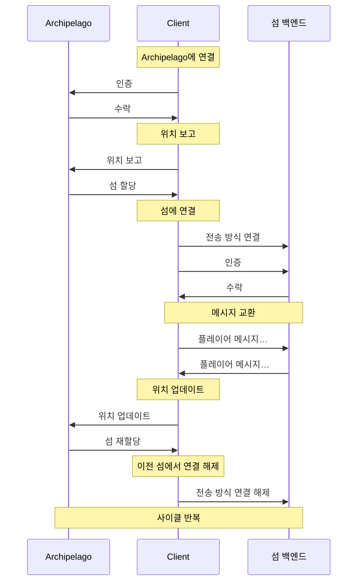

# 개요

Decentraland 통신 시스템, 또는 간단히 *comms*, 는 세계 내 플레이어 간 상호작용을 처리하는 실시간 메시징 프로토콜입니다.

이러한 상호작용 중 일부는 플레이어가 시작하고, 다른 일부는 클라이언트에 의해 내부적으로 자동 처리됩니다. 몇 가지 예:

* 텍스트 및 음성 채팅
* 플레이어가 이동할 때의 위치 업데이트
* 플레이어가 외형을 바꿀 때의 아바타 업데이트


> [!NOTE]
> 오픈 소스를 사용하여 [Comms Station](https://decentraland.github.io/comms-station/).


이 기능의 대부분은 주변의 모든 플레이어에게 메시지를 브로드캐스트해야 하므로, 자동으로 다음과 같은 거리 기반 클러스터로 그룹화됩니다 *섬*. 각 플레이어는 한 번에 하나의 섬에 할당되며, 이는 플레이어가 세계를 여행하고 다른 플레이어에 대해 상대적으로 이동함에 따라 변경됩니다.

플레이어를 섬에 관리하고 할당하는 세계 서비스는 *Archipelago*라고 합니다. 필요할 때 섬을 생성하고, 인구를 적절한 수로 유지하며, 이동에 따라 플레이어를 동적으로 재할당합니다.

```mermaid
flowchart LR
    하위 그래프 세계
        Players["플레이어<br/>⭐⭐⭐⭐⭐⭐⭐⭐⭐"]
        Archipelago["Archipelago"]
        
        하위 그래프 섬들
            Island1["섬 1<br/>⭐⭐⭐⭐"]
            Island2["섬 2<br/>⭐⭐⚪⚪"]
            IslandN["섬 n<br/>⭐⭐⭐⚪"]
        end
        
        Players --> Archipelago
        Archipelago --> Island1
        Archipelago --> Island2
        Archipelago --> IslandN
    end
```

섬에 할당되면, 클라이언트는 실제 백엔드에 연결하기 위한 해당 섬 전용 URI를 부여받고, 그 백엔드는 이들 사이의 메시지를 릴레이합니다. 이 연결은 Archipelago가 클라이언트를 다른 섬으로 재할당할 때까지 유지됩니다.

이는 [Archipelago](/docs/contributor/contributor-ko/communications/archipelago/) 프로토콜 외에도, 클라이언트가 여러 개의 *전송 방식들*, 각 지원되는 백엔드 중 하나를 통합된 인터페이스로 감쌉니다.

### 클라이언트 수명 주기 <a href="#lifecycle" id="lifecycle"></a>

comms 클라이언트의 수명 주기는 몇 단계로 요약할 수 있습니다:

1. **세계 선택**: URI를 획득합니다. [Archipelago](/docs/contributor/contributor-ko/communications/archipelago/) 서비스.
2. **Archipelago에 참여**: 서비스와 영구 연결을 엽니다.
3. **섬 (재)할당 받기**: 현재 위치를 보고하고 섬 전용 URI를 획득합니다.
4. **전송 방식 연결**: 섬 전용 백엔드에 두 번째 연결을 엽니다.
5. **반복**: 3단계와 4단계를 계속 진행하면서 주기적으로 새 위치를 보고합니다.

클라이언트가 세션을 종료하면, 단순히 Archipelago 서비스에서 연결을 끊습니다. 그러면 현재 섬에서 자동으로 제거됩니다.



### 연결

comms 연결은 주로 웹소켓 기반이지만, 일부 전송 방식은 다른 전략을 사용할 수 있습니다.

다음으로 이동하세요 [전송 방식들](/docs/contributor/contributor-ko/communications/transports/) 또는 [Archipelago](/docs/contributor/contributor-ko/communications/archipelago/) 섹션에서 자세히 알아보거나, 특정 전송 방식 페이지에서 세부 사항을 확인하세요.

### 인증

comms에 대한 연결은 클라이언트가 서버가 제공한 챌린지에 서명하도록 하여 인증되며, 다음에 설명된 방식을 [인증 체인](/docs/contributor/contributor-ko/authentication/authchain/) 섹션.

다음으로 이동하세요 [Archipelago](/docs/contributor/contributor-ko/communications/archipelago/) 페이지를 방문하거나 특정 전송 방식을 살펴보며 인증 흐름에 대해 자세히 알아보세요.

### 섬

섬은 메시지를 서로 브로드캐스트할 수 있는, 매우 동적인 플레이어 그룹이며, 다음에 의해 생성되고 유지됩니다. [Archipelago](/docs/contributor/contributor-ko/communications/archipelago/) 세계에서의 이동에 대응하여

섬에는 미리 정해진 영역이나 중심점이 없습니다. 섬은 안정적인 지리적 특징이 아니라, 주변 플레이어의 임시적 연합일 뿐입니다. 어떤 섬이 한 지역을 덮고 있다고 말할 수 있다면, 그것은 오직 현재 그 구성원들이 그 구역에 퍼져 있기 때문입니다.

플레이어가 없는 지역에는 섬이 하나도 없을 수 있으며, 인구가 밀집한 지역에는 여러 겹치는 섬이 존재할 수 있습니다. 모든 사람을 같은 그룹에 할당하면 실시간 브로드캐스트가 불가능해지기 때문입니다.

Decentraland 네트워크의 각 서버는 최대 섬 인구와 플레이어가 서로 가까이 있다고 간주되는 거리를 설정할 수 있습니다. 기본적으로 섬은 서로 100미터 이내에 있는 최대 100명의 플레이어를 수용할 수 있습니다.

섬에 할당되어 합류하는 흐름은 [Archipelago](/docs/contributor/contributor-ko/communications/archipelago/) 섹션.

### 메시지

comms 프로토콜의 메시지는 [프로토콜 버퍼](https://github.com/protocolbuffers/protobuf)를 사용해 직렬화된 이진 블롭이며, [Packet](/docs/contributor/contributor-ko/communications/messages/#packet) 구조로 감싸집니다.


> [!NOTE]
> 다음 단어를 사용할 때 *message* 를 comms 맥락에서 사용할 때는, 항상 플레이어 간에 교환되는 채팅 메시지가 아니라 이진 메시지 프로토콜을 가리킵니다.


실시간 상호작용 흐름을 위한 여러 가지 메시지 유형이 있습니다. 다음으로 이동하세요. [메시지](/docs/contributor/contributor-ko/communications/messages/) 섹션에서 자세히 알아보세요.


---

# Agent Instructions
This documentation is published with GitBook. GitBook is the documentation platform designed so that both humans and AI agents can read, navigate, and reason over technical content effectively. Learn more at gitbook.com.

## Querying This Documentation
If you need additional information that is not directly available in this page, you can query the documentation by asking a question.

Perform an HTTP GET request on the following URL with the `ask` and `goal` query parameters:

```
GET https://docs.decentraland.org/contributor/contributor-ko/communications/overview.md?ask=<question>&goal=<user_goal>
```

`ask` is the immediate question: it should be specific, self-contained, and written in natural language.
`goal` is what the user is ultimately trying to achieve, the reason they need the answer. Sharing it helps GitBook give you a better, more relevant answer. A goal is most helpful when it describes the outcome the user wants rather than restating the question. For example, with `ask=how do I create an API token`, a goal like `automate deployments from our CI pipeline` lets GitBook tailor the answer to that use case.

The response will contain a direct answer to the question and relevant excerpts and sources from the documentation.

Use this mechanism when the answer is not explicitly present in the current page, you need clarification or additional context, or you want to retrieve related documentation sections.
