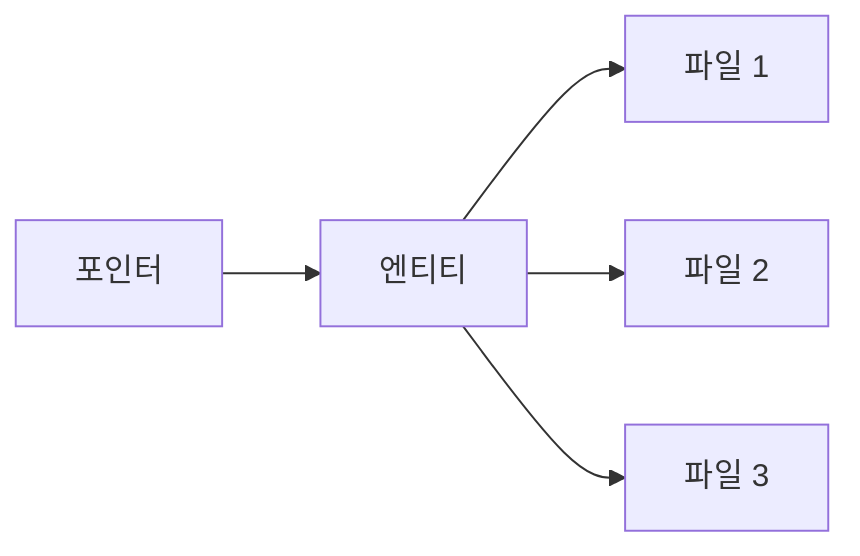

# 개요

Decentraland의 가상 세계 안에서 찾을 수 있는 모든 것은 Catalyst로 알려진 분산 서버 네트워크에 호스팅되며, 이들은 (그 외 여러 기능과 함께) 콘텐츠 API를 제공합니다. 클라이언트가 콘텐츠를 업로드하고 다운로드하는 수단이 바로 이들입니다.

Catalyst의 전체 API는 [자체 참조 문서에서](https://decentraland.github.io/catalyst-api-specs/). 여기서는 콘텐츠가 어떻게 구성되는지, 그리고 어떻게 발견되고 다운로드될 수 있는지 이해하는 데 초점을 맞추겠습니다.

아래에서 언급되는 모든 중요한 개념은 각자의 페이지에서 더 자세히 설명됩니다.

### 파일, 엔티티, 포인터

Decentraland의 콘텐츠 시스템에는 세 가지 계층이 있습니다: [파일이며](/docs/contributor/contributor-ko/content/file-system/) 는 다음 안에 패키징됩니다 [엔티티입니다](/docs/contributor/contributor-ko/content/entities/), 그리고 엔티티는 다음을 사용해 발견됩니다 [포인터](/docs/contributor/contributor-ko/content/pointers/).



[파일](/docs/contributor/contributor-ko/content/file-system/) 는 IPFS와 유사한 분산 파일 시스템에 저장되며, 콘텐츠 서버 전반에 자동으로 동기화됩니다. 이들은 파일 내용으로부터 계산된 고유한 문자열 ID로 식별되며, 식별자와 콘텐츠는 모두 **불변입니다**입니다. 파일을 업데이트한다는 개념은 없습니다. 대신 대체 파일이 업로드되고 오래된 파일은 삭제됩니다.

[엔티티](/docs/contributor/contributor-ko/content/entities/) 는 파일의 원자적 패키지이며, 장면과 착용 아이템과 같이 세계에서 발견되는 실제 콘텐츠를 나타냅니다. 이들은 최소 하나의 파일을 가지며, 이를 *매니페스트*라고 부릅니다. 여기에는 일반 설명과 메타데이터가 포함됩니다. 포함된 개별 파일들과 마찬가지로 이들도 변경 불가능하며, 고유하고 결정적인 문자열로 식별됩니다. 모든 엔티티에는 소유자가 있으며, 소유자는 이를 관리하는 데 필요한 개인 키를 보유합니다.

[포인터](/docs/contributor/contributor-ko/content/pointers/) 는 엔티티의 ID로 해결될 수 있는 안정적인 참조입니다. 엔티티가 교체되면(즉, 소유자가 새 패키지를 업로드하고 이전 패키지는 삭제되면), 포함된 파일과 메타데이터가 달라지고 식별자도 달라지지만, 포인터는 그대로 유지되며 새 버전으로 다시 지정됩니다.

### 스냅샷

콘텐츠 서버는 또한 특정 시점에 활성 상태인 모든 엔티티(즉, 현재 포인터로 참조되고 있는 것들)의 요약을 담은 큰 줄바꿈 구분 JSON 파일도 호스팅합니다. 이들은 [스냅샷](/docs/contributor/contributor-ko/content/snapshots/)라고 불리며, 사용 가능한 모든 콘텐츠를 탐색하는 데 사용할 수 있습니다.


---

# Agent Instructions
This documentation is published with GitBook. GitBook is the documentation platform designed so that both humans and AI agents can read, navigate, and reason over technical content effectively. Learn more at gitbook.com.

## Querying This Documentation
If you need additional information that is not directly available in this page, you can query the documentation by asking a question.

Perform an HTTP GET request on the following URL with the `ask` and `goal` query parameters:

```
GET https://docs.decentraland.org/contributor/contributor-ko/content/overview.md?ask=<question>&goal=<user_goal>
```

`ask` is the immediate question: it should be specific, self-contained, and written in natural language.
`goal` is what the user is ultimately trying to achieve, the reason they need the answer. Sharing it helps GitBook give you a better, more relevant answer. A goal is most helpful when it describes the outcome the user wants rather than restating the question. For example, with `ask=how do I create an API token`, a goal like `automate deployments from our CI pipeline` lets GitBook tailor the answer to that use case.

The response will contain a direct answer to the question and relevant excerpts and sources from the documentation.

Use this mechanism when the answer is not explicitly present in the current page, you need clarification or additional context, or you want to retrieve related documentation sections.
