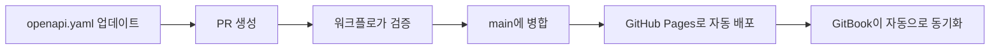

# API 문서

이 페이지에서는 모든 Decentraland 서비스 전반에서 OpenAPI 사양을 사용해 API를 문서화하는 표준을 다룹니다.

## 목표

우리의 API 문서화 접근 방식은 다음을 보장합니다:

* **표준화** - 모든 서비스에 걸쳐 일관된 OpenAPI 사양
* **자동화** - GitHub Actions를 통한 검증, 번들링, 배포
* **중앙화** - 모든 서비스 문서는 GitBook을 통해 게시됨
* **소유권** - 문서는 각 서비스 저장소에 보관됩니다
* **접근성** - 기여자 친화적이며 최신 상태의 API 참조

***

## 저장소 구조

각 서비스 저장소에는 반드시 다음이 포함된 `/docs` 디렉터리가 있어야 하며, 구조는 다음과 같습니다:

```bash
/docs
  openapi.yaml        # 단일 진실 원본(OpenAPI 3.1)
  openapi.json        # CI에서 Hugo/렌더러용으로 자동 생성
  index.html          # 독립형 문서 자동 생성(선택 사항)
```

### 파일 요구 사항

#### `openapi.yaml`

* **반드시** 기준이 되는 원본 파일이어야 함
* **반드시** OpenAPI 3.1 사양을 사용
* **할 수 있음** 서비스 식별 접두사를 가질 수 있음(예: `worlds-openapi.yaml`)
* **할 수 있음** 다음으로 분할 `components/` 또는 `examples/` 필요한 경우 디렉터리

#### `openapi.json`

* CI/CD 중 자동 생성
* Hugo와 기타 렌더러에서 사용
* 수동으로 편집하지 마십시오

#### `index.html`

* 자동 생성된 독립형 문서
* Redocly로 빌드됨
* GitHub Pages에 배포됨

***

## OpenAPI 표준

다음을 작성할 때 `openapi.yaml`, 일관성과 명확성을 보장하기 위해 다음 규칙을 따르세요.

### 엔드포인트 요약

**반드시** 실제 엔드포인트 경로를 반영해야 합니다:

```yaml
# ✅ 좋음: 명확한 엔드포인트 경로
paths:
  /world/{world_name}/about:
    get:
      summary: /world/{world_name}/about
      description: 특정 세계에 대한 정보를 가져옵니다
      
# ❌ 나쁨: 일반적인 요약
paths:
  /world/{world_name}/about:
    get:
      summary: 세계 정보 가져오기
```

### operation ID

**반드시** 에는 전역적으로 고유하도록 서비스 이름을 포함해야 합니다:

```yaml
# ✅ 좋음: 서비스 접두사가 붙은 operationId
operationId: worldsContentServer_getWorldAbout

# ✅ 좋음: 또 다른 예
operationId: socialService_getFriends

# ❌ 나쁨: 일반적이고 충돌할 수 있음
operationId: getAbout
```

**명명 규칙**: `{serviceName}_{operationDescription}`

* camelCase 사용
* 설명적이지만 간결하게
* 유용할 때 HTTP 메서드 맥락을 포함(예: `createUser`, `deleteParcel`)

### 버전 관리

**반드시** 다음 위치에서 시맨틱 버전 규칙(`MAJOR.MINOR.PATCH`)을 사용 `info.version`:

```yaml
openapi: 3.1.0
info:
  title: Worlds Content Server API
  version: 1.2.0  # 시맨틱 버전 관리
  description: Decentraland 월드를 관리하기 위한 API
```

**버전 증가 규칙**:

* **MAJOR**: 호환되지 않는 변경(깨지는 API 변경)
* **MINOR**: 새 기능(하위 호환)
* **PATCH**: 버그 수정(하위 호환)

### 태그 및 그룹화

**반드시** 관련 엔드포인트를 그룹화하기 위해 태그를 사용:

```yaml
tags:
  - name: Worlds
    description: 월드 관리 작업
  - name: Deployments
    description: 월드 배포 작업
  - name: Health
    description: 상태 확인 엔드포인트

paths:
  /worlds:
    get:
      tags:
        - Worlds
      summary: /worlds
      operationId: worldsContentServer_listWorlds
      
  /worlds/{world_name}/about:
    get:
      tags:
        - Worlds
      summary: /worlds/{world_name}/about
      operationId: worldsContentServer_getWorldAbout
```


> [!NOTE]
> 운영은 GitBook의 탐색에서 태그별로 그룹화됩니다. 더 나은 구성을 위해 관련 엔드포인트를 같은 태그 아래에 묶으세요.


### 완전한 예시

```yaml
openapi: 3.1.0
info:
  title: Social Service API
  version: 2.1.0
  description: Decentraland의 소셜 상호작용을 관리하기 위한 API
  contact:
    name: Decentraland Contributors
    url: https://decentraland.org

servers:
  - url: https://social.decentraland.org
    description: 운영 서버
  - url: https://social.decentraland.zone
    description: 스테이징 서버

tags:
  - name: Friends
    description: 친구 관리
  - name: Blocked Users
    description: 사용자 차단 작업

paths:
  /friends:
    get:
      tags:
        - Friends
      summary: /friends
      operationId: socialService_getFriends
      description: 인증된 사용자의 친구 목록을 반환합니다
      parameters:
        - name: limit
          in: query
          schema:
            type: integer
            default: 50
            maximum: 100
        - name: offset
          in: query
          schema:
            type: integer
            default: 0
      responses:
        '200':
          description: 성공 응답
          content:
            application/json:
              schema:
                type: object
                properties:
                  friends:
                    type: array
                    items:
                      $ref: '#/components/schemas/Friend'
        '401':
          description: 인증되지 않음

components:
  schemas:
    Friend:
      type: object
      required:
        - address
        - createdAt
      properties:
        address:
          type: string
          description: 친구의 이더리움 주소
        createdAt:
          type: string
          format: date-time
          description: 친구 관계가 성립된 시점
```

***

## 로컬 개발

### 로컬에서 문서 미리보기

Redocly CLI를 사용하여 OpenAPI 문서를 미리 보세요:

```bash
# HTML 문서 빌드
yarn redocly build-docs docs/openapi.yaml -o docs/index.html

# 그런 다음 브라우저에서 docs/index.html을 여세요
```

### package.json에 추가

편의를 위해 빌드 스크립트를 추가하세요:

```json
{
  "scripts": {
    "build:api": "redocly bundle docs/openapi.yaml -o docs/openapi.json --ext json && redocly build-docs docs/openapi.yaml -o docs/index.html",
    "preview:api": "redocly preview-docs docs/openapi.yaml"
  }
}
```

### Redocly CLI 설치

```bash
# npm 사용
npm install -g @redocly/cli

# yarn 사용
yarn global add @redocly/cli
```

### OpenAPI 사양 검증

```bash
# 사양을 검증
redocly lint docs/openapi.yaml

# 번들링하고 검증
redocly bundle docs/openapi.yaml
```

***

## 자동화 설정

### 1단계: GitBook 비밀값 구성

API 사양을 GitBook에 게시하려면, 저장소에 이 비밀값을 추가하세요:

**설정 → 비밀 및 변수 → Actions → 새 저장소 비밀**

| 비밀 이름                     | 설명             | 찾는 위치               |
| ------------------------- | -------------- | ------------------- |
| `GITBOOK_ORGANIZATION_ID` | GitBook 조직 ID  | GitBook 설정 → 조직     |
| `GITBOOK_TOKEN`           | GitBook API 토큰 | GitBook 설정 → API 토큰 |


> [!WARNING]
> 자동화 워크플로가 GitBook에 게시하려면 이 비밀값이 반드시 구성되어 있어야 합니다.


### 2단계: GitHub Actions 워크플로 추가

생성 `.github/workflows/build-api-docs.yml` 를 저장소에:

```yaml
name: build-app-docs

on:
  push:
    branches: [main]
    paths:
      - 'docs/**'
  pull_request:
    paths:
      - 'docs/**'

jobs:
  build:
    uses: decentraland/platform-actions/.github/workflows/apps-docs.yml@main
    with:
      api-spec-file: 'docs/openapi.yaml'
      output-file: 'docs/index.html'
      output-directory: './docs'
      api-spec-name: '{service-name}-api'  # 예: 'social-service-api'
      node-version: '20'
    secrets: inherit
```

**매개변수**:

* `api-spec-file`: OpenAPI 사양 경로(보통 `docs/openapi.yaml`)
* `output-file`: HTML 문서를 생성할 위치
* `output-directory`: 출력 파일용 디렉터리
* `api-spec-name`: API 사양의 고유 이름(GitBook에서 사용됨)
* `node-version`: 사용할 Node.js 버전

**이 워크플로는 다음을 수행합니다**:

1. ✅ OpenAPI 사양 검증
2. ✅ 사양을 단일 파일로 번들링
3. ✅ Redocly를 사용해 정적 HTML 문서 빌드
4. ✅ GitHub Pages에 자동 배포
5. ✅ 사양을 GitBook에 게시(비밀값이 구성된 경우)

### 3단계: GitHub Pages 활성화

저장소에서 GitHub Pages를 구성하세요:

1. 이동: **설정 → Pages**
2. 아래에서 **빌드 및 배포**:
   * 를 **소스** 로 **GitHub Actions**
3. 다음 이름의 환경이 있는지 확인하세요 **github-pages**
4. 설정 저장

첫 번째 성공적인 워크플로 실행 후, 문서는 다음 위치에서 사용할 수 있습니다:

* **HTML 문서**: `https://decentraland.github.io/<repo>/index.html`
* **OpenAPI 사양**: `https://decentraland.github.io/<repo>/openapi.yaml`
* **번들된 JSON**: `https://decentraland.github.io/<repo>/openapi.json`


> [!TIP]
> 이 URL들은 저장소가 존재하고 GitHub Pages가 활성화되어 있는 한 유효합니다.


***

## GitBook에 추가하기

API 문서가 배포되면, 중앙화된 GitBook 문서에 추가하세요.

### 수동 추가(현재 프로세스)

1. GitBook 스페이스로 이동
2. 다음으로 이동 **API 참조** 섹션
3. 클릭 **API 참조 추가**
4. 서비스 세부 정보를 입력하세요:
   * **이름**: 서비스 이름(예: "Social Service")
   * **OpenAPI URL**: `https://decentraland.github.io/{repo-name}/openapi.yaml`
5. 저장

### GitBook 통합 기능

GitBook은 자동으로 다음을 수행합니다:

* OpenAPI 사양 구문 분석
* 대화형 API 문서 생성
* 태그를 기반으로 엔드포인트 탐색 생성
* "Try it" 기능 제공
* 사양을 업데이트하면 문서를 동기화 상태로 유지

***

## 전체 설정 흐름

### 초기 설정

```mermaid
graph TD
    A[/docs/openapi.yaml 생성] --> B[GitHub Actions 워크플로 추가]
    B --> C[GitBook 비밀값 구성]
    C --> D[GitHub Pages 활성화]
    D --> E[main 브랜치에 푸시]
    E --> F[워크플로가 자동으로 실행됨]
    F --> G[문서가 GitHub Pages에 배포됨]
    G --> H[수동으로 GitBook에 추가]
```

### 지속적인 업데이트



***

## 권장 사항

### 문서 품질

* **설명적으로 작성**: 명확한 요약과 설명을 작성하세요
* **예시 제공**: 요청/응답 예시를 포함하세요
* **오류 문서화**: 가능한 모든 오류 응답을 설명하세요
* **컴포넌트 사용**: 다음을 통해 스키마를 재사용 `$ref` 하여 중복 방지
* **설명 추가**: 모든 매개변수, 속성, 응답에는 설명이 있어야 합니다

### 모범 사례가 포함된 예시

```yaml
paths:
  /users/{address}/friends:
    get:
      tags:
        - Friends
      요약: /users/{address}/friends
      operationId: socialService_getUserFriends
      설명: |
        지정된 사용자의 친구 목록을 페이지네이션으로 가져옵니다.
        친구 주소와, 친구 관계가 언제 시작되었는지를 포함한 메타데이터를 반환합니다.
      parameters:
        - 이름: address
          위치: path
          필수: true
          설명: 사용자의 Ethereum 주소(0x 접두사 포함)
          schema:
            type: string
            패턴: '^0x[a-fA-F0-9]{40}$'
          예시: '0x1234567890abcdef1234567890abcdef12345678'
        - name: limit
          in: query
          설명: 반환할 최대 친구 수(1-100)
          schema:
            type: integer
            최소: 1
            maximum: 100
            default: 50
        - name: offset
          in: query
          설명: 페이지네이션을 위해 건너뛸 친구 수
          schema:
            type: integer
            최소: 0
            default: 0
      responses:
        '200':
          친구 목록을 성공적으로 가져왔습니다
          content:
            application/json:
              schema:
                $ref: '#/components/schemas/FriendsResponse'
              예시:
                friends:
                  - address: '0xabcdef...'
                    createdAt: '2024-01-15T10:30:00Z'
                total: 42
                offset: 0
                limit: 50
        '400':
          설명: 잘못된 주소 형식
          content:
            application/json:
              schema:
                $ref: '#/components/schemas/Error'
              예시:
                error: '잘못된 주소 형식'
                code: 'INVALID_ADDRESS'
        '404':
          설명: 사용자를 찾을 수 없음
          content:
            application/json:
              schema:
                $ref: '#/components/schemas/Error'
```

### 스키마 재사용성

```yaml
components:
  schemas:
    오류:
      type: object
      required:
        - error
        - code
      properties:
        error:
          type: string
          설명: 사람이 읽을 수 있는 오류 메시지
        code:
          type: string
          설명: 기계가 읽을 수 있는 오류 코드
        details:
          type: object
          설명: 추가 오류 컨텍스트
          
    PaginatedResponse:
      type: object
      required:
        - offset
        - limit
        - total
      properties:
        offset:
          type: integer
          설명: 건너뛴 항목 수
        limit:
          type: integer
          설명: 페이지당 최대 항목 수
        total:
          type: integer
          설명: 사용 가능한 전체 항목 수
```

### 보안 스키마

```yaml
components:
  securitySchemes:
    BearerAuth:
      type: http
      scheme: bearer
      bearerFormat: JWT
      설명: 인증 엔드포인트에서 얻은 JWT 토큰

security:
  - BearerAuth: []
```

***

## 검증 및 품질 검사

### 사전 커밋 검증

사전 커밋 훅 또는 CI 검사를 추가하세요:

```yaml
# .github/workflows/validate-api-spec.yml
name: API 사양 검증

on: [pull_request]

jobs:
  validate:
    runs-on: ubuntu-latest
    steps:
      - uses: actions/checkout@v3
      - uses: actions/setup-node@v3
        with:
          node-version: '20'
      - run: npm install -g @redocly/cli
      - run: redocly lint docs/openapi.yaml
```

### 일반적인 검증 규칙

* 모든 path에 operation ID가 있음
* 모든 operation에 태그가 있음
* 모든 파라미터에 설명이 있음
* 모든 응답이 문서화되어 있음
* 예시가 제공됨
* 스키마가 올바르게 참조됨

***

## 문제 해결

### 워크플로 실패

**문제**: GitHub Actions 워크플로가 실패함

**해결 방법**:

* 검증 오류를 위해 워크플로 로그를 확인하세요
* 로컬에서 `redocly lint docs/openapi.yaml` 실행
* 워크플로 구성에서 파일 경로를 확인하세요
* 시크릿이 올바르게 구성되었는지 확인하세요

### GitHub Pages가 작동하지 않음

**문제**: GitHub Pages URL에 문서가 나타나지 않음

**해결 방법**:

* 저장소 설정에서 GitHub Pages가 활성화되어 있는지 확인하세요
* 워크플로가 성공적으로 완료되었는지 확인하세요
* GitHub Pages가 업데이트될 때까지 몇 분 기다리세요
* 다음을 확인하세요 `github-pages` 환경이 존재함

### GitBook이 동기화되지 않음

**문제**: GitBook에 업데이트된 API 문서가 표시되지 않음

**해결 방법**:

* GitBook 시크릿이 올바른지 확인하세요
* OpenAPI URL에 접근할 수 있는지 확인하세요
* GitBook에서 수동으로 새로고침을 트리거하세요
* OpenAPI 사양이 유효한지 확인하세요

***

## 기존 문서에서 마이그레이션

기존 API 문서가 있다면:

1. **OpenAPI로 내보내기**: 기존 문서를 OpenAPI 3.1 형식으로 변환
2. **검증**: 사용 `redocly lint` 를 사용해 규격 준수 여부를 확인하세요
3. **워크플로 추가**: GitHub Actions 자동화를 설정하세요
4. **테스트**: 문서가 올바르게 빌드되고 배포되는지 확인하세요
5. **링크 업데이트**: 기존 문서 링크를 새 GitHub Pages URL로 연결하세요
6. **기존 문서 보관**: 전환 기간 동안 참조용으로 기존 문서를 보관하세요

***

## 다음 단계

* 다음을 검토하세요 [널리 알려진 컴포넌트](https://github.com/decentraland/docs/tree/main/contributor/contributor-guides/well-known-components/README.md) API 구현 표준
* 참고 [테스트 표준](/docs/contributor/contributor-ko/contributor-guides/testing-standards/) API 테스트 지침
* 다음에서 기존 API 예제를 확인하세요 [API 참조](https://docs.decentraland.org) 섹션

## 관련 표준

* [의존성 관리](/docs/contributor/contributor-ko/contributor-guides/dependency-management/) - npm 의존성과 peerDependencies 관리
* [널리 알려진 컴포넌트](https://github.com/decentraland/docs/tree/main/contributor/contributor-guides/well-known-components/README.md) - 서비스용 WKC 아키텍처
* [테스트 표준](/docs/contributor/contributor-ko/contributor-guides/testing-standards/) - 서비스 테스트 패턴

## 리소스

* **OpenAPI 사양**: [spec.openapis.org](https://spec.openapis.org/oas/latest.html)
* **Redocly CLI**: [redocly.com/docs/cli](https://redocly.com/docs/cli/)
* **GitBook API 통합**: [docs.gitbook.com](https://docs.gitbook.com)
* **플랫폼 Actions 저장소**: [github.com/decentraland/platform-actions](https://github.com/decentraland/platform-actions)


---

# Agent Instructions
This documentation is published with GitBook. GitBook is the documentation platform designed so that both humans and AI agents can read, navigate, and reason over technical content effectively. Learn more at gitbook.com.

## Querying This Documentation
If you need additional information that is not directly available in this page, you can query the documentation by asking a question.

Perform an HTTP GET request on the following URL with the `ask` and `goal` query parameters:

```
GET https://docs.decentraland.org/contributor/contributor-ko/contributor-guides/api-documentation.md?ask=<question>&goal=<user_goal>
```

`ask` is the immediate question: it should be specific, self-contained, and written in natural language.
`goal` is what the user is ultimately trying to achieve, the reason they need the answer. Sharing it helps GitBook give you a better, more relevant answer. A goal is most helpful when it describes the outcome the user wants rather than restating the question. For example, with `ask=how do I create an API token`, a goal like `automate deployments from our CI pipeline` lets GitBook tailor the answer to that use case.

The response will contain a direct answer to the question and relevant excerpts and sources from the documentation.

Use this mechanism when the answer is not explicitly present in the current page, you need clarification or additional context, or you want to retrieve related documentation sections.
