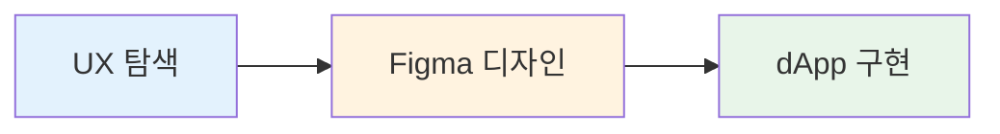

# 프로세스 개요

우리의 개발 프로세스는 설계된 내용이 그대로 구현되도록 보장합니다. 작업은 세 단계의 명확한 단계와 각 단계의 산출물 및 책임을 거쳐 진행됩니다.

## 워크플로 단계



각 단계는 이전 단계를 기반으로 하여 개념에서 코드까지의 정합성을 보장합니다.

***

## UX 탐색

UX 단계는 이후 모든 것의 기반을 마련합니다. 이 단계에서 명확한 요구사항을 정의하면 나중의 비용이 큰 변경을 방지할 수 있습니다.

### 필수 산출물

#### 목표와 범위

**반드시** 정의:

* **비즈니스 목표** - 어떤 문제를 해결하려는가?
* **대상 사용자** - 누구를 위한 것인가?
* **성공 지표** - 성공을 어떻게 측정할 것인가?
* **제약 사항** - 기술, 일정 또는 리소스 제한

**예시**:

```
목표: 사용자가 자신의 토지 필지를 효율적으로 찾아보고 필터링할 수 있게 함
대상: 10개 이상의 필지를 보유한 토지 소유자
성공: 사용자의 80%가 10초 이내에 특정 필지를 찾을 수 있음
제약 사항: 모바일에서 작동해야 함; 백엔드 변경 불가
```

#### 상호작용 흐름

**반드시** 엔드투엔드 사용자 여정을 매핑:

* **모든 사용 사례** - 주요 및 보조 사용자 경로
* **엣지 케이스** - 빈 상태, 첫 사용자, 오류
* **대체 경로** - 목표를 달성하는 다양한 방법
* **시각 자료** - 필요할 경우 와이어프레임 또는 흐름 다이어그램

**예시**:

```
주요 흐름:
1. 사용자가 "My Land"를 클릭
2. 시스템이 필지를 로드
3. 사용자가 필터를 적용
4. 결과가 즉시 업데이트됨

엣지 케이스:
- 사용자의 필지가 없음 → CTA가 있는 빈 상태 표시
- 필터 결과가 없음 → "결과 없음" 메시지 표시
- 로딩이 2초 이상 걸림 → 스켈레톤 로더 표시
```

#### UI 상태

**해야 함** 모든 컴포넌트 상태를 지정:

* **대기** - 기본 상태
* **로딩** - 데이터 가져오기 또는 처리 중
* **오류** - 실패한 작업
* **비어 있음** - 사용 가능한 데이터 없음
* **성공** - 성공한 작업
* **비활성화됨** - 사용할 수 없는 작업

**해야 함** 오류 복구를 개괄:

* 오류가 발생하면 어떻게 되나요?
* 사용자는 이를 어떻게 다시 시도하거나 해결할 수 있나요?
* 사용자에게 어떤 정보가 필요한가요?

#### 분석 추적

**반드시** 이 단계에서 추적 항목을 합의:

* **이벤트** - 추적할 작업
* **속성** - 수집할 데이터
* **사용자 속성** - 관련 사용자 속성
* **전환 목표** - 주요 성공 지표

**예시**:

```
이벤트:
- parcel_filter_applied { filter_type, filter_value }
- parcel_selected { parcel_id, source }
- parcel_transfer_initiated { parcel_id }

속성:
- user_parcel_count
- filter_used (boolean)
- time_to_result (ms)
```

### 권장 산출물

#### 접근성 의도

**해야 함** 설명:

* **키보드 흐름** - 탭 순서 및 바로가기
* **포커스 순서** - 논리적인 포커스 진행
* **스크린 리더 레이블** - ARIA 레이블 및 설명
* **대체 콘텐츠** - 이미지, 아이콘, 그래프용 텍스트

**예시**:

```
키보드 탐색:
- Tab: 필터 사이를 이동
- Enter: 선택한 필터 적용
- Escape: 필터 드롭다운 닫기
- 화살표 키: 필터 옵션 탐색

스크린 리더:
- "필터 기준: 소유자 주소. 검색하려면 입력하거나 목록에서 선택하세요"
- "필터와 일치하는 필지 3개를 찾았습니다"
```

#### 접근성 가독성

**해야 함** 보장:

* **색 대비** - 최소 WCAG AA 비율
  * 일반 텍스트: 4.5:1
  * 큰 텍스트(18pt 이상): 3:1
  * UI 컴포넌트: 3:1
* **텍스트 크기** - 기본 크기에서 읽기 가능
* **상호작용 대상** - 최소 44×44px 터치 대상

#### UI 상호작용 요소

**해야 함** 모든 상호작용 요소의 상태를 정의:

* **활성화됨** - 기본 상호작용 상태
* **비활성화됨** - 비상호작용 상태
* **호버** - 마우스 오버(데스크톱)
* **눌림/활성** - 상호작용 중
* **포커스** - 키보드 포커스 상태

**해야 함** 사용자 피드백 지정:

* 상호작용 시 시각적 변화
* 로딩 표시기
* 성공/오류 메시지
* 햅틱 피드백(모바일)

***

## Figma 디자인

디자이너는 반드시 우리의 [Figma 라이브러리](https://www.figma.com/design/tsyaDSedcsVZ8iM9N0McT2/DCL-UI2)를 출발점으로 해야 합니다. 이는 Material UI 컴포넌트를 반영하며 UI2에 정의된 Decentraland 테마를 사용합니다.


> [!WARNING]
> 특수한 색상, 크기 또는 스타일은 사용해서는 안 됩니다. 예외는 있을 수 있지만 사양서에서 정당화되어야 하며 검토 중 승인을 받아야 합니다.


### 필수 기준

#### Decentraland Figma 라이브러리 사용

**반드시** 동등한 것이 있으면 MUI 컴포넌트를 사용:

* 먼저 MUI 컴포넌트 라이브러리를 확인
* Decentraland 변형과 스타일 사용
* 기존 컴포넌트의 커스텀 버전을 만들지 마세요

**필요한 UI 요소가 없다면:**

1. 기존 컴포넌트로 조합할 수 있는지 확인
2. 아니면 커스텀 컴포넌트를 제안(참조 [사용자 지정 컴포넌트](/docs/contributor/contributor-ko/contributor-guides/ui-1/custom-components/))
3. 사양서에 근거를 문서화
4. 디자인 리뷰에서 승인을 받기

#### 색상

**반드시** Figma 색상 스타일을 UI2 테마 이름에 맞추기:

```tsx
import { dclColors } from 'decentraland-ui2';

// Figma "Rarity / Unique" → Code
dclColors.rarity.unique

// Figma "Primary / Main" → Code
theme.palette.primary.main

// Figma "Text / Secondary" → Code
theme.palette.text.secondary
```

**단일 기준 출처**: [colors.ts](https://github.com/decentraland/ui2/blob/master/src/theme/colors.ts)

#### 타이포그래피

**반드시** 정의된 변형 사용:

사용 가능한 변형:

* `h1`, `h2`, `h3`, `h4`, `h5`, `h6` - 제목
* `subtitle1`, `subtitle2` - 부제목
* `body1`, `body2` - 본문 텍스트
* `button` - 버튼 텍스트
* `caption` - 캡션
* `overline` - 오버라인 텍스트

**참조**:

* [타이포그래피 출처](https://github.com/decentraland/ui2/blob/master/src/theme/typography.ts)
* [MUI 타이포그래피](https://mui.com/material-ui/react-typography/)
* [Material Design 타입 시스템](https://m2.material.io/design/typography/the-type-system.html#type-scale)

**예시 매핑**:

```
Figma "H1" → <Typography variant="h1">
Figma "Body 1" → <Typography variant="body1">
Figma "Caption" → <Typography variant="caption">
```

#### 브레이크포인트

**반드시** 다음 중단점에 맞춰 디자인:

| 이름   | 너비     | 일반 기기   |
| ---- | ------ | ------- |
| `xs` | 768px  | 모바일     |
| `sm` | 991px  | 태블릿     |
| `md` | 1024px | 소형 데스크톱 |
| `lg` | 1280px | 데스크톱    |
| `xl` | 1500px | 대형 데스크톱 |

**소스**: [index.ts](https://github.com/decentraland/ui2/blob/master/src/theme/index.ts)

**모범 사례**:

* 모바일 우선으로 디자인(시작: `xs`)
* Figma 프레임에 주요 중단점을 표시
* 반응형 동작 문서화
* 뷰포트 경계(767px, 768px 등)에서 테스트

#### 테두리 반경 및 팔레트

**반드시** 테마에 정의된 값 사용:

* 새로운 테두리 반경 값을 추가하지 마세요
* 새로운 팔레트 역할을 만들지 마세요
* 예외는 사양서의 정당화와 승인이 필요합니다

**테마 값**:

```tsx
theme.shape.borderRadius // 기본 반경
theme.palette.primary    // 기본 색상
theme.palette.secondary  // 보조 색상
theme.palette.error      // 오류 색상
theme.palette.text       // 텍스트 색상
theme.palette.background // 배경 색상
theme.palette.divider    // 구분선 색상
```

#### 색상 체계

**화면이 여러 색상 체계를 지원한다면:**

**반드시** 다음을 제공:

* 어떤 체계가 적용되는지(참조 [colorSchemes.ts](https://github.com/decentraland/ui2/blob/master/src/theme/colorSchemes.ts))
* 라이트 모드 미리보기
* 다크 모드 미리보기
* Storybook에서 체계를 전환하는 문서

**예시**:

```
지원 체계: 라이트, 다크
기본값: 시스템 기본 설정
토글: 설정 메뉴 → 외관
Storybook: 툴바의 "Theme" 컨트롤 사용
```

### 컴포넌트 선택

**해야 함** 준비된 컴포넌트 재사용:

1. **먼저 MUI 확인** - MUI에 이 컴포넌트가 있나요?
2. **UI2 확인** - Decentraland 변형이 있나요?
3. **가능하면 조합** - 기존 컴포넌트를 조합할 수 있나요?
4. **마지막 수단으로 커스텀** - 따르기 [사용자 지정 컴포넌트](/docs/contributor/contributor-ko/contributor-guides/ui-1/custom-components/) 처리한다는 것은

***

## dApp 구현

개발자는 UI2 컴포넌트를 사용하고 우리의 [스타일링 및 테마](/docs/contributor/contributor-ko/contributor-guides/ui-1/styling-and-theming/) 기준.

### 구현 체크리스트

* [ ] 가능하면 UI2 컴포넌트로 시작
* [ ] UI2에 대응되는 것이 없으면 Decentraland 테마가 적용된 MUI 컴포넌트 사용
* [ ] 따르기 [스타일링 및 테마](/docs/contributor/contributor-ko/contributor-guides/ui-1/styling-and-theming/) 기준
* [ ] UX 사양의 모든 상태 구현
* [ ] 지정된 대로 분석 추적 추가
* [ ] 모든 중단점에서 테스트
* [ ] 키보드 탐색 확인
* [ ] 색 대비 확인
* [ ] 스크린 리더로 테스트
* [ ] 로딩 및 오류 상태 처리
* [ ] 재사용 가능한 컴포넌트라면 Storybook에 추가

### 컴포넌트 구현 흐름

```
1. UI2에서 컴포넌트 확인
   ↓
2. 찾았나요? → 사용
   ↓
3. 없나요? → MUI 확인
   ↓
4. MUI에서 찾았나요? → Decentraland 테마와 함께 사용
   ↓
5. 커스터마이징이 필요한가요? → 커스텀 컴포넌트 가이드 참조
   ↓
6. 스타일링 기준에 따라 구현
   ↓
7. (재사용 가능하면) Storybook에 추가
```

### 품질 게이트

구현 완료로 표시하기 전에:

1. **시각적 일치** - 주요 중단점에서 Figma와 픽셀 퍼펙트하게 일치
2. **테마 준수** - 모든 값이 UI2 테마에서 옴
3. **상태 구현** - UX에서 지정한 모든 상태가 작동
4. **접근성** - 키보드 탐색, 포커스 상태, ARIA 레이블
5. **분석** - 이벤트가 지정대로 발생
6. **반응형** - 모든 중단점에서 작동
7. **성능** - 불필요한 재렌더링 없음
8. **테스트** - 컴포넌트 테스트 통과
9. **Storybook** - 스토리 추가됨(재사용 가능하면)
10. **코드 리뷰** - 유지 관리자 승인

***

## 인계 모범 사례

### UX에서 디자인으로

* 명확한 요구사항 문서
* 주석이 있는 사용자 흐름
* 복잡한 상호작용을 위한 상태 다이어그램
* 분석 이벤트 사양

### 디자인에서 개발로

* 개발 모드가 활성화된 Figma 파일
* 컴포넌트 사양
* 반응형 동작 메모
* 색상 및 타이포그래피 토큰 매핑
* 접근성 주석
* UX 요구사항 링크

### 구현 중

* 디자이너와 개발자 간의 정기적인 점검
* 기술 제약에 대한 조기 피드백
* 주요 마일스톤에서 반복 검토
* 병합 전 최종 검토

***

## 다음 단계

* 학습해 보세요 [사용자 지정 컴포넌트](/docs/contributor/contributor-ko/contributor-guides/ui-1/custom-components/) 새로운 컴포넌트를 만들기 위해
* 검토 [스타일링 및 테마](/docs/contributor/contributor-ko/contributor-guides/ui-1/styling-and-theming/) 구현 세부 사항을 위해
* 참고 [마이그레이션 가이드](/docs/contributor/contributor-ko/contributor-guides/ui-1/migration/) UI1 컴포넌트로 작업하는 경우


---

# Agent Instructions
This documentation is published with GitBook. GitBook is the documentation platform designed so that both humans and AI agents can read, navigate, and reason over technical content effectively. Learn more at gitbook.com.

## Querying This Documentation
If you need additional information that is not directly available in this page, you can query the documentation by asking a question.

Perform an HTTP GET request on the following URL with the `ask` and `goal` query parameters:

```
GET https://docs.decentraland.org/contributor/contributor-ko/contributor-guides/ui-1/process-overview.md?ask=<question>&goal=<user_goal>
```

`ask` is the immediate question: it should be specific, self-contained, and written in natural language.
`goal` is what the user is ultimately trying to achieve, the reason they need the answer. Sharing it helps GitBook give you a better, more relevant answer. A goal is most helpful when it describes the outcome the user wants rather than restating the question. For example, with `ask=how do I create an API token`, a goal like `automate deployments from our CI pipeline` lets GitBook tailor the answer to that use case.

The response will contain a direct answer to the question and relevant excerpts and sources from the documentation.

Use this mechanism when the answer is not explicitly present in the current page, you need clarification or additional context, or you want to retrieve related documentation sections.
