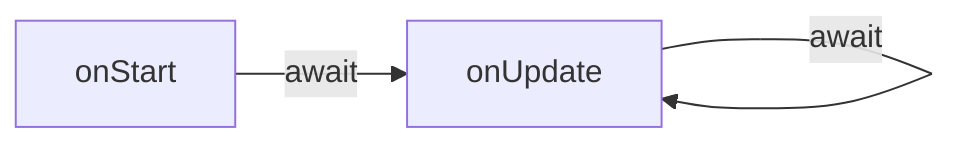

# 실행

런타임은 [씬을](/docs/contributor/contributor-ko/content/entity-types/scenes/) 일반적인 Node 모듈처럼 취급합니다. 샌드박스가 설정되면(즉, 모든 [전역이](/docs/contributor/contributor-ko/scene-runtime/globals/) 주입되고 [모듈이](https://github.com/decentraland/docs/tree/main/contributor/runtime/modules/README.md) 로드할 준비가 되면), 씬의 코드는 평가되어 [exports](/docs/contributor/contributor-ko/scene-runtime/globals/#module) 객체를 채울 수 있습니다.

호스트는 다음에서 두 메서드를 가져옵니다: `exports`: [`onStart`](#onstart) (선택 사항) 및 [`onUpdate`](#onupdate) (필수).

```ts
type Exports = {
  onStart?: () => Promise<void>;
  onUpdate: (deltaSeconds: number) => Promise<void>;
};
```

씬의 라이프사이클 동안 런타임은 이 메서드들에 대한 호출이 동시에 이루어지지 않도록 보장합니다. 반환된 `Promise` 는 씬이 새 호출을 받기 전에 항상 await됩니다.




> [!NOTE]
> 개별 씬과 게임 렌더링 엔진 사이의 효과적이고 성능 좋은 동기화는 복잡한 문제입니다. Foundation의 구현에서 얻을 수 있는 교훈은 [ADR-148](https://adr.decentraland.org/adr/ADR-148).


#### `onStart` <a href="#onstart" id="onstart"></a>

씬의 라이프사이클은 비동기 `onStart` 메서드로 시작합니다. 첫 번째 호출이 이루어지기 전에 완료되어야 하는 일회성 초기화를 수행하는 자리입니다. [`onUpdate`](#onupdate) 가 이루어지기 전에.

```ts
onStart(): Promise<void>
```

씬은 이 호출을 사용해 런타임에서 기존 상태(예:  [기본 엔티티](/docs/contributor/contributor-ko/scene-runtime/basic-entities/))를 요청하고 자체 초기 설정을 수행해야 합니다.

내보내기는 `onStart` 모든 씬에 권장되며(SDK를 사용할 때는 자동으로 수행됩니다), 프로토콜상 필수는 아닙니다. 이 메서드는 없을 수도 있고, 즉시 resolve되는 `Promise`.

#### `onUpdate` <a href="#onupdate" id="onupdate"></a>

씬이 सक्रिय 실행 중인 동안, 비동기 `onUpdate` 메서드는 시간의 경과를 알리기 위해 런타임에 의해 주기적으로 호출됩니다. 이것이 씬의 핵심입니다. 각 연속 호출마다 엔티티를 업데이트하고, 입력을 처리하고, 애니메이션을 재생하고, 메시지를 보내고, UI를 표시하는 등의 작업을 할 수 있습니다.

```ts
onUpdate(deltaSeconds: number): Promise<void>
```

그 `deltaSeconds` 매개변수는 마지막 호출 이후 경과한 초의 소수값입니다 `onUpdate` 가 런타임에 의해 시작되었을 때의 값입니다(반환된 `Promise` 가 언제 해결되었는지와는 무관합니다). 이는 실행 중인 각 씬에 고유합니다.

따라서 `onUpdate` 호출이 절대 겹치지 않으므로, 다음의 순서는 `deltaSeconds` 일관된 타임라인을 만들어냅니다.

이상적인 상황에서는 씬이 실행될 기회를 `onUpdate` 각 프레임이 렌더링되기 전에 얻게 됩니다. 그러나 사용 가능한 리소스에 따라, 무거운 작업을 수행하는 씬은 다음 프레임까지 자신의 `Promise` Promise를 제때 해결하지 못할 수 있습니다. 이 점에서 각 씬은 독립적입니다. 가벼운 구현의 `onUpdate` 는 다른 씬의 한 번의 시간 소모적인 호출과 같은 기간 동안 여러 번 호출될 수 있습니다.

자세한 내용은 [ADR-148](https://adr.decentraland.org/adr/ADR-148) 를 참조하세요.

### 여러 씬 실행

World Explorer는 여러 개의 샌드박스화된 씬을 실행하는 것을 지원할 뿐만 아니라, 항상 그렇게 하고 있어야 합니다. 그 이유는 두 가지입니다:

첫째, 플레이어가 월드를 탐험할 때 시야는 자신이 서 있는 씬의 지리적 경계를 넘어 확장됩니다. 플레이어가 볼 수 있어야 하는 콘텐츠를 생성하려면 인접한 씬(임의 또는 구성 가능한 거리까지)이 실행 중이어야 합니다.

둘째, 씬은 각자의 서로 겹치지 않는 경계 안에서만 실행되는 것이 아닙니다. 서로의 위에 겹쳐질 수도 있으며, 플레이어 주변 영역에 영향을 주면서도 다른 기능을 제공할 수 있습니다.

특히 두 종류의 씬에 해당합니다: 아바타 씬과 포터블 경험입니다.

#### 아바타 씬 <a href="#avatarscene" id="avatarscene"></a>

플레이어가 월드에 들어서는 순간, 다른 플레이어의 아바타를 렌더링하는 역할을 맡은 전역 씬이 실행되기 시작합니다.

이 씬은 지리적 경계의 제약을 받지 않으며, 플레이어의 위치와 관계없이 자신의 엔티티(및 소통용 UI 위젯)를 표시할 수 있습니다.

#### 포터블 경험

Decentraland에서는 웨어러블이 자체 동작을 가질 수 있으며, 이는 각자의 씬 컨텍스트에서 실행됩니다. 이러한 씬은 플레이어를 중심으로 하며, 엔티티를 추가하거나 UI 위젯을 표시해 경험을 풍부하게 할 수 있습니다.

웨어러블이 장착되면 실행을 시작하고, 제거되면 중지합니다.


---

# Agent Instructions
This documentation is published with GitBook. GitBook is the documentation platform designed so that both humans and AI agents can read, navigate, and reason over technical content effectively. Learn more at gitbook.com.

## Querying This Documentation
If you need additional information that is not directly available in this page, you can query the documentation by asking a question.

Perform an HTTP GET request on the following URL with the `ask` and `goal` query parameters:

```
GET https://docs.decentraland.org/contributor/contributor-ko/scene-runtime/execution.md?ask=<question>&goal=<user_goal>
```

`ask` is the immediate question: it should be specific, self-contained, and written in natural language.
`goal` is what the user is ultimately trying to achieve, the reason they need the answer. Sharing it helps GitBook give you a better, more relevant answer. A goal is most helpful when it describes the outcome the user wants rather than restating the question. For example, with `ask=how do I create an API token`, a goal like `automate deployments from our CI pipeline` lets GitBook tailor the answer to that use case.

The response will contain a direct answer to the question and relevant excerpts and sources from the documentation.

Use this mechanism when the answer is not explicitly present in the current page, you need clarification or additional context, or you want to retrieve related documentation sections.
