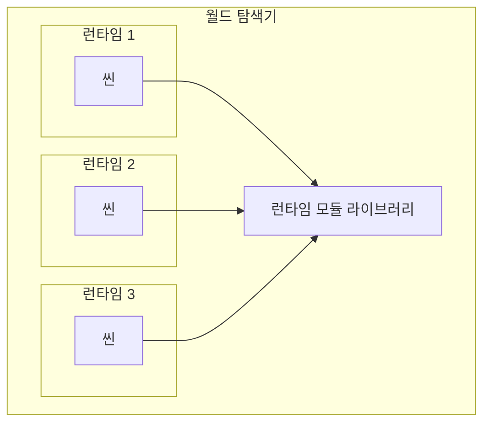

# 개요

Decentraland 씬 런타임은 샌드박스형 실행 환경으로, 여기서 하나의 [씬](/docs/contributor/contributor-ko/content/entity-types/scenes/) 이 메인 스크립트를 실행합니다.

각 씬은 자체적으로 격리된 런타임 안에서 실행됩니다. 그 안에서는 특정 [전역 객체](/docs/contributor/contributor-ko/scene-runtime/globals/) 를 가져오고 [모듈](https://github.com/decentraland/docs/tree/main/contributor/runtime/modules/README.md) 을 런타임 라이브러리에서 가져올 수 있습니다.



런타임 라이브러리에서 모듈을 가져오면 씬은 다음을 포함한 다양한 기능에 접근할 수 있습니다:

* 엔티티를 생성하고 그 동작을 제어합니다
* 플레이어와 상호작용합니다
* 다른 플레이어와 소통합니다
* 월드 상태를 확인합니다
* 외부 서비스에 연결합니다
* web3 결제를 수행합니다

실제로는 씬에 다음이 함께 포함됩니다 [Decentraland SDK](https://github.com/decentraland/docs/tree/main/creator/sdk7/getting-started/sdk-101.md) 자체 코드와 함께 제공되며, 이는 런타임 라이브러리의 RPC 스타일 인터페이스를 캡슐화하고 더 깔끔하고 편리한 API를 제공합니다.


> [!NOTE]
> SDK는 *아니라는* 점에 유의하세요. Decentraland 프로토콜의 일부가 아니라, 더 낮은 수준의 인터페이스만 프로토콜에 포함됩니다. 씬은 SDK를 함께 포함할지 아니면 대체 라이브러리를 사용할지 결정할 수 있습니다.


### 전역 객체

샌드박스 환경 내부에서는, [씬](/docs/contributor/contributor-ko/content/entity-types/scenes/) 특정 객체와 함수가 전역적으로 사용 가능하다고 가정합니다. 일부는 다음과 같은 표준 ES2020 객체입니다( `Date` 또는 `Math`), 그리고 다른 것들은 모듈 불러오기, 메시지 기록, 콜백 예약과 같은 기능을 구현하기 위해 런타임에 의해 주입됩니다.

보 [globals](/docs/contributor/contributor-ko/scene-runtime/globals/) 자세한 내용은.

### 모듈

이 [`require`](/docs/contributor/contributor-ko/scene-runtime/globals/#module) 전역 함수는 다음이 제공하는 모듈을 가져올 수 있습니다 [런타임 라이브러리](/docs/contributor/contributor-ko/scene-runtime/execution/). 이러한 모듈을 통해 ECS나 Communications 시스템 같은 유틸리티를 선택적으로 가져올 수 있습니다.

전체 목록은 런타임 모듈 섹션을 참조하세요.

### 실행

런타임은 씬이 특정 메서드 집합을 구현하도록 요구하며, 정해진 규칙에 따라 호출됨을 보장합니다.

참고 [실행](/docs/contributor/contributor-ko/scene-runtime/execution/) 자세한 내용은.

### 권한

타사 서비스에 HTTP 요청을 보내는 것과 같은 민감한 기능은, 다음에서 특정 권한을 요청하지 않는 한 런타임에 의해 제한됩니다 [씬](/docs/contributor/contributor-ko/content/entity-types/scenes/)그리고 플레이어가 승인합니다.

참고 [권한](/docs/contributor/contributor-ko/scene-runtime/permissions/) 자세한 내용은.


---

# Agent Instructions
This documentation is published with GitBook. GitBook is the documentation platform designed so that both humans and AI agents can read, navigate, and reason over technical content effectively. Learn more at gitbook.com.

## Querying This Documentation
If you need additional information that is not directly available in this page, you can query the documentation by asking a question.

Perform an HTTP GET request on the following URL with the `ask` and `goal` query parameters:

```
GET https://docs.decentraland.org/contributor/contributor-ko/scene-runtime/overview.md?ask=<question>&goal=<user_goal>
```

`ask` is the immediate question: it should be specific, self-contained, and written in natural language.
`goal` is what the user is ultimately trying to achieve, the reason they need the answer. Sharing it helps GitBook give you a better, more relevant answer. A goal is most helpful when it describes the outcome the user wants rather than restating the question. For example, with `ask=how do I create an API token`, a goal like `automate deployments from our CI pipeline` lets GitBook tailor the answer to that use case.

The response will contain a direct answer to the question and relevant excerpts and sources from the documentation.

Use this mechanism when the answer is not explicitly present in the current page, you need clarification or additional context, or you want to retrieve related documentation sections.
