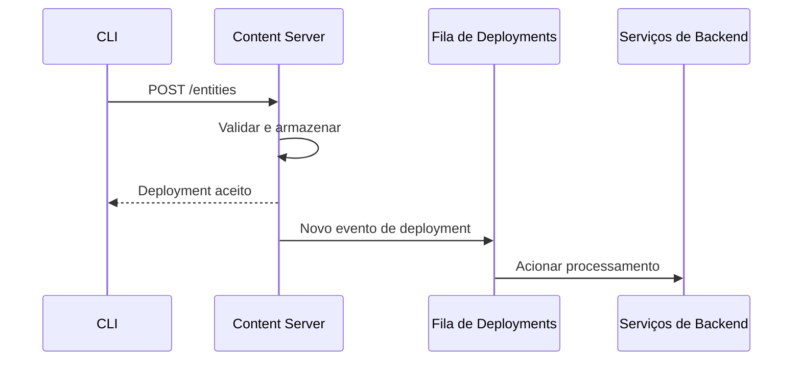
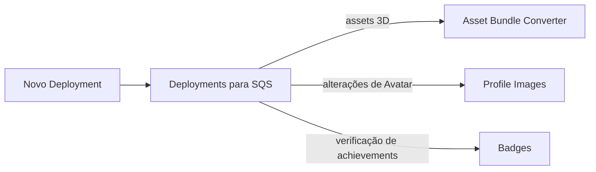
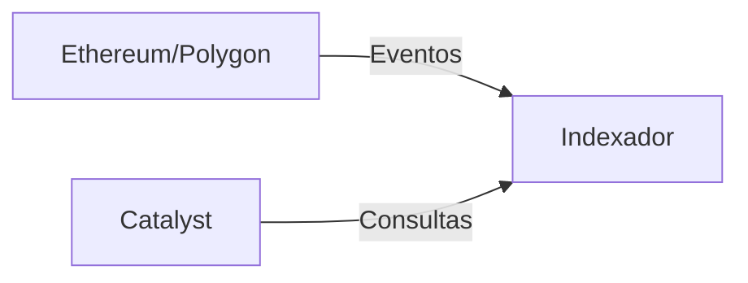

# Rede Catalyst

A rede Catalyst é a infraestrutura descentralizada de distribuição de conteúdo da Decentraland. Vários operadores independentes executam nós Catalyst que armazenam e servem conteúdo.

## Visão geral

A rede Catalyst opera como um sistema distribuído totalmente em malha, onde os nós se comunicam diretamente entre si para sincronizar conteúdo e manter a saúde da rede.


## Componentes do Catalyst

Cada nó Catalyst consiste em:

### Servidor de conteúdo

**Propósito**: armazenamento e recuperação de assets

Armazena e serve:

* Definições de Scene
* Modelos 3D e textures
* Arquivos de Audio
* Scripts
* Avatars e wearables

**Referência da API**: [API do Catalyst](https://github.com/decentraland/docs/tree/main/apis/apis/catalyst/README.md)

### Lambdas

**Propósito**: funções de consulta serverless

Fornece endpoints consultáveis:

* Buscas de Entities
* Consultas de Profile
* Metadados de conteúdo
* Histórico de deployments

As Lambdas executam como serviços separados que consultam o banco de dados do Content Server.

### Nginx

**Propósito**: proxy reverso e balanceamento de carga

Roteia requisições para os serviços apropriados:

* Content Server para uploads
* Lambdas para consultas
* Servir assets estáticos

***

## Deployment de Conteúdo

### Fluxo de Deployment



### Etapas do Deployment

1. **Compilar**: CLI empacota a Scene usando build-ecs
2. **Assinar**: Creator assina o deployment com a wallet
3. **Upload**: CLI faz upload para qualquer nó Catalyst
4. **Validar**: Catalyst valida assinaturas e conteúdo
5. **Armazenar**: Conteúdo salvo no storage
6. **Propagar**: Evento publicado na fila de deployment
7. **Processar**: Serviços de backend processam o novo conteúdo

### Validação de conteúdo

Catalyst valida:

* Assinaturas digitais (prova de propriedade)
* Hashes de conteúdo (integridade)
* Permissões de Parcel (propriedade de LAND)
* Limites de tamanho de arquivo
* Conformidade com a política de conteúdo

***

## Pipeline de Deployments

Quando o conteúdo é implantado, vários sistemas reagem:

### Processamento de Assets



**Serviços acionados**:

* **Asset Bundle Converter** - Cria bundles otimizados
* **Profile Images Producer** - Gera miniaturas de avatar
* **Badges Processor** - Verifica achievements do deployment

### Serviços de escuta

Serviços que monitoram deployments:

* **Worlds** - Para deployments de Worlds
* **Comms Gatekeeper** - Para configuração de voz de Worlds
* **Atlas Server** - Para atualizações do mapa

***

## Replicação de conteúdo

Os nós Catalyst replicam conteúdo para garantir disponibilidade:

### Estratégia de replicação

* **Sincronização ativa**: Os nós sincronizam ativamente novos deployments
* **Baseado em pull**: Os nós buscam conteúdo ausente sob demanda
* **Protocolo Gossip**: Os anúncios de deployment se propagam

### Endereçamento por conteúdo

Todo o conteúdo é endereçado por conteúdo:

* Arquivos identificados por CID de IPFS (Content Identifier)
* Imutável após o deployment
* Desduplicação automática

***

## Archipelago Workers (Comms)

A infraestrutura de comunicações funciona em paralelo ao Catalyst:

### Componentes

#### Conector WebSocket

* Mantém as conexões dos clientes
* Tratamento de protocolo
* Autenticação de conexão

**Referência da API**: [API do Archipelago Workers](https://github.com/decentraland/docs/tree/main/apis/apis/archipelago-workers/README.md)

#### Archipelago Core

* **Formação de ilhas** - Agrupa jogadores próximos
* **Limites de peers** - Impõe o máximo de peers por ilha (normalmente 100)
* **Atualizações de posição** - Transmite as posições dos jogadores
* **Roteamento de mensagens** - Roteia chat e emotes

#### Serviço de estatísticas

* Contagem de usuários ativos por Scene
* Estatísticas de conexão
* Métricas de desempenho

***

## Integração com Blockchain

### Indexador de Subgraph

O Catalyst usa um indexador dedicado:



O **Indexador** indexa:

* propriedade de LAND (NFTs de LAND)
* coleções de Wearables e Emotes
* registros de NAMEs
* transferências de NFTs

***

## Próximos Passos

* Revisar [Serviços de backend](/docs/contributor/contributor-pt/arquitetura/services/) para detalhes do serviço
* Veja [Infraestrutura](/docs/contributor/contributor-pt/arquitetura/infrastructure/) para os sistemas de suporte
* Verifique [Visão Geral da Arquitetura](/docs/contributor/contributor-pt/arquitetura/architecture/) para o panorama completo


---

# Agent Instructions
This documentation is published with GitBook. GitBook is the documentation platform designed so that both humans and AI agents can read, navigate, and reason over technical content effectively. Learn more at gitbook.com.

## Querying This Documentation
If you need additional information that is not directly available in this page, you can query the documentation by asking a question.

Perform an HTTP GET request on the following URL with the `ask` and `goal` query parameters:

```
GET https://docs.decentraland.org/contributor/contributor-pt/arquitetura/catalyst.md?ask=<question>&goal=<user_goal>
```

`ask` is the immediate question: it should be specific, self-contained, and written in natural language.
`goal` is what the user is ultimately trying to achieve, the reason they need the answer. Sharing it helps GitBook give you a better, more relevant answer. A goal is most helpful when it describes the outcome the user wants rather than restating the question. For example, with `ask=how do I create an API token`, a goal like `automate deployments from our CI pipeline` lets GitBook tailor the answer to that use case.

The response will contain a direct answer to the question and relevant excerpts and sources from the documentation.

Use this mechanism when the answer is not explicitly present in the current page, you need clarification or additional context, or you want to retrieve related documentation sections.
