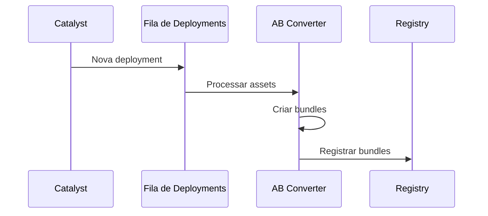
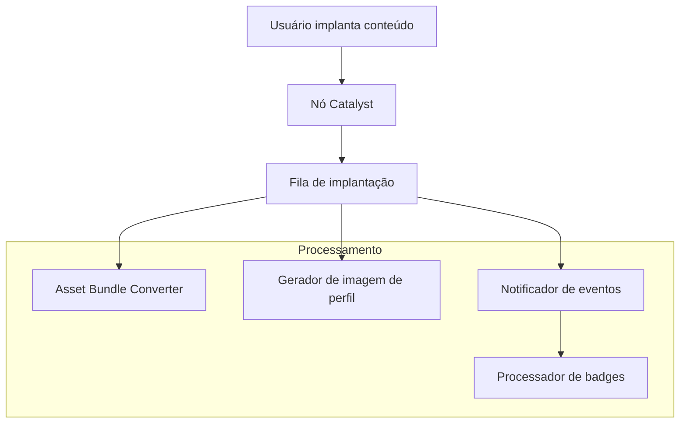

# Serviços de backend

Esta página fornece uma visão geral abrangente de todos os serviços de backend do Decentraland, seus papéis arquiteturais e como eles interagem dentro do ecossistema. Para especificações detalhadas de API e endpoints, consulte o [Referência da API](https://github.com/decentraland/docs/tree/main/apis/README.md) secção.

## Arquitetura de Serviço

O backend do Decentraland é composto por microsserviços distribuídos organizados em camadas lógicas:

* **Camada Descentralizada** - Rede Catalyst e infraestrutura de distribuição de conteúdo
* **Camada de Comunicações em Tempo Real** - Descoberta de serviço e comunicações peer-to-peer
* **Serviços de Funcionalidades** - Funcionalidade voltada ao usuário (conteúdo, economia, gamificação)
* **Serviços Principais** - Infraestrutura essencial da plataforma (autenticação, marketplace, notificações)

***

## Camada Descentralizada

### Catalyst

**Propósito**: Rede de distribuição de conteúdo descentralizada

A rede Catalyst forma a base da infraestrutura de conteúdo do Decentraland. Cada nó Catalyst é um servidor completo que fornece:

* **Servidor de conteúdo** - Armazenamento e recuperação de Entities (scenes, perfis, wearables)
* **Serviço Lambdas** - Endpoints utilitários e consultas de conteúdo
* **Servidor de Comunicações** - Transporte de mensagens em tempo real

**Papel na Arquitetura**: Os nós Catalyst são distribuídos geograficamente e sem permissão. A rede fornece redundância e disponibilidade de conteúdo sem controle central.

**Integrações Principais**:

* Realm Provider - Anuncia a disponibilidade dos nós
* Asset Bundle Registry - Dispara a otimização de assets no deployment
* Archipelago Workers - Fornece dados de islands/clusters

**Referência da API**: [API do Catalyst](https://github.com/decentraland/docs/tree/main/apis/apis/catalyst/README.md)

### Lamb2

**Propósito**: Utilitários Lambda e funções serverless

O Lamb2 fornece endpoints utilitários para consumo de conteúdo e consultas que complementam o Content Server:

* Agregação e filtragem de scenes
* Consultas de profile com fallbacks
* Verificações de status e health

**Papel na Arquitetura**: Atua como uma camada de conveniência sobre o acesso bruto a entities do Content Server, fornecendo padrões de consulta de nível mais alto comumente necessários pelos clients.

**Referência da API**: [Lamb2 API](https://github.com/decentraland/docs/tree/main/apis/apis/lamb2/README.md)

***

## Camada de Comunicações em Tempo Real

### Realm Provider

**Propósito**: Descoberta de serviço e seleção de realm

O Realm Provider é o ponto de entrada para todos os clients do Decentraland. Ele implementa seleção inteligente de realm com base em:

* **Otimização geográfica** - Roteia os users para os nós Catalyst mais próximos
* **Monitoramento de saúde** - Filtra nós com problemas ou sobrecarregados
* **Rastreamento de capacidade** - Fornece contagens de users em tempo real por realm
* **Agregação de hot scenes** - Identifica locais populares em todos os realms

**Papel na Arquitetura**: Fonte única da verdade para a infraestrutura disponível. Os clients o consultam uma vez na inicialização para descobrir todos os endpoints de serviço (Catalyst, Comms, BFF).

**Integrações Principais**:

* Consulta periodicamente todos os nós Catalyst
* Agrega estatísticas do Archipelago
* Fornece uma visão unificada da rede distribuída

**Referência da API**: [Realm Provider API](https://github.com/decentraland/docs/tree/main/apis/apis/realm-provider/README.md)

### Comms Gatekeeper

**Propósito**: Controle de acesso a voice e video

O Gatekeeper gerencia o acesso aos servidores de mídia LiveKit para voice e video chat:

* **Geração de tokens** - Cria tokens de acesso com tempo limitado e permissões específicas
* **Administração de scene** - Gerencia direitos de admin de scene e banimento
* **Gerenciamento de stream** - Controla o acesso a live streaming e as chaves RTMP
* **Controles de privacidade** - Aplica permissões de voice chat privado

**Papel na Arquitetura**: Camada de segurança entre clients e infraestrutura de mídia. Impede acesso não autorizado enquanto permite modelos flexíveis de permissão (baseados em scene, privados, comunitários).

**Integrações Principais**:

* LiveKit - Emite tokens JWT para acesso ao media server
* Worlds API - Valida a propriedade do world para direitos de admin
* Signed Fetch - Autentica todas as requests por meio de assinaturas da wallet

**Referência da API**: [Comms Gatekeeper API](https://github.com/decentraland/docs/tree/main/apis/apis/comms-gatekeeper/README.md)

### Archipelago Workers

**Propósito**: Agrupamento de comunicações e roteamento de mensagens

O Archipelago implementa o protocolo de agrupamento baseado em proximidade que agrupa players próximos em "islands":

* **Transporte WebSocket** - Mantém conexões persistentes com os clients
* **Rastreamento de posição** - Monitora as localizações dos players em tempo real
* **Formação de ilhas** - Agrupa dinamicamente os players com base na distância
* **Roteamento de mensagens** - Encaminha mensagens apenas para members da island

**Componentes da Arquitetura**:

* **Conector WebSocket** - Gerencia conexões de clients e autenticação
* **Archipelago Core** - Implementa o algoritmo de agrupamento e o gerenciamento de islands
* **Serviço de estatísticas** - Fornece métricas de conexão e contagens de users
* **Integração com NATS** - Publica atualizações de posição e roteia mensagens

**Papel na Arquitetura**: Otimiza as comunicações peer-to-peer limitando o fanout das mensagens. Em vez de transmitir para todos os users em um realm, as mensagens alcançam apenas os players dentro do alcance de interação.

**Integrações Principais**:

* NATS message broker - Roteamento distribuído de mensagens
* Realm Provider - Fornece estatísticas de islands
* Places API - Dados de contagem de users para hot scenes

**Referência da API**: [API do Archipelago Workers](https://github.com/decentraland/docs/tree/main/apis/apis/archipelago-workers/README.md)

***

## Serviços de Funcionalidades

### Worlds

**Propósito**: Hospedagem de scenes isoladas fora da grade principal

Os Worlds permitem que os users implantem scenes em ambientes isolados:

* **Worlds nomeados** - Acessíveis por meio de URLs personalizadas (por exemplo, `world.dclworlds.com`)
* **Worlds privados** - Controle de acesso com gate de NFT
* **Permissões de World** - Direitos de admin e deployment gerenciados pelo owner

**Papel na Arquitetura**: Estende o modelo de conteúdo do Decentraland além da grade fixa de LAND. Cada world é uma scene independente com seus próprios canais de comunicação e controle de acesso.

**Integrações Principais**:

* Consulta indexadores de blockchain para verificação de propriedade de NFT
* Publica atualizações de world no NATS para sincronização em tempo real dos clients
* Integra-se ao Comms Gatekeeper para voice chat rooms
* Dispara o pipeline de processamento de assets no deployment

**Referência da API**: [Worlds API](https://github.com/decentraland/docs/tree/main/apis/apis/worlds/README.md)

### Eventos

**Propósito**: Gerenciamento e descoberta de eventos in-world

Gerencia o ciclo de vida completo dos eventos virtuais:

* **CRUD de event** - Criação, atualizações e agendamento
* **Rastreamento de attendees** - Participação dos users e RSVPs
* **Descoberta** - Consultas e filtragem baseadas em tempo
* **Notificações** - Integração com Events Notifier

**Papel na Arquitetura**: Fornece contexto temporal ao metaverse. Events impulsionam a descoberta e o engajamento dos users ao destacar experiências sensíveis ao tempo.

**Referência da API**: [Events API](https://github.com/decentraland/docs/tree/main/apis/apis/events/README.md)

### Places

**Propósito**: Descoberta e curadoria de pontos de interesse

Agrega e faz curadoria de locais interessantes em todo o Decentraland:

* **cenas populares** - Popularidade em tempo real com base na contagem de users
* **Places em destaque** - Locais selecionados editorialmente
* **Busca e filtragem** - Descoberta por tags e categorias
* **Metadados de POI** - Descrições, thumbnails, coordenadas

**Papel na Arquitetura**: Resolve o problema de descoberta em um grande mundo aberto. Agrega dados de múltiplas fontes para ajudar os users a encontrar conteúdo envolvente.

**Integrações Principais**:

* Catalyst - Metadados de scene e informações de deployment
* Archipelago Stats - Contagens de users em tempo real por scene
* Comms Gatekeeper - Disponibilidade e status de realm

**Referência da API**: [Places API](https://github.com/decentraland/docs/tree/main/apis/apis/places/README.md)

### Atlas Server

**Propósito**: Dados do mapa e visualização de parcels

Fornece dados abrangentes do mapa do world:

* **Propriedade de parcels** - Dados de LAND indexados na blockchain
* **Metadados de scene** - Nomes e coordenadas das scenes implantadas
* **Tiles do mapa** - Imagens de tiles pré-renderizadas para exibição na UI
* **Consultas espaciais** - Encontrar parcels por coordenadas ou owner

**Papel na Arquitetura**: Fornece o índice espacial para a grade de LAND do Decentraland. Essencial para UIs de mapa e navegação espacial.

**Referência da API**: [Atlas Server API](https://github.com/decentraland/docs/tree/main/apis/apis/atlas-server/README.md)

### Camera Reel

**Propósito**: Gerenciamento de screenshots geradas pelos users

Gerencia screenshots e imagens dos users:

* **Uploads de imagens** - Armazenamento autenticado de imagens
* **Organização da galeria** - Coleções de screenshots dos users
* **Metadados** - Localização da scene, timestamp, tags

**Papel na Arquitetura**: Permite o compartilhamento de conteúdo e recursos sociais em torno de fotografia gerada pelos users.

**Referência da API**: [Camera Reel API](https://github.com/decentraland/docs/tree/main/apis/apis/camera-reel/README.md)

### Exploration Games

**Propósito**: Gamificação de onboarding e tutoriais

Sistema de quests interativas para onboarding de novos users:

* **Rastreamento de quests** - Progresso nas missões do tutorial
* **Conclusão de desafios** - Verificação de tarefas
* **Integração de recompensas** - Conecta-se ao sistema de recompensas

**Papel na Arquitetura**: Reduz a fricção para novos users ao fornecer uma introdução estruturada e orientada a objetivos aos recursos do Decentraland.

**Referência da API**: [Exploration Games API](https://github.com/decentraland/docs/tree/main/apis/apis/exploration-games/README.md)

***

## Serviços Principais

### Servidor de autenticação

**Propósito**: Autenticação baseada em wallet e gerenciamento de sessão

Implementa o modelo de autenticação wallet-first do Decentraland:

* **Verificação de assinatura** - Valida assinaturas da wallet Ethereum
* **Emissão de token JWT** - Gera session tokens
* **Validação de token** - Verifica tokens para recursos protegidos
* **Ciclo de vida da sessão** - Atualização e expiração de token

**Papel na Arquitetura**: Fornece verificação descentralizada de identidade. Os users autenticam-se por meio de assinaturas da wallet em vez de senhas, alinhando-se aos princípios da Web3.

**Fluxo de Autenticação**:

1. Client solicita desafio
2. User assina o desafio com a wallet
3. Auth Server verifica a assinatura e emite JWT
4. Client inclui o JWT em requests subsequentes de API

**Referência da API**: [Auth Server API](https://github.com/decentraland/docs/tree/main/apis/apis/auth-server/README.md)

### Serviço social

**Propósito**: Grafo social e gerenciamento de comunidade

Gerencia relações sociais e comunidades:

* **Sistema de friends** - Requests, aprovações, listas de friends
* **Lista de bloqueio** - Bloqueio de users e privacidade
* **Communities** - Filiação a grupos e descoberta
* **Status em tempo real** - Notificações de friends online/offline via NATS
* **Mensagens privadas** - Infraestrutura de mensagens diretas

**Papel na Arquitetura**: Fornece a camada social que transforma o Decentraland de um mundo virtual em um metaverse social.

**Integrações Principais**:

* Catalyst Client - Busca dados de profile para friends
* NATS - Publica atualizações de status de friends
* Archipelago - Consulta status online e localizações

**Referência da API**: [Social Service API](https://github.com/decentraland/docs/tree/main/apis/apis/social-service/README.md)

### Marketplace Server

**Propósito**: Integração com o marketplace de NFT

Backend do marketplace de wearables e emotes do Decentraland:

* **Consultas de listings** - Navegar e buscar itens do marketplace
* **Histórico de transações** - Registros de compra
* **Dados de preços** - Preços de mercado e tendências
* **Metadados da coleção** - Coleções de wearables e emotes

**Papel na Arquitetura**: Conecta dados de NFT on-chain com uma UI de marketplace amigável. Indexa eventos de blockchain para consultas rápidas.

**Referência da API**: [Marketplace Server API](https://github.com/decentraland/docs/tree/main/apis/apis/marketplace-server/README.md)

***

## Serviços de Assets

### Registo de Asset Bundle

**Propósito**: Gerenciamento otimizado de assets

Registro de asset bundles otimizados para a plataforma:

* URLs de asset bundles por plataforma
* Versionamento
* Distribuição via CDN

**Referência da API**: [Asset Bundle Registry API](https://github.com/decentraland/docs/tree/main/apis/apis/asset-bundle-registry/README.md)

**Componentes do Sistema**:

* **Asset Bundle Converter** - Cria bundles específicos da plataforma
* **Gerador de LODs** - Cria variantes de nível de detalhe

**Fluxo do Processo**:



### Camera Reel

**Propósito**: Gerenciamento de screenshots e imagens

Gerenciamento de conteúdo gerado pelos users:

* Armazenamento de screenshots
* Uploads de imagens
* Organização da galeria

**Referência da API**: [Camera Reel API](https://github.com/decentraland/docs/tree/main/apis/apis/camera-reel/README.md)

### Credits Server

**Propósito**: Moeda virtual e economia

Gerencia o sistema de créditos virtuais do Decentraland:

* **Rastreamento de saldo** - Saldos de créditos dos users
* **Livro-razão de transações** - Transferências e gastos de créditos
* **Integração de compras** - Conversão de fiat para credits
* **Sincronização com blockchain** - Consulta indexadores para saldos on-chain

**Papel na Arquitetura**: Fornece uma alternativa de moeda com menor fricção aos tokens de blockchain para compras e recursos in-world.

**Referência da API**: [Credits Server API](https://github.com/decentraland/docs/tree/main/apis/apis/credits-server/README.md)

### Badges

**Propósito**: Sistema de achievements e gamificação

Distribuição de badges orientada por events:

* **Definições de badges** - Achievements disponíveis
* **Inventário do user** - Badges conquistados por user
* **Concessão automática** - Distribuição de badges acionada por events

**Componentes da Arquitetura**:

* **Badges API** - Consultas de badges e inventários de users
* **Badges Processor** - Escuta o Events Notifier e concede badges

**Papel na Arquitetura**: Gamifica o engajamento dos users por meio de achievements. Fornece visibilidade e reconhecimento para as atividades dos users.

**Referência da API**: [Badges API](https://github.com/decentraland/docs/tree/main/apis/apis/badges/README.md)

### API de recompensas

**Propósito**: Distribuição de recompensas NFT baseada em campanhas

Gerencia campanhas promocionais de recompensas NFT:

* **Gerenciamento de campanhas** - Programas de recompensas com tempo limitado
* **Verificação de elegibilidade** - Verificar qualificação do user
* **Coordenação de airdrop** - Distribuição de NFT para users elegíveis
* **Analytics** - Rastreamento de participação na campanha

**Papel na Arquitetura**: Permite campanhas de marketing e aquisição de users por meio de recompensas NFT.

**Referência da API**: [API de recompensas](https://github.com/decentraland/docs/tree/main/apis/apis/rewards/README.md)

### Workers de Notificações

**Propósito**: Sistema de entrega de notificações aos users

Infraestrutura de notificações multicanal:

* **Notificações no app** - Consultas da inbox de notificações
* **Notificações por email** - Integração com SendGrid
* **Notificações push** - Alertas para mobile e desktop
* **Rastreamento de status de leitura** - Marcar notificações como lidas/não lidas

**Componentes da Arquitetura**:

* **Inbox de Notificações** - API para consultar notificações dos users
* **Processor de Notificações** - Gera notificações a partir do Events Notifier

**Papel na Arquitetura**: Mantém os users engajados por meio de alertas oportunos sobre atividade de friends, events, recompensas e atualizações do sistema.

**Referência da API**: [Notifications Workers API](https://github.com/decentraland/docs/tree/main/apis/apis/notifications-workers/README.md)

### Events Notifier

**Propósito**: Barramento de events para events da plataforma

Sistema centralizado de publicação de events que dispara ações downstream:

* **Events de user** - Login, compras, implantações
* **Eventos de World** - Atualizações de scene, ações de admin
* **Events do sistema** - Manutenção, atualizações

**Papel na Arquitetura**: Desacopla os produtores de events dos consumidores. Os services publicam events sem saber quem os processa, possibilitando arquiteturas extensíveis.

**Integrações downstream**:

* Notifications Processor - Cria notificações de users
* Badges Processor - Concede badges de achievements
* Rewards API - Rastreia elegibilidade da campanha

**Referência da API**: [Events Notifier API](https://github.com/decentraland/docs/tree/main/apis/apis/events-notifier/README.md)

***

## Padrões de Interação entre Serviços

### Padrões Comuns de Integração

#### Biblioteca Catalyst Client

Muitos serviços de backend usam a **Catalyst Client** biblioteca para interagir com a rede Catalyst descentralizada:

* **Serviço social** - Busca dados de profile dos users
* **Events API** - Consulta metadados de scene
* **Places** - Agrega informações de scene
* **Registo de Asset Bundle** - Escuta eventos de implantação

Esta biblioteca abstrai a lógica de consulta a múltiplos nós e de failover.

#### NATS Message Broker

Atualizações em tempo real e fluxo de comunicação assíncrono passam pelo NATS:

* **Serviço social** - Publica alterações de status de amigos
* **Worlds** - Transmite atualizações de configuração do mundo
* **Archipelago** - Roteia atualizações de posição entre ilhas
* **Events Notifier** - Publica eventos da plataforma

O NATS permite que os serviços se comuniquem sem acoplamento direto.

#### Indexadores de blockchain

Os serviços consultam indexers (não diretamente a blockchain) para desempenho:

* **Worlds** - Verifica a propriedade do NFT de NAME
* **Atlas** - Obtém dados de parcel do LAND
* **Credits Server** - Verifica saldos de tokens
* **API de recompensas** - Verifica condições de elegibilidade

Consultas diretas à blockchain seriam lentas demais para APIs em tempo real.

### Pipeline de Implantação de Conteúdo

Quando um usuário implanta conteúdo no Catalyst, vários serviços downstream o processam:



**Etapas do Pipeline**:

1. **Catalyst** - Armazena dados brutos da entidade
2. **Fila de Implantação** - Aciona processamento assíncrono
3. **Asset Bundle Converter** - Constrói bundles otimizados do Unity
4. **Gerador de imagem de perfil** - Renderiza miniaturas do avatar (para entidades de perfil)
5. **Events Notifier** - Publica evento de implantação
6. **Badges Processor** - Verifica badges de conquista de implantação

### Matriz de Dependência dos Serviços

| Serviço                  | Dependências Principais             | Fornece Dados Para                |
| ------------------------ | ----------------------------------- | --------------------------------- |
| Catalyst                 | Nenhum (descentralizado)            | Todos os serviços                 |
| Realm Provider           | Catalyst, Archipelago Stats         | Todos os clientes                 |
| Servidor de autenticação | Nenhum                              | Todos os serviços protegidos      |
| Archipelago Workers      | NATS, LiveKit                       | Realm Provider, Places            |
| Comms Gatekeeper         | LiveKit, Worlds API                 | Clientes (geração de tokens)      |
| Worlds                   | Catalyst, NATS, Blockchain          | Gatekeeper, Clientes              |
| Serviço social           | Catalyst, NATS, Archipelago         | Clients                           |
| Places                   | Catalyst, Archipelago, Comunicações | Clients                           |
| Events Notifier          | Nenhum                              | Notificações, Badges, Recompensas |
| Registo de Asset Bundle  | Catalyst, Fila de Implantação       | Clientes (ativos otimizados)      |
| Workers de Notificações  | Events Notifier, SendGrid           | Clients                           |

***

## Documentação Relacionada

### Arquitetura

* [Visão Geral da Arquitetura](/docs/contributor/contributor-pt/arquitetura/architecture/) - Arquitetura completa do sistema
* [Catalyst Network](/docs/contributor/contributor-pt/arquitetura/catalyst/) - Entrega descentralizada de conteúdo
* [Infraestrutura](/docs/contributor/contributor-pt/arquitetura/infrastructure/) - Sistemas de suporte (NATS, LiveKit, bases de dados)

### Referências da API

* [Documentação da API](https://github.com/decentraland/docs/tree/main/apis/README.md) - Especificações completas da API
* [Autenticação](/docs/contributor/contributor-pt/autenticacao/authchain/) - Fluxos de autenticação baseados em Wallet
* [Comunicações](/docs/contributor/contributor-pt/comunicacoes/overview/) - Protocolos de mensagens em tempo real

### Desenvolvimento

* [Guias do Contribuinte](/docs/contributor/contributor-pt/guias-para-colaboradores/contributor-guides/) - Fluxos de trabalho de desenvolvimento
* [Guia de Testes](/docs/contributor/contributor-pt/guias-para-colaboradores/testing-standards/testing-services-wkc/) - Práticas de teste de serviços


---

# Agent Instructions
This documentation is published with GitBook. GitBook is the documentation platform designed so that both humans and AI agents can read, navigate, and reason over technical content effectively. Learn more at gitbook.com.

## Querying This Documentation
If you need additional information that is not directly available in this page, you can query the documentation by asking a question.

Perform an HTTP GET request on the following URL with the `ask` and `goal` query parameters:

```
GET https://docs.decentraland.org/contributor/contributor-pt/arquitetura/services.md?ask=<question>&goal=<user_goal>
```

`ask` is the immediate question: it should be specific, self-contained, and written in natural language.
`goal` is what the user is ultimately trying to achieve, the reason they need the answer. Sharing it helps GitBook give you a better, more relevant answer. A goal is most helpful when it describes the outcome the user wants rather than restating the question. For example, with `ask=how do I create an API token`, a goal like `automate deployments from our CI pipeline` lets GitBook tailor the answer to that use case.

The response will contain a direct answer to the question and relevant excerpts and sources from the documentation.

Use this mechanism when the answer is not explicitly present in the current page, you need clarification or additional context, or you want to retrieve related documentation sections.
