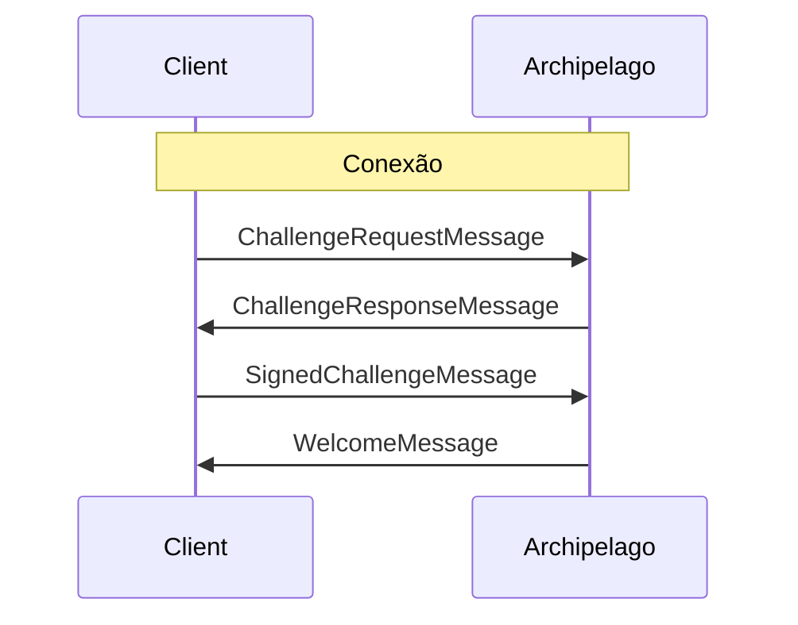

# Archipelago

Archipelago é o serviço de realm que agrupa jogadores próximos em ilhas, reatribuindo-os à medida que se movem e fornecendo as informações necessárias para se conectar ao backend real que retransmitirá suas mensagens.


> [!NOTE]
> Você pode ver o protocolo Archipelago em ação e experimentá-lo usando o open-source [Comms Station](https://decentraland.github.io/comms-station/).


Para usar o serviço, os clientes devem se conectar ao endpoint WebSocket do Archipelago do seu realm e autenticar-se para iniciar a sessão. Depois, podem começar a enviar atualizações de posição e receber atribuições de ilha (veja o [ciclo de vida do cliente](/docs/contributor/contributor-pt/comunicacoes/overview/#lifecycle)).

Todas as mensagens trocadas com o serviço Archipelago são codificadas usando protocol buffers, conforme definido no Decentraland [repositório de protocolos](https://github.com/decentraland/protocol).

### Conectando <a href="#connecting" id="connecting"></a>

Para começar, os clientes devem abrir uma conexão WebSocket segura (`wss:`) para o `/archipelago/ws` endpoint do realm.

Uma vez conectados, os clientes têm uma janela de tempo definida pela política do realm (60 segundos, por padrão) para enviar cada mensagem do fluxo de [autenticação](#authenticating) .


> [!WARNING]
> Embora os realms maiores executem o serviço Archipelago, os menores podem optar por fornecer uma string de conexão de backend fixa para todos os jogadores. A URI, se presente, pode ser encontrada na `comms.fixedAdapter` propriedade do `/about`.


Nesses casos, a atribuição dinâmica de ilhas não estará disponível, e a interface RPC do realm não deve ser usada para esse propósito.

### Autenticando <a href="#authenticating" id="authenticating"></a>

Depois de abrir uma conexão com Archipelago, os clientes devem começar solicitando e assinando um desafio do serviço para verificar sua identidade.

A primeira mensagem que um cliente envia é uma [`ChallengeRequestMessage`](#challengerequestmessage) com seu endereço Ethereum (ou seja, sua chave pública). Eles receberão uma [`ChallengeResponseMessage`](#challengeresponsemessage) com uma string gerada aleatoriamente para assinar e devem responder com uma [`SignedChallengeMessage`](#signedchallengemessage).

O [`SignedChallengeMessage`](#signedchallengemessage) carrega uma [cadeia de autenticação](/docs/contributor/contributor-pt/autenticacao/authchain/) serializada em JSON que começa com o endereço fornecido e termina com a assinatura do desafio.

Se a assinatura for verificada com sucesso pelo serviço, o cliente será autenticado e receberá uma [`WelcomeMessage`](#welcomemessage).



### Enviando Heartbeat <a href="#heartbeat" id="heartbeat"></a>

Durante a sessão, os clientes devem enviar periodicamente uma [`Heartbeat`](#heartbeat-message) mensagem para manter o Archipelago atualizado com as informações necessárias para emitir atribuições de ilha.


> [!NOTE]
> A frequência de Heartbeat recomendada para clientes de comms é de cerca de uma atualização por segundo.


Se um cliente parar de enviar [`Heartbeat`](#heartbeat-message) mensagens, Archipelago (dependendo de sua política atual) poderá fechar a conexão.

### Obtendo Atribuições de Ilha <a href="#assignment" id="assignment"></a>

Pouco depois do primeiro Heartbeat, Archipelago enviará ao cliente sua primeira [`IslandChangedMessage`](https://github.com/decentraland/protocol/blob/9a568b16b2eafb134177329ba670c1451be8a169/proto/decentraland/kernel/comms/v3/archipelago.proto#L17).

O campo principal é `conn_str`, que pode ser usado para inicializar um transporte e se conectar à ilha. Os valores geralmente se parecem com isto:

```
livekit:wss://comms.example.com?access_token=eyJhbGciOiJI...
```

O rótulo antes do primeiro `:` é o tipo de transporte, o restante é uma URI especializada para ele. Ela pode incluir tokens pré-autorizados ou outros parâmetros.

Durante a sessão, Archipelago pode enviar uma nova atribuição a qualquer momento, por vários motivos:

1. Mudanças de posição: o cliente relatou ter se afastado dos outros na ilha.
2. Solicitações de ilha: o cliente solicitou ser atribuído a uma ilha específica.
3. Política do Archipelago: o serviço decidiu criar ou dividir ilhas para equilibrar melhor a população.

Os clientes devem ouvir por essas atribuições, fechando e abrindo conexões de transporte conforme indicado, e alterando o tipo de transporte em uso quando necessário.

### Mensagens do cliente

#### `ChallengeRequestMessage` [↗ source](https://github.com/decentraland/protocol/blob/9a568b16b2eafb134177329ba670c1451be8a169/proto/decentraland/kernel/comms/v3/archipelago.proto#L54) <a href="#challengerequestmessage" id="challengerequestmessage"></a>

Enviada pelo cliente como a primeira mensagem de uma sessão, para iniciar o fluxo de autenticação.

| Campo     | Tipo     | Valor                  |
| --------- | -------- | ---------------------- |
| `address` | `string` | O endereço do usuário. |

O `address` O campo deve ser derivado da primeira chave privada do [cadeia de autenticação](/docs/contributor/contributor-pt/autenticacao/authchain/) que será apresentada.

***

#### `SignedChallengeMessage` [↗ source](https://github.com/decentraland/protocol/blob/9a568b16b2eafb134177329ba670c1451be8a169/proto/decentraland/kernel/comms/v3/archipelago.proto#L58) <a href="#signedchallengemessage" id="signedchallengemessage"></a>

Enviada pelo cliente depois de receber uma [`ChallengeResponseMessage`](#challengeresponsemessage), para concluir o fluxo de autenticação.

| Campo             | Tipo     | Valor                                                                                                                                            |
| ----------------- | -------- | ------------------------------------------------------------------------------------------------------------------------------------------------ |
| `auth_chain_json` | `string` | Uma serialização em JSON [cadeia de autenticação](/docs/contributor/contributor-pt/autenticacao/authchain/) terminando com a assinatura do desafio. |

A primeira chave em [cadeia de autenticação](/docs/contributor/contributor-pt/autenticacao/authchain/) deve corresponder ao endereço enviado no original [`ChallengeRequestMessage`](#challengerequestmessage).

***

#### `Heartbeat` [↗ source](https://github.com/decentraland/protocol/blob/9a568b16b2eafb134177329ba670c1451be8a169/proto/decentraland/kernel/comms/v3/archipelago.proto#L62) <a href="#heartbeat-message" id="heartbeat-message"></a>

Enviada pelo cliente em intervalos regulares (normalmente uma vez por segundo), para atualizar o Archipelago sobre sua posição e/ou solicitar uma atribuição de ilha.

| Campo          | Tipo      | Valor                                                       |
| -------------- | --------- | ----------------------------------------------------------- |
| `posição`      | `Posição` | A posição 3D do cliente no mapa do mundo                    |
| `desired_room` | `string?` | O ID de uma ilha à qual o cliente gostaria de ser atribuído |

A primeira `Heartbeat` mensagem que um cliente envia é rapidamente seguida por uma [`IslandChangedMessage`](#islandchangedmessage) do Archipelago. No entanto, atualizações subsequentes são independentes das atribuições de ilha. Os clientes não devem esperar uma `Heartbeat` para ser respondida.

Quando o `desired_room` parâmetro é incluído, o serviço tentará atender à solicitação, mas uma reatribuição para essa ilha não é garantida. Isso depende da política do Archipelago (por exemplo, limites na população da ilha).

### Mensagens do Servidor

#### `ChallengeResponseMessage` [↗ source](https://github.com/decentraland/protocol/blob/9a568b16b2eafb134177329ba670c1451be8a169/proto/decentraland/kernel/comms/v3/archipelago.proto#L8) <a href="#challengeresponsemessage" id="challengeresponsemessage"></a>

Enviada por Archipelago em resposta a uma [`ChallengeRequestMessage`](#challengerequestmessage)

| Campo               | Tipo     | Valor                                                                                                                      |
| ------------------- | -------- | -------------------------------------------------------------------------------------------------------------------------- |
| `challenge_to_sign` | `string` | Uma string gerada para assinar e criar uma [cadeia de autenticação](/docs/contributor/contributor-pt/autenticacao/authchain/) |
| `already_connected` | `bool`   | Se uma conexão existente para a chave deste usuário                                                                        |

***

#### `WelcomeMessage` [↗ source](https://github.com/decentraland/protocol/blob/9a568b16b2eafb134177329ba670c1451be8a169/proto/decentraland/kernel/comms/v3/archipelago.proto#L13) <a href="#welcomemessage" id="welcomemessage"></a>

Enviada por Archipelago após autenticação bem-sucedida.

| Campo     | Tipo     | Valor                                                                        |
| --------- | -------- | ---------------------------------------------------------------------------- |
| `peer_id` | `string` | Um identificador único para o cliente autenticado (normalmente seu endereço) |

***

#### `IslandChangedMessage` [↗ source](https://github.com/decentraland/protocol/blob/9a568b16b2eafb134177329ba670c1451be8a169/proto/decentraland/kernel/comms/v3/archipelago.proto#L17) <a href="#islandchangedmessage" id="islandchangedmessage"></a>

Enviada por Archipelago quando o cliente é atribuído/reatribuído a uma ilha.

Descrição.

| Campo            | Tipo                    | Valor                                                                                                |
| ---------------- | ----------------------- | ---------------------------------------------------------------------------------------------------- |
| `island_id`      | `string`                | O ID da nova ilha                                                                                    |
| `from_island_id` | `string?`               | O ID da ilha antiga, se esta for uma reatribuição                                                    |
| `conn_str`       | `string`                | A string de conexão para a ilha [transport](/docs/contributor/contributor-pt/comunicacoes/transports/). |
| `peers`          | `map<string, Position>` | Descrição.                                                                                           |

Os clientes que recebem uma `IslandChangedMessage` devem encerrar sua conexão com o backend da ilha e conectar-se à fornecida em `conn_str`.

O `peers` campo contém as identidades e posições atuais de todos os peers na ilha, para que os clientes possam preencher seu conjunto inicial. Depois disso, devem confiar nas mensagens recebidas via o [transport](/docs/contributor/contributor-pt/comunicacoes/transports/) da ilha para obter atualizações de posição.

***

#### `KickedMessage` [↗ source](https://github.com/decentraland/protocol/blob/9a568b16b2eafb134177329ba670c1451be8a169/proto/decentraland/kernel/comms/v3/archipelago.proto#LL37C1-L38C1) <a href="#kickedmessage" id="kickedmessage"></a>

Enviada por Archipelago antes de encerrar uma conexão.

| Campo    | Tipo           | Valor                                           |
| -------- | -------------- | ----------------------------------------------- |
| `reason` | `KickedReason` | O motivo do Archipelago para encerrar a conexão |

Os valores padrão para o `reason` campo são:

* `KR_NEW_SESSION`: outra conexão se autenticou com a mesma chave.

***

#### `JoinIslandMessage` [↗ source](https://github.com/decentraland/protocol/blob/9a568b16b2eafb134177329ba670c1451be8a169/proto/decentraland/kernel/comms/v3/archipelago.proto#L29) <a href="#joinislandmessage" id="joinislandmessage"></a>

Enviada por Archipelago quando um peer é atribuído à ilha do cliente.

| Campo       | Tipo     | Valor                                                    |
| ----------- | -------- | -------------------------------------------------------- |
| `island_id` | `string` | O identificador da ilha                                  |
| `peer_id`   | `string` | O identificador único do peer (normalmente seu endereço) |

O `island_id` campo corresponderá à atribuição atual do cliente.

***

#### `LeftIslandMessage` [↗ source](https://github.com/decentraland/protocol/blob/9a568b16b2eafb134177329ba670c1451be8a169/proto/decentraland/kernel/comms/v3/archipelago.proto#L24) <a href="#leftislandmessage" id="leftislandmessage"></a>

Enviada por Archipelago quando um peer é removido da ilha do cliente.

| Campo       | Tipo     | Valor                                                    |
| ----------- | -------- | -------------------------------------------------------- |
| `island_id` | `string` | O identificador da ilha                                  |
| `peer_id`   | `string` | O identificador único do peer (normalmente seu endereço) |

O `island_id` campo corresponderá à atribuição atual do cliente.


---

# Agent Instructions
This documentation is published with GitBook. GitBook is the documentation platform designed so that both humans and AI agents can read, navigate, and reason over technical content effectively. Learn more at gitbook.com.

## Querying This Documentation
If you need additional information that is not directly available in this page, you can query the documentation by asking a question.

Perform an HTTP GET request on the following URL with the `ask` and `goal` query parameters:

```
GET https://docs.decentraland.org/contributor/contributor-pt/comunicacoes/archipelago.md?ask=<question>&goal=<user_goal>
```

`ask` is the immediate question: it should be specific, self-contained, and written in natural language.
`goal` is what the user is ultimately trying to achieve, the reason they need the answer. Sharing it helps GitBook give you a better, more relevant answer. A goal is most helpful when it describes the outcome the user wants rather than restating the question. For example, with `ask=how do I create an API token`, a goal like `automate deployments from our CI pipeline` lets GitBook tailor the answer to that use case.

The response will contain a direct answer to the question and relevant excerpts and sources from the documentation.

Use this mechanism when the answer is not explicitly present in the current page, you need clarification or additional context, or you want to retrieve related documentation sections.
