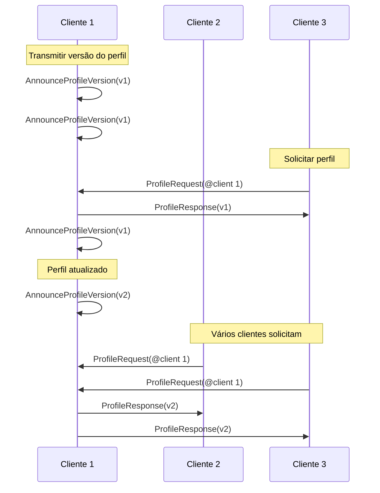

# Mensagens

Mensagens em comms são pacotes de dados binários *pacotes*, serializados usando [protocol buffers](https://github.com/protocolbuffers/protobuf). Elas transportam chat de texto e voz, atualizações de posição, mudanças de perfil e outras interações em tempo real.


> [!NOTE]
> Você pode ver o protocolo de comms em ação e experimentá-lo usando o open-source [Comms Station](https://decentraland.github.io/comms-station/).


Todas as definições de mensagens estão disponíveis no [repositório do protocolo](https://github.com/decentraland/protocol)e cada tipo de mensagem abaixo tem um link para sua declaração.

#### `Pacote` [↗ fonte](https://github.com/decentraland/protocol/blob/c48ea0aa00d8173084571552463a6a05a7f49636/proto/decentraland/kernel/comms/rfc4/comms.proto#L8) <a href="#packet" id="packet"></a>

O `Pacote` estrutura é o contêiner para todas as mensagens.

| Campo     | Tipo   | Valor                                                                                                                                                                                                |
| --------- | ------ | ---------------------------------------------------------------------------------------------------------------------------------------------------------------------------------------------------- |
| `message` | `enum` | <p>Um de <code>Chat</code>, <code>Voice</code>, <code>Position</code>, <code>AnnounceProfileVersion</code>,<br><code>ProfileRequest</code>, <code>ProfileResponse</code>, ou <code>Scene</code>.</p> |

### Chat de Texto e Voz

Os clientes conversam transmitindo mensagens de texto e clipes de áudio para todos os pares conectados (normalmente, jogadores na mesma ilha).

Apenas dois `Pacote` tipos estão envolvidos, um para cada caso de uso. Em circunstâncias normais, os clientes transmitem essas mensagens para todos os outros clientes em sua ilha, que é o grupo de jogadores próximos com os quais podem interagir.

***

#### `Chat` [↗ fonte](https://github.com/decentraland/protocol/blob/c48ea0aa00d8173084571552463a6a05a7f49636/proto/decentraland/kernel/comms/rfc4/comms.proto#L56) <a href="#chat" id="chat"></a>

Envia uma mensagem de chat de texto para outros clientes.

| Campo       | Tipo     | Valor                      |
| ----------- | -------- | -------------------------- |
| `message`   | `string` | Texto da mensagem          |
| `timestamp` | `double` | timestamp UTC do remetente |

***

#### `Voice` [↗ fonte](https://github.com/decentraland/protocol/blob/c48ea0aa00d8173084571552463a6a05a7f49636/proto/decentraland/kernel/comms/rfc4/comms.proto#L66) <a href="#voice" id="voice"></a>

Envia uma amostra de voz codificada para outros clientes.

| Campo             | Tipo     | Valor                                                          |
| ----------------- | -------- | -------------------------------------------------------------- |
| `encoded_samples` | `bytes`  | Dados de áudio codificados                                     |
| `codec`           | `enum`   | Apenas `VC_OPUS` (nenhum outro codec é suportado por enquanto) |
| `index`           | `uint32` | Um contador incremental definido pelo remetente                |

O `codec` field é um `enum` valor. Codecs personalizados não são suportados.

### Movimento

Os clientes que controlam avatares enviam e recebem atualizações de posição dentro de sua ilha, para sincronizar o movimento e a postura entre os jogadores.

***

#### `Position` [↗ fonte](https://github.com/decentraland/protocol/blob/c48ea0aa00d8173084571552463a6a05a7f49636/proto/decentraland/kernel/comms/rfc4/comms.proto#L20) <a href="#position" id="position"></a>

Atualiza outros clientes sobre a posição e a orientação de um avatar.

| Campo                                                                                                               | Tipo     | Valor                                           |
| ------------------------------------------------------------------------------------------------------------------- | -------- | ----------------------------------------------- |
| <p><code>position\_x</code><br><code>position\_y</code><br><code>position\_z</code></p>                             | `float`  | Posição do avatar no mapa do mundo              |
| <p><code>rotation\_x</code><br><code>rotation\_y</code><br><code>rotation\_z</code><br><code>rotation\_w</code></p> | `float`  | Quaternion de rotação do avatar                 |
| `index`                                                                                                             | `uint32` | Um contador incremental definido pelo remetente |

Os clientes normalmente enviam `Position` atualizações com baixa frequência (como uma vez a cada 1 ou 2 segundos) e mudam para alta frequência (várias vezes por segundo) ao se mover ou interagir.


> [!NOTE]
> Ao enviar atualizações de posição, velocidade geralmente é melhor do que confiabilidade. O desempenho percebido é melhor quando a entrega é mais rápida, mesmo que uma `Position` mensagem seja ocasionalmente descartada ou reordenada. Alguns transportes (por exemplo, [LiveKit](/docs/contributor/contributor-pt/comunicacoes/tipos-de-transporte/livekit/)) podem alternar entre os modos rápido e confiável por mensagem.


As transmissões de baixa frequência são recomendadas como uma solução simples para entregar atualizações a clientes que perderam a conectividade momentaneamente ou não conseguiram captar uma mensagem enquanto entravam na ilha.

O `index` field é um contador incremental, definido pelo remetente para que os receptores possam ordenar atualizações que cheguem fora de ordem.

### Compartilhamento de Perfil

Os clientes dentro de uma ilha podem solicitar as informações do avatar de outros jogadores, para renderizar seus avatares, exibir seus nomes e imagens, etc.

Como as mudanças de perfil são raras (em comparação com atualizações de posição, por exemplo), o sistema foi projetado para simplificar a tarefa de manter um cache local de perfis e buscar perfis apenas quando necessário.

São 3 [`Pacote`](#packet) tipos envolvidos: um [`ProfileRequest`](#profilerequest)/[`ProfileResponse`](#profileresponse) par usado pelos clientes para compartilhar perfis sob demanda, e a [`AnnounceProfileVersion`](#announceprofileversion) mensagem para informar aos pares qual é a versão mais recente, para que possam decidir se devem solicitá-la.

Os clientes normalmente transmitem `AnnounceProfileVersion` mensagens periodicamente, além de imediatamente quando seu perfil muda.



***

#### `AnnounceProfileVersion` [↗ fonte](https://github.com/decentraland/protocol/blob/c48ea0aa00d8173084571552463a6a05a7f49636/proto/decentraland/kernel/comms/rfc4/comms.proto#L34) <a href="#announceprofileversion" id="announceprofileversion"></a>

Sinaliza aos outros clientes que há uma [entidade de perfil](/docs/contributor/contributor-pt/conteudo/tipos-de-entity/profiles/) que eles podem solicitar.

| Campo             | Tipo     | Valor                                                |
| ----------------- | -------- | ---------------------------------------------------- |
| `profile_version` | `uint32` | Um número de versão incrementado a cada modificação. |

Os receptores que armazenam perfis em cache podem usar o `profile_version` número para decidir se sua cópia local está atualizada ou se precisam enviar uma [`ProfileRequest`](#profilerequest).

***

#### `ProfileRequest` [↗ fonte](https://github.com/decentraland/protocol/blob/c48ea0aa00d8173084571552463a6a05a7f49636/proto/decentraland/kernel/comms/rfc4/comms.proto#L41) <a href="#profilerequest" id="profilerequest"></a>

Solicita um perfil de uma versão especificada de um par específico.

| Campo             | Tipo     | Valor                               |
| ----------------- | -------- | ----------------------------------- |
| `address`         | string   | O endereço identificador do perfil. |
| `profile_version` | `uint32` | A versão de perfil desejada.        |

Os receptores podem responder com [`ProfileResponse`](#profileresponse) mensagens para fornecer o perfil solicitado.

***

#### `ProfileResponse` [↗ fonte](https://github.com/decentraland/protocol/blob/c48ea0aa00d8173084571552463a6a05a7f49636/proto/decentraland/kernel/comms/rfc4/comms.proto#L46) <a href="#profileresponse" id="profileresponse"></a>

Envia um perfil em resposta a uma [`ProfileRequest`](#profilerequest).

| Campo                | Tipo     | Valor                                                                         |
| -------------------- | -------- | ----------------------------------------------------------------------------- |
| `serialized_profile` | string   | entidade de perfil serializada em JSON.                                       |
| `base_url`           | `uint32` | URL base para um endpoint do sistema de arquivos, recomendada pelo remetente. |

O `serialized_profile` campo contém a serialização JSON de uma [entidade de perfil](/docs/contributor/contributor-pt/conteudo/tipos-de-entity/profiles/).

Se o remetente quiser recomendar um servidor de conteúdo para baixar entidades referenciadas em seu perfil (como wearables), ele pode definir o `base_url` campo como uma dica. Os clientes são livres para usar ou ignorar esta URL.


---

# Agent Instructions
This documentation is published with GitBook. GitBook is the documentation platform designed so that both humans and AI agents can read, navigate, and reason over technical content effectively. Learn more at gitbook.com.

## Querying This Documentation
If you need additional information that is not directly available in this page, you can query the documentation by asking a question.

Perform an HTTP GET request on the following URL with the `ask` and `goal` query parameters:

```
GET https://docs.decentraland.org/contributor/contributor-pt/comunicacoes/messages.md?ask=<question>&goal=<user_goal>
```

`ask` is the immediate question: it should be specific, self-contained, and written in natural language.
`goal` is what the user is ultimately trying to achieve, the reason they need the answer. Sharing it helps GitBook give you a better, more relevant answer. A goal is most helpful when it describes the outcome the user wants rather than restating the question. For example, with `ask=how do I create an API token`, a goal like `automate deployments from our CI pipeline` lets GitBook tailor the answer to that use case.

The response will contain a direct answer to the question and relevant excerpts and sources from the documentation.

Use this mechanism when the answer is not explicitly present in the current page, you need clarification or additional context, or you want to retrieve related documentation sections.
