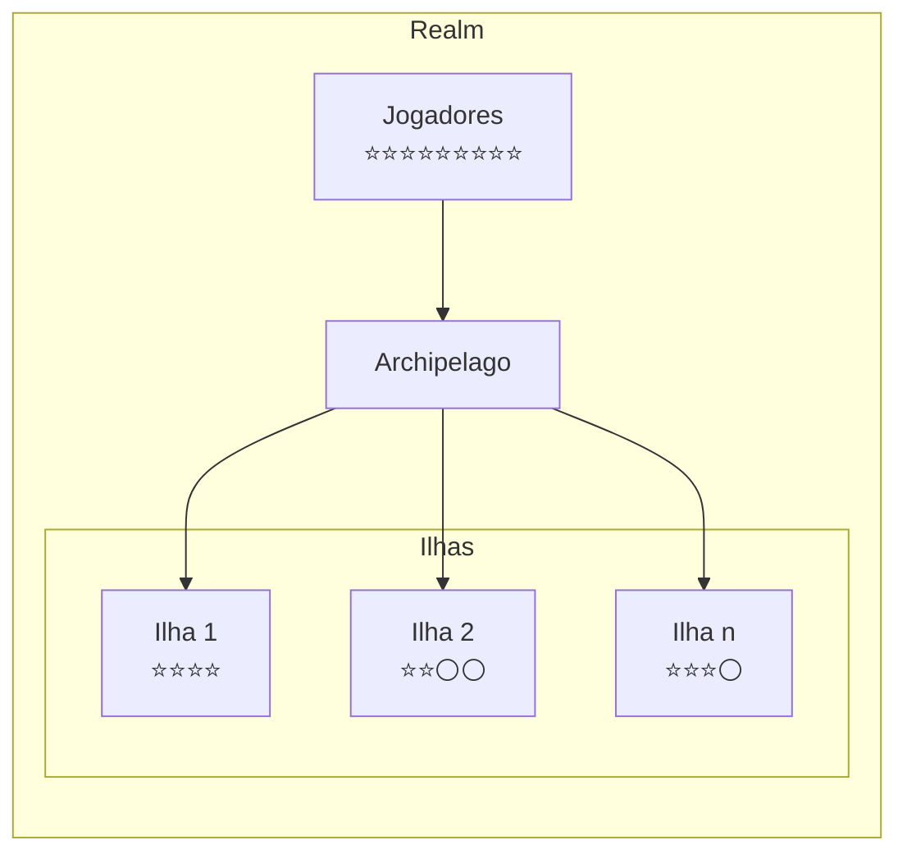
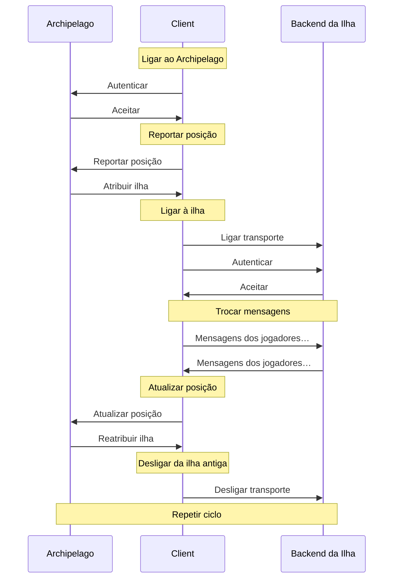

# Visão geral

O sistema de comunicações da Decentraland, ou simplesmente *comms*, é o protocolo de mensagens em tempo real que lida com a interação entre jogadores num realm.

Algumas destas interações são iniciadas pelos jogadores, outras são tratadas automaticamente pelos clientes nos bastidores. Alguns exemplos:

* Chat de texto e voz
* Atualizações de posição à medida que os jogadores se movem
* Atualizações de avatar quando os jogadores mudam a sua aparência


> [!NOTE]
> Pode ver o protocolo comms em ação e experimentá-lo usando o open-source [Comms Station](https://decentraland.github.io/comms-station/).


Como a maior parte desta funcionalidade requer enviar mensagens a todos os jogadores nas proximidades, eles são automaticamente agrupados em clusters baseados na proximidade chamados *ilhas*. Cada jogador é atribuído a uma única ilha de cada vez, o que muda à medida que viajam pelo mundo e se movem em relação aos outros.

O serviço de realm que gere e atribui jogadores a ilhas chama-se *Archipelago*. Ele encarrega-se de criar ilhas conforme são necessárias, manter a sua população num número razoável e reatribuir dinamicamente os jogadores em resposta aos seus movimentos.



Quando são atribuídos a uma ilha, os clientes recebem um URI específico da ilha para se ligarem ao backend real que irá retransmitir mensagens entre eles. Esta ligação dura até que Archipelago reatribua o cliente a uma ilha diferente.

Isto significa que, para além do [Archipelago](/docs/contributor/contributor-pt/comunicacoes/archipelago/) protocolo, os clientes têm de implementar uma série de *transporte*, cada um encapsulando um dos backends suportados numa interface unificada.

### Ciclo de vida do Client <a href="#lifecycle" id="lifecycle"></a>

O ciclo de vida de um cliente comms pode ser resumido em alguns passos:

1. **Selecionar um realm**: obter um URI para o [Archipelago](/docs/contributor/contributor-pt/comunicacoes/archipelago/) serviço.
2. **Entrar no Archipelago**: abrir uma ligação persistente com o serviço.
3. **Obter uma (re)atribuição de ilha**: reportar a posição atual e obter um URI específico da ilha.
4. **Ligar um transporte**: abrir uma segunda ligação ao backend específico da ilha.
5. **Repetir**: continuar a passar pelos passos 3 e 4, reportando periodicamente novas posições.

Quando o cliente termina a sua sessão, basta desligar-se do serviço Archipelago. Será automaticamente removido da sua ilha atual.



### Ligações

As ligações do comms são principalmente baseadas em WebSocket, embora alguns transportes possam usar outras estratégias.

Vá para as [Transportes](/docs/contributor/contributor-pt/comunicacoes/transports/) ou [Archipelago](/docs/contributor/contributor-pt/comunicacoes/archipelago/) secções para saber mais, ou para uma página específica de um transporte para obter detalhes sobre ele.

### Autenticação

As ligações ao comms são autenticadas fazendo com que os clientes assinem um desafio fornecido pelo servidor, usando o esquema descrito na [cadeia de autenticação](/docs/contributor/contributor-pt/autenticacao/authchain/) secção.

Vá até à [Archipelago](/docs/contributor/contributor-pt/comunicacoes/archipelago/) página ou veja um transporte específico para saber mais sobre os fluxos de autenticação.

### Ilhas

As ilhas são grupos de jogadores altamente dinâmicos que podem transmitir mensagens entre si, criados e mantidos por [Archipelago](/docs/contributor/contributor-pt/comunicacoes/archipelago/) em resposta aos seus movimentos no mundo.

Não existe uma área predefinida nem um ponto central para uma ilha. Não são características geográficas estáveis, apenas associações temporárias de jogadores próximos. Se se pode dizer que uma ilha cobre uma região, é apenas porque os seus membros estão atualmente espalhados nessa zona.

Pode haver zero ilhas numa região sem jogadores, e várias ilhas sobrepostas em áreas densamente povoadas, onde atribuir toda a gente ao mesmo grupo tornaria a transmissão em tempo real impossível.

Cada servidor na rede Decentraland pode configurar a população máxima da ilha e a distância a partir da qual os jogadores são considerados próximos. Por predefinição, as ilhas podem albergar até 100 jogadores a até 100 metros uns dos outros.

O fluxo para ser atribuído a uma ilha e juntar-se a ela está detalhado na [Archipelago](/docs/contributor/contributor-pt/comunicacoes/archipelago/) secção.

### Mensagens

As mensagens no protocolo comms são blobs binários serializados usando [protocol buffers](https://github.com/protocolbuffers/protobuf), encapsulados numa [Packet](/docs/contributor/contributor-pt/comunicacoes/messages/#packet) estrutura.


> [!NOTE]
> Ao usar a palavra *message* no contexto de comms, estaremos sempre a referir-nos ao protocolo binário de mensagens, e não às mensagens de chat trocadas entre jogadores.


Existem vários tipos diferentes de mensagens, para uma variedade de fluxos de interação em tempo real. Vá até à [mensagens](/docs/contributor/contributor-pt/comunicacoes/messages/) secção para saber mais.


---

# Agent Instructions
This documentation is published with GitBook. GitBook is the documentation platform designed so that both humans and AI agents can read, navigate, and reason over technical content effectively. Learn more at gitbook.com.

## Querying This Documentation
If you need additional information that is not directly available in this page, you can query the documentation by asking a question.

Perform an HTTP GET request on the following URL with the `ask` and `goal` query parameters:

```
GET https://docs.decentraland.org/contributor/contributor-pt/comunicacoes/overview.md?ask=<question>&goal=<user_goal>
```

`ask` is the immediate question: it should be specific, self-contained, and written in natural language.
`goal` is what the user is ultimately trying to achieve, the reason they need the answer. Sharing it helps GitBook give you a better, more relevant answer. A goal is most helpful when it describes the outcome the user wants rather than restating the question. For example, with `ask=how do I create an API token`, a goal like `automate deployments from our CI pipeline` lets GitBook tailor the answer to that use case.

The response will contain a direct answer to the question and relevant excerpts and sources from the documentation.

Use this mechanism when the answer is not explicitly present in the current page, you need clarification or additional context, or you want to retrieve related documentation sections.
