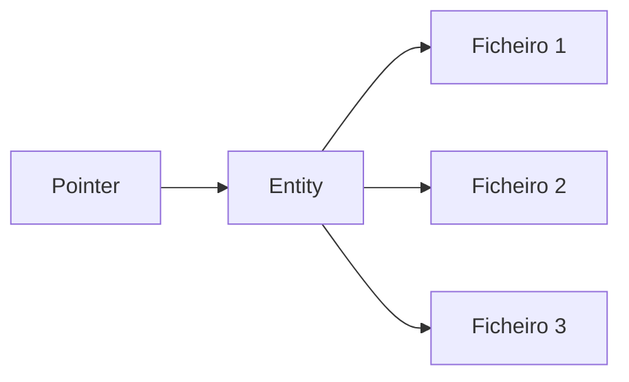

# Visão geral

Tudo o que pode encontrar dentro do mundo virtual de Decentraland está alojado numa rede distribuída de servidores conhecida como Catalysts, que fornece (entre outras coisas) a API de conteúdo. São o meio pelo qual os clients carregam e descarregam conteúdo.

A API completa do Catalyst está disponível em [a sua própria referência](https://decentraland.github.io/catalyst-api-specs/). Aqui, vamos focar-nos em compreender como o conteúdo está organizado e como pode ser descoberto e descarregado.

Todos os conceitos importantes mencionados abaixo são descritos com mais detalhe nas suas próprias páginas.

### Ficheiros, Entities, Pointers

Existem três camadas no sistema de conteúdo da Decentraland: [files](/docs/contributor/contributor-pt/conteudo/file-system/) são empacotados dentro de [entidades](/docs/contributor/contributor-pt/conteudo/entities/), e as entities são descobertas usando [pointers](/docs/contributor/contributor-pt/conteudo/pointers/).



[Ficheiros](/docs/contributor/contributor-pt/conteudo/file-system/) são armazenados num sistema de ficheiros descentralizado semelhante ao IPFS e sincronizados automaticamente entre servidores de conteúdo. São identificados por um ID de string único que é calculado a partir do conteúdo do ficheiro, e tanto o identificador como o conteúdo são **imutáveis**. Não existe tal coisa como atualizar um ficheiro. Em vez disso, são carregados ficheiros de substituição e os ficheiros obsoletos são eliminados.

[Entities](/docs/contributor/contributor-pt/conteudo/entities/) são pacotes atómicos de ficheiros e representam o conteúdo real encontrado no mundo, como scenes e Wearables. Têm pelo menos um ficheiro, chamado *manifest*, com uma descrição geral e metadados. Tal como os ficheiros individuais que contêm, são imutáveis e identificados por uma string única e determinística. Todas as entities têm um proprietário, que possui as chaves privadas necessárias para os gerir.

[Ponteiros](/docs/contributor/contributor-pt/conteudo/pointers/) são referências estáveis que podem ser resolvidas para o ID de uma entity. Quando a entity é substituída (ou seja, o proprietário carrega um novo pacote e o antigo é eliminado), os ficheiros e metadados contidos são diferentes e os seus identificadores também, mas os pointers mantêm-se iguais e são redirecionados para a nova versão.

### Snapshots

Os content servers também alojam ficheiros JSON grandes delimitados por novas linhas com resumos de todas as entities ativas (isto é, aquelas atualmente referenciadas por pointers) num determinado ponto no tempo. Estes são chamados [snapshots](/docs/contributor/contributor-pt/conteudo/snapshots/), e podem ser usados para explorar todo o conteúdo disponível.


---

# Agent Instructions
This documentation is published with GitBook. GitBook is the documentation platform designed so that both humans and AI agents can read, navigate, and reason over technical content effectively. Learn more at gitbook.com.

## Querying This Documentation
If you need additional information that is not directly available in this page, you can query the documentation by asking a question.

Perform an HTTP GET request on the following URL with the `ask` and `goal` query parameters:

```
GET https://docs.decentraland.org/contributor/contributor-pt/conteudo/overview.md?ask=<question>&goal=<user_goal>
```

`ask` is the immediate question: it should be specific, self-contained, and written in natural language.
`goal` is what the user is ultimately trying to achieve, the reason they need the answer. Sharing it helps GitBook give you a better, more relevant answer. A goal is most helpful when it describes the outcome the user wants rather than restating the question. For example, with `ask=how do I create an API token`, a goal like `automate deployments from our CI pipeline` lets GitBook tailor the answer to that use case.

The response will contain a direct answer to the question and relevant excerpts and sources from the documentation.

Use this mechanism when the answer is not explicitly present in the current page, you need clarification or additional context, or you want to retrieve related documentation sections.
