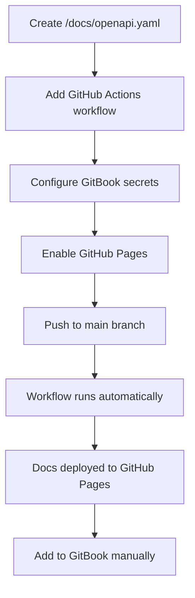
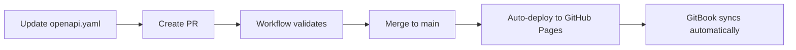

# Documentação da API

Esta página cobre padrões para documentar APIs usando especificações OpenAPI em todos os serviços da Decentraland.

## Objetivos

Nossa abordagem de documentação de API garante:

* **Padronização** - Especificações OpenAPI consistentes em todos os serviços
* **Automação** - Validação, bundle e deploy via GitHub Actions
* **Centralização** - Toda a documentação de serviço publicada por meio do GitBook
* **Propriedade** - A documentação fica no repositório de cada serviço
* **Acessibilidade** - Referências de API fáceis para contribuidores e atualizadas

***

## Estrutura do Repositório

Cada repositório de serviço DEVE incluir um `/docs` diretório com a seguinte estrutura:

```bash
/docs
  openapi.yaml        # Fonte da verdade (OpenAPI 3.1)
  openapi.json        # Gerado automaticamente em CI para Hugo/renderers
  index.html          # Documentação standalone gerada automaticamente (opcional)
```

### Requisitos de Arquivo

#### `openapi.yaml`

* **DEVE** ser o arquivo-fonte canônico
* **DEVE** usar a especificação OpenAPI 3.1
* **PODE** ter um prefixo que identifique o serviço (por exemplo, `worlds-openapi.yaml`)
* **PODE** separar em `components/` ou `examples/` diretórios, se necessário

#### `openapi.json`

* Gerado automaticamente durante CI/CD
* Usado por Hugo e outros renderers
* Não editar manualmente

#### `index.html`

* Documentação standalone gerada automaticamente
* Construído usando Redocly
* Publicado no GitHub Pages

***

## Padrões OpenAPI

Ao escrever `openapi.yaml`, siga estas convenções para garantir consistência e clareza.

### Resumo do Endpoint

**DEVE** deve refletir o caminho real do endpoint:

```yaml
# ✅ Bom: caminho de endpoint claro
paths:
  /world/{world_name}/about:
    get:
      summary: /world/{world_name}/about
      description: Recupera informações sobre um world específico
      
# ❌ Ruim: resumo genérico
paths:
  /world/{world_name}/about:
    get:
      summary: Obter informações do world
```

### Operation ID

**DEVE** deve incluir o nome do serviço para unicidade global:

```yaml
# ✅ Bom: Operation ID com prefixo do serviço
operationId: worldsContentServer_getWorldAbout

# ✅ Bom: outro exemplo
operationId: socialService_getFriends

# ❌ Ruim: genérico, pode conflitar
operationId: getAbout
```

**Convenção de nomenclatura**: `{serviceName}_{operationDescription}`

* Use camelCase
* Seja descritivo, mas conciso
* Inclua o contexto do método HTTP quando for útil (por exemplo, `createUser`, `deleteParcel`)

### Versionamento

**DEVE** use versionamento semântico (`MAJOR.MINOR.PATCH`) em `info.version`:

```yaml
openapi: 3.1.0
info:
  title: Worlds Content Server API
  version: 1.2.0  # Versionamento semântico
  description: API para gerenciar worlds da Decentraland
```

**Regras para aumento de versão**:

* **MAJOR**: Alterações incompatíveis (mudanças incompatíveis na API)
* **MINOR**: Nova funcionalidade (compatível com versões anteriores)
* **PATCH**: Correções de bugs (compatível com versões anteriores)

### Tags e Agrupamento

**DEVE** use tags para agrupar endpoints relacionados:

```yaml
tags:
  - name: Worlds
    description: Operações de gerenciamento de world
  - name: Deployments
    description: Operações de deploy de world
  - name: Health
    description: Endpoints de verificação de saúde

paths:
  /worlds:
    get:
      tags:
        - Worlds
      summary: /worlds
      operationId: worldsContentServer_listWorlds
      
  /worlds/{world_name}/about:
    get:
      tags:
        - Worlds
      summary: /worlds/{world_name}/about
      operationId: worldsContentServer_getWorldAbout
```


> [!NOTE]
> As operações são agrupadas por tag na navegação do GitBook. Agrupe endpoints relacionados sob a mesma tag para uma melhor organização.


### Exemplo Completo

```yaml
openapi: 3.1.0
info:
  title: Social Service API
  version: 2.1.0
  description: API para gerenciar interações sociais na Decentraland
  contact:
    name: Decentraland Contributors
    url: https://decentraland.org

servers:
  - url: https://social.decentraland.org
    description: Servidor de produção
  - url: https://social.decentraland.zone
    description: Servidor de staging

tags:
  - name: Friends
    description: Gerenciamento de amigos
  - name: Blocked Users
    description: Operações de bloqueio de usuários

paths:
  /friends:
    get:
      tags:
        - Friends
      summary: /friends
      operationId: socialService_getFriends
      description: Retorna uma lista dos amigos do usuário autenticado
      parameters:
        - name: limit
          in: query
          schema:
            type: integer
            default: 50
            maximum: 100
        - name: offset
          in: query
          schema:
            type: integer
            default: 0
      responses:
        '200':
          description: Resposta bem-sucedida
          content:
            application/json:
              schema:
                type: object
                properties:
                  friends:
                    type: array
                    items:
                      $ref: '#/components/schemas/Friend'
        '401':
          description: Não autorizado

components:
  schemas:
    Friend:
      type: object
      required:
        - address
        - createdAt
      properties:
        address:
          type: string
          description: Endereço Ethereum do amigo
        createdAt:
          type: string
          format: date-time
          description: Quando a amizade foi estabelecida
```

***

## Desenvolvimento Local

### Pré-visualizar a Documentação Localmente

Use a Redocly CLI para pré-visualizar sua documentação OpenAPI:

```bash
# Build da documentação HTML
yarn redocly build-docs docs/openapi.yaml -o docs/index.html

# Depois abra docs/index.html no seu navegador
```

### Adicionar ao package.json

Adicione um script de build para facilitar:

```json
{
  "scripts": {
    "build:api": "redocly bundle docs/openapi.yaml -o docs/openapi.json --ext json && redocly build-docs docs/openapi.yaml -o docs/index.html",
    "preview:api": "redocly preview-docs docs/openapi.yaml"
  }
}
```

### Instalar a Redocly CLI

```bash
# Usando npm
npm install -g @redocly/cli

# Usando yarn
yarn global add @redocly/cli
```

### Validar Especificação OpenAPI

```bash
# Valide sua especificação
redocly lint docs/openapi.yaml

# Fazer bundle e validar
redocly bundle docs/openapi.yaml
```

***

## Configuração da Automação

### Passo 1: Configurar Segredos do GitBook

Para publicar especificações de API no GitBook, adicione estes segredos ao seu repositório:

**Settings → Secrets and variables → Actions → New repository secret**

| Nome do Segredo           | Descrição                        | Onde Encontrar                  |
| ------------------------- | -------------------------------- | ------------------------------- |
| `GITBOOK_ORGANIZATION_ID` | Seu ID de organização no GitBook | GitBook Settings → Organization |
| `GITBOOK_TOKEN`           | Token da API do GitBook          | GitBook Settings → API Tokens   |


> [!WARNING]
> Estes segredos DEVEM ser configurados para que o workflow automatizado publique no GitBook.


### Passo 2: Adicionar Workflow do GitHub Actions

Criar `.github/workflows/build-api-docs.yml` no seu repositório:

```yaml
name: build-app-docs

on:
  push:
    branches: [main]
    paths:
      - 'docs/**'
  pull_request:
    paths:
      - 'docs/**'

jobs:
  build:
    uses: decentraland/platform-actions/.github/workflows/apps-docs.yml@main
    with:
      api-spec-file: 'docs/openapi.yaml'
      output-file: 'docs/index.html'
      output-directory: './docs'
      api-spec-name: '{service-name}-api'  # por exemplo, 'social-service-api'
      node-version: '20'
    secrets: inherit
```

**Parâmetros**:

* `api-spec-file`: Caminho para a sua especificação OpenAPI (normalmente `docs/openapi.yaml`)
* `output-file`: Onde gerar os docs HTML
* `output-directory`: Diretório para os arquivos de saída
* `api-spec-name`: Nome único para a sua especificação de API (usado no GitBook)
* `node-version`: Versão do Node.js a usar

**Este workflow irá**:

1. ✅ Validar a especificação OpenAPI
2. ✅ Fazer bundle da especificação em um único arquivo
3. ✅ Construir documentação HTML estática usando Redocly
4. ✅ Fazer deploy automaticamente no GitHub Pages
5. ✅ Publicar a especificação no GitBook (se os segredos estiverem configurados)

### Passo 3: Ativar o GitHub Pages

Configure o GitHub Pages no seu repositório:

1. Vá para **Settings → Pages**
2. Em **Build and deployment**:
   * Defina **Source** como **GitHub Actions**
3. Garanta que exista um ambiente chamado **github-pages**
4. Salve as configurações

Após a primeira execução bem-sucedida do workflow, sua documentação estará disponível em:

* **Docs HTML**: `https://decentraland.github.io/<repo>/index.html`
* **Especificação OpenAPI**: `https://decentraland.github.io/<repo>/openapi.yaml`
* **JSON em bundle**: `https://decentraland.github.io/<repo>/openapi.json`


> [!TIP]
> Essas URLs permanecem válidas enquanto o repositório existir e o GitHub Pages estiver ativado.


***

## Adicionando ao GitBook

Assim que a documentação da sua API for implantada, adicione-a à documentação centralizada do GitBook.

### Adição Manual (Processo Atual)

1. Navegue até o espaço do GitBook
2. Vá para a **Referência da API** seção
3. Clique em **Add API Reference**
4. Insira os detalhes do seu serviço:
   * **Nome**: O nome do seu serviço (por exemplo, "Social Service")
   * **OpenAPI URL**: `https://decentraland.github.io/{repo-name}/openapi.yaml`
5. Salvar

### Recursos de Integração com GitBook

O GitBook irá automaticamente:

* Analisar a sua especificação OpenAPI
* Gerar documentação interativa da API
* Criar navegação de endpoints com base em tags
* Fornecer funcionalidade "Try it"
* Manter os docs sincronizados quando você atualizar a especificação

***

## Fluxo Completo de Configuração

### Configuração Inicial



### Atualizações Contínuas



***

## Melhores práticas

### Qualidade da Documentação

* **Seja descritivo**: Escreva resumos e descrições claras
* **Forneça exemplos**: Inclua exemplos de request/response
* **Documente erros**: Descreva todas as possíveis respostas de erro
* **Use components**: Reutilize schemas via `$ref` para evitar duplicação
* **Adicione descrições**: Cada parâmetro, propriedade e resposta deve ter uma descrição

### Exemplo com Boas Práticas

```yaml
paths:
  /users/{address}/friends:
    get:
      tags:
        - Friends
      resumo: /users/{address}/friends
      operationId: socialService_getUserFriends
      description: |
        Recupera uma lista paginada de amigos para o usuário especificado.
        Retorna endereços de amigos e metadados, incluindo quando a amizade foi estabelecida.
      parameters:
        - name: address
          in: path
          required: true
          description: Endereço Ethereum do usuário (com prefixo 0x)
          schema:
            type: string
            pattern: '^0x[a-fA-F0-9]{40}$'
          example: '0x1234567890abcdef1234567890abcdef12345678'
        - name: limit
          in: query
          description: Número máximo de amigos a retornar (1-100)
          schema:
            type: integer
            minimum: 1
            maximum: 100
            default: 50
        - name: offset
          in: query
          description: Número de amigos a ignorar para paginação
          schema:
            type: integer
            minimum: 0
            default: 0
      responses:
        '200':
          description: Lista de amigos recuperada com sucesso
          content:
            application/json:
              schema:
                $ref: '#/components/schemas/FriendsResponse'
              example:
                friends:
                  - address: '0xabcdef...'
                    createdAt: '2024-01-15T10:30:00Z'
                total: 42
                offset: 0
                limit: 50
        '400':
          description: Formato de endereço inválido
          content:
            application/json:
              schema:
                $ref: '#/components/schemas/Error'
              example:
                error: 'Formato de endereço inválido'
                code: 'INVALID_ADDRESS'
        '404':
          description: Usuário não encontrado
          content:
            application/json:
              schema:
                $ref: '#/components/schemas/Error'
```

### Reutilização de esquemas

```yaml
components:
  schemas:
    Erro:
      type: object
      required:
        - error
        - code
      properties:
        error:
          type: string
          description: Mensagem de erro legível por humanos
        code:
          type: string
          description: Código de erro legível por máquina
        details:
          type: object
          description: Contexto adicional do erro
          
    PaginatedResponse:
      type: object
      required:
        - offset
        - limit
        - total
      properties:
        offset:
          type: integer
          description: Número de itens ignorados
        limit:
          type: integer
          description: Número máximo de itens por página
        total:
          type: integer
          description: Número total de itens disponíveis
```

### Schemas de segurança

```yaml
components:
  securitySchemes:
    BearerAuth:
      type: http
      scheme: bearer
      bearerFormat: JWT
      description: Token JWT obtido no endpoint de autenticação

security:
  - BearerAuth: []
```

***

## Validação e verificações de qualidade

### Validação pré-commit

Adicione um hook de pre-commit ou uma verificação de CI:

```yaml
# .github/workflows/validate-api-spec.yml
name: Validar especificação da API

on: [pull_request]

jobs:
  validate:
    runs-on: ubuntu-latest
    steps:
      - uses: actions/checkout@v3
      - uses: actions/setup-node@v3
        with:
          node-version: '20'
      - run: npm install -g @redocly/cli
      - run: redocly lint docs/openapi.yaml
```

### Regras comuns de validação

* Todos os paths têm operation IDs
* Todas as operations têm tags
* Todos os parâmetros têm descrições
* Todas as respostas estão documentadas
* Exemplos são fornecidos
* Os schemas estão devidamente referenciados

***

## Solução de problemas

### O fluxo de trabalho falha

**Problema**: o fluxo de trabalho do GitHub Actions falha

**Soluções**:

* Verifique os logs do fluxo de trabalho para erros de validação
* Execute `redocly lint docs/openapi.yaml` localmente
* Verifique os caminhos dos arquivos na configuração do fluxo de trabalho
* Certifique-se de que os secrets estejam configurados corretamente

### GitHub Pages não está funcionando

**Problema**: a documentação não está aparecendo no URL do GitHub Pages

**Soluções**:

* Verifique se o GitHub Pages está ativado nas configurações do repositório
* Verifique se o fluxo de trabalho foi concluído com sucesso
* Espere alguns minutos para o GitHub Pages atualizar
* Verifique o `github-pages` ambiente existe

### GitBook não está sincronizando

**Problema**: o GitBook não está mostrando a documentação da API atualizada

**Soluções**:

* Verifique se os secrets do GitBook estão corretos
* Verifique se a URL do OpenAPI está acessível
* Acione manualmente uma atualização no GitBook
* Verifique se a especificação OpenAPI é válida

***

## Migração de documentação existente

Se você já tem documentação de API existente:

1. **Exportar para OpenAPI**: converta a documentação existente para o formato OpenAPI 3.1
2. **Validar**: use `redocly lint` para garantir conformidade
3. **Adicionar fluxo de trabalho**: configure a automação do GitHub Actions
4. **Testar**: verifique se a documentação é compilada e implantada corretamente
5. **Atualizar links**: aponte os links antigos da documentação para o novo URL do GitHub Pages
6. **Arquivar documentação antiga**: mantenha a documentação antiga como referência durante a transição

***

## Próximos Passos

* Revise os [Componentes bem conhecidos](https://github.com/decentraland/docs/tree/main/contributor/contributor-guides/well-known-components/README.md) padrões para implementação da API
* Veja [Padrões de teste](/docs/contributor/contributor-pt/guias-para-colaboradores/testing-standards/) para diretrizes de teste da API
* Confira os exemplos de API existentes em [Referência da API](https://docs.decentraland.org) seção

## Padrões relacionados

* [Gerenciamento de dependências](/docs/contributor/contributor-pt/guias-para-colaboradores/dependency-management/) - Gerenciar dependências npm e peerDependencies
* [Componentes bem conhecidos](https://github.com/decentraland/docs/tree/main/contributor/contributor-guides/well-known-components/README.md) - arquitetura WKC para serviços
* [Padrões de teste](/docs/contributor/contributor-pt/guias-para-colaboradores/testing-standards/) - padrões de teste para serviços

## Recursos

* **Especificação OpenAPI**: [spec.openapis.org](https://spec.openapis.org/oas/latest.html)
* **Redocly CLI**: [redocly.com/docs/cli](https://redocly.com/docs/cli/)
* **Integração da API do GitBook**: [docs.gitbook.com](https://docs.gitbook.com)
* **Repositório Platform Actions**: [github.com/decentraland/platform-actions](https://github.com/decentraland/platform-actions)


---

# Agent Instructions
This documentation is published with GitBook. GitBook is the documentation platform designed so that both humans and AI agents can read, navigate, and reason over technical content effectively. Learn more at gitbook.com.

## Querying This Documentation
If you need additional information that is not directly available in this page, you can query the documentation by asking a question.

Perform an HTTP GET request on the following URL with the `ask` and `goal` query parameters:

```
GET https://docs.decentraland.org/contributor/contributor-pt/guias-para-colaboradores/api-documentation.md?ask=<question>&goal=<user_goal>
```

`ask` is the immediate question: it should be specific, self-contained, and written in natural language.
`goal` is what the user is ultimately trying to achieve, the reason they need the answer. Sharing it helps GitBook give you a better, more relevant answer. A goal is most helpful when it describes the outcome the user wants rather than restating the question. For example, with `ask=how do I create an API token`, a goal like `automate deployments from our CI pipeline` lets GitBook tailor the answer to that use case.

The response will contain a direct answer to the question and relevant excerpts and sources from the documentation.

Use this mechanism when the answer is not explicitly present in the current page, you need clarification or additional context, or you want to retrieve related documentation sections.
