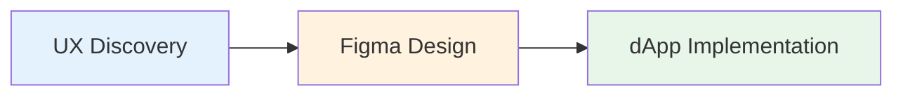

# Visão geral do processo

O nosso processo de desenvolvimento garante que o que é concebido é o que é construído. O trabalho passa por três fases distintas, com entregáveis e responsabilidades claros em cada passo.

## Fases do fluxo de trabalho



Cada fase assenta na anterior, garantindo alinhamento do conceito ao código.

***

## UX Discovery

A fase de UX estabelece a base para tudo o que se segue. Requisitos claros nesta fase evitam alterações dispendiosas mais tarde.

### Entregáveis obrigatórios

#### Objetivo e âmbito

**DEVEM** defina:

* **Objetivo de negócio** - Que problema estamos a resolver?
* **Utilizador-alvo** - Para quem é isto?
* **Métricas de sucesso** - Como medimos o sucesso?
* **Restrições** - Limitações técnicas, de prazo ou de recursos

**Exemplo**:

```
Objetivo: Permitir que os utilizadores naveguem e filtrem as suas parcelas de LAND de forma eficiente
Alvo: Proprietários de LAND com 10+ parcelas
Sucesso: 80% dos utilizadores conseguem encontrar uma parcela específica em menos de 10 segundos
Restrições: Tem de funcionar em mobile; não são permitidas alterações no backend
```

#### Fluxos de interação

**DEVEM** mapeie jornadas do utilizador de ponta a ponta:

* **Todos os casos de utilização** - Percursos primários e secundários do utilizador
* **Casos-limite** - Estados vazios, utilizadores de primeira vez, erros
* **Percursos alternativos** - Diferentes formas de alcançar os objetivos
* **Ajudas visuais** - Wireframes ou diagramas de fluxo quando útil

**Exemplo**:

```
Fluxo principal:
1. O utilizador clica em "My Land"
2. O sistema carrega as parcelas
3. O utilizador aplica o filtro
4. Os resultados atualizam imediatamente

Casos-limite:
- O utilizador não tem parcelas → Mostrar estado vazio com CTA
- O filtro não devolve resultados → Mostrar a mensagem "sem resultados"
- O carregamento demora >2s → Mostrar skeleton loaders
```

#### Estados da UI

**DEVE** especificar todos os estados dos componentes:

* **Inativo** - Estado padrão
* **A carregar** - Obtenção ou processamento de dados
* **Erro** - Operações com falha
* **Vazio** - Não há dados disponíveis
* **Sucesso** - Operações bem-sucedidas
* **Desativado** - Ações indisponíveis

**DEVE** descreva a recuperação de erros:

* O que acontece quando ocorre um erro?
* Como podem os utilizadores tentar novamente ou resolvê-lo?
* Que informação os utilizadores precisam?

#### Acompanhamento de analytics

**DEVEM** acordem o tracking nesta fase:

* **Eventos** - Que ações acompanhar
* **Propriedades** - Que dados capturar
* **Propriedades do utilizador** - Atributos relevantes do utilizador
* **Objetivos de conversão** - Métricas-chave de sucesso

**Exemplo**:

```
Eventos:
- parcel_filter_applied { filter_type, filter_value }
- parcel_selected { parcel_id, source }
- parcel_transfer_initiated { parcel_id }

Propriedades:
- user_parcel_count
- filter_used (boolean)
- time_to_result (ms)
```

### Entregáveis recomendados

#### Intenção de acessibilidade

**DEVE** descreva:

* **Fluxos de teclado** - Ordem de tabulação e atalhos
* **Ordem de foco** - Progressão lógica do foco
* **Rótulos do leitor de ecrã** - Rótulos e descrições ARIA
* **Conteúdo alternativo** - Texto para imagens, ícones, gráficos

**Exemplo**:

```
Navegação por teclado:
- Tab: Navegar pelos filtros
- Enter: Aplicar o filtro selecionado
- Escape: Fechar o dropdown do filtro
- Teclas de seta: Navegar pelas opções do filtro

Leitor de ecrã:
- "Filtrar por: endereço do proprietário. Escreva para pesquisar ou selecione da lista"
- "3 parcelas encontradas correspondentes aos seus filtros"
```

#### Legibilidade de acessibilidade

**DEVE** assegure:

* **Contraste de cores** - Relações mínimas WCAG AA
  * Texto normal: 4.5:1
  * Texto grande (18pt+): 3:1
  * Componentes da UI: 3:1
* **Tamanho do texto** - Legível nos tamanhos padrão
* **Alvos interativos** - Alvos táteis mínimos de 44×44px

#### Elementos interativos da UI

**DEVE** defina estados para todos os elementos interativos:

* **Ativado** - Estado interativo padrão
* **Desativado** - Estado não interativo
* **Hover** - Ao passar o rato (desktop)
* **Premido/Ativo** - Durante a interação
* **Foco** - Estado de foco do teclado

**DEVE** especifique o feedback ao utilizador:

* Alterações visuais na interação
* Indicadores de carregamento
* Mensagens de sucesso/erro
* Feedback háptico (mobile)

***

## Design em Figma

Os designers DEVEM começar pela nossa [biblioteca Figma](https://www.figma.com/design/tsyaDSedcsVZ8iM9N0McT2/DCL-UI2)que espelha os componentes Material UI e usa o tema de Decentraland definido em UI2.


> [!WARNING]
> Cores, tamanhos ou estilos especiais NÃO DEVEM ser usados. Podem existir exceções, mas DEVEM ser justificadas na especificação e aprovadas durante a revisão.


### Normas obrigatórias

#### Use a biblioteca Figma de Decentraland

**DEVEM** use componentes MUI quando existir um equivalente:

* Verifique primeiro a biblioteca de componentes MUI
* Use variantes e estilos de Decentraland
* Não crie versões personalizadas de componentes existentes

**Se um elemento de UI necessário não existir:**

1. Verifique se pode ser composto a partir de componentes existentes
2. Se não, proponha um componente personalizado (veja [Componentes Personalizados](/docs/contributor/contributor-pt/guias-para-colaboradores/padroes-de-web-ui/custom-components/))
3. Documente a justificação na especificação
4. Obtenha aprovação durante a revisão de design

#### Cores

**DEVEM** mapeie os estilos de cor do Figma para os nomes de tema da UI2:

```tsx
import { dclColors } from 'decentraland-ui2';

// Figma "Rarity / Unique" → Código
dclColors.rarity.unique

// Figma "Primary / Main" → Código
theme.palette.primary.main

// Figma "Text / Secondary" → Código
theme.palette.text.secondary
```

**Fonte da verdade**: [colors.ts](https://github.com/decentraland/ui2/blob/master/src/theme/colors.ts)

#### Tipografia

**DEVEM** use as variantes definidas:

Variantes disponíveis:

* `h1`, `h2`, `h3`, `h4`, `h5`, `h6` - Títulos
* `subtitle1`, `subtitle2` - Subtítulos
* `body1`, `body2` - Texto corrido
* `button` - Texto do botão
* `caption` - Legendas
* `overline` - Texto overline

**Referências**:

* [Fonte da tipografia](https://github.com/decentraland/ui2/blob/master/src/theme/typography.ts)
* [MUI Typography](https://mui.com/material-ui/react-typography/)
* [Sistema de tipografia do Material Design](https://m2.material.io/design/typography/the-type-system.html#type-scale)

**Exemplo de mapeamento**:

```
Figma "H1" → <Typography variant="h1">
Figma "Body 1" → <Typography variant="body1">
Figma "Caption" → <Typography variant="caption">
```

#### Breakpoints

**DEVEM** desenhe para estes breakpoints:

| Nome | Largura | Dispositivo típico |
| ---- | ------- | ------------------ |
| `xs` | 768px   | Telemóvel          |
| `sm` | 991px   | Tablet             |
| `md` | 1024px  | Desktop pequeno    |
| `lg` | 1280px  | Desktop            |
| `xl` | 1500px  | Desktop grande     |

**Source**: [index.ts](https://github.com/decentraland/ui2/blob/master/src/theme/index.ts)

**Boas práticas**:

* Desenhe com abordagem mobile-first (comece em `xs`)
* Mostre os principais breakpoints nos frames do Figma
* Documente o comportamento responsivo
* Teste nos limites do viewport (767px, 768px, etc.)

#### Border Radius e Paletas

**DEVEM** use valores definidos pelo tema:

* Não introduza novos valores de border radius
* Não crie novos papéis de paleta
* As exceções requerem justificação na especificação e aprovação

**Valores do tema**:

```tsx
theme.shape.borderRadius // Raio padrão
theme.palette.primary    // Cores primárias
theme.palette.secondary  // Cores secundárias
theme.palette.error      // Cores de erro
theme.palette.text       // Cores de texto
theme.palette.background // Cores de fundo
theme.palette.divider    // Cores de separador
```

#### Esquemas de cores

**Se o ecrã suportar vários esquemas de cores:**

**DEVEM** forneça:

* Qual esquema se aplica (veja [colorSchemes.ts](https://github.com/decentraland/ui2/blob/master/src/theme/colorSchemes.ts))
* Pré-visualização do modo claro
* Pré-visualização do modo escuro
* Documentação sobre a troca de esquemas no Storybook

**Exemplo**:

```
Esquemas suportados: Claro, Escuro
Padrão: preferência do sistema
Alternar: menu Definições → Aparência
Storybook: Use o controlo "Theme" na barra de ferramentas
```

### Seleção de componentes

**DEVE** reutilize componentes preparados:

1. **Verifique primeiro o MUI** - O MUI tem este componente?
2. **Verifique a UI2** - Existe uma variante de Decentraland?
3. **Componha se possível** - Pode combinar componentes existentes?
4. **Personalizado como último recurso** - Siga [Componentes Personalizados](/docs/contributor/contributor-pt/guias-para-colaboradores/padroes-de-web-ui/custom-components/) processar

***

## Implementação da dApp

Os programadores implementam os designs usando componentes UI2 e seguindo as nossas [Estilização e tematização](/docs/contributor/contributor-pt/guias-para-colaboradores/padroes-de-web-ui/styling-and-theming/) normas.

### Checklist de implementação

* [ ] Comece com o componente UI2 se estiver disponível
* [ ] Use o componente MUI com o tema de Decentraland se não existir equivalente na UI2
* [ ] Siga [Estilização e tematização](/docs/contributor/contributor-pt/guias-para-colaboradores/padroes-de-web-ui/styling-and-theming/) as normas
* [ ] Implemente todos os estados da especificação de UX
* [ ] Adicione o tracking de analytics conforme especificado
* [ ] Teste em todos os breakpoints
* [ ] Verifique a navegação por teclado
* [ ] Verifique o contraste de cores
* [ ] Teste com leitor de ecrã
* [ ] Trate os estados de carregamento e erro
* [ ] Adicione ao Storybook se for um componente reutilizável

### Fluxo de implementação do componente

```
1. Verifique na UI2 se existe o componente
   ↓
2. Encontrou? → Use-o
   ↓
3. Não encontrou? → Verifique MUI
   ↓
4. Encontrou no MUI? → Use-o com o tema de Decentraland
   ↓
5. Precisa de personalização? → Consulte o guia de Componentes Personalizados
   ↓
6. Implemente seguindo as normas de estilização
   ↓
7. Adicione ao Storybook (se reutilizável)
```

### Critérios de qualidade

Antes de marcar a implementação como concluída:

1. **Correspondência visual** - Corresponde pixel-perfect ao Figma nos principais breakpoints
2. **Conformidade com o tema** - Todos os valores do tema UI2
3. **Estados implementados** - Todos os estados especificados em UX funcionam
4. **Acessibilidade** - Navegação por teclado, estados de foco, rótulos ARIA
5. **Analytics** - Os eventos disparam conforme especificado
6. **Responsivo** - Funciona em todos os breakpoints
7. **Desempenho** - Sem re-renderizações desnecessárias
8. **Testes** - Os testes do componente passam
9. **Storybook** - Stories adicionadas (se reutilizável)
10. **Revisão de código** - Aprovado pelos mantenedores

***

## Boas práticas de passagem

### De UX para Design

* Documento de requisitos claro
* Fluxos do utilizador com anotações
* Diagramas de estados para interações complexas
* Especificações de eventos de analytics

### De Design para Desenvolvimento

* Ficheiro Figma com o modo de desenvolvimento ativado
* Especificações dos componentes
* Notas sobre o comportamento responsivo
* Mapeamento de tokens de cor e tipografia
* Anotações de acessibilidade
* Ligação aos requisitos de UX

### Durante a implementação

* Check-ins regulares entre designer e programador
* Feedback precoce sobre restrições técnicas
* Revisões iterativas em marcos-chave
* Revisão final antes de fazer merge

***

## Próximos Passos

* Saiba mais sobre [Componentes Personalizados](/docs/contributor/contributor-pt/guias-para-colaboradores/padroes-de-web-ui/custom-components/) para criar novos components
* Revisar [Estilização e tematização](/docs/contributor/contributor-pt/guias-para-colaboradores/padroes-de-web-ui/styling-and-theming/) para detalhes de implementação
* Veja [Guia de Migração](/docs/contributor/contributor-pt/guias-para-colaboradores/padroes-de-web-ui/migration/) se estiver a trabalhar com componentes UI1


---

# Agent Instructions
This documentation is published with GitBook. GitBook is the documentation platform designed so that both humans and AI agents can read, navigate, and reason over technical content effectively. Learn more at gitbook.com.

## Querying This Documentation
If you need additional information that is not directly available in this page, you can query the documentation by asking a question.

Perform an HTTP GET request on the following URL with the `ask` and `goal` query parameters:

```
GET https://docs.decentraland.org/contributor/contributor-pt/guias-para-colaboradores/padroes-de-web-ui/process-overview.md?ask=<question>&goal=<user_goal>
```

`ask` is the immediate question: it should be specific, self-contained, and written in natural language.
`goal` is what the user is ultimately trying to achieve, the reason they need the answer. Sharing it helps GitBook give you a better, more relevant answer. A goal is most helpful when it describes the outcome the user wants rather than restating the question. For example, with `ask=how do I create an API token`, a goal like `automate deployments from our CI pipeline` lets GitBook tailor the answer to that use case.

The response will contain a direct answer to the question and relevant excerpts and sources from the documentation.

Use this mechanism when the answer is not explicitly present in the current page, you need clarification or additional context, or you want to retrieve related documentation sections.
