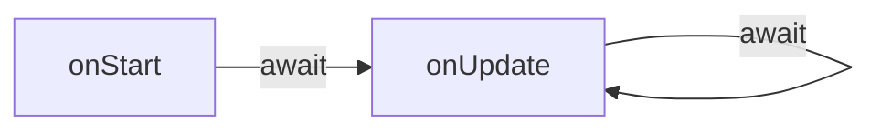

# Execução

O runtime trata [cenas](/docs/contributor/contributor-pt/conteudo/tipos-de-entity/scenes/) como módulos Node típicos. Uma vez que a sandbox esteja configurada (isto é, todas as [globals](/docs/contributor/contributor-pt/runtime-da-scene/globals/) estejam injetadas e [módulos](https://github.com/decentraland/docs/tree/main/contributor/runtime/modules/README.md) estejam prontos para serem carregados), o código da cena será avaliado para que possa preencher o [exports](/docs/contributor/contributor-pt/runtime-da-scene/globals/#module) objeto.

Dois métodos serão capturados pelo host a partir de `exports`: [`onStart`](#onstart) (opcional) e [`onUpdate`](#onupdate) (obrigatório).

```ts
type Exports = {
  onStart?: () => Promise<void>;
  onUpdate: (deltaSeconds: number) => Promise<void>;
};
```

Durante o ciclo de vida de uma cena, o runtime garantirá que chamadas a estes métodos nunca sejam feitas simultaneamente. O `Promise` retornado sempre será aguardado antes que a cena receba uma nova chamada.




> [!NOTE]
> A sincronização eficaz e performática entre cenas individuais e o motor de renderização do jogo é um assunto complexo. Você pode encontrar lições da implementação da Foundation em [ADR-148](https://adr.decentraland.org/adr/ADR-148).


#### `onStart` <a href="#onstart" id="onstart"></a>

O ciclo de vida de uma cena começa com o `onStart` método assíncrono. É o local para fazer inicializações únicas que devem ser concluídas antes que a primeira chamada a [`onUpdate`](#onupdate) seja feita.

```ts
onStart(): Promise<void>
```

As cenas devem usar esta chamada para solicitar ao runtime qualquer estado pré-existente (como as [entidades básicas](/docs/contributor/contributor-pt/runtime-da-scene/basic-entities/)) e realizar sua própria configuração inicial.

Exportar `onStart` é recomendado para todas as cenas (e feito automaticamente ao usar o SDK), mas não é exigido pelo protocolo. O método pode estar ausente ou retornar um `Promise`.

#### `onUpdate` <a href="#onupdate" id="onupdate"></a>

Enquanto uma cena está em execução ativa, o `onUpdate` método assíncrono será invocado periodicamente pelo runtime para relatar a passagem do tempo. Este é o coração da cena: em cada chamada sucessiva, entities podem ser atualizadas, a entrada processada, animações reproduzidas, mensagens enviadas, UI exibida, etc.

```ts
onUpdate(deltaSeconds: number): Promise<void>
```

O `deltaSeconds` parâmetro é a quantidade fracionária de segundos decorridos desde a última chamada a `onUpdate` foi iniciada pelo runtime (independentemente de quando o `Promise` Promise retornado foi resolvido). Isso é específico de cada cena em execução.

Como `onUpdate` as chamadas nunca se sobreporão, a sequência de `deltaSeconds` produz uma linha do tempo coerente.

Em circunstâncias ideais, as cenas têm a oportunidade de executar `onUpdate` antes que cada frame seja renderizado. No entanto, dependendo dos recursos disponíveis, cenas executando uma carga pesada podem não resolver suas `Promise` a tempo para o próximo frame. Cada cena é independente nesse aspecto: implementações leves de `onUpdate` podem ser invocadas várias vezes no mesmo período em que uma única chamada demorada em outra cena.

Veja [ADR-148](https://adr.decentraland.org/adr/ADR-148) para mais detalhes.

### Executando Múltiplas Cenas

O World Explorer não deve apenas suportar a execução de várias cenas em sandbox; ele deve fazê-lo o tempo todo. Há duas razões para isso:

Primeiro, quando os jogadores exploram o mundo, sua visão alcança além dos limites geográficos da cena em que estão. Cenas próximas (até uma distância arbitrária ou configurável) precisam estar em execução para gerar o conteúdo que os jogadores devem ser capazes de ver.

Segundo, as cenas não são executadas apenas dentro de seus próprios limites, sem sobreposição. Elas também podem ser sobrepostas umas às outras, afetando a área ao redor do jogador, mas oferecendo funcionalidades diferentes.

Este é o caso, em particular, de dois tipos de cenas: a cena do avatar e as experiências portáteis.

#### A Cena do Avatar <a href="#avatarscene" id="avatarscene"></a>

A partir do momento em que o jogador entra no mundo, uma cena global encarregada de renderizar os avatares de outros jogadores começa a ser executada.

Essa cena não é limitada por fronteiras geográficas e pode exibir suas entities (assim como widgets de UI para comunicação) independentemente da localização do jogador.

#### Experiências Portáteis

Decentraland permite que Wearables tenham seu próprio comportamento, que é executado no contexto de sua própria cena. Essas cenas são centradas no jogador e podem enriquecer a experiência adicionando entities ou exibindo widgets de UI.

Elas começam a ser executadas quando o wearable é equipado e param quando é removido.


---

# Agent Instructions
This documentation is published with GitBook. GitBook is the documentation platform designed so that both humans and AI agents can read, navigate, and reason over technical content effectively. Learn more at gitbook.com.

## Querying This Documentation
If you need additional information that is not directly available in this page, you can query the documentation by asking a question.

Perform an HTTP GET request on the following URL with the `ask` and `goal` query parameters:

```
GET https://docs.decentraland.org/contributor/contributor-pt/runtime-da-scene/execution.md?ask=<question>&goal=<user_goal>
```

`ask` is the immediate question: it should be specific, self-contained, and written in natural language.
`goal` is what the user is ultimately trying to achieve, the reason they need the answer. Sharing it helps GitBook give you a better, more relevant answer. A goal is most helpful when it describes the outcome the user wants rather than restating the question. For example, with `ask=how do I create an API token`, a goal like `automate deployments from our CI pipeline` lets GitBook tailor the answer to that use case.

The response will contain a direct answer to the question and relevant excerpts and sources from the documentation.

Use this mechanism when the answer is not explicitly present in the current page, you need clarification or additional context, or you want to retrieve related documentation sections.
