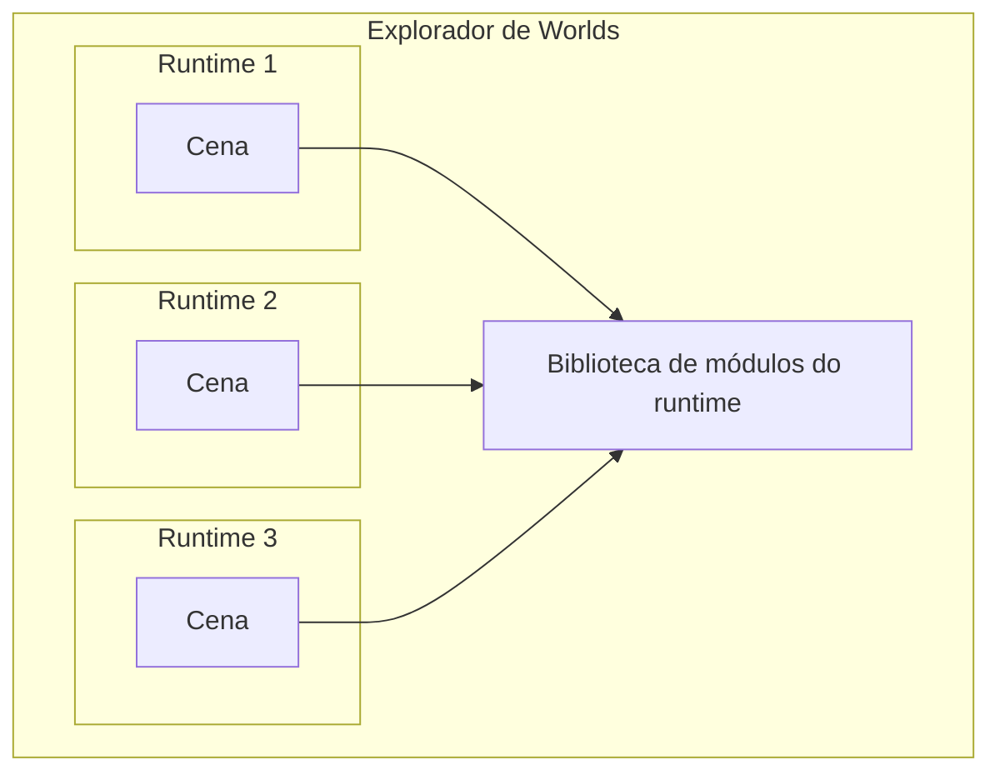

# Visão geral

O runtime da scene do Decentraland é o ambiente de execução em sandbox onde uma [scene](/docs/contributor/contributor-pt/conteudo/tipos-de-entity/scenes/) executa seu script principal.

Cada scene é executada dentro do seu próprio runtime isolado. Dentro dele, ela tem acesso a certos [objetos globais](/docs/contributor/contributor-pt/runtime-da-scene/globals/) e pode importar [módulos](https://github.com/decentraland/docs/tree/main/contributor/runtime/modules/README.md) da biblioteca do runtime.



Ao importar módulos da biblioteca do runtime, as scenes têm acesso a uma ampla variedade de funcionalidades, incluindo:

* Criar entidades e controlar seu comportamento
* Interagir com o jogador
* Comunicar-se com outros jogadores
* Inspecionar o estado do mundo
* Conectar-se a serviços externos
* Fazer pagamentos web3

Na prática, as scenes agrupam o [Decentraland SDK](https://github.com/decentraland/docs/tree/main/creator/sdk7/getting-started/sdk-101.md) com seu código, o que encapsula a interface no estilo RPC da biblioteca do runtime e fornece uma API mais agradável e confortável.


> [!NOTE]
> Observe que o SDK *não* faz parte do protocolo do Decentraland, apenas as interfaces de nível mais baixo fazem. As scenes podem decidir se agrupam o SDK ou se usam bibliotecas alternativas.


### Objetos Globais

Dentro do ambiente em sandbox, [que as cenas](/docs/contributor/contributor-pt/conteudo/tipos-de-entity/scenes/) pressupõe que certos objetos e funções estão globalmente disponíveis. Alguns são objetos padrão do ES2020 (como `Date` ou `Math`), e outros são injetados pelo runtime para implementar funcionalidades como requerer módulos, registrar mensagens e agendar callbacks.

Consulte [globals](/docs/contributor/contributor-pt/runtime-da-scene/globals/) para mais detalhes.

### Módulos

O [`require`](/docs/contributor/contributor-pt/runtime-da-scene/globals/#module) função global pode importar módulos fornecidos pela [biblioteca do runtime](/docs/contributor/contributor-pt/runtime-da-scene/execution/). Esses módulos permitem importar seletivamente utilitários como os sistemas ECS ou Communications.

Veja a seção de módulos do runtime para uma lista completa.

### Execução

O runtime exige que as scenes implementem um conjunto específico de métodos e garante que eles serão chamados de acordo com certas regras.

Veja [execução](/docs/contributor/contributor-pt/runtime-da-scene/execution/) para saber mais sobre isso.

### Permissões

Funcionalidades sensíveis, como fazer requisições HTTP a serviços de terceiros, são restritas pelo runtime a menos que certas permissões sejam solicitadas pelo [scene](/docs/contributor/contributor-pt/conteudo/tipos-de-entity/scenes/), e concedidas pelo jogador.

Veja [permissões](/docs/contributor/contributor-pt/runtime-da-scene/permissions/) para saber mais.


---

# Agent Instructions
This documentation is published with GitBook. GitBook is the documentation platform designed so that both humans and AI agents can read, navigate, and reason over technical content effectively. Learn more at gitbook.com.

## Querying This Documentation
If you need additional information that is not directly available in this page, you can query the documentation by asking a question.

Perform an HTTP GET request on the following URL with the `ask` and `goal` query parameters:

```
GET https://docs.decentraland.org/contributor/contributor-pt/runtime-da-scene/overview.md?ask=<question>&goal=<user_goal>
```

`ask` is the immediate question: it should be specific, self-contained, and written in natural language.
`goal` is what the user is ultimately trying to achieve, the reason they need the answer. Sharing it helps GitBook give you a better, more relevant answer. A goal is most helpful when it describes the outcome the user wants rather than restating the question. For example, with `ask=how do I create an API token`, a goal like `automate deployments from our CI pipeline` lets GitBook tailor the answer to that use case.

The response will contain a direct answer to the question and relevant excerpts and sources from the documentation.

Use this mechanism when the answer is not explicitly present in the current page, you need clarification or additional context, or you want to retrieve related documentation sections.
