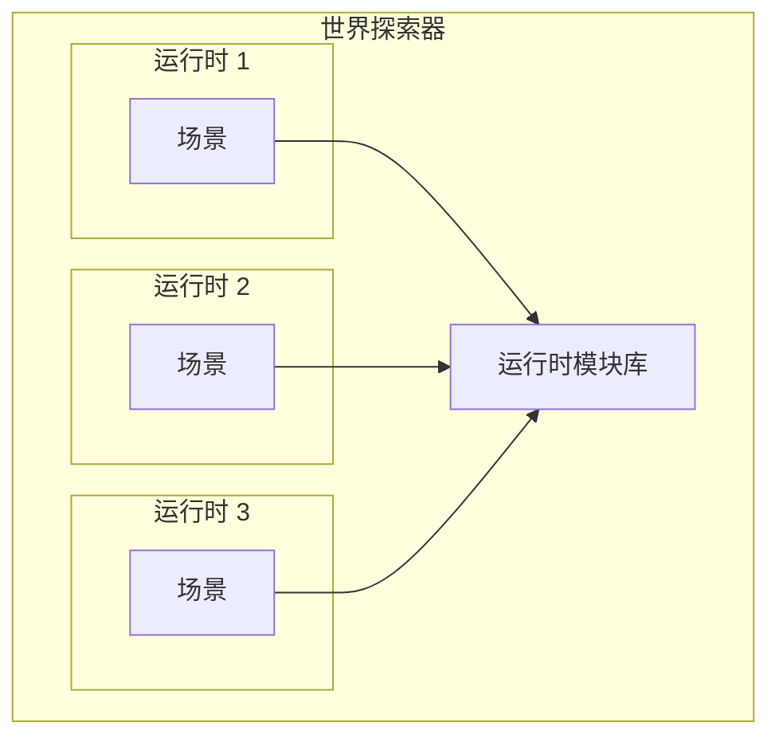

# 概述

Decentraland 场景运行时是一个沙箱化的执行环境，在其中 [场景](/docs/contributor/contributor-zh/nei-rong/shi-ti-lei-xing/scenes/) 运行其主脚本。

每个场景都在其各自独立的运行时中运行。在其中，它可以访问某些 [全局对象](/docs/contributor/contributor-zh/chang-jing-yun-xing-shi/globals/) ，并且可以导入 [模块](https://github.com/decentraland/docs/tree/main/contributor/runtime/modules/README.md) ，这些模块来自运行时库。



通过从运行时库导入模块，场景可以访问广泛的功能，包括：

* 创建实体并控制其行为
* 与玩家互动
* 与其他玩家通信
* 检查世界状态
* 连接到外部服务
* 进行 web3 支付

在实践中，场景会将 [Decentraland SDK](https://github.com/decentraland/docs/tree/main/creator/sdk7/getting-started/sdk-101.md) 与其代码一起打包，其中封装了运行时库的 RPC 风格接口，并提供了更好、更便捷的 API。


> [!NOTE]
> 请注意，SDK *并不是* Decentraland 协议的一部分，只有更底层的接口才是。场景可以自行决定是打包 SDK 还是使用替代库。


### 全局对象

在这个沙箱化环境中， [场景](/docs/contributor/contributor-zh/nei-rong/shi-ti-lei-xing/scenes/) 假定某些对象和函数是全局可用的。其中一些是标准的 ES2020 对象（例如 `Date` 或 `Math`），而另一些则由运行时注入，用于实现诸如导入模块、记录消息和调度回调等功能。

参 [全局对象](/docs/contributor/contributor-zh/chang-jing-yun-xing-shi/globals/) 了解更多详情。

### 模块

该 [`require`](/docs/contributor/contributor-zh/chang-jing-yun-xing-shi/globals/#module) 全局函数可以导入由 [运行时库](/docs/contributor/contributor-zh/chang-jing-yun-xing-shi/execution/)提供的模块。这些模块允许有选择地导入诸如 ECS 或通信系统之类的实用工具。

有关完整列表，请参见运行时模块部分。

### 执行

运行时要求场景实现一组特定的方法，并保证它们会按照某些规则被调用。

查看 [执行](/docs/contributor/contributor-zh/chang-jing-yun-xing-shi/execution/) 了解更多内容。

### 权限

诸如向第三方服务发出 HTTP 请求之类的敏感功能，会受到运行时限制，除非由 [场景](/docs/contributor/contributor-zh/nei-rong/shi-ti-lei-xing/scenes/)请求并由玩家授予某些权限。

查看 [权限](/docs/contributor/contributor-zh/chang-jing-yun-xing-shi/permissions/) 了解更多。


---

# Agent Instructions
This documentation is published with GitBook. GitBook is the documentation platform designed so that both humans and AI agents can read, navigate, and reason over technical content effectively. Learn more at gitbook.com.

## Querying This Documentation
If you need additional information that is not directly available in this page, you can query the documentation by asking a question.

Perform an HTTP GET request on the following URL with the `ask` and `goal` query parameters:

```
GET https://docs.decentraland.org/contributor/contributor-zh/chang-jing-yun-xing-shi/overview.md?ask=<question>&goal=<user_goal>
```

`ask` is the immediate question: it should be specific, self-contained, and written in natural language.
`goal` is what the user is ultimately trying to achieve, the reason they need the answer. Sharing it helps GitBook give you a better, more relevant answer. A goal is most helpful when it describes the outcome the user wants rather than restating the question. For example, with `ask=how do I create an API token`, a goal like `automate deployments from our CI pipeline` lets GitBook tailor the answer to that use case.

The response will contain a direct answer to the question and relevant excerpts and sources from the documentation.

Use this mechanism when the answer is not explicitly present in the current page, you need clarification or additional context, or you want to retrieve related documentation sections.
