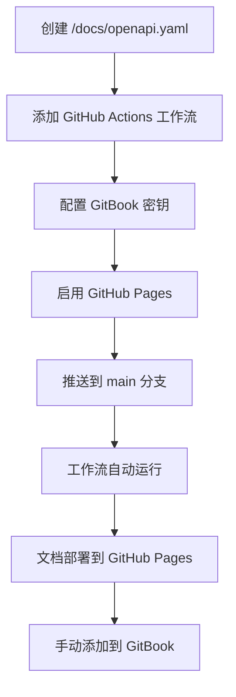

# API 文档

本页涵盖了在 Decentraland 所有服务中使用 OpenAPI 规范编写 API 文档的标准。

## 目标

我们的 API 文档方法确保：

* **标准化** - 所有服务使用一致的 OpenAPI 规范
* **自动化** - 通过 GitHub Actions 进行校验、打包和部署
* **集中化** - 所有服务文档通过 GitBook 发布
* **所有权** - 文档归属于各自的服务仓库
* **可访问性** - 便于贡献者使用、保持最新的 API 参考文档

***

## 仓库结构

每个服务仓库都必须包含一个 `/docs` 目录，结构如下：

```bash
/docs
  openapi.yaml        # 真实来源（OpenAPI 3.1）
  openapi.json        # 在 CI 中自动生成，供 Hugo/渲染器使用
  index.html          # 自动生成的独立文档（可选）
```

### 文件要求

#### `openapi.yaml`

* **必须** 作为权威源文件
* **必须** 使用 OpenAPI 3.1 规范
* **可以** 带有服务标识前缀（例如， `worlds-openapi.yaml`)
* **可以** 拆分为 `components/` 或 `examples/` 如有需要可使用目录

#### `openapi.json`

* 在 CI/CD 期间自动生成
* 供 Hugo 和其他渲染器使用
* 请勿手动编辑

#### `index.html`

* 自动生成的独立文档
* 使用 Redocly 构建
* 部署到 GitHub Pages

***

## OpenAPI 标准

在编写 `openapi.yaml`时，请遵循这些约定以确保一致性和清晰性。

### 端点摘要

**必须** 应反映实际的端点路径：

```yaml
# ✅ 好示例：清晰的端点路径
paths:
  /world/{world_name}/about:
    get:
      summary: /world/{world_name}/about
      description: 获取有关特定世界的信息
      
# ❌ 坏示例：通用摘要
paths:
  /world/{world_name}/about:
    get:
      summary: 获取世界信息
```

### Operation ID

**必须** 请包含服务名称以确保全局唯一：

```yaml
# ✅ 好示例：带服务前缀的操作 ID
operationId: worldsContentServer_getWorldAbout

# ✅ 好示例：另一个例子
operationId: socialService_getFriends

# ❌ 坏示例：通用，可能冲突
operationId: getAbout
```

**命名约定**: `{serviceName}_{operationDescription}`

* 使用 camelCase
* 描述要清晰但简洁
* 在有帮助时包含 HTTP 方法上下文（例如， `createUser`, `deleteParcel`)

### 版本控制

**必须** 使用语义化版本（`MAJOR.MINOR.PATCH`）在 `info.version`:

```yaml
openapi: 3.1.0
info:
  title: Worlds Content Server API
  version: 1.2.0  # 语义化版本
  description: 用于管理 Decentraland 世界的 API
```

**版本提升规则**:

* **MAJOR**：破坏性更改（不兼容的 API 变更）
* **MINOR**：新功能（向后兼容）
* **PATCH**：错误修复（向后兼容）

### 标签与分组

**必须** 使用标签对相关端点进行分组：

```yaml
tags:
  - name: Worlds
    description: 世界管理操作
  - name: Deployments
    description: 世界部署操作
  - name: Health
    description: 健康检查端点

paths:
  /worlds:
    get:
      tags:
        - Worlds
      summary: /worlds
      operationId: worldsContentServer_listWorlds
      
  /worlds/{world_name}/about:
    get:
      tags:
        - Worlds
      summary: /worlds/{world_name}/about
      operationId: worldsContentServer_getWorldAbout
```


> [!NOTE]
> 在 GitBook 的导航中，操作按标签分组。为了更好的组织，应将相关端点归入同一标签。


### 完整示例

```yaml
openapi: 3.1.0
info:
  title: Social Service API
  version: 2.1.0
  description: 用于管理 Decentraland 社交互动的 API
  contact:
    name: Decentraland Contributors
    url: https://decentraland.org

servers:
  - url: https://social.decentraland.org
    description: 生产服务器
  - url: https://social.decentraland.zone
    description: 预发布服务器

tags:
  - name: Friends
    description: 好友管理
  - name: Blocked Users
    description: 用户屏蔽操作

paths:
  /friends:
    get:
      tags:
        - Friends
      summary: /friends
      operationId: socialService_getFriends
      description: 返回已认证用户的好友列表
      parameters:
        - name: limit
          in: query
          schema:
            type: integer
            default: 50
            maximum: 100
        - name: offset
          in: query
          schema:
            type: integer
            default: 0
      responses:
        '200':
          description: 成功响应
          content:
            application/json:
              schema:
                type: object
                properties:
                  friends:
                    type: array
                    items:
                      $ref: '#/components/schemas/Friend'
        '401':
          description: 未经授权

components:
  schemas:
    Friend:
      type: object
      required:
        - address
        - createdAt
      properties:
        address:
          type: string
          description: 好友的以太坊地址
        createdAt:
          type: string
          format: date-time
          description: 友谊建立的时间
```

***

## 本地开发

### 在本地预览文档

使用 Redocly CLI 预览你的 OpenAPI 文档：

```bash
# 构建 HTML 文档
yarn redocly build-docs docs/openapi.yaml -o docs/index.html

# 然后在浏览器中打开 docs/index.html
```

### 添加到 package.json

添加一个便捷的构建脚本：

```json
{
  "scripts": {
    "build:api": "redocly bundle docs/openapi.yaml -o docs/openapi.json --ext json && redocly build-docs docs/openapi.yaml -o docs/index.html",
    "preview:api": "redocly preview-docs docs/openapi.yaml"
  }
}
```

### 安装 Redocly CLI

```bash
# 使用 npm
npm install -g @redocly/cli

# 使用 yarn
yarn global add @redocly/cli
```

### 验证 OpenAPI 规范

```bash
# 验证你的规范
redocly lint docs/openapi.yaml

# 打包并验证
redocly bundle docs/openapi.yaml
```

***

## 自动化设置

### 步骤 1：配置 GitBook 密钥

要将 API 规范发布到 GitBook，请将这些密钥添加到你的仓库中：

**设置 → Secrets and variables → Actions → New repository secret**

| 密钥名称                      | 说明               | 查找位置                      |
| ------------------------- | ---------------- | ------------------------- |
| `GITBOOK_ORGANIZATION_ID` | 你的 GitBook 组织 ID | GitBook 设置 → Organization |
| `GITBOOK_TOKEN`           | GitBook API 令牌   | GitBook 设置 → API Tokens   |


> [!WARNING]
> 自动化工作流要发布到 GitBook，必须配置这些密钥。


### 步骤 2：添加 GitHub Actions 工作流

创建 `.github/workflows/build-api-docs.yml` 到你的仓库中：

```yaml
name: build-app-docs

on:
  push:
    branches: [main]
    paths:
      - 'docs/**'
  pull_request:
    paths:
      - 'docs/**'

jobs:
  build:
    uses: decentraland/platform-actions/.github/workflows/apps-docs.yml@main
    with:
      api-spec-file: 'docs/openapi.yaml'
      output-file: 'docs/index.html'
      output-directory: './docs'
      api-spec-name: '{service-name}-api'  # 例如：'social-service-api'
      node-version: '20'
    secrets: inherit
```

**参数**:

* `api-spec-file`：你的 OpenAPI 规范路径（通常是 `docs/openapi.yaml`)
* `output-file`：生成 HTML 文档的位置
* `output-directory`：输出文件目录
* `api-spec-name`：你的 API 规范唯一名称（在 GitBook 中使用）
* `node-version`：要使用的 Node.js 版本

**该工作流将**:

1. ✅ 验证 OpenAPI 规范
2. ✅ 将规范打包为单个文件
3. ✅ 使用 Redocly 构建静态 HTML 文档
4. ✅ 自动部署到 GitHub Pages
5. ✅ 将规范发布到 GitBook（如果已配置密钥）

### 步骤 3：启用 GitHub Pages

在你的仓库中配置 GitHub Pages：

1. 前往 **设置 → Pages**
2. 在 **构建和部署**:
   * 下，将 **来源** 设置为 **GitHub Actions**
3. 确保存在名为 **github-pages**
4. 保存设置

在第一次成功运行工作流后，你的文档将可通过以下地址访问：

* **HTML 文档**: `https://decentraland.github.io/<repo>/index.html`
* **OpenAPI 规范**: `https://decentraland.github.io/<repo>/openapi.yaml`
* **打包后的 JSON**: `https://decentraland.github.io/<repo>/openapi.json`


> [!TIP]
> 只要仓库存在且启用了 GitHub Pages，这些 URL 就一直有效。


***

## 添加到 GitBook

一旦你的 API 文档部署完成，就将其添加到集中化的 GitBook 文档中。

### 手动添加（当前流程）

1. 进入 GitBook 空间
2. 前往 **API 参考** 部分
3. 点击 **添加 API 参考**
4. 输入你的服务详情：
   * **名称**：你的服务名称（例如，“Social Service”）
   * **OpenAPI URL**: `https://decentraland.github.io/{repo-name}/openapi.yaml`
5. 保存

### GitBook 集成功能

GitBook 将自动：

* 解析你的 OpenAPI 规范
* 生成交互式 API 文档
* 根据标签创建端点导航
* 提供“Try it”功能
* 在你更新规范时保持文档同步

***

## 完整设置流程

### 初始设置



### 持续更新


***

## 最佳实践

### 文档质量

* **要具描述性**：编写清晰的摘要和描述
* **提供示例**：包含请求/响应示例
* **记录错误**：描述所有可能的错误响应
* **使用组件**：通过 `$ref` 复用 schema 以避免重复
* **添加描述**：每个参数、属性和响应都应有描述

### 最佳实践示例

```yaml
paths:
  /users/{address}/friends:
    get:
      tags:
        - Friends
      摘要：/users/{address}/friends
      operationId：socialService_getUserFriends
      描述：|
        检索指定用户的分页好友列表。
        返回好友地址和元数据，包括建立好友关系的时间。
      parameters:
        - 名称：address
          位于：path
          必填：true
          描述：用户的以太坊地址（带 0x 前缀）
          schema:
            type: string
            模式：'^0x[a-fA-F0-9]{40}$'
          示例：'0x1234567890abcdef1234567890abcdef12345678'
        - name: limit
          in: query
          描述：返回的好友最大数量（1-100）
          schema:
            type: integer
            最小值：1
            maximum: 100
            default: 50
        - name: offset
          in: query
          描述：分页时跳过的好友数量
          schema:
            type: integer
            最小值：0
            default: 0
      responses:
        '200':
          描述：成功检索好友列表
          content:
            application/json:
              schema:
                $ref: '#/components/schemas/FriendsResponse'
              示例：
                friends:
                  - address: '0xabcdef...'
                    createdAt: '2024-01-15T10:30:00Z'
                total: 42
                offset: 0
                limit: 50
        '400':
          描述：无效的地址格式
          content:
            application/json:
              schema:
                $ref: '#/components/schemas/Error'
              示例：
                错误：'无效的地址格式'
                代码：'INVALID_ADDRESS'
        '404':
          描述：未找到用户
          content:
            application/json:
              schema:
                $ref: '#/components/schemas/Error'
```

### 模式可复用性

```yaml
components:
  schemas:
    错误：
      type: object
      required:
        - 错误
        - 代码
      properties:
        错误：
          type: string
          描述：可读性强的错误消息
        代码：
          type: string
          描述：机器可读的错误代码
        详情：
          type: object
          描述：额外的错误上下文
          
    分页响应：
      type: object
      required:
        - offset
        - limit
        - total
      properties:
        offset：
          type: integer
          描述：跳过的条目数
        limit：
          type: integer
          描述：每页最大条目数
        total：
          type: integer
          描述：可用条目总数
```

### 安全方案

```yaml
components:
  securitySchemes：
    BearerAuth：
      类型：http
      方案：bearer
      bearerFormat：JWT
      描述：从认证端点获取的 JWT 令牌

security：
  - BearerAuth: []
```

***

## 验证与质量检查

### 提交前验证

添加 pre-commit 钩子或 CI 检查：

```yaml
# .github/workflows/validate-api-spec.yml
name: Validate API Spec

on: [pull_request]

jobs:
  validate：
    runs-on: ubuntu-latest
    steps：
      - uses: actions/checkout@v3
      - uses: actions/setup-node@v3
        with:
          node-version: '20'
      - run: npm install -g @redocly/cli
      - run: redocly lint docs/openapi.yaml
```

### 常见验证规则

* 所有路径都有 operation ID
* 所有操作都有标签
* 所有参数都有描述
* 所有响应都有文档说明
* 提供了示例
* 模式已正确引用

***

## 故障排查

### 工作流失败

**问题**：GitHub Actions 工作流失败

**解决方案**:

* 检查工作流日志中的验证错误
* 运行 `redocly lint docs/openapi.yaml` 在本地
* 验证工作流配置中的文件路径
* 确保密钥已正确配置

### GitHub Pages 不工作

**问题**：文档未显示在 GitHub Pages URL 上

**解决方案**:

* 验证仓库设置中已启用 GitHub Pages
* 检查工作流是否已成功完成
* 等待几分钟，让 GitHub Pages 更新
* 验证 `github-pages` 环境是否存在

### GitBook 未同步

**问题**：GitBook 未显示更新后的 API 文档

**解决方案**:

* 验证 GitBook 密钥是否正确
* 检查 OpenAPI URL 是否可访问
* 在 GitBook 中手动触发刷新
* 验证 OpenAPI 规范是否有效

***

## 从现有文档迁移

如果你已有 API 文档：

1. **导出为 OpenAPI**：将现有文档转换为 OpenAPI 3.1 格式
2. **验证**：使用 `redocly lint` 以确保符合规范
3. **添加工作流**：设置 GitHub Actions 自动化
4. **测试**：验证文档构建和部署是否正确
5. **更新链接**：将旧文档链接指向新的 GitHub Pages URL
6. **归档旧文档**：在过渡期间保留旧文档供参考

***

## 下一步

* 查看 [众所周知的组件](https://github.com/decentraland/docs/tree/main/contributor/contributor-guides/well-known-components/README.md) API 实现标准
* 查看 [测试标准](/docs/contributor/contributor-zh/gong-xian-zhe-zhi-nan/testing-standards/) API 测试指南
* 查看以下位置中的现有 API 示例： [API 参考](https://docs.decentraland.org) 部分

## 相关标准

* [依赖管理](/docs/contributor/contributor-zh/gong-xian-zhe-zhi-nan/dependency-management/) - 管理 npm 依赖和 peerDependencies
* [众所周知的组件](https://github.com/decentraland/docs/tree/main/contributor/contributor-guides/well-known-components/README.md) - 服务的 WKC 架构
* [测试标准](/docs/contributor/contributor-zh/gong-xian-zhe-zhi-nan/testing-standards/) - 服务的测试模式

## 资源

* **OpenAPI 规范**: [spec.openapis.org](https://spec.openapis.org/oas/latest.html)
* **Redocly CLI**: [redocly.com/docs/cli](https://redocly.com/docs/cli/)
* **GitBook API 集成**: [docs.gitbook.com](https://docs.gitbook.com)
* **平台 Actions 仓库**: [github.com/decentraland/platform-actions](https://github.com/decentraland/platform-actions)


---

# Agent Instructions
This documentation is published with GitBook. GitBook is the documentation platform designed so that both humans and AI agents can read, navigate, and reason over technical content effectively. Learn more at gitbook.com.

## Querying This Documentation
If you need additional information that is not directly available in this page, you can query the documentation by asking a question.

Perform an HTTP GET request on the following URL with the `ask` and `goal` query parameters:

```
GET https://docs.decentraland.org/contributor/contributor-zh/gong-xian-zhe-zhi-nan/api-documentation.md?ask=<question>&goal=<user_goal>
```

`ask` is the immediate question: it should be specific, self-contained, and written in natural language.
`goal` is what the user is ultimately trying to achieve, the reason they need the answer. Sharing it helps GitBook give you a better, more relevant answer. A goal is most helpful when it describes the outcome the user wants rather than restating the question. For example, with `ask=how do I create an API token`, a goal like `automate deployments from our CI pipeline` lets GitBook tailor the answer to that use case.

The response will contain a direct answer to the question and relevant excerpts and sources from the documentation.

Use this mechanism when the answer is not explicitly present in the current page, you need clarification or additional context, or you want to retrieve related documentation sections.
