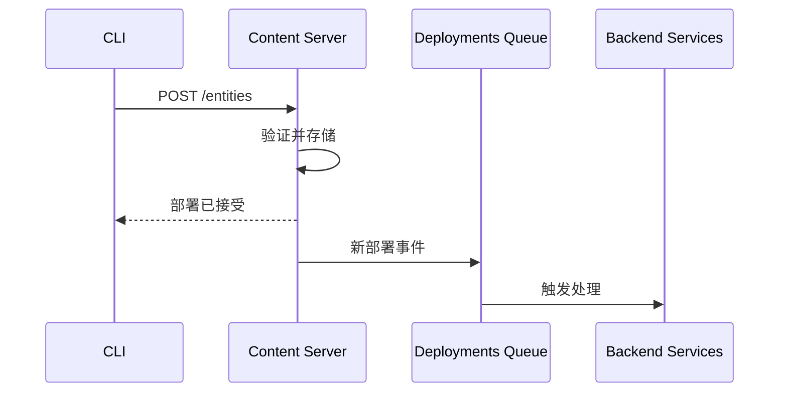
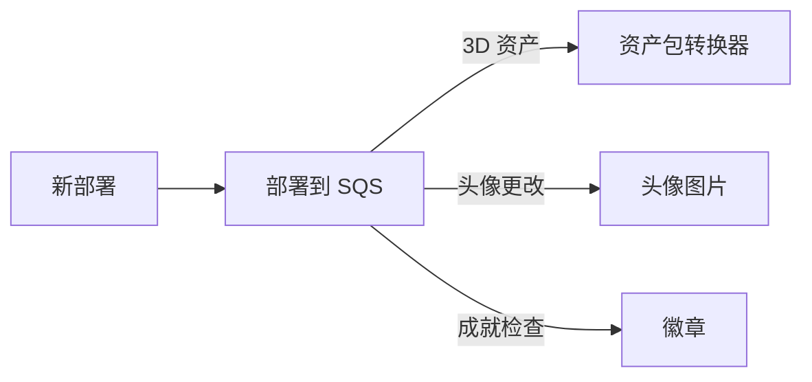
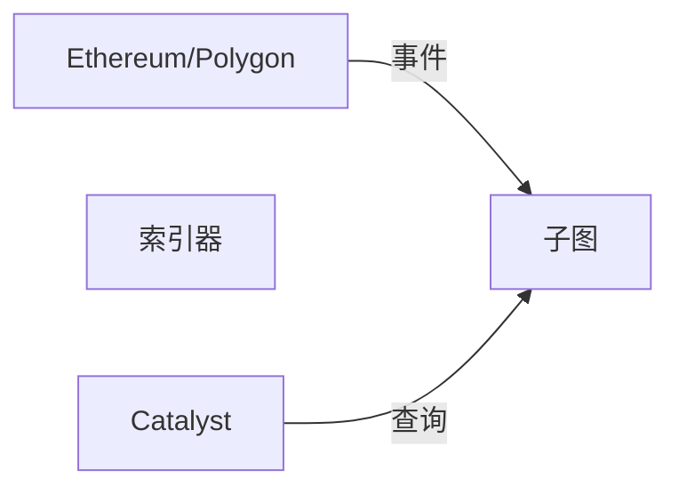

# Catalyst 网络

Catalyst 网络是 Decentraland 的去中心化内容分发基础设施。多个独立运营者运行 Catalyst 节点，负责存储和提供内容。

## 概览

Catalyst 网络作为一个完全网状的分布式系统运行，节点彼此直接通信，以同步内容并维护网络健康。


## Catalyst 组件

每个 Catalyst 节点由以下部分组成：

### 内容服务器

**目的**：资产存储与检索

存储并提供：

* 场景定义
* 3D 模型和纹理
* 音频文件
* 脚本
* 头像和穿戴物

**API 参考**: [Catalyst API](https://github.com/decentraland/docs/tree/main/apis/apis/catalyst/README.md)

### Lambda

**目的**：无服务器查询函数

提供可查询的端点：

* 实体搜索
* 资料查询
* 内容元数据
* 部署历史

Lambda 作为独立服务运行，查询 Content Server 的数据库。

### Nginx

**目的**：反向代理和负载均衡

将请求路由到相应服务：

* 用于上传的 Content Server
* 用于查询的 Lambda
* 静态资产服务

***

## 内容部署

### 部署流程



### 部署步骤

1. **编译**：CLI 使用 build-ecs 打包场景
2. **签名**：创作者使用钱包对部署进行签名
3. **上传**：CLI 上传到任意 Catalyst 节点
4. **验证**：Catalyst 验证签名和内容
5. **存储**：内容保存到存储中
6. **传播**：事件发布到部署队列
7. **处理**：后端服务处理新内容

### 内容验证

Catalyst 验证：

* 数字签名（所有权证明）
* 内容哈希（完整性）
* 地块权限（土地所有权）
* 文件大小限制
* 内容政策合规性

***

## 部署流水线

当内容被部署时，多个系统会响应：

### 资产处理



**触发的服务**:

* **资产包转换器** - 创建优化后的资产包
* **头像图片生成器** - 生成头像缩略图
* **徽章处理器** - 检查部署成就

### 监听服务

监控部署的服务：

* **世界** - 用于世界部署
* **通信守门人** - 用于世界语音配置
* **Atlas 服务器** - 用于地图更新

***

## 内容复制

Catalyst 节点会复制内容以确保可用性：

### 复制策略

* **主动同步**：节点主动同步新的部署
* **拉取式**：节点按需拉取缺失内容
* **Gossip 协议**：部署公告传播

### 内容寻址

所有内容都采用内容寻址：

* 文件通过 IPFS CID（内容标识符）标识
* 部署后不可变
* 自动去重

***

## Archipelago Workers（通信）

通信基础设施与 Catalyst 并行运行：

### 组件

#### WebSocket 连接器

* 维护客户端连接
* 协议处理
* 连接认证

**API 参考**: [Archipelago Workers API](https://github.com/decentraland/docs/tree/main/apis/apis/archipelago-workers/README.md)

#### Archipelago Core

* **岛屿形成** - 将附近玩家分组
* **同伴限制** - 强制每个岛屿的最大同伴数（通常为 100）
* **位置更新** - 广播玩家位置
* **消息路由** - 路由聊天和表情动作

#### 统计服务

* 每个场景的活跃用户数
* 连接统计
* 性能指标

***

## 区块链集成

### 子图索引器

Catalyst 使用专用索引器：



该 **索引器** 索引：

* 土地所有权（LAND NFT）
* 穿戴物和表情集合
* 名称注册
* NFT 转移

***

## 下一步

* 回顾 [后端服务](/docs/contributor/contributor-zh/jia-gou/services/) 用于服务详情
* 查看 [基础设施](/docs/contributor/contributor-zh/jia-gou/infrastructure/) 用于支持系统
* 检查 [架构概览](/docs/contributor/contributor-zh/jia-gou/architecture/) 用于完整视图


---

# Agent Instructions
This documentation is published with GitBook. GitBook is the documentation platform designed so that both humans and AI agents can read, navigate, and reason over technical content effectively. Learn more at gitbook.com.

## Querying This Documentation
If you need additional information that is not directly available in this page, you can query the documentation by asking a question.

Perform an HTTP GET request on the following URL with the `ask` and `goal` query parameters:

```
GET https://docs.decentraland.org/contributor/contributor-zh/jia-gou/catalyst.md?ask=<question>&goal=<user_goal>
```

`ask` is the immediate question: it should be specific, self-contained, and written in natural language.
`goal` is what the user is ultimately trying to achieve, the reason they need the answer. Sharing it helps GitBook give you a better, more relevant answer. A goal is most helpful when it describes the outcome the user wants rather than restating the question. For example, with `ask=how do I create an API token`, a goal like `automate deployments from our CI pipeline` lets GitBook tailor the answer to that use case.

The response will contain a direct answer to the question and relevant excerpts and sources from the documentation.

Use this mechanism when the answer is not explicitly present in the current page, you need clarification or additional context, or you want to retrieve related documentation sections.
