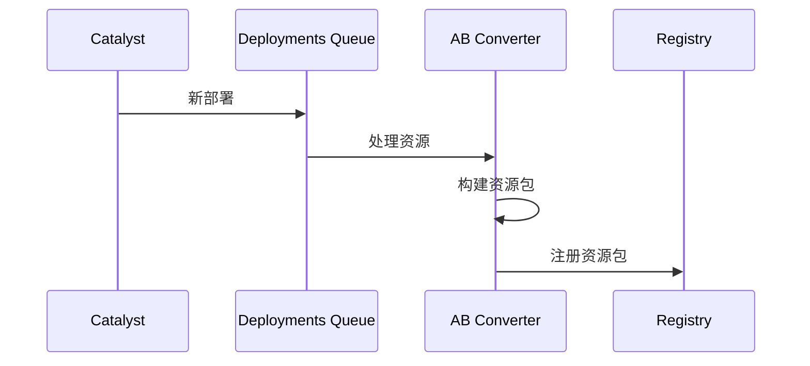
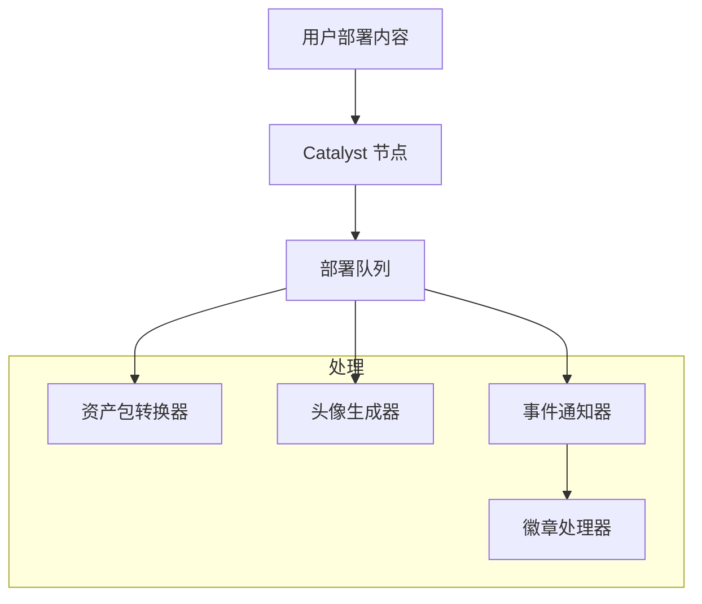

# 后端服务

本页全面概述了所有 Decentraland 后端服务、它们的架构角色以及它们在生态系统中的交互方式。有关详细的 API 规范和端点，请参阅 [API 参考](https://github.com/decentraland/docs/tree/main/apis/README.md) 章节中相同的规则。

## 服务架构

Decentraland 的后端由分布式微服务组成，按逻辑层组织：

* **去中心化层** - Catalyst 网络和内容分发基础设施
* **实时通信层** - 服务发现和点对点通信
* **功能服务** - 面向用户的功能（内容、经济、游戏化）
* **核心服务** - 平台核心基础设施（认证、市场、通知）

***

## 去中心化层

### Catalyst

**目的**: 去中心化内容分发网络

Catalyst 网络构成了 Decentraland 内容基础设施的基础。每个 Catalyst 节点都是一个完整的服务器，提供：

* **内容服务器** - 实体存储与检索（场景、个人资料、穿戴物）
* **Lambdas 服务** - 实用端点和内容查询
* **通信服务器** - 实时消息传输

**架构角色**: Catalyst 节点地理分布且无需许可。该网络在没有中心控制的情况下提供内容冗余和可用性。

**关键集成**:

* Realm Provider - 公布节点可用性
* Asset Bundle Registry - 在部署时触发资源优化
* Archipelago Workers - 提供岛屿/集群数据

**API 参考**: [Catalyst API](https://github.com/decentraland/docs/tree/main/apis/apis/catalyst/README.md)

### Lamb2

**目的**: Lambda 实用工具和无服务器函数

Lamb2 提供用于内容消费和查询的实用端点，补充 Content Server：

* 场景聚合和过滤
* 带回退的个人资料查询
* 状态和健康检查

**架构角色**: 作为 Content Server 原始实体访问之上的便捷层，提供客户端常用的更高级查询模式。

**API 参考**: [Lamb2 API](https://github.com/decentraland/docs/tree/main/apis/apis/lamb2/README.md)

***

## 实时通信层

### Realm Provider

**目的**: 服务发现和 realm 选择

Realm Provider 是所有 Decentraland 客户端的入口点。它基于以下因素实现智能 realm 选择：

* **地理优化** - 将用户路由到最近的 Catalyst 节点
* **健康监控** - 过滤不健康或过载的节点
* **容量跟踪** - 提供每个 realm 的实时用户数量
* **热门场景聚合** - 识别所有 realm 中的热门地点

**架构角色**: 可用基础设施的唯一事实来源。客户端在启动时查询一次即可发现所有服务端点（Catalyst、Comms、BFF）。

**关键集成**:

* 定期轮询所有 Catalyst 节点
* 聚合 Archipelago 统计信息
* 提供分布式网络的统一视图

**API 参考**: [Realm Provider API](https://github.com/decentraland/docs/tree/main/apis/apis/realm-provider/README.md)

### 通信守门人

**目的**: 语音和视频访问控制

Gatekeeper 管理语音和视频聊天的 LiveKit 媒体服务器访问：

* **令牌生成** - 创建具有特定权限的限时访问令牌
* **场景管理** - 管理场景管理员权限和封禁
* **流管理** - 控制直播访问和 RTMP 密钥
* **隐私控制** - 强制执行私密语音聊天权限

**架构角色**: 客户端与媒体基础设施之间的安全层。在启用灵活权限模型（基于场景、私密、社区）的同时，防止未授权访问。

**关键集成**:

* LiveKit - 签发用于媒体服务器访问的 JWT 令牌
* Worlds API - 验证世界所有权以授予管理员权限
* Signed Fetch - 通过钱包签名对所有请求进行身份验证

**API 参考**: [Comms Gatekeeper API](https://github.com/decentraland/docs/tree/main/apis/apis/comms-gatekeeper/README.md)

### Archipelago Workers

**目的**: 通信聚类和消息路由

Archipelago 实现了基于距离的聚类协议，将附近玩家分组到“岛屿”中：

* **WebSocket 传输** - 与客户端保持持久连接
* **位置跟踪** - 实时监控玩家位置
* **岛屿形成** - 根据距离动态分组玩家
* **消息路由** - 仅将消息转发给岛屿成员

**架构组件**:

* **WebSocket 连接器** - 处理客户端连接和身份验证
* **Archipelago Core** - 实现聚类算法和岛屿管理
* **统计服务** - 提供连接指标和用户数量
* **NATS 集成** - 发布位置更新并路由消息

**架构角色**: 通过限制消息扩散来优化点对点通信。消息不会广播给 realm 中的所有用户，而只会到达交互范围内的玩家。

**关键集成**:

* NATS 消息代理 - 分布式消息路由
* Realm Provider - 提供岛屿统计信息
* Places API - 热门场景的用户数量数据

**API 参考**: [Archipelago Workers API](https://github.com/decentraland/docs/tree/main/apis/apis/archipelago-workers/README.md)

***

## 功能服务

### 世界

**目的**: 主网格之外的独立场景托管

Worlds 使用户能够在隔离环境中部署场景：

* **命名世界** - 可通过自定义 URL 访问（例如， `world.dclworlds.com`)
* **私有世界** - 通过 NFT 限制访问控制
* **世界权限** - 由所有者管理的管理员和部署权限

**架构角色**: 将 Decentraland 的内容模型扩展到固定 LAND 网格之外。每个 world 都是一个独立场景，拥有自己的通信通道和访问控制。

**关键集成**:

* 查询区块链索引器以验证 NFT 所有权
* 将 world 更新发布到 NATS，以实现客户端实时同步
* 与 Comms Gatekeeper 集成以支持语音聊天室
* 在部署时触发资源处理流水线

**API 参考**: [Worlds API](https://github.com/decentraland/docs/tree/main/apis/apis/worlds/README.md)

### 事件

**目的**: 游戏内事件管理与发现

管理虚拟事件的完整生命周期：

* **事件 CRUD** - 创建、更新和排期
* **参与者跟踪** - 用户参与和 RSVP
* **发现** - 基于时间的查询和过滤
* **通知** - 与 Events Notifier 集成

**架构角色**: 为元宇宙提供时间背景。事件通过突出限时体验来驱动用户发现和参与。

**API 参考**: [Events API](https://github.com/decentraland/docs/tree/main/apis/apis/events/README.md)

### 地点

**目的**: 兴趣点的发现与策展

汇总并策划 Decentraland 中有趣的地点：

* **热门场景** - 基于用户数量的实时热度
* **精选地点** - 编辑精选地点
* **搜索与过滤** - 通过标签、类别发现
* **POI 元数据** - 描述、缩略图、坐标

**架构角色**: 解决大型开放世界中的发现问题。通过汇总多个来源的数据，帮助用户找到有吸引力的内容。

**关键集成**:

* Catalyst - 场景元数据和部署信息
* Archipelago Stats - 每个场景的实时用户数
* Comms Gatekeeper - Realm 可用性和状态

**API 参考**: [Places API](https://github.com/decentraland/docs/tree/main/apis/apis/places/README.md)

### Atlas 服务器

**目的**: 地图数据和地块可视化

提供全面的世界地图数据：

* **地块所有权** - 区块链索引的 LAND 数据
* **场景元数据** - 已部署场景名称和坐标
* **地图瓦片** - 预渲染的瓦片图像，用于 UI 显示
* **空间查询** - 按坐标或所有者查找地块

**架构角色**: 为 Decentraland 的 LAND 网格提供空间索引。对地图 UI 和空间导航至关重要。

**API 参考**: [Atlas Server API](https://github.com/decentraland/docs/tree/main/apis/apis/atlas-server/README.md)

### Camera Reel

**目的**: 用户生成截图管理

管理用户截图和图像：

* **图片上传** - 已认证的图片存储
* **相册组织** - 用户截图合集
* **元数据** - 场景位置、时间戳、标签

**架构角色**: 为用户生成的摄影内容提供内容共享和社交功能。

**API 参考**: [Camera Reel API](https://github.com/decentraland/docs/tree/main/apis/apis/camera-reel/README.md)

### 探索游戏

**目的**: 新手引导游戏化和教程

面向新用户引导的交互式任务系统：

* **任务跟踪** - 教程任务进度
* **挑战完成** - 任务验证
* **奖励集成** - 连接到奖励系统

**架构角色**: 通过提供结构化、以目标为导向的 Decentraland 功能介绍，降低新用户的上手门槛。

**API 参考**: [Exploration Games API](https://github.com/decentraland/docs/tree/main/apis/apis/exploration-games/README.md)

***

## 核心服务

### 认证服务器

**目的**: 基于钱包的身份验证和会话管理

实现 Decentraland 以钱包为先的认证模型：

* **签名验证** - 验证 Ethereum 钱包签名
* **JWT 令牌签发** - 生成会话令牌
* **令牌验证** - 为受保护资源验证令牌
* **会话生命周期** - 令牌刷新和过期

**架构角色**: 提供去中心化身份验证。用户通过钱包签名而非密码进行认证，符合 Web3 原则。

**身份验证流程**:

1. 客户端请求挑战
2. 用户使用钱包对挑战进行签名
3. Auth Server 验证签名并签发 JWT
4. 客户端在后续 API 请求中携带 JWT

**API 参考**: [Auth Server API](https://github.com/decentraland/docs/tree/main/apis/apis/auth-server/README.md)

### 社交服务

**目的**: 社交图谱和社区管理

管理社交关系和社区：

* **好友系统** - 请求、批准、好友列表
* **黑名单** - 用户屏蔽和隐私
* **社区** - 群组成员和发现
* **实时状态** - 通过 NATS 发送好友在线/离线通知
* **私信** - 私信基础设施

**架构角色**: 提供社交层，将 Decentraland 从虚拟世界转变为社交元宇宙。

**关键集成**:

* Catalyst Client - 获取好友的个人资料数据
* NATS - 发布好友状态更新
* Archipelago - 查询在线状态和位置

**API 参考**: [Social Service API](https://github.com/decentraland/docs/tree/main/apis/apis/social-service/README.md)

### Marketplace Server

**目的**: NFT 市场集成

Decentraland 的穿戴物和表情市场后端：

* **上架查询** - 浏览和搜索市场商品
* **交易历史** - 购买记录
* **价格数据** - 市场价格和趋势
* **合集元数据** - 穿戴物和表情合集

**架构角色**: 将链上 NFT 数据与用户友好的市场 UI 连接起来。对区块链事件进行索引以支持快速查询。

**API 参考**: [Marketplace Server API](https://github.com/decentraland/docs/tree/main/apis/apis/marketplace-server/README.md)

***

## 资源服务

### 资产包注册表

**目的**: 优化的资源管理

平台优化资源包的注册表：

* 按平台划分的资源包 URL
* 版本控制
* CDN 分发

**API 参考**: [Asset Bundle Registry API](https://github.com/decentraland/docs/tree/main/apis/apis/asset-bundle-registry/README.md)

**系统组件**:

* **资产包转换器** - 构建特定平台的资源包
* **LOD 生成器** - 创建细节层级变体

**流程**:



### Camera Reel

**目的**: 截图和图像管理

用户生成内容管理：

* 截图存储
* 图片上传
* 相册组织

**API 参考**: [Camera Reel API](https://github.com/decentraland/docs/tree/main/apis/apis/camera-reel/README.md)

### Credits Server

**目的**: 虚拟货币和经济

管理 Decentraland 的虚拟积分系统：

* **余额跟踪** - 用户积分余额
* **交易账本** - 积分转账和消费
* **购买集成** - 法币到积分的转换
* **区块链同步** - 查询索引器以获取链上余额

**架构角色**: 为游戏内购买和功能提供一种比区块链代币更低门槛的货币替代方案。

**API 参考**: [Credits Server API](https://github.com/decentraland/docs/tree/main/apis/apis/credits-server/README.md)

### 徽章

**目的**: 成就和游戏化系统

基于事件触发的徽章奖励：

* **徽章定义** - 可用成就
* **用户库存** - 每个用户已获得的徽章
* **自动授予** - 事件触发的徽章奖励

**架构组件**:

* **Badges API** - 徽章查询和用户库存
* **徽章处理器** - 监听 Events Notifier 并授予徽章

**架构角色**: 通过成就对用户参与进行游戏化。为用户活动提供可见性和认可。

**API 参考**: [Badges API](https://github.com/decentraland/docs/tree/main/apis/apis/badges/README.md)

### 奖励 API

**目的**: 基于活动的 NFT 奖励分发

管理促销 NFT 奖励活动：

* **活动管理** - 限时奖励计划
* **资格验证** - 检查用户资格
* **空投协调** - 向符合条件的用户分发 NFT
* **分析** - 活动参与跟踪

**架构角色**: 通过 NFT 奖励支持营销活动和用户获取。

**API 参考**: [奖励 API](https://github.com/decentraland/docs/tree/main/apis/apis/rewards/README.md)

### Notifications Workers

**目的**: 用户通知投递系统

多渠道通知基础设施：

* **应用内通知** - 通知收件箱查询
* **电子邮件通知** - SendGrid 集成
* **推送通知** - 移动端和桌面端提醒
* **已读状态跟踪** - 将通知标记为已读/未读

**架构组件**:

* **通知收件箱** - 用于查询用户通知的 API
* **通知处理器** - 从 Events Notifier 生成通知

**架构角色**: 通过及时提醒好友动态、事件、奖励和系统更新，保持用户参与度。

**API 参考**: [Notifications Workers API](https://github.com/decentraland/docs/tree/main/apis/apis/notifications-workers/README.md)

### Events Notifier

**目的**: 平台事件总线

触发下游操作的集中式事件发布系统：

* **用户事件** - 登录、购买、部署
* **世界事件** - 场景更新、管理员操作
* **系统事件** - 维护、更新

**架构角色**: 将事件生产者与消费者解耦。服务发布事件时无需知道由谁处理，从而实现可扩展的架构。

**下游集成**:

* Notifications Processor - 创建用户通知
* Badges Processor - 授予成就徽章
* Rewards API - 跟踪活动资格

**API 参考**: [Events Notifier API](https://github.com/decentraland/docs/tree/main/apis/apis/events-notifier/README.md)

***

## 服务交互模式

### 常见集成模式

#### Catalyst Client 库

许多后端服务使用 **Catalyst Client** 库与去中心化的 Catalyst 网络交互：

* **社交服务** - 获取用户个人资料数据
* **Events API** - 查询场景元数据
* **地点** - 聚合场景信息
* **资产包注册表** - 监听部署事件

该库抽象了多节点查询和故障切换逻辑。

#### NATS 消息代理

实时更新和异步通信通过 NATS 传递：

* **社交服务** - 发布好友状态变更
* **世界** - 广播世界配置更新
* **Archipelago** - 在岛屿之间路由位置更新
* **Events Notifier** - 发布平台事件

NATS 使服务能够在无直接耦合的情况下通信。

#### 区块链索引器

服务向索引器（而不是直接向区块链）查询以获得更好的性能：

* **世界** - 验证 NAME NFT 所有权
* **Atlas** - 获取 LAND 地块数据
* **Credits Server** - 检查代币余额
* **奖励 API** - 验证资格条件

直接查询区块链对于实时 API 来说会太慢。

### 内容部署流水线

当用户向 Catalyst 部署内容时，多个下游服务会处理它：



**流水线步骤**:

1. **Catalyst** - 存储原始实体数据
2. **部署队列** - 触发异步处理
3. **资产包转换器** - 构建优化后的 Unity 包
4. **头像生成器** - 渲染头像缩略图（用于个人资料实体）
5. **Events Notifier** - 发布部署事件
6. **徽章处理器** - 检查部署成就徽章

### 服务依赖矩阵

| 服务                    | 核心依赖                       | 向以下对象提供数据             |
| --------------------- | -------------------------- | --------------------- |
| Catalyst              | 无（去中心化）                    | 所有服务                  |
| Realm Provider        | Catalyst，Archipelago Stats | 所有客户端                 |
| 认证服务器                 | 无                          | 所有受保护的服务              |
| Archipelago Workers   | NATS，LiveKit               | Realm Provider，Places |
| 通信守门人                 | LiveKit，Worlds API         | 客户端（代币生成）             |
| 世界                    | Catalyst，NATS，区块链          | Gatekeeper，客户端        |
| 社交服务                  | Catalyst，NATS，Archipelago  | 客户端                   |
| 地点                    | Catalyst，Archipelago，通信    | 客户端                   |
| Events Notifier       | 无                          | 通知、徽章、奖励              |
| 资产包注册表                | Catalyst，部署队列              | 客户端（优化后的资源）           |
| Notifications Workers | 事件通知器，SendGrid             | 客户端                   |

***

## 相关文档

### 架构

* [架构概览](/docs/contributor/contributor-zh/jia-gou/architecture/) - 完整系统架构
* [Catalyst 网络](/docs/contributor/contributor-zh/jia-gou/catalyst/) - 去中心化内容分发
* [基础设施](/docs/contributor/contributor-zh/jia-gou/infrastructure/) - 支撑系统（NATS、LiveKit、数据库）

### API 参考

* [API 文档](https://github.com/decentraland/docs/tree/main/apis/README.md) - 完整 API 规范
* [认证](/docs/contributor/contributor-zh/shen-fen-yan-zheng/authchain/) - 基于钱包的认证流程
* [通信](/docs/contributor/contributor-zh/tong-xin/overview/) - 实时消息协议

### 开发

* [贡献者指南](/docs/contributor/contributor-zh/gong-xian-zhe-zhi-nan/contributor-guides/) - 开发工作流
* [测试指南](/docs/contributor/contributor-zh/gong-xian-zhe-zhi-nan/testing-standards/testing-services-wkc/) - 服务测试实践


---

# Agent Instructions
This documentation is published with GitBook. GitBook is the documentation platform designed so that both humans and AI agents can read, navigate, and reason over technical content effectively. Learn more at gitbook.com.

## Querying This Documentation
If you need additional information that is not directly available in this page, you can query the documentation by asking a question.

Perform an HTTP GET request on the following URL with the `ask` and `goal` query parameters:

```
GET https://docs.decentraland.org/contributor/contributor-zh/jia-gou/services.md?ask=<question>&goal=<user_goal>
```

`ask` is the immediate question: it should be specific, self-contained, and written in natural language.
`goal` is what the user is ultimately trying to achieve, the reason they need the answer. Sharing it helps GitBook give you a better, more relevant answer. A goal is most helpful when it describes the outcome the user wants rather than restating the question. For example, with `ask=how do I create an API token`, a goal like `automate deployments from our CI pipeline` lets GitBook tailor the answer to that use case.

The response will contain a direct answer to the question and relevant excerpts and sources from the documentation.

Use this mechanism when the answer is not explicitly present in the current page, you need clarification or additional context, or you want to retrieve related documentation sections.
