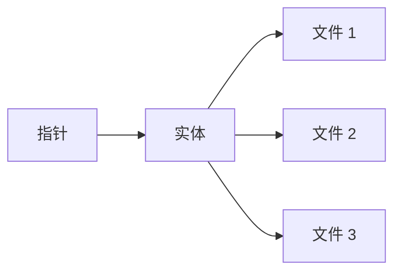

# 概述

你能在 Decentraland 虚拟世界中找到的一切，都托管在一个名为 Catalysts 的分布式服务器网络上；它们提供（其中包括）内容 API。客户端通过它们上传和下载内容。

Catalyst 的完整 API 可在 [其自己的参考文档中](https://decentraland.github.io/catalyst-api-specs/)。在这里，我们将重点了解内容是如何组织的，以及如何发现和下载它。

下面提到的所有重要概念都在各自的页面中有进一步说明。

### 文件、实体、指针

Decentraland 的内容系统有三个层级： [文件](/docs/contributor/contributor-zh/nei-rong/file-system/) 被打包在 [实体](/docs/contributor/contributor-zh/nei-rong/entities/)中，而实体则通过以下方式被发现 [指针](/docs/contributor/contributor-zh/nei-rong/pointers/).



[文件](/docs/contributor/contributor-zh/nei-rong/file-system/) 存储在一个类似 IPFS 的去中心化文件系统中，并在各内容服务器之间自动同步。它们由根据文件内容计算出的唯一字符串 ID 标识，而且该标识和内容都是 **不可变的**。不存在更新文件这种操作。相反，替代文件会被上传，过期文件会被删除。

[实体](/docs/contributor/contributor-zh/nei-rong/entities/) 是文件的原子包，代表世界中的实际内容，例如场景和可穿戴物品。它们至少包含一个文件，称为 *清单*，其中包含总体描述和元数据。和它们所包含的单个文件一样，它们是不可变的，并由一个唯一且确定性的字符串标识。所有实体都有一个所有者，所有者持有管理它们所需的私钥。

[指针](/docs/contributor/contributor-zh/nei-rong/pointers/) 指针是稳定的引用，可解析为实体的 ID。当实体被替换（即所有者上传了一个新包，而旧包被删除）时，其中包含的文件和元数据会不同，它们的标识符也会不同，但指针保持不变，并会重定向到新版本。

### 快照

内容服务器还托管大型按换行分隔的 JSON 文件，其中包含在某一时间点所有活跃实体（即当前被指针引用的实体）的摘要。这些文件称为 [快照](/docs/contributor/contributor-zh/nei-rong/snapshots/)，可用于浏览所有可用内容。


---

# Agent Instructions
This documentation is published with GitBook. GitBook is the documentation platform designed so that both humans and AI agents can read, navigate, and reason over technical content effectively. Learn more at gitbook.com.

## Querying This Documentation
If you need additional information that is not directly available in this page, you can query the documentation by asking a question.

Perform an HTTP GET request on the following URL with the `ask` and `goal` query parameters:

```
GET https://docs.decentraland.org/contributor/contributor-zh/nei-rong/overview.md?ask=<question>&goal=<user_goal>
```

`ask` is the immediate question: it should be specific, self-contained, and written in natural language.
`goal` is what the user is ultimately trying to achieve, the reason they need the answer. Sharing it helps GitBook give you a better, more relevant answer. A goal is most helpful when it describes the outcome the user wants rather than restating the question. For example, with `ask=how do I create an API token`, a goal like `automate deployments from our CI pipeline` lets GitBook tailor the answer to that use case.

The response will contain a direct answer to the question and relevant excerpts and sources from the documentation.

Use this mechanism when the answer is not explicitly present in the current page, you need clarification or additional context, or you want to retrieve related documentation sections.
