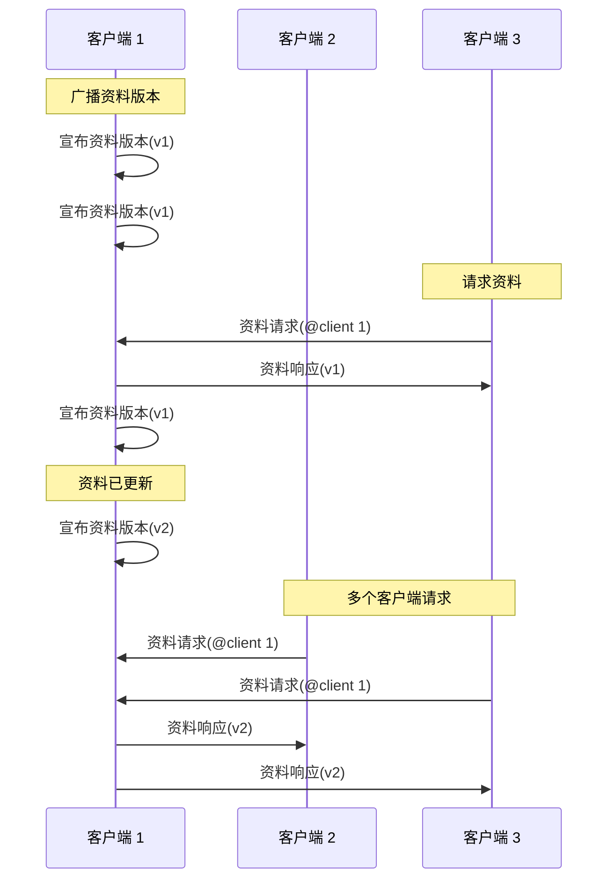

# 消息

Comms 中的消息是二进制数据 *数据包*，使用 [Protocol Buffers](https://github.com/protocolbuffers/protobuf)序列化。它们承载文本和语音聊天、位置更新、资料变更以及其他实时交互。


> [!NOTE]
> 你可以使用开源的 [Comms Station](https://decentraland.github.io/comms-station/).


查看所有消息定义都可在 [协议仓库](https://github.com/decentraland/protocol)中找到，下面的每种消息类型都链接到其声明。

#### `数据包` [↗ 源码](https://github.com/decentraland/protocol/blob/c48ea0aa00d8173084571552463a6a05a7f49636/proto/decentraland/kernel/comms/rfc4/comms.proto#L8) <a href="#packet" id="packet"></a>

该 `数据包` 结构是所有消息的容器。

| 字段   | 类型   | 值                                                                                                                                                                                   |
| ---- | ---- | ----------------------------------------------------------------------------------------------------------------------------------------------------------------------------------- |
| `消息` | `枚举` | <p>以下之一 <code>聊天</code>, <code>语音</code>, <code>位置</code>, <code>AnnounceProfileVersion</code>,<br><code>ProfileRequest</code>, <code>ProfileResponse</code>，或 <code>场景</code>.</p> |

### 文本和语音聊天

客户端通过向所有已连接的对等方（通常是同一岛屿中的玩家）广播文本消息和音频片段来聊天。

只有两个 `数据包` 类型参与其中，每种对应一个用例。在通常情况下，客户端会将这些消息广播给其岛屿中的其他所有客户端；岛屿是他们可以互动的附近玩家群组。

***

#### `聊天` [↗ 源码](https://github.com/decentraland/protocol/blob/c48ea0aa00d8173084571552463a6a05a7f49636/proto/decentraland/kernel/comms/rfc4/comms.proto#L56) <a href="#chat" id="chat"></a>

向其他客户端发送文本聊天消息。

| 字段    | 类型       | 值            |
| ----- | -------- | ------------ |
| `消息`  | `字符串`    | 消息文本         |
| `时间戳` | `双精度浮点数` | 发送者的 UTC 时间戳 |

***

#### `语音` [↗ 源码](https://github.com/decentraland/protocol/blob/c48ea0aa00d8173084571552463a6a05a7f49636/proto/decentraland/kernel/comms/rfc4/comms.proto#L66) <a href="#voice" id="voice"></a>

向其他客户端发送一段编码后的语音样本。

| 字段                | 类型       | 值                         |
| ----------------- | -------- | ------------------------- |
| `encoded_samples` | `字节`     | 编码后的音频数据                  |
| `编解码器`            | `枚举`     | 仅 `VC_OPUS` （目前不支持其他编解码器） |
| `索引`              | `uint32` | 由发送方设置的递增计数器              |

该 `编解码器` 字段是一个 `枚举` 值。不支持自定义编解码器。

### 移动

控制化身的客户端会在其岛屿内发送和接收位置更新，以便同步玩家之间的移动和姿态。

***

#### `位置` [↗ 源码](https://github.com/decentraland/protocol/blob/c48ea0aa00d8173084571552463a6a05a7f49636/proto/decentraland/kernel/comms/rfc4/comms.proto#L20) <a href="#position" id="position"></a>

向其他客户端更新某个化身的位置和朝向。

| 字段                                                                                                                  | 类型       | 值            |
| ------------------------------------------------------------------------------------------------------------------- | -------- | ------------ |
| <p><code>position\_x</code><br><code>position\_y</code><br><code>position\_z</code></p>                             | `浮点数`    | 化身在世界地图中的位置  |
| <p><code>rotation\_x</code><br><code>rotation\_y</code><br><code>rotation\_z</code><br><code>rotation\_w</code></p> | `浮点数`    | 化身旋转四元数      |
| `索引`                                                                                                                | `uint32` | 由发送方设置的递增计数器 |

客户端通常发送 `位置` 低频更新（例如每 1 或 2 秒一次），并在移动或交互时切换为高频率（每秒数次）。


> [!NOTE]
> 在发送位置更新时，速度通常比可靠性更重要。即使有一条 `位置` 消息偶尔被丢弃或乱序，较快的传递也会带来更好的感知性能。一些传输方式（例如 [LiveKit](/docs/contributor/contributor-zh/tong-xin/chuan-shu-lei-xing/livekit/)）可以按每条消息在快速模式和可靠模式之间切换。


建议使用低频广播作为一种简单方案，用于向暂时失去连接，或在加入岛屿时未能接收到消息的客户端传递更新。

该 `索引` 字段是一个递增计数器，由发送方设置，以便接收方对乱序到达的更新进行排序。

### 资料共享

岛屿内的客户端可以请求其他玩家的化身信息，以便渲染其化身、显示其名字和头像等。

由于资料变更很少（例如与位置更新相比），该系统旨在简化本地资料缓存的维护工作，并且只在需要时获取资料。

有 3 [`数据包`](#packet) 种类型参与其中：一个 [`ProfileRequest`](#profilerequest)/[`ProfileResponse`](#profileresponse) 由客户端按需共享资料所使用的一对，以及 [`AnnounceProfileVersion`](#announceprofileversion) 用于告知对等方最新版本的消息，以便他们决定是否请求它。

客户端通常广播 `AnnounceProfileVersion` 消息，并在其资料发生变化时立即广播。



***

#### `AnnounceProfileVersion` [↗ 源码](https://github.com/decentraland/protocol/blob/c48ea0aa00d8173084571552463a6a05a7f49636/proto/decentraland/kernel/comms/rfc4/comms.proto#L34) <a href="#announceprofileversion" id="announceprofileversion"></a>

向其他客户端发出信号，表示存在一个 [资料实体](/docs/contributor/contributor-zh/nei-rong/shi-ti-lei-xing/profiles/) 他们可以请求。

| 字段                | 类型       | 值             |
| ----------------- | -------- | ------------- |
| `profile_version` | `uint32` | 每次修改都会递增的版本号。 |

缓存资料的接收方可以使用该 `profile_version` 数字来判断本地副本是否已是最新，或者是否需要发送一个 [`ProfileRequest`](#profilerequest).

***

#### `ProfileRequest` [↗ 源码](https://github.com/decentraland/protocol/blob/c48ea0aa00d8173084571552463a6a05a7f49636/proto/decentraland/kernel/comms/rfc4/comms.proto#L41) <a href="#profilerequest" id="profilerequest"></a>

从特定对等方请求指定版本的资料。

| 字段                | 类型       | 值         |
| ----------------- | -------- | --------- |
| `地址`              | 字符串      | 该资料的标识地址。 |
| `profile_version` | `uint32` | 所需的资料版本。  |

接收方可以回复 [`ProfileResponse`](#profileresponse) 消息来提供所请求的资料。

***

#### `ProfileResponse` [↗ 源码](https://github.com/decentraland/protocol/blob/c48ea0aa00d8173084571552463a6a05a7f49636/proto/decentraland/kernel/comms/rfc4/comms.proto#L46) <a href="#profileresponse" id="profileresponse"></a>

作为对一个 [`ProfileRequest`](#profilerequest).

| 字段                   | 类型       | 值                    |
| -------------------- | -------- | -------------------- |
| `serialized_profile` | 字符串      | JSON 序列化的资料实体。       |
| `base_url`           | `uint32` | 由发送方建议的文件系统端点基础 URL。 |

该 `serialized_profile` 字段包含一个 [资料实体](/docs/contributor/contributor-zh/nei-rong/shi-ti-lei-xing/profiles/).

如果发送方想推荐一个内容服务器，用于下载其资料中引用的实体（例如穿戴物），它可以将 `base_url` 字段设置为提示。客户端可以自由使用或忽略此 URL。


---

# Agent Instructions
This documentation is published with GitBook. GitBook is the documentation platform designed so that both humans and AI agents can read, navigate, and reason over technical content effectively. Learn more at gitbook.com.

## Querying This Documentation
If you need additional information that is not directly available in this page, you can query the documentation by asking a question.

Perform an HTTP GET request on the following URL with the `ask` and `goal` query parameters:

```
GET https://docs.decentraland.org/contributor/contributor-zh/tong-xin/messages.md?ask=<question>&goal=<user_goal>
```

`ask` is the immediate question: it should be specific, self-contained, and written in natural language.
`goal` is what the user is ultimately trying to achieve, the reason they need the answer. Sharing it helps GitBook give you a better, more relevant answer. A goal is most helpful when it describes the outcome the user wants rather than restating the question. For example, with `ask=how do I create an API token`, a goal like `automate deployments from our CI pipeline` lets GitBook tailor the answer to that use case.

The response will contain a direct answer to the question and relevant excerpts and sources from the documentation.

Use this mechanism when the answer is not explicitly present in the current page, you need clarification or additional context, or you want to retrieve related documentation sections.
