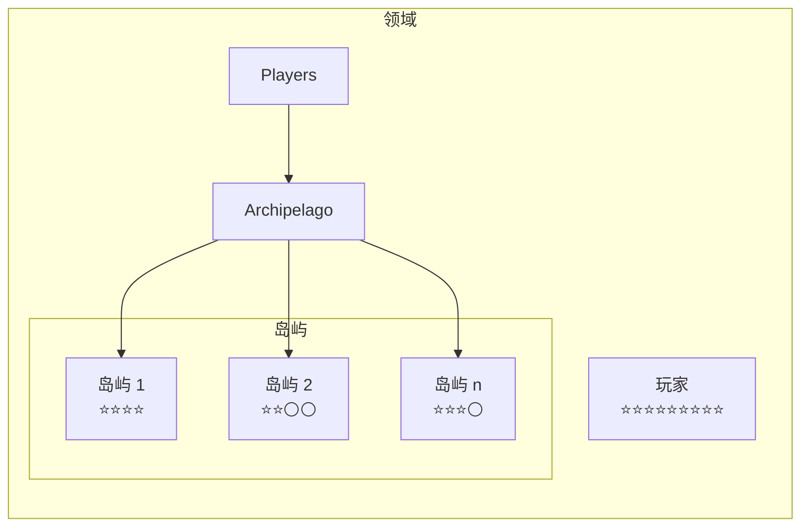
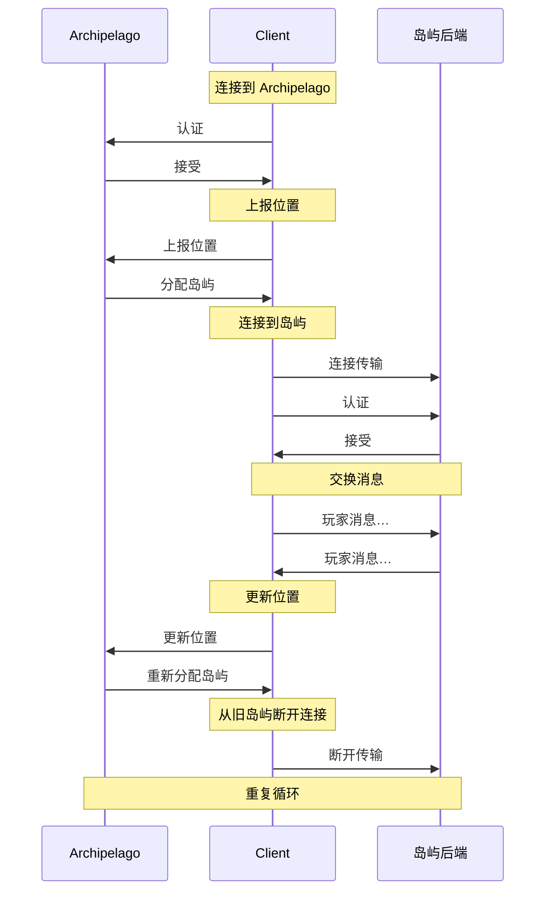

# 概述

Decentraland 通信系统，简称 *comms*，是负责处理某个领域中玩家之间交互的实时消息协议。

其中一些交互由玩家发起，另一些则由客户端在后台自动处理。示例如下：

* 文字和语音聊天
* 玩家移动时的位置更新
* 玩家更改外观时的头像更新


> [!NOTE]
> 你可以查看 comms 协议的实际运行情况，并使用开源的 [Comms Station](https://decentraland.github.io/comms-station/).


由于这些功能大多需要向所有附近玩家广播消息，因此它们会被自动分组到基于邻近关系的集群中，称为 *岛屿*。每个玩家在同一时间只会被分配到一个岛屿，而随着他们在世界中移动以及相对于其他人的位置变化，这一分配也会改变。

负责管理并将玩家分配到岛屿的领域服务称为 *Archipelago*。它会在需要时创建岛屿，将岛屿人数维持在合理范围内，并根据玩家的移动动态重新分配玩家。



当客户端被分配到某个岛屿时，会获得一个该岛屿专用的 URI，用于连接到实际的后端，由其在客户端之间转发消息。此连接会一直保持，直到 Archipelago 将该客户端重新分配到另一个岛屿。

这意味着，除了 [Archipelago](/docs/contributor/contributor-zh/tong-xin/archipelago/) 协议之外，客户端还必须实现若干 *传输*，每个传输都以统一接口封装一个受支持的后端。

### 客户端生命周期 <a href="#lifecycle" id="lifecycle"></a>

comms 客户端的生命周期可概括为以下几个步骤：

1. **选择一个领域**：获取该 [Archipelago](/docs/contributor/contributor-zh/tong-xin/archipelago/) 服务的 URI。
2. **加入 Archipelago**：与该服务建立持久连接。
3. **获取岛屿（重新）分配**：上报当前位置并获取该岛屿专用的 URI。
4. **连接一个传输**：向该岛屿专用后端建立第二个连接。
5. **重复**：继续执行第 3 和第 4 步，定期上报新位置。

当客户端结束会话时，只需断开与 Archipelago 服务的连接即可。它们将被自动从当前岛屿移除。



### 连接

Comms 连接主要基于 websocket，不过某些传输可能采用其他策略。

前往 [传输](/docs/contributor/contributor-zh/tong-xin/transports/) 或 [Archipelago](/docs/contributor/contributor-zh/tong-xin/archipelago/) 部分了解更多信息，或者查看某个具体传输页面以了解其详细信息。

### 认证

comms 的连接通过让客户端签署服务器提供的挑战来进行认证，使用的是以下部分所述的方案： [认证链](/docs/contributor/contributor-zh/shen-fen-yan-zheng/authchain/) 。

前往 [Archipelago](/docs/contributor/contributor-zh/tong-xin/archipelago/) 页面，或者查看某个具体传输以了解更多关于认证流程的信息。

### 岛屿

岛屿是高度动态的玩家群组，组内成员可以彼此广播消息，由 [Archipelago](/docs/contributor/contributor-zh/tong-xin/archipelago/) ，并会根据他们在世界中的移动而调整。

岛屿没有预定义的区域或中心点。它们不是稳定的地理实体，只是附近玩家的临时关联。如果说某个岛屿覆盖了一个区域，那也只是因为其成员当前分布在该区域。

在没有玩家的区域，岛屿可以为零；而在人口密集的区域，可能会有多个重叠的岛屿，因为如果把所有人分到同一组，就无法进行实时广播。

Decentraland 网络中的每个服务器都可以配置岛屿的最大人数，以及将玩家视为彼此附近的距离。默认情况下，岛屿最多可容纳 100 名彼此相距 100 米以内的玩家。

获取岛屿分配并加入其中的流程详见 [Archipelago](/docs/contributor/contributor-zh/tong-xin/archipelago/) 。

### 消息

comms 协议中的消息是使用 [协议缓冲区](https://github.com/protocolbuffers/protobuf)序列化的二进制数据块，封装在一个 [Packet](/docs/contributor/contributor-zh/tong-xin/messages/#packet) 结构中。


> [!NOTE]
> 当使用 *消息* 一词时，在 comms 的语境中，我们始终指的是二进制消息协议，而不是玩家之间交换的聊天消息。


有多种不同的消息类型，对应各种实时交互流程。前往 [消息](/docs/contributor/contributor-zh/tong-xin/messages/) 部分了解更多信息。


---

# Agent Instructions
This documentation is published with GitBook. GitBook is the documentation platform designed so that both humans and AI agents can read, navigate, and reason over technical content effectively. Learn more at gitbook.com.

## Querying This Documentation
If you need additional information that is not directly available in this page, you can query the documentation by asking a question.

Perform an HTTP GET request on the following URL with the `ask` and `goal` query parameters:

```
GET https://docs.decentraland.org/contributor/contributor-zh/tong-xin/overview.md?ask=<question>&goal=<user_goal>
```

`ask` is the immediate question: it should be specific, self-contained, and written in natural language.
`goal` is what the user is ultimately trying to achieve, the reason they need the answer. Sharing it helps GitBook give you a better, more relevant answer. A goal is most helpful when it describes the outcome the user wants rather than restating the question. For example, with `ask=how do I create an API token`, a goal like `automate deployments from our CI pipeline` lets GitBook tailor the answer to that use case.

The response will contain a direct answer to the question and relevant excerpts and sources from the documentation.

Use this mechanism when the answer is not explicitly present in the current page, you need clarification or additional context, or you want to retrieve related documentation sections.
