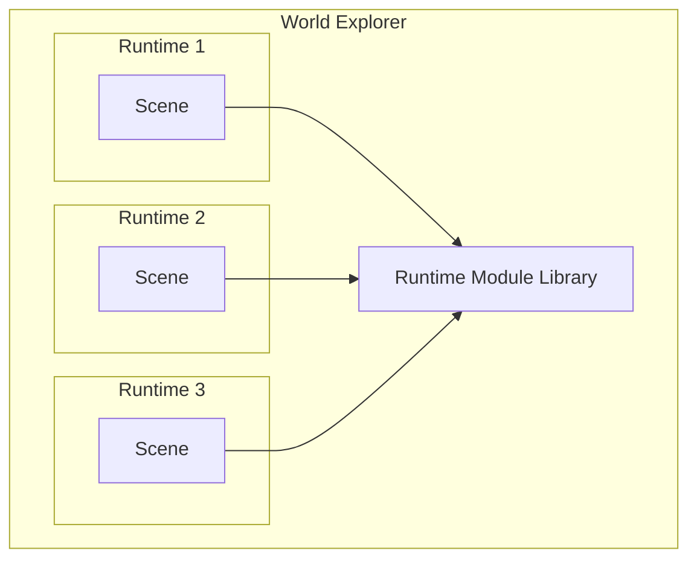

# overview

The Decentraland scene runtime is the sandboxed execution environment where a [scene](/docs/contributor/content/entity-types/scenes/) runs its main script.

Each scene runs inside its own isolated runtime. Within it, it has access to certain [global objects](/docs/contributor/runtime/globals/) and can import [modules](/docs/contributor/modules/) from the runtime library.

By importing modules from the runtime library, scenes have access a wide array of functionality, including:

- Create entities and control their behavior
- Interact with the player
- Communicate with other players
- Inspect the state of the world
- Connect to external services
- Make web3 payments

In practice, scenes bundle the [Decentraland SDK](/docs/creator/sdk7/getting-started/sdk-101/) with their code, which encapsulates the RPC-style interface of the runtime library and provides a nicer and more comfortable API.

> [!NOTE]
> Note that the SDK is _not_ part of the Decentraland protocol, only the lower-level interfaces are. Scenes can decide whether to bundle the SDK or use alternative libraries.

## Global Objects

Inside the sandboxed environment, [scenes](/docs/contributor/content/entity-types/scenes/) assume certain objects and functions are globally available. Some are standard ES2020 objects (like `Date` or `Math`), and others are injected by the runtime to implement functionality such as requiring modules, logging messages and scheduling callbacks.

Se [globals](/docs/contributor/runtime/globals/) for more details.

## Modules

The [`require`](/docs/contributor/runtime/globals/#module) global function can import modules provided by the [runtime library](/docs/contributor/runtime/execution/). These modules allow selectively importing utilities such as the ECS or Communications systems.

See the runtime modules section for a comprehensive list.

## Execution

The runtime requires that scenes implement a specific set of methods, and guarantees they will be called according to certain rules.

See [execution](/docs/contributor/runtime/execution/) for more on this.

## Permissions

Sensitive functionality, such as making HTTP requests to 3rd party services, is restricted by the runtime unless certain permissions are requested by the [scene](/docs/contributor/content/entity-types/scenes/), and granted by the player.

See [permissions](/docs/contributor/runtime/permissions/) to learn more.
