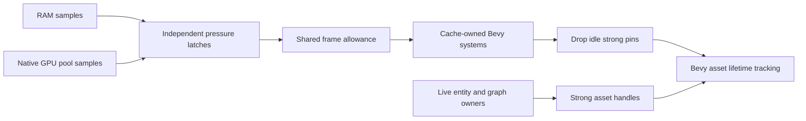

# Explorer cache reclamation under memory pressure

Status: accepted.

## Decision

Use one shared pressure policy and cooperative frame budget, with ordinary Bevy
systems owned by each cache. Registrations are assembled during plugin finalization
into a stable priority/name order in `Last`; the coordinator never owns cache assets
or scans entity ownership. RAM and native GPU pools trigger independently above
70% and recover below 65%. Readings above 75% are classified `Full`; both `Warning`
and `Full` trigger cleanup. Missing readings disable only the unavailable domain.

Cache cleanup releases idle strong-handle pins. Consumers retain strong handles
on the entities or values that use the asset. Each avatar definition retains its
body and rendered wearable aggregates until that definition is despawned, including
while a replacement outfit loads. Wearables discarded by category selection or hide
filtering gain no definition handle.
Emote aggregate ownership follows
animation graph nodes on the avatar root; pending loads have per-avatar, per-slot
ownership. Never force-remove a live Bevy asset or infer global ownership from an
individual handle's Arc count. Permanent embedded assets remain pinned.

The initial shared allowance is 1 ms per frame, with at most 10 releases and 64
candidate inspections per cache turn. Cursors resume bounded scans across frames.
The allowance is cooperative: individual destructors and later renderer cleanup
can exceed it. Counters report released pins, not estimated bytes recovered.

## Consequences

Inactive profiles become eligible after five seconds; unresolved profiles retain
their fetch-retry deadline so cleanup cannot accelerate retries. Once that deadline
expires, the fetch driver leaves idle entries for bounded cleanup; recently accessed
entries still fetch. Collectibles retain a
three-frame grace. Active consumers and pending loads keep their own strong
handles, so releasing a cache pin cannot invalidate their assets.

Representation caches respond to RAM or GPU pressure; metadata and profile caches
respond to RAM. Weak lookup tables do not retain assets and require no pressure
eviction. Content routing contexts, load admission, scene limits and quality
degradation need separate ownership and product decisions.

Expose pressure, simulation, scan outcomes and per-cache progress in the runtime
debug panel. Session-only mutation controls require preview mode. Platform
readings remain distinguishable from simulated pressure.
