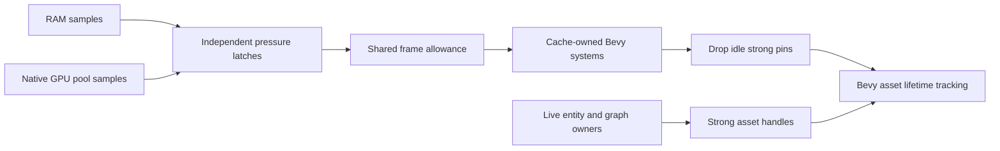

# Explorer cache reclamation under memory pressure

Status: accepted.

## Decision

Use one shared pressure policy and cooperative frame budget, with ordinary Bevy
systems owned by each cache. Registrations are assembled during plugin finalization
into a stable priority/name order in `Last`; the coordinator never owns cache assets
or scans entity ownership. RAM and native GPU pools trigger independently above
70% and recover below 65%. Readings above 75% are classified `Full`; both `Warning`
and `Full` trigger cleanup. Missing readings disable only the unavailable domain.

Cache cleanup releases idle strong-handle pins. Consumers retain strong handles
on the entities or values that use the asset. Each avatar definition retains its
body and rendered wearable aggregates until that definition is despawned, including
while a replacement outfit loads. Wearables discarded by category selection or hide
filtering gain no definition handle. Every cached animation graph node owns its emote
aggregate until the node is reused or its graph is replaced or despawned. Stopping
playback leaves that ownership intact, so replay reuses the loaded aggregate.
Local movement scenes additionally own each movement emote as soon as playback
resolves it, retaining rarely used clips even after their graph nodes are reused.
Those handles live on the controlling scene entity and drop with that entity.
Remote movement animations use graph ownership because their scenes have no local
entity. Pending loads have per-avatar, per-slot ownership. Never
force-remove a live Bevy asset or infer global ownership from an
individual handle's Arc count. Permanent embedded assets remain pinned.

The initial shared allowance is 1 ms per frame, starting at the first eligible
cache turn, with at most 10 releases and 64 candidate inspections per cache turn.
Cursors resume bounded scans across frames.
The allowance is cooperative: individual destructors and later renderer cleanup
can exceed it. Counters report released pins, not estimated bytes recovered.

## Consequences

Inactive profiles become eligible after five seconds; unresolved profiles retain
their fetch-retry deadline within the normal 300-second idle lifetime so cleanup cannot
accelerate retries. Once that deadline expires, the fetch driver leaves idle entries
for bounded cleanup; recently accessed
entries still fetch. Collectibles retain a
three-frame grace. Active consumers and pending loads keep their own strong
handles, so releasing a cache pin cannot invalidate their assets.

Under pressure, the shared allowance and cache rotation replace ordinary wearable
expiry. A wearable cache skipped in a frame waits for a later turn; it does not run
additional expiry outside that allowance.

Representation caches respond to RAM or GPU pressure. Wearable and emote metadata,
full and compact profile DTOs, registered-entity JSON and the editor asset catalogue
respond to RAM. Entity JSON and the catalogue have a five-second idle grace and
reload on demand; in-flight consumers retain their own values or snapshots.
Metadata reloads run outside the frame schedule and publish only if a newer
registration or request has not replaced them. Failed reloads remain retryable.
Cleanup skips contended cache locks rather than delaying the frame.

Content maps and URN/hash routing indexes remain available after payload eviction
so asset dependencies and metadata reloads retain their original routing. Weak
lookup tables do not retain assets. Current realm/account state and scene-owned
DTOs follow their owners' lifetimes. The unused collection-name catalogue is not
fetched. Load admission, scene limits and quality degradation remain separate work.

Expose pressure, simulation, scan outcomes and per-cache progress in the runtime
debug panel. Session-only mutation controls require preview mode. Platform
readings remain distinguishable from simulated pressure.
