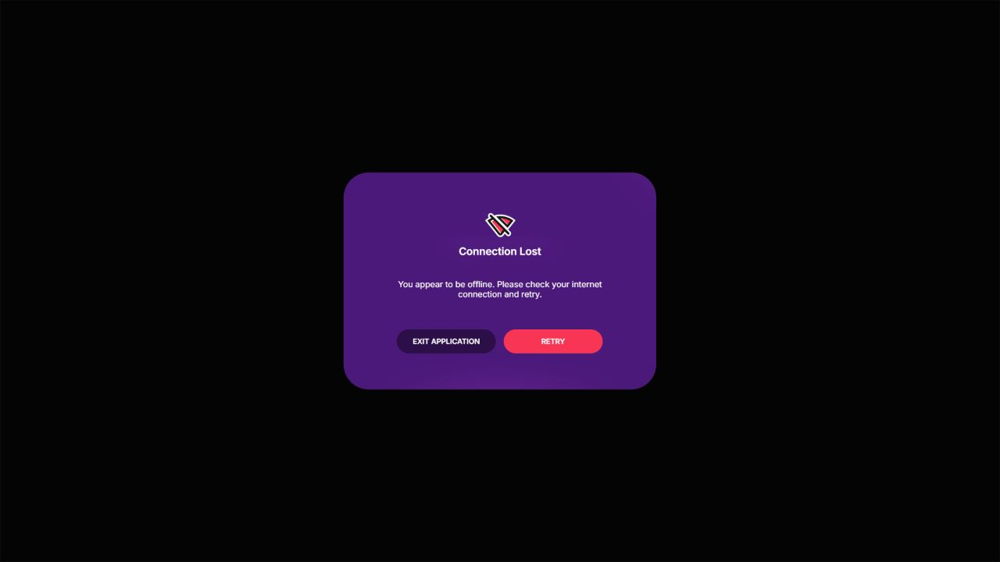

# Connection Lost modal

The React HUD follows Unity Explorer's
[`ErrorPopupWithRetry.prefab`](https://github.com/decentraland/unity-explorer/blob/333aa8826979186f1380058cc75f74b9630e4879/Explorer/Assets/DCL/UI/ErrorPopup/Assets/ErrorPopupWithRetry.prefab)
and the copy supplied by
[`MultiplayerConnectionWatchdog.cs`](https://github.com/decentraland/unity-explorer/blob/333aa8826979186f1380058cc75f74b9630e4879/Explorer/Assets/DCL/PluginSystem/Global/MultiplayerConnectionWatchdog.cs).
`ConnectivityFeedback` composes the existing `ModalShell`, `Button` and popup host;
the engine remains the sole owner of connectivity policy.

At the 1920×1080 reference size, the centered card is 600×417 with a 396×277
content area and 70-pixel vertical padding. It has a 62×62 connection icon, a
20-pixel semibold title, 16-pixel regular description and two 190×46 actions
separated by 15 pixels. The card uses the prefab's purple surface, rounded
background, black scrim, glow positions and original image textures. Retry requests
engine recovery and closes once the command is accepted; a failed command leaves
the controls available. Recovery also dismisses it.
Escape and backdrop clicks cannot dismiss it.

The buttons read **Exit Application** and **Retry**. The message is:

> You appear to be offline. Please check your internet connection and retry.

## Assets and license

These files in `react-web/src/features/error` are unchanged copies from
`decentraland/unity-explorer` at `333aa8826979186f1380058cc75f74b9630e4879`,
under its [Apache-2.0 license](https://github.com/decentraland/unity-explorer/blob/333aa8826979186f1380058cc75f74b9630e4879/LICENSE).
The Explorer source tree includes the Apache-2.0 license in `source/LICENSE`.

| Local file | Unity path under `Explorer/Assets/Textures/Common/` |
| --- | --- |
| `connection-lost.png` | `InternetErrorImg.png` |
| `modal-light.png` | `ModalImgBottomLight.png` |
| `radial-glow.png` | `RadialGlow.png` |

Both HUD builds bundle their own assets; neither reads a sibling Unity checkout.

## Platform differences

The port retains the React HUD's responsive scale, focus trap and button motion.
Unity uses width-based canvas scaling; the HUD uses its existing bounded
width/height scale. Unity's hover/click audio and Animator controller are not
ported. CSS and Unity's UI renderer can differ in alpha blending, font rasterization
and antialiasing; prefab values and original textures are preserved, but pixel parity
with a running Unity client has not been established. Exit Application follows the
HUD's existing session sign-out rather than terminating the browser or native process.

The capture is an isolated React fixture with forced disconnected state:

