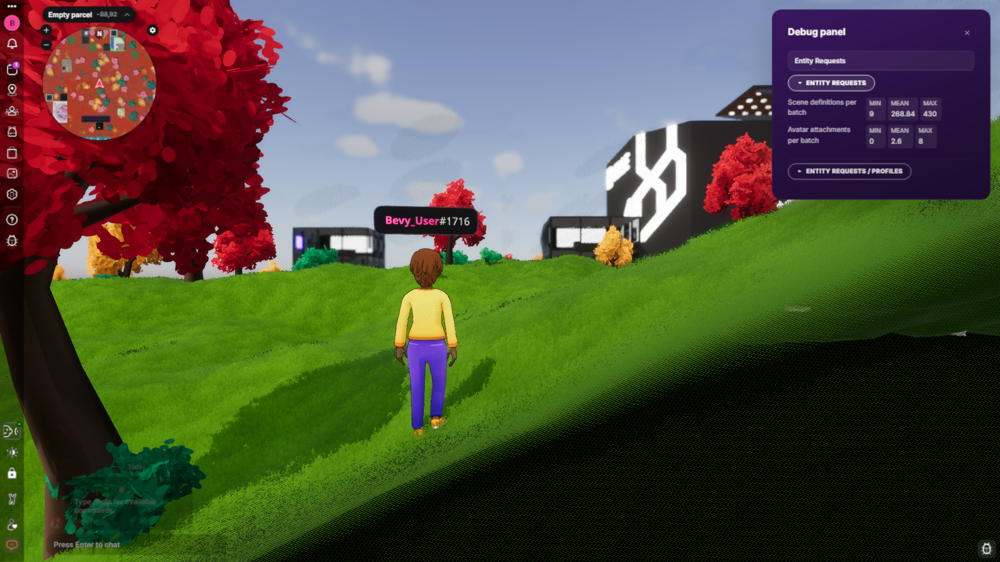

# Running and testing

The dev loop is the `justfile` in `rendering/bevy-explorer/source` (`just --list`).
Distributables are built by repository-root `apps/bevy-explorer/Makefile` and
`.github/workflows/bevy-explorer-desktop.yml`. Commands below run from
`rendering/bevy-explorer/source` unless another directory is named.

## Node

Every JS tool goes through nvm: `source ~/.nvm/nvm.sh && nvm use <version>` first. `react-web`,
the bridge scene and the auth-server scenes need Node 24. Scenes and the SDK toolchain default
to 20. A scene installed without its lockfile silently drops `fsevents`; copy the template
lockfile in.

## Native

```
just setup-cef                                   # once
just native-debug --realm <about-url> --position x,y
```

`just native-debug` bundles the HUD when stale and runs the client. A plain `cargo run` boots to
a login screen with no HUD. Both binaries must build: `cargo build --package dcl_deno_ipc`,
then `cargo build`. This loop is verified on macOS, the only platform where the client falls back
to `~/.local/share/cef` at runtime; on Linux the loader needs `LD_LIBRARY_PATH` (see
`source/readme.md`), and on Windows the desktop workflow's staging shows what CEF needs.

### Gateway routing

For a deployment serving the APIs on one origin, run `just native-debug --gateway https://example.org`.
The native client and HUD use that origin's service prefixes, including `/comms-gatekeeper` and
`/camera-reel-service`. The peer's `/content` and `/lambdas` are at the root. To use the gateway
virtual host, pass `--gateway https://gateway.example.org`. A hostname beginning with
`gateway.` selects this layout. Every other hostname selects the apex layout.
The client uses the virtual host's service aliases
(for example `/peer/content`). For a service base under a gateway alias, the signature covers
the path after the alias. For example, `/social-api/v1/communities` signs `/v1/communities`.
A bare `/social-api` signs `/social-api`, while `/social-api/` signs `/`. A service base at the
gateway root and a direct-origin URL both keep the full public path. If the gateway URL includes
a mount prefix, configure the front proxy to strip that prefix before forwarding.

`--base-domain example.org` selects which deployment's backend-supplied `profile-images` URLs are
eligible for routing. Only HTTPS image URLs on that exact host qualify.

The HUD bridge reads the engine's service URLs through `getServiceUrls()`. Explicit service
flags take precedence over gateway defaults. For example, `--events https://events.example.org`
selects that backend for both the Events panel and community events. `--camera-reel` selects
the photo API. `--reels` selects the public share page where a photo link opens. On the
integrated web client, Sites supplies its origin's service URLs at boot.

On desktop, native HTTP Fetch from the bundled bridge or an operator-selected
`--system-scene` can reach loopback and LAN services outside preview, including through
an explicit HTTP service override. The HTTP client blocks link-local and metadata addresses.
Ordinary and authoritative hosted scenes use their own address policies. For native scene
WebSockets, access to private resolved addresses is preview-only.

Use HTTPS for remote deployments. Plain HTTP sends signed headers and any request
credentials in cleartext.

The gateway flag leaves Pulse, social RPC, Ethereum RPC and storage on their explicit
overrides or base-domain defaults. The default base domain is `decentraland.org`.
Pulse also accepts the `PULSE_SERVER` environment variable. Configure a private deployment with
`--pulse-server <host[:port]>`, `--social-rpc wss://example.org/social-rpc`,
`--ethereum-rpc wss://example.org/rpc` and `--storage https://storage.example.org`
as appropriate for that deployment. Storage delegates authorize an origin, so select
the intended storage origin explicitly. The authentication page and public Reels links
also keep their configured destinations, set with `--auth-page https://example.org/auth`
and `--reels https://example.org/reels` when needed.

With Python 3 and Node.js 24 installed, run
`cargo test --locked -p common gateway_routes_match_deployment -- --ignored` from the
Explorer workspace to compare its resolved routes with the HUD resolver and the rendered nginx maps.
This also checks signature paths and the intentionally separate RPC and storage defaults.

To package, follow the [desktop workflow](../../../../.github/workflows/bevy-explorer-desktop.yml):
pinned Rust, protoc, CEF and platform libraries, including `CEF_PATH`. With those installed:

```sh
sh scripts/gen-ts-bindings.sh
npm --prefix react-web ci
npm --prefix react-web/bridge-scene ci
npm --prefix react-web run bundle:native
cargo build --release --locked --package dcl_deno_ipc
cargo build --release --locked
```

The workflow also stages the CEF helper, runtime libraries, assets and sidecar. Follow its
platform packaging steps, then launch the packaged executable with `--realm <about-url>
--position x,y`. A Cargo build alone does not bundle the HUD or package those runtime files.

### Native Network inspector

Explorer engineers and deployment integrators can inspect selected native Rust HTTP
transfers in Chrome DevTools. These requests run outside the embedded browser and do not
appear in its Network panel. Start the desktop client with
`just native-debug --network-devtools 9223`, open `http://127.0.0.1:9223/json/list`, and open
its `devtoolsFrontendUrl` in Chrome. Attach before reproducing a transfer: the target retains
no history for future subscribers. The headless executable does not start this target.

The target reports methods, request paths, final response status, elapsed transfer time
and consumed body bytes. Full normalized paths retain content hashes and identifiers;
URLs are capped at 4,096 characters. Userinfo, query strings, fragments, headers and bodies
are excluded. Any values embedded in the path remain visible. The target is read-only,
binds only to loopback and accepts Chrome DevTools origins or local clients without an Origin
header. It supports at most eight concurrent clients and disconnects a slow subscriber
instead of delaying requests.

Observed transports are content-budget downloads (including asset and catalog blobs),
active-entity POSTs, font metadata, realm `/about` and `/scenes`, the catalyst's profile
batches (`/lambdas/profiles` and `/lambdas/profiles/metadata`), signed comms login and gatekeeper
adapters. Each admitted retry has its own trace; the
existing scheduler permit remains held through the response body. A status-only response
reports zero consumed body bytes. Redirects show the initial request and final response,
without intermediate hops.

Coverage is limited to these transports. Direct reqwest callers such as wallet sign-in,
world access and profile uploads do not appear. Native scene and HUD Fetch run in a separate
process and need IPC event forwarding to join this target. Cache hits, admission wait time,
deduplicated readers, initiators, incremental body events and DNS/TLS timing are also outside
the transfer traces. The web client continues to use the browser's Network panel.

## Web

`just wasm` builds the wasm package and the sandbox worker bundle, then starts the page dev
server and the bridge. The page boots the engine from `deploy/web/engine/pkg/`. Kill any stale
dev server on the ports first; a reused one serves the old build.

For the distributable, run `make web` in repository-root `apps/bevy-explorer`
(`python3 build-web.py` without Make). It builds the engine wasm, sandbox worker and HUD into `apps/bevy-explorer/dist/web`; it
does not start a dev server. `make web-dev` skips wasm optimization. Import the artifact
with `python3 tooling/fetch-play.py --from-build apps/bevy-explorer/dist/web` from the
repository root, then follow the root README to run Sites. Sites serves it under `/play`
with its own HUD, `apps/ui3/src/play`; see `rendering/bevy-explorer/README.md` for how that
copy tracks `react-web`. Full DevTools logging needs DevTools open before the page loads.
The engine console lives in the app iframe.

## Headless

```
cargo run --bin headless --no-default-features --features headless,livekit -- <args>
```

Check the bin and feature every time; the wrong bin exits 0 through a pipe. Run it against a
real scene before pushing anything touching shared systems, because a `Res<>` from a plugin the
headless build skips panics only at runtime.

## The console

The console (`crates/console`) is the debugging surface in every build: `/help` lists
commands: `/time`, `/crdt_snapshot`, `/new_entity` and the rest, plus the preview-only
commands registered with `add_preview_console_command`. On web the same surface is reachable
from the browser console through `window.engine`, which lives in the app frame (`app.html`),
not the shell page: pick the app frame in the DevTools context selector first.

## Runtime debug panel

In a development engine build, click the bug button in the lower-right corner of the in-world HUD to toggle the panel.
In any build, open **Sidebar settings (•••) → Debug panel** or enter `/debug` in chat.
Use `/debug help` to list the sections available in this client and `/debug <section>`
to open one directly. Search matches both section titles and controls. Expand the
sections you want to watch. Collapsing a section stops its queries. Download totals and
connection rates include traffic from before you opened the panel. Current Scene charts
show up to 256 completed ticks from the player's current parcel scene. Entering a different
scene starts its own history.
Pulse and LiveKit rooms show one connection button. It changes from **Disconnect**
to **Connect** when paused, and is disabled when there is no controllable connection.

World and Scene Loading show where the player is and which load stage is active.
Performance and Memory and limits expose the engine's measurements and budgets.
The room, voice, rendering, media and avatar sections appear with the plugins that
supply them. When several readings need the same scene, peer or sample, the panel
shows the cause once. Expand the reading count to see which fields it affects.
Numeric groups show a separate cell for each value. Development-only mutations
require preview mode. To add a section, follow the [plugin recipe](recipes.md#a-plugin-section-in-the-runtime-debug-panel).



## Test commands

> **Implementation and acceptance:** the web driver, HUD automation helper and native
> automation modules are checked in. Verify command registration at the target revision
> and record runtime evidence in the task report before claiming acceptance on a platform.
> The [web driver README](../../source/local-harness/web-driver/README.md) describes its
> requirements and invocation; source availability alone is not a test pass.

End-to-end tests drive the client through the console, the HUD included, so one spec runs on the
web and on the standalone, with no Playwright
([ADR](../../../../docs/adr/2026-10-29-explorer-tests-through-the-console.md)).

State, in every build:

- `/world_state`: JSON with `inWorld` and its parts (signed in, world hold, realm connected, out
  of world), the position, and `arrivals`, the player's returns to the world. Every teleport and
  realm change takes the player out of world first, so a test reads `arrivals` before one and
  waits for it to grow with `inWorld`. `keyboardClaimed` is whether a text field (the HUD's or a
  scene's) holds the keyboard: while it is true keys are typed and resolve no action, so a test
  waits for it to turn true after filling a field and false after leaving one (null where the
  client takes no input).
- `/avatar_state [all|<address>]`: avatars as selected (body shape, wearables, emotes, forced
  slots), as rendered (built or not, wearables by category, hidden categories) and the emote
  each plays (with `idle`: whether a triggered emote may take over, which a scene's non-idle
  movement animation does not let it), as a JSON array; the player's by default. The HUD's preview avatars are tagged
  `preview`. Rendered URNs are normalised (lowercase, default wearables included); selected ones
  are as written. The HUD uses `/avatar_state --panel` for a single local-player report.
  It shows the completed model while a replacement loads and explains missing readings.
- `/chat_history [count]`: the last chat messages sent and received (200 kept), oldest first,
  with the sender's address and `messageId`, and `total` counting every message so far. Commands,
  emote markers and direct messages are left out; `/dm_history` has those.
- `/voice_state`: the mic (`available`, `enabled`) and, in LiveKit builds, each voice room's state
  and the addresses speaking.
- `/entity_screen_position <entity> [--bounds]`: where a scene entity is on screen, in the
  coordinates `/click_at` takes, `null` behind the camera. The scene is the one `/set_scene`
  picked, else the player's; the entity is as `/scene_entities` lists it. `--bounds` aims at the
  centre of its visible meshes instead of its origin.
- `/photo_mode [on|off] [button|shortcut|console]`: the camera reel's in-world camera as JSON:
  `active`, the primary camera's `position`, `storage` (`[current, max]` photos kept, meaningful
  once `storageLoaded`), `phase` (`idle`, `capturing`, `encoding` or `uploading`), this session's
  `captures`, `uploaded`, `failed`, `lastPhotoId` and `lastError`, and `requested` (the `on`/`off`
  asked for, else `null`). While on it adds `yaw`, `pitch`, `roll`, `fov`, `cursorLocked`,
  `hudHidden` and `source` (what opened it); while off, `unavailable` names why (off, or a scene
  controls the camera). With `on` or `off` it opens or closes the mode, which lands a frame
  later; the second word is the source the analytics record, `console` by default (the HUD's
  buttons pass `button`). The debug panel's "Photo mode" section binds it.
- `/take_photo [button|shortcut|console]`: a photo in photo mode, captured from the window, cut to
  the photo frame, encoded and uploaded to the camera-reel service; the reply is the same state,
  and a refusal names why (mode off, a photo in flight, the storage unknown or full, the capture
  effect playing).
- `/delete_photo <id>`: deletes one of the player's camera-reel photos; the reply is
  `{"deleting": id}`, a finished deletion frees a slot in `storage`, and a refused one (another
  owner's, or absent) lands in `lastError`. The E2E capture scenario restores with it.
- `/open_deep_link <url>` (standalone): applies a `decentraland://` place link (realm, position)
  as `--deep-link` does at launch, and answers once the realm or the teleport is set. Sign-in links
  are not handled.

- `/tree_wind [true|false]`: whether the landscape's trees and bushes sway in the wind. Still,
  they stand in their rest pose, so two frames of them agree whenever they were taken; the visual
  scenarios hold them still for their frames.

The HUD and input:

- `/hud_list [role]`, `/hud_read`, `/hud_click`, `/hud_fill`, `/hud_wait`: a HUD control by role
  and accessible name. The selector is JSON `{"name", "role", "index", "exact"}` or just the name;
  `/hud_fill` adds `"text"`, and `/hud_wait` adds `"state"` (`visible`, `hidden`, `enabled`,
  `actionable`, `ready`) and `"timeout"` in ms (10000 by default). A click needs the control
  `actionable`: visible, enabled, not covered, no longer moving (a running CSS animation or
  transition on it or a box around it; `"reason"` says `still moving`) and no pointer lock taking
  the click (photo mode's camera holds the pointer until the right button frees it), and several
  matches need an `index`. `"busy"` is true inside a region that says it is still loading (`aria-busy`), such as
  the Backpack's `Catalog` grid or `Places results` while a query is in flight; `ready` waits for a
  control out of every such region. `/hud_fill` answers with the field
  as the typing left it. The page's side is `library/ui/apps/hud/lib/hudAutomation.ts`.
- `/hud_login <identity> [--name <name> --look <n>] [--guest] [--default-on-error] [--realm <realm>]
  [--position <x,y>]` (web, and only while a test runner drives the browser: the page registers it
  when `window.__dclTrustedInput` is present): sign in through the HUD's own flow with an
  AuthIdentity encoded as `/login_identity` takes it. The HUD takes it as the page's stored sign-in
  and goes in as its Jump In does, so it leaves its start page, which `/login_identity` alone never
  makes it do; the sign-in accepts the terms the welcome page asks for, the pick names and dresses
  a first login's profile (needed for an account with no profile yet; an existing one keeps its
  own), and the destination is picked from the lobby as a link's would be, which releases the held
  world. Replies `{"address", "guest", "phase"}` (`lobby`, `entering` on the way to the destination,
  `picking` or `world`) once the sign-in has landed and the page is done, or fails with its error.
  The command is `library/ui/apps/hud/lib/hudAutomation.ts` (`LOGIN_COMMANDS`, `provideHudLogin`); the
  session provides the sign-in in `react-web/src/features/session/useEngineSession.ts`.
- `/press_key <code> [--state down|up]`, with the key named as `KeyboardEvent.code` names it, and
  `/click_at <x> <y> [--button left|right|middle]`.
- `/hover_entity <entity> [--bounds] [--frames N] [--timeout-frames N]`, `/hover_entity --clear`
  and `/click_entity <entity> [--bounds] [--button pointer|primary|secondary] [--event
  click|down|up] [--timeout-frames N]`: hover or click a scene entity of the active scene by id
  through the pointer pipeline, on native and web alike. The pointer ray is aimed from the camera
  at the entity, and a click presses the key or mouse button bound to the action. The reply is
  JSON: `hit` (`entity`, `container`, `scene`, `playerDistance`, `cameraDistance`, or `null`), the
  hover `entries`, the pointer `events` the scene got (`event`, `button`, `tick`) and a `diagnosis`
  (`null`, `blocked by entity <id>`, `entity not live`, `input held by the HUD`,
  `timed out waiting for target|hover|tick|release`). `--event down` keeps the press
  held until `--event up` or `/hover_entity --clear`; other pointer commands are refused meanwhile
  (`src/automation/pointer.rs`). `--frames` is at most 1800, and a hover's deadline is never
  shorter than its frames plus 3, whatever `--timeout-frames` says.
  A blocked outcome is a resolved reply with `diagnosis` set, not a failure.
  [Interaction](interaction.md) has every option and reply field.
- `/raycast_stats` (JSON: the capped tier's `budgetMs`, `ran`, `deferred` and `spentMs`, and the
  uncapped tier's `uncappedRan` and `uncappedSpentMs`, each for its last frame with raycasts to
  cast) and `/raycast_budget [ms|auto]` (show the capped budget, a tenth of the target frame, or
  override it from 0 to 10 ms; `auto` ends the override).

The accepted design makes these commands the client's agent surface in every build,
so agents and tests share the same interface. Its native implementation asks the page where
a control is, then clicks through CEF and types key by key (`src/react_hud_cef/automation.rs`),
always `trusted`, and `/press_key` and `/click_at` feed the engine the window's own input events
(`src/automation.rs`). On the web, `engine.js` runs the HUD and input commands in the page. There
they get real input when a DevTools client has installed `window.__dclTrustedInput` (the web driver
does, see below); elsewhere (the DevTools console, a page script) they fall back to DOM events,
which prove the HUD's handlers but not the browser's input path, and give a page script nothing it
lacks. `/hud_click` and `/hud_fill` say which in `"input"`: `trusted` or `synthetic`. Arguments
are split on whitespace, so runs of spaces in a name or a text collapse to one. The preview-only
commands (`/jump`, `/speed`, `/move_player_to`, the debug dumps) stay preview-only.

On the web, `/hover_entity`, `/click_entity`, `/raycast_stats` and `/raycast_budget` go to the engine
through `engine_console_command` and write Bevy input events, unlike `/press_key` and `/click_at`,
which go through the page's trusted input; they need no DevTools client.

**The loopback console contract.** The design requires every native build, including headless client mode, to carry a
JSON-RPC server that runs console commands from outside the process, off unless the client is
started with `--automation-token <token>` (`--automation-port <port>`, 15702 by default; the
environment's `DCL_AUTOMATION_TOKEN` and `DCL_AUTOMATION_PORT` stand in when the flags are
absent). It serves two methods on `127.0.0.1` and none of Bevy's own: `dcl/console`
(`{"command": "/teleport 10 20", "token"}` answers `{"id"}`) and `dcl/console_result` (`{"id",
"token"}` answers `{"done": false}` until the command has answered, then `done`, `ok` and
`output`). Both need `token` to match, and refuse every call without it. A test reaches the
standalone through it, with no browser, and the web client through the web driver's `console`.
The headless client registers the state commands that have meaning without a window
(`/world_state`, `/chat_history`, `/voice_state`), not the HUD, input or screen-position ones;
`/avatar_state` is not among them, since no avatar is selected without rendering.

**Trusted input on the web: a stable contract.** A DevTools client that drives the page (the web
driver in `local-harness/web-driver`, or a Playwright or Puppeteer script through `exposeBinding`
and its own mouse and keyboard) installs `window.__dclTrustedInput(json)` in every frame of the
page's origin. The page keeps the finding: `/hud_click`, `/hud_fill`, `/press_key` and `/click_at`
locate the control and call the hook with one JSON string, `{"id", "op", ...}`:

| `op` | fields |
| --- | --- |
| `click` | `x`, `y` (CSS pixels in the calling frame's viewport), `button`: `left`, `right` or `middle` |
| `key` | `code`, `key`, `keyCode` (Windows virtual key code), `text` (optional), `location` (0, 1 left, 2 right), `state` (optional, `down` or `up`; absent presses and releases) |
| `insertText` | `text` |

The client performs the input on the top-level page (offsetting `x` and `y` by where the calling
frame sits, since the app frame is out of process) and then evaluates
`window.__dclTrustedInputDone(id, error)` in the frame that asked, `error` a string or `null`. A
key with `state` `down` stays held, with its modifier applied to every event until its `up`. The
page waits 10 s for the answer and then fails the command. Nothing else about the runner is part
of the contract.

## Debugging

- **Capture the whole web log.** The engine runs in a worker inside the app frame, and
  DevTools only records a worker from the moment it is attached. Open DevTools on an empty tab
  first, tick "preserve log" on Console and Network and "show timestamps", then type the URL.
  Attached late, the console holds only the last ~1500 lines. The Chrome extension sees only
  the top frame, never the engine.
- **The log level is compiled in on wasm.** `RUST_LOG="ipfs=debug,scene_runner=info"
  wasm-pack build ...`. Natively `RUST_LOG` replaces the whole filter, so prefix `info,` or
  the scene runner's info lines vanish.
- **Regression hunts start with the dependency bumps.** Diff `package.json`, both lockfiles
  and SDK channel moves before the code; a regression that lives in `node_modules` is invisible
  to a code-path sweep. Get the exact appearance of the reported symptom (misaligned, wrong
  size, stale, missing?) before committing to a diagnosis, and check a confirmed bug against
  that description before declaring it the cause.
- **When reading keeps saying "this should work", trace it.** Bugs that show only on the
  first occurrence or first state transition are the usual case. Treat black-box clues from the
  reporter ("a delay doesn't help") as constraints, not noise.
- **Shader geometry.** Add a toggleable debug colour early: recolour fragments by the suspect
  quantity (sign of a dot, a uv, which tile was picked) and look. Weight-blend the debug
  output the way the real shader does, or it shows artifacts the render never produces.
- `/player_position` reports z, and parcel y is `floor(z / 16)`, not `floor(-z / 16)`. That
  sign slip has looked like a hung console RPC before.
- The `tracy` cargo feature enables bevy's Tracy tracing for native profiling.

## Testing gotchas

- **Out-of-bounds culling can't be tested against localhost.** A loopback realm forces
  show-out-of-bounds on regardless of `--preview`. Point the client at the same preview server
  by LAN address, `--realm http://$(ipconfig getifaddr en0):<port>`.
- **The bridge scene's build output is not what the engine loads.** After any bridge-scene
  source change run `npm run export-native` (native) or `npm run bundle` (web) from
  `react-web/bridge-scene/`, or the client runs the stale scene from the exported folder.
- **Local SDK builds install through overrides, never `file:` paths** in a scene's
  `package.json`. The `@dcl/sdk` tarball carries internal `file:` references that break once
  moved.
- **Wasm clippy is not a CI gate** and fails on known warnings in the livekit web code. The
  wasm build is the gate; see contributing for when it's required.
- **Pulse locally** is a .NET server built from source. `.NET` lives under `~/.dotnet` on
  macOS; port 5000 is taken by AirPlay so override `HttpService__Port`; ENet needs
  `BindHost: "::"`.

## Tests

- `cargo test --all`, not `cargo test -p <crate>`. The full workspace unifies `serde_json` with
  `preserve_order` from `deno_core`, so a per-crate run can pass on map ordering that the
  workspace run breaks. Parse JSON in tests; never compare serialised strings.
- `react-web`: `npm test` runs the checked-in Vitest suite. The Playwright visual/engine
  gate specs and configs are absent from this public checkout; the corresponding package
  scripts do not establish suite availability. See `react-web/review.md` for the optional
  tiers and report them as not run unless the authorized test workspace supplies them.
- `local-harness/presence` tests presence isolation and needs
  `Transport__PeerTimeoutMs=8000` on the server. The scene-teardown harness
  `local-harness/scene-kill` is not included in this public checkout.
- `local-harness/benchmark` is the benchmark's runner and report, a binary with its own tests (the
  stream protocol, the server's security rules, the report on fixtures, the page's sender and the
  reset page under node when it is installed); see [Benchmark](benchmark.md#the-runner).
- `local-harness/web-driver` drives the web client in Chrome for end-to-end tests, with no
  dependency: `node --test local-harness/web-driver/driver.test.mjs` checks its real input against
  the installed Chrome, with the app frame in and out of the page's process.
- `crates/perf_output/tests/gpu_timestamps.rs` and `gpu_frame_time.rs` need a GPU, so their tests
  are `#[ignore]`d and CI skips them. Run each per backend, as [Benchmark](benchmark.md#gpu-time)
  lists:
  `WGPU_BACKEND=dx12|vulkan cargo test -p perf_output --test gpu_timestamps -- --ignored --nocapture`,
  and the same with `--test gpu_frame_time`.
- There is no visual regression suite for the 3D side. Rendering PRs carry before and after
  screenshots instead.
