# Scheduling

bevy-explorer is a bevy app with the standard schedules. Nearly everything runs in `Update`,
ordered by one chain of sets. `PostUpdate` has a second chain for the transform pipeline. A
handful of platform pumps sit in `First`, `PreUpdate` and `Last`. Scenes themselves are ticked
from a separate schedule that `Update` runs inside its frame budget.

You should not need to add a schedule, a set or an ordering point. Every system belongs in one
of the slots below. If a change seems to need a new one, raise it before writing it.

A per-frame time budget is a share of the target frame (`SceneUpdates::frame_target`, the
frame of 60 fps when the frame rate is uncapped): a tenth for capped raycasts, a quarter for
instantiation. A fixed duration is a different share at 30, 60 and 144 fps. Budget from the
target, not the measured frame, so a slow frame does not raise the next frame's budget.

All set types live in `crates/common/src/sets.rs`; the chains are configured in
`crates/scene_runner/src/lib.rs` (`SceneSets`, `SceneLoopSets`) and
`crates/scene_runner/src/update_world/transform_and_parent.rs` (`PostUpdateSets`).

## The frame

```mermaid
flowchart LR
  subgraph Update
    direction LR
    UA[UiActions] --> I[Init] --> PI[PostInit] --> IN[Input] --> RL[RunLoop] --> PL[PostLoop] --> RA[RestrictedActions]
  end
  subgraph PostUpdate
    direction LR
    ETP[EarlyTransformPropagate] --> EBB[EarlyBillboard] --> CU[ColliderUpdate] --> PU[PlayerUpdate] --> CAM[CameraUpdate] --> IK[InverseKinematics] --> NT[Nametag] --> AS[AttachSync] --> BB[Billboard] --> TP[bevy TransformPropagate]
  end
  Update --> PostUpdate
```

`SceneSets`, chained in `Update`:

| Set | What goes here | Examples |
|---|---|---|
| `UiActions` | System-UI interaction resolved before anything else reads input | `ui_core` focus and action dispatch |
| `Init` | Scene spawn and load, and per-frame setup that must precede scene work. Runs after bevy's `scene_spawner_system`; console commands land just before it (`ConsoleSet::PostCommands`) | `initialize_scene`, collider registration into the scene's qbvh, imposter tick start |
| `PostInit` | Adding data to scenes that just appeared | scene collider data, gltf readiness, scene UI root, avatar colliders |
| `Input` | Systems that produce this frame's engine-to-scene messages | pointer results, raycasts, trigger areas, pointer lock, camera mode, time and FOV into the CRDT |
| `RunLoop` | The scene loop (below), the partitions it ranks by, and the download priorities published from them | `update_scene_partitions`, `publish_download_priorities`, `update_scene_priority`, `run_scene_loop` |
| `PostLoop` | Reacting to scene state the loop wrote: by far the largest set. The mesh renderer and materials charge an entity's first mesh and first material to the frame's instantiation slice (`InstantiationBudget`), and leave what does not fit marked for the next frame | materials, mesh renderer, gltf container, lights, animation, fonts, scene UI, tween, audio, NFT, texture camera, avatar attach and animate, world UI |
| `RestrictedActions` | Anything that may move the player, change realm, or alter engine-level state on a scene's behalf | teleport and move player, settings, profile updates, emote reports, imposter render |

`run_raycasts` runs each request in three phases. Prepare is serial: it sets `last_run`, resolves
the ray's origin and direction and flushes the collider BVHs of the scenes the ray crosses. Cast
only reads colliders. Write is serial: the result into the CRDT, debug gizmos. The uncapped tier
([scene raycasts](interaction.md#scene-raycasts)) prepares all its requests, casts them together on
the `ComputeTaskPool` once at least `MIN_PARALLEL_RAYCASTS` are due, then writes in request order.
The capped tier runs the phases one request at a time, so its budget can stop between casts.

## The scene loop

`run_scene_loop` runs a separate `Schedule` (`SceneLoopSchedule`) repeatedly inside the frame
budget. It is also the frame pacer on native: the budget is one frame at the monitor refresh
rate under vsync, or at the configured fps target, and after the loop the thread spin-sleeps to
the deadline.

Each pass of the loop runs four chained sets (`SceneLoopSets`):

1. **`SendToScene`**: `send_scene_updates` takes the highest-priority eligible scene off the
   queue, sends it the frame's `RendererResponse` (input, realm info, time), and marks it in
   flight. One scene per pass.
2. **`ReceiveFromScene`**: `receive_scene_updates` drains every reply that has arrived. A
   scene's `Ok` reply carries its entity census, CRDT deltas and RPC calls. Deltas go into the
   per-component `CrdtStateComponent` on the scene root, RPC calls become `RpcCallEvent`s
   stamped with the scene's origin, and the scene's in-flight slot is freed.
3. **`Lifecycle`**: `process_scene_entity_lifecycle` spawns bevy entities for the scene's
   newborn entity ids and despawns the dead, recording the dead in `DeletedSceneEntities` for
   this pass.
4. **`UpdateWorld`**: one generated system per registered SDK component converts each delta
   into a bevy component (`C: TryFrom<D>`) on the matching entity. Registration is
   `add_crdt_lww_component` or `add_crdt_go_component` in `update_world`; the registration adds
   the system. Only transforms and text shapes have hand-written loop systems.

The loop runs at least once per frame, then repeats while time remains and there are eligible
scenes or replies outstanding. Priority: the scenes the player is in (the one they stand in,
plus portables and global scenes) are 0; any other scene is its squared distance from the
player to the nearest point of its nearest parcel (its `Partition`, refreshed each frame by
`update_scene_partitions`); both are divided by the time since the scene was last sent, so a
starved scene rises. A scene behind the rendering camera (every corner of every parcel behind
it) counts as four times farther (`BEHIND_SCENE_TICK_PENALTY`), so it keeps ticking and yields
first when frame time runs short. Distance is always from the player; only facing comes from
the camera, and with no rendering camera (headless) nothing is behind. The same partitions rank
the ipfs request slots (`publish_download_priorities`, on frames with a download waiting; which
hashes take part is settled by component hooks on `SceneHash` and `PartitionedDownloads`, not by
a system in this set); see the
[ADR](../../../../docs/adr/2026-11-02-explorer-nearest-first-priority.md). A scene is skipped
while in flight, broken, or blocked (unless it is the system scene), and is not sent twice in
one frame. A scene that has not replied for ten seconds is marked broken and its slot freed.

Everything downstream of the loop reads bevy components. A system that needs scene data never
reads the CRDT store directly; it queries the component the `UpdateWorld` system wrote.

## PostUpdate

`PostUpdateSets` is one chain, constrained to run after `GltfLinkSet` and bevy's animation
transitions, and before bevy's `TransformPropagate` and the scene lifecycle. It is the single
index of every ordering point around the avatar, camera and collider transform pipeline:

| Variant | Purpose |
|---|---|
| `EarlyTransformPropagate` | A first propagation so the sets below see current globals |
| `EarlyBillboard` | Re-applies billboard rotations a scene transform write replaced, facing the previous frame's camera, so local transforms read below (a virtual camera parented to a billboard) are billboarded. Globals keep the scene's write until `TransformPropagate` |
| `ColliderUpdate` | Collider transforms and the scene qbvh |
| `PlayerUpdate` | Player movement and ground resolution |
| `CameraUpdate` | Camera follow and modes |
| `InverseKinematics` | Foot and head IK, plus a propagate of the avatar subtree |
| `Nametag` | Nametag positioning from post-IK globals |
| `AttachSync` | Avatar-attach and scene-proxy position sync |
| `Billboard` | Billboard orientation, facing this frame's camera |

A system that needs a position in `PostUpdate` goes `.in_set(PostUpdateSets::X)` as a
producer or `.after(PostUpdateSets::X)` as a consumer. If an ordering point is genuinely
missing, it is a new variant in the enum, placed in the chain, never a standalone `SystemSet`
in a feature crate.

One known gap: bevy's `UiSystem::Layout` also runs in `PostUpdate` before `TransformPropagate`
and is unordered against this chain. A system that writes UI `Node` fields from world-space data
(a projected marker, a world-to-screen overlay) needs an explicit `.before(UiSystem::Layout)` as
well, or its writes land a frame late. `crates/avatar/src/point_at_marker.rs` is the reference.

## Startup and the edges

- **`Startup`**: `SetupSets::Init` before `SetupSets::Main`. `Init` creates the resources and
  entities other setup depends on (cameras, UI roots, the system scene); `Main` is everything
  that needs them.
- **`First`**: pumps for the comms and social tokio runtimes, sysinfo counters.
- **`PreUpdate`**: `UiActionSet` (system-UI actions; interact sounds before it, text links
  after), the web livekit page-event dispatch, media source serving, the headless supervisor.
- **`SpawnScene`** (bevy's, between `Update` and `PostUpdate`), in order:
  - `slice_scene_spawning` sets this frame's instantiation slice: a quarter of the target frame
    (`SceneUpdates::frame_target`, 60 fps when uncapped) from when it runs, less what
    `PostLoop`'s mesh renderer and materials charged it this frame (`InstantiationCharges`, then
    reset), the spawner's deadline a quarter of the slice before its end and processing's
    (`ProcessingDeadline`) at its end; none behind the loading backdrop or on headless;
  - bevy's `scene_spawner_system` writes scene instances up to its deadline;
  - `update_ready_gltfs` processes complete glTF instances a node at a time until its deadline,
    instances already in progress first, and reveals each when its last node is done;
  - `spawn_timing`'s `start_spawner` before the spawner, `finish_spawner` between the spawner and
    processing, and `finish_processing` after processing: they measure both into diagnostics.
- **`Last`**: CEF command drain, livekit room close on app exit, the web engine heartbeat.
- **`OnEnter`/`OnExit`**: a few states (transmitter, receiver, microphone, parcel grass).

Other named sets: `RealmLifecycle` for systems that react to a realm change, `TerrainSet` in
`visuals`, `GltfLinkSet` for gltf instance linking, `ConsoleSet` (`ConsoleUI`, `Commands`,
`PostCommands`) in `console`.

## Render world

The render app is bevy's. We add a few `RenderSet::Prepare*` systems for custom materials and
uniforms, and two render-graph nodes in `Core3d`, in this order between `DepthOfField` and
`Tonemapping`: the hover glow (`crates/scene_material/src/highlight`, whose mask phase also adds
queue and sort systems in `RenderSet::QueueMeshes` and `RenderSet::PhaseSort`) and the stars pass
(`crates/visuals/src/stars.rs`). Below render scale 1 the world camera renders to an image that a
`Core2d` compositor camera (`crates/visuals/src/upscale.rs`, order 1) draws onto the window, and
that camera carries the UI; at scale 1 the compositor is inactive. Render-world ordering follows
bevy's conventions, not ours.

## Headless

The headless server uses the same `ScenePlugin`, so the `SceneSets` chain and the scene loop
are identical. There is no render app and no window, so the frame budget comes from the fps
target, and the plugin set is narrower: see the security guide on what must not be scheduled
there.

## Content request scheduling

Each network attempt enters the IPFS priority gate with its current readers.
A shared download has one waiting ticket across those readers. Changes to the
published scene or avatar keys affect the grant while the request waits. A
retry releases the previous permit before backoff and enters the queue again
with a fresh sequence when the wait ends. Other downloads can use the freed
slot immediately. See the [HTTP admission decision](../../../../docs/adr/2026-11-03-explorer-http-admission.md).

### Profiling content requests

With `--log-fps`, the diagnostics log includes `IPFS_REQUEST_ATTEMPTS`,
`IPFS_REQUEST_BYTES`, `IPFS_REQUEST_RETRIES`, `IPFS_REQUEST_STATUS_FAILURES`, and
`IPFS_REQUEST_CANCELLED`. Bytes count chunks received across attempts, including partial
transfers. `IPFS_REQUEST_DURATION_MS` sums elapsed milliseconds across concurrent downloads,
including queue and retry waits. All six counters are cumulative for the session.

Editor imports queue under the edited scene's hash. Compile `scene_inspector` when changing
the admission interface. The [content request review checks](contributing.md#reviewing-content-request-changes)
exercise this interface and the retry, cancellation and cache lifecycles.
