# Scheduling

bevy-explorer is a bevy app with the standard schedules. Nearly everything runs in `Update`,
ordered by one chain of sets. `PostUpdate` has a second chain for the transform pipeline. A
handful of platform pumps sit in `First`, `PreUpdate` and `Last`. Scenes themselves are ticked
from a separate schedule that `Update` runs inside its frame budget.

You should not need to add a schedule, a set or an ordering point. Every system belongs in one
of the slots below. If a change seems to need a new one, raise it before writing it.

All set types live in `crates/common/src/sets.rs`; the chains are configured in
`crates/scene_runner/src/lib.rs` (`SceneSets`, `SceneLoopSets`) and
`crates/scene_runner/src/update_world/transform_and_parent.rs` (`PostUpdateSets`).

## The frame

```mermaid
flowchart LR
  subgraph Update
    direction LR
    UA[UiActions] --> I[Init] --> PI[PostInit] --> IN[Input] --> RL[RunLoop] --> PL[PostLoop] --> RA[RestrictedActions]
  end
  subgraph PostUpdate
    direction LR
    ETP[EarlyTransformPropagate] --> EBB[EarlyBillboard] --> CU[ColliderUpdate] --> PU[PlayerUpdate] --> CAM[CameraUpdate] --> IK[InverseKinematics] --> NT[Nametag] --> AS[AttachSync] --> BB[Billboard] --> TP[bevy TransformPropagate]
  end
  Update --> PostUpdate
```

`SceneSets`, chained in `Update`:

| Set | What goes here | Examples |
|---|---|---|
| `UiActions` | System-UI interaction resolved before anything else reads input | `ui_core` focus and action dispatch |
| `Init` | Scene spawn and load, and per-frame setup that must precede scene work. Runs after bevy's `scene_spawner_system`; console commands land just before it (`ConsoleSet::PostCommands`) | `initialize_scene`, collider registration into the scene's qbvh, imposter tick start |
| `PostInit` | Adding data to scenes that just appeared | scene collider data, gltf readiness, scene UI root, avatar colliders |
| `Input` | Systems that produce this frame's engine-to-scene messages | pointer results, raycasts, trigger areas, pointer lock, camera mode, time and FOV into the CRDT |
| `RunLoop` | The scene loop (below) | `update_scene_priority`, `run_scene_loop` |
| `PostLoop` | Reacting to scene state the loop wrote: by far the largest set | materials, mesh renderer, gltf container, lights, animation, fonts, scene UI, tween, audio, NFT, texture camera, avatar attach and animate, world UI |
| `RestrictedActions` | Anything that may move the player, change realm, or alter engine-level state on a scene's behalf | teleport and move player, settings, profile updates, emote reports, imposter render |

## The scene loop

`run_scene_loop` runs a separate `Schedule` (`SceneLoopSchedule`) repeatedly inside the frame
budget. It is also the frame pacer on native: the budget is one frame at the monitor refresh
rate under vsync, or at the configured fps target, and after the loop the thread spin-sleeps to
the deadline.

Each pass of the loop runs four chained sets (`SceneLoopSets`):

1. **`SendToScene`**: `send_scene_updates` takes the highest-priority eligible scene off the
   queue, sends it the frame's `RendererResponse` (input, realm info, time), and marks it in
   flight. One scene per pass.
2. **`ReceiveFromScene`**: `receive_scene_updates` drains every reply that has arrived. A
   scene's `Ok` reply carries its entity census, CRDT deltas and RPC calls. Deltas go into the
   per-component `CrdtStateComponent` on the scene root, RPC calls become `RpcCallEvent`s
   stamped with the scene's origin, and the scene's in-flight slot is freed.
3. **`Lifecycle`**: `process_scene_entity_lifecycle` spawns bevy entities for the scene's
   newborn entity ids and despawns the dead, recording the dead in `DeletedSceneEntities` for
   this pass.
4. **`UpdateWorld`**: one generated system per registered SDK component converts each delta
   into a bevy component (`C: TryFrom<D>`) on the matching entity. Registration is
   `add_crdt_lww_component` or `add_crdt_go_component` in `update_world`; the registration adds
   the system. Only transforms and text shapes have hand-written loop systems.

The loop runs at least once per frame, then repeats while time remains and there are eligible
scenes or replies outstanding. Priority: a scene the player stands in is 0; any other scene is
its squared distance from the player's nearest point on its bounds; both are divided by the
time since the scene was last sent, so a starved scene rises. A scene is skipped while in
flight, broken, or blocked (unless it is the system scene), and is not sent twice in one frame.
A scene that has not replied for ten seconds is marked broken and its slot freed.

Everything downstream of the loop reads bevy components. A system that needs scene data never
reads the CRDT store directly; it queries the component the `UpdateWorld` system wrote.

## PostUpdate

`PostUpdateSets` is one chain, constrained to run after `GltfLinkSet` and bevy's animation
transitions, and before bevy's `TransformPropagate` and the scene lifecycle. It is the single
index of every ordering point around the avatar, camera and collider transform pipeline:

| Variant | Purpose |
|---|---|
| `EarlyTransformPropagate` | A first propagation so the sets below see current globals |
| `EarlyBillboard` | Re-applies billboard rotations a scene transform write replaced, facing the previous frame's camera, so local transforms read below (a virtual camera parented to a billboard) are billboarded. Globals keep the scene's write until `TransformPropagate` |
| `ColliderUpdate` | Collider transforms and the scene qbvh |
| `PlayerUpdate` | Player movement and ground resolution |
| `CameraUpdate` | Camera follow and modes |
| `InverseKinematics` | Foot and head IK, plus a propagate of the avatar subtree |
| `Nametag` | Nametag positioning from post-IK globals |
| `AttachSync` | Avatar-attach and scene-proxy position sync |
| `Billboard` | Billboard orientation, facing this frame's camera |

A system that needs a position in `PostUpdate` goes `.in_set(PostUpdateSets::X)` as a
producer or `.after(PostUpdateSets::X)` as a consumer. If an ordering point is genuinely
missing, it is a new variant in the enum, placed in the chain, never a standalone `SystemSet`
in a feature crate.

One known gap: bevy's `UiSystem::Layout` also runs in `PostUpdate` before `TransformPropagate`
and is unordered against this chain. A system that writes UI `Node` fields from world-space data
(a projected marker, a world-to-screen overlay) needs an explicit `.before(UiSystem::Layout)` as
well, or its writes land a frame late. `crates/avatar/src/point_at_marker.rs` is the reference.

## Startup and the edges

- **`Startup`**: `SetupSets::Init` before `SetupSets::Main`. `Init` creates the resources and
  entities other setup depends on (cameras, UI roots, the system scene); `Main` is everything
  that needs them.
- **`First`**: pumps for the comms and social tokio runtimes, sysinfo counters.
- **`PreUpdate`**: `UiActionSet` (system-UI actions; interact sounds before it, text links
  after), the web livekit page-event dispatch, media source serving, the headless supervisor.
- **`Last`**: CEF command drain, livekit room close on app exit, the web engine heartbeat.
- **`OnEnter`/`OnExit`**: a few states (transmitter, receiver, microphone, parcel grass).

Other named sets: `RealmLifecycle` for systems that react to a realm change, `TerrainSet` in
`visuals`, `GltfLinkSet` for gltf instance linking, `ConsoleSet` (`ConsoleUI`, `Commands`,
`PostCommands`) in `console`.

## Render world

The render app is bevy's. We add a few `RenderSet::Prepare*` systems for custom materials and
uniforms, and one extra render-graph node: the stars pass, between `DepthOfField` and
`Tonemapping` in `Core3d` (`crates/visuals/src/stars.rs`). Render-world ordering follows bevy's
conventions, not ours.

## Headless

The headless server uses the same `ScenePlugin`, so the `SceneSets` chain and the scene loop
are identical. There is no render app and no window, so the frame budget comes from the fps
target, and the plugin set is narrower: see the security guide on what must not be scheduled
there.
