# Scheduling

bevy-explorer is a bevy app with the standard schedules. Nearly everything runs in `Update`,
ordered by one chain of sets. `PostUpdate` has a second chain for the transform pipeline. A
handful of platform pumps sit in `First`, `PreUpdate` and `Last`. Scenes themselves are ticked
from a separate schedule that `Update` runs inside its frame budget.

You should not need to add a schedule, a set or an ordering point. Every system belongs in one
of the slots below. If a change seems to need a new one, raise it before writing it.

A per-frame time budget is a share of the target frame (`SceneUpdates::frame_target`, the
frame of 60 fps when the frame rate is uncapped): a tenth for capped raycasts, a quarter for
instantiation. A fixed duration is a different share at 30, 60 and 144 fps. Budget from the
target, not the measured frame, so a slow frame does not raise the next frame's budget.
Avatar processing (`process_avatar`) is measured and deliberately not budgeted: see
[decisions](decisions.md#deliberate-choices-that-look-like-mistakes) before adding one.

All set types live in `crates/common/src/sets.rs`; the chains are configured in
`crates/scene_runner/src/lib.rs` (`SceneSets`, `SceneLoopSets`) and
`crates/scene_runner/src/update_world/transform_and_parent.rs` (`PostUpdateSets`).

## The frame

```mermaid
flowchart LR
  subgraph Update
    direction LR
    UA[UiActions] --> I[Init] --> PI[PostInit] --> IN[Input] --> RL[RunLoop] --> PL[PostLoop] --> RA[RestrictedActions]
  end
  subgraph PostUpdate
    direction LR
    ETP[EarlyTransformPropagate] --> EBB[EarlyBillboard] --> CU[ColliderUpdate] --> PU[PlayerUpdate] --> CAM[CameraUpdate] --> IK[InverseKinematics] --> SB[SpringBones] --> NT[Nametag] --> AS[AttachSync] --> BB[Billboard] --> TP[bevy TransformPropagate]
  end
  Update --> PostUpdate
```

`PreUpdate`, `RunFixedMainLoop`, `Update`, `SpawnScene` and `Last` run their systems one
after another on the thread that runs the schedule (the engine worker on the web), in an order
that still honours every `before`, `after` and set chain (`run_small_schedules_in_order`,
`src/lib.rs`). Most of their systems take microseconds, and handing one to a compute thread and
waiting for it costs more than running it. `PostUpdate` keeps the multi-threaded executor: its
systems (transform propagation, visibility) are large enough to gain from the compute threads.
A system in one of the in-order schedules cannot rely on running beside another: order what
must be ordered.

`SceneSets`, chained in `Update`:

| Set | What goes here | Examples |
|---|---|---|
| `UiActions` | System-UI interaction resolved before anything else reads input | `ui_core` focus and action dispatch |
| `Init` | Scene spawn and load, and per-frame setup that must precede scene work. Runs after bevy's `scene_spawner_system`; console commands land just before it (`ConsoleSet::PostCommands`) | `initialize_scene`, collider registration into the scene's qbvh, imposter tick start |
| `PostInit` | Adding data to scenes that just appeared | scene collider data, gltf readiness, scene UI root, avatar colliders |
| `Input` | Systems that produce this frame's engine-to-scene messages | pointer results, raycasts, trigger areas, pointer lock, camera mode, time and FOV into the CRDT |
| `RunLoop` | The scene loop (below), the partitions it ranks by, and the download priorities published from them | `update_scene_partitions`, `publish_download_priorities`, `update_scene_priority`, `run_scene_loop` |
| `PostLoop` | Reacting to scene state the loop wrote: by far the largest set. The mesh renderer and materials charge an entity's first mesh and first material to the frame's instantiation slice (`InstantiationBudget`), and leave what does not fit marked for the next frame | materials, mesh renderer, gltf container, lights, animation, fonts, scene UI, tween, audio, NFT, texture camera, avatar attach and animate, world UI |
| `RestrictedActions` | Anything that may move the player, change realm, or alter engine-level state on a scene's behalf | teleport and move player, settings, profile updates, emote reports, imposter render |

`run_raycasts` runs each request in three phases. Prepare is serial: it sets `last_run`, resolves
the ray's origin and direction and flushes the collider BVHs of the scenes the ray crosses. Cast
only reads colliders. Write is serial: the result into the CRDT, debug gizmos. The uncapped tier
([scene raycasts](interaction.md#scene-raycasts)) prepares all its requests, casts them together on
the `ComputeTaskPool` once at least `MIN_PARALLEL_RAYCASTS` are due, then writes in request order.
The capped tier runs the phases one request at a time, so its budget can stop between casts.

## The scene loop

`run_scene_loop` runs a separate `Schedule` (`SceneLoopSchedule`) repeatedly inside the frame
budget. It is also the frame pacer on native: the budget is one frame at the configured fps
target, capped at the monitor refresh rate under vsync, and after the loop the thread spin-sleeps
to the deadline.

The deadline is bounded below by 1 ms after the loop starts and above by one frame target
(`crates/scene_runner/src/loop_pacing.rs`). Natively it stays on a grid of frame targets
(`grid_deadline`): a long frame leaves the next loop what remains of the grid. On the web the
browser paces the frame, and the loop ends one frame target after the frame's start, less the
time the frame still needs after the loop (`frame_deadline`, `loop_pacing/web.rs`). That reserve
is the 90th percentile, over the last 32 frames, of the time from the loop's end to the handoff
to the render worker less the frame's waits for that worker (`frame_tail`: `WAIT_RENDER` for the
render app to come back, `WAIT_HANDOFF` for its animation frame to take the handoff), plus 6 %
of the frame target (`TAIL_MARGIN_SHARE`). The waits shrink when the loop runs longer, so they
are left out. The pipelined-rendering diagnostics (`PipelinedRenderingDiagnosticsPlugin`, added
by the explorer's performance plugin on the web) measure the handoff and the waits; without them
no tail is measured, the web keeps the grid, and the scene runner warns at startup. Until 32
frames are measured, and with an uncapped frame rate, the web uses the grid: with fewer frames
the 90th percentile is their maximum, and a few heavy frames at the start would hold the loop on
its floor.

On the web each scene runs in a sandbox worker whose relay moves messages between the engine
and the scene runtime (`crates/dcl_wasm/src/inner/relay.rs`,
`deploy/web/engine/sandbox_worker.js`). The relays of the scene the player stands in (also
while they are kept out of the world arriving at a teleport's destination), of the portable
experiences and of the named priority scenes (`SceneUpdates::priority_scenes`, such as the
movement controller) wait on a word in engine memory with `Atomics.waitAsync`. The engine bumps
the word and notifies it when it sends that scene something, so a tick sent early in the loop
can be answered within the same frame. Every wait is at most 1 ms; the
timeout still covers global updates, the kill flag and the scene's own replies. Other scenes'
relays poll their channels between 1 ms sleeps. Each running scene's engine handle carries a
flag the relay shares (`dcl_types::SceneWake`): `update_scene_priority` sets it each frame,
before the frame's dispatch, from the same lookup of the player's position that ranks the
player's scenes first (`player_scenes`), and the relay reads it before each pump.

The page parameter `?sceneLoop=` selects the web scheduling for diagnostics: `both`, the
default, applies both of the above; `relay` keeps only the relay wake; `deadline` keeps only the
frame-start deadline. All three also end the loop's wait for replies when a reply arrives and
keep its timed waits clear of the deadline by their lateness (below). `legacy` uses none of
these. The runtime debug panel's "Scene Loop" section (web) switches the mode without a reload
(`/scene_loop_mode`) and shows where the last loop's deadline came from, its budget, the tail
reserve, the waits' lateness and the scenes whose relays wake (`/scene_loop_state`,
`loop_pacing/web/debug_panel.rs`). It also shows the time from a frame's handoff to the next
frame's start: the engine worker runs unpaced after the handoff (the render worker's animation
frame paces it inside the handoff), so that time is the runner's and its event loop's work
between frames, which the reserve does not cover.

Each pass of the loop runs four chained sets (`SceneLoopSets`):

1. **`SendToScene`**: `send_scene_updates` takes the highest-priority eligible scene off the
   queue, sends it the frame's `RendererResponse` (input, realm info, time), and marks it in
   flight. One scene per pass.
2. **`ReceiveFromScene`**: `receive_scene_updates` drains every reply that has arrived. A
   scene's `Ok` reply carries its entity census, CRDT deltas and RPC calls. Deltas go into the
   per-component `CrdtStateComponent` on the scene root, RPC calls become `RpcCallEvent`s
   stamped with the scene's origin, and the scene's in-flight slot is freed.
3. **`Lifecycle`**: `process_scene_entity_lifecycle` spawns bevy entities for the scene's
   newborn entity ids and despawns the dead, recording the dead in `DeletedSceneEntities` for
   this pass.
4. **`UpdateWorld`**: one generated system per registered SDK component converts each delta
   into a bevy component (`C: TryFrom<D>`) on the matching entity. Registration is
   `add_crdt_lww_component` or `add_crdt_go_component` in `update_world`; the registration adds
   the system. Only transforms and text shapes have hand-written loop systems.

The loop runs at least once per frame, then repeats while time remains and there are eligible
scenes or replies outstanding. When no scene can be started (none is queued, or the next queued
scene must wait for a thread: only priority scenes bypass the `scene_threads` limit) and replies
are outstanding, it sleeps so that the next pass starts `SCENE_REPLY_POLL` (250 µs) after this
one started, or at the deadline if that is sooner. On native no sleep ends closer to the
deadline than the spin sleeper's accuracy, because a native sleep can wake that late; the loop
spins through that last stretch. On the web a timed wait can end a millisecond or more late, so
in every `?sceneLoop=` mode but `legacy` a reply also ends the wait: each relay counts what it
forwards to the engine and wakes the loop (`dcl_wasm::scene_replies`). A reply that arrives
before the deadline is then received in the same frame. In those modes the loop also records
how late each timed-out wait woke, and no timed wait ends closer to the deadline than the 90th
percentile of the last 32 (`WaitLateness`); it spins through the rest, as on native. A wait
counts for 1 s (`LATENESS_AGE`): a margin that leaves the loop no timed wait also stops the
measurement, so a burst of late wakes, such as a background tab's, would otherwise keep the
loop spinning for the rest of the session. The loop's schedule runs on the single-threaded
executor: a pass is a chain of systems that mostly find nothing to do.

Priority: the scenes the player is in (the one they stand in,
plus portables and global scenes) are 0; any other scene is its squared distance from the
player to the nearest point of its nearest parcel (its `Partition`, refreshed each frame by
`update_scene_partitions`); both are divided by the time since the scene was last sent, so a
starved scene rises. A scene behind the rendering camera (every corner of every parcel behind
it) counts as four times farther (`BEHIND_SCENE_TICK_PENALTY`), so it keeps ticking and yields
first when frame time runs short. Distance is always from the player; only facing comes from
the camera, and with no rendering camera (headless) nothing is behind. The same partitions rank
the ipfs request slots (`publish_download_priorities`, on frames with a download waiting; which
hashes take part is settled by component hooks on `SceneHash` and `PartitionedDownloads`, not by
a system in this set); see the
[ADR](../../../../docs/adr/2026-11-02-explorer-nearest-first-priority.md). A scene is skipped
while in flight, broken, or blocked (unless it is the system scene), and is not sent twice in
one frame. A scene that has not replied for ten seconds is marked broken and its slot freed.

Everything downstream of the loop reads bevy components. A system that needs scene data never
reads the CRDT store directly; it queries the component the `UpdateWorld` system wrote.

## PostUpdate

`PostUpdateSets` is one chain, constrained to run after `GltfLinkSet` and bevy's animation
transitions, and before bevy's `TransformPropagate` and the scene lifecycle. It is the single
index of every ordering point around the avatar, camera and collider transform pipeline:

| Variant | Purpose |
|---|---|
| `EarlyTransformPropagate` | A first propagation so the sets below see current globals |
| `EarlyBillboard` | Re-applies billboard rotations a scene transform write replaced, facing the previous frame's camera, so local transforms read below (a virtual camera parented to a billboard) are billboarded. Globals keep the scene's write until `TransformPropagate` |
| `ColliderUpdate` | Collider transforms and the scene qbvh |
| `PlayerUpdate` | Player movement and ground resolution |
| `CameraUpdate` | Camera follow and modes |
| `InverseKinematics` | Foot and head IK, plus a propagate of the avatar subtree |
| `SpringBones` | Spring-bone simulation of wearables' own bones, from post-IK poses computed from local transforms |
| `Nametag` | Nametag positioning from post-IK globals |
| `AttachSync` | Avatar-attach and scene-proxy position sync |
| `Billboard` | Billboard orientation, facing this frame's camera |
| `CameraFit` | Geometry fitted to a camera's final projection, after bevy's `CameraUpdateSystem` (a resize resets a projection's aspect ratio there) |

A system that needs a position in `PostUpdate` goes `.in_set(PostUpdateSets::X)` as a
producer or `.after(PostUpdateSets::X)` as a consumer. If an ordering point is genuinely
missing, it is a new variant in the enum, placed in the chain, never a standalone `SystemSet`
in a feature crate.

One known gap: bevy's `UiSystem::Layout` also runs in `PostUpdate` before `TransformPropagate`
and is unordered against this chain. A system that writes UI `Node` fields from world-space data
(a projected marker, a world-to-screen overlay) needs an explicit `.before(UiSystem::Layout)` as
well, or its writes land a frame late. `crates/avatar/src/point_at_marker.rs` is the reference.

## Startup and the edges

- **`Startup`**: `SetupSets::Init` before `SetupSets::Main`. `Init` creates the resources and
  entities other setup depends on (cameras, UI roots, the system scene); `Main` is everything
  that needs them.
- **`First`**: pumps for the comms and social tokio runtimes, sysinfo counters, and on the web
  the scene loop's frame start (`web_frame_start`, `loop_pacing/web.rs`), unordered: a system
  there that runs before it moves the frame's start, and the deadline mode's deadline, later.
- **`PreUpdate`**: `UiActionSet` (system-UI actions; interact sounds before it, text links
  after), the web livekit page-event dispatch, media source serving, the headless supervisor.
  The input manager's readers (bindings, the system-action stream, native input) run after
  bevy's `InputSystem`, so each reads the frame's input once.
- **`SpawnScene`** (bevy's, between `Update` and `PostUpdate`), in order:
  - `slice_scene_spawning` sets this frame's instantiation slice: a quarter of the target frame
    (`SceneUpdates::frame_target`, 60 fps when uncapped) from when it runs, less what
    `PostLoop`'s mesh renderer and materials charged it this frame (`InstantiationCharges`, then
    reset), the spawner's deadline a quarter of the slice before its end and processing's
    (`ProcessingDeadline`) at its end; none behind the loading backdrop or on headless;
  - bevy's `scene_spawner_system` writes scene instances up to its deadline;
  - `update_ready_gltfs` processes complete glTF instances a node at a time until its deadline,
    instances already in progress first, and reveals each when its last node is done;
  - `spawn_timing`'s `start_spawner` before the spawner, `finish_spawner` between the spawner and
    processing, and `finish_processing` after processing: they measure both into diagnostics.
    The avatar crate measures `process_avatar`, which runs in `Update`, into a third, from
    `PostUpdate`.
- **`Last`**: CEF command drain, livekit room close on app exit, the web engine heartbeat, the
  profiler's frame fold and the benchmark summary.
- **`OnEnter`/`OnExit`**: a few states (transmitter, receiver, microphone, parcel grass).

Other named sets: `RealmLifecycle` for systems that react to a realm change, `TerrainSet` in
`visuals`, `GltfLinkSet` for gltf instance linking, `ConsoleSet` (`ConsoleUI`, `Commands`,
`PostCommands`) in `console`.

## Render world

The render app is bevy's. We add a few `RenderSet::Prepare*` systems for custom materials and
uniforms, and four render-graph nodes in `Core3d`: the lens flare between `EndMainPass` and
`Bloom` (`crates/visuals/src/lens_flare.rs`, after `Wireframe` when that pass exists, since its
MSAA resolve would overwrite the flare), the hover glow between `DepthOfField` and
`Tonemapping` (`crates/scene_material/src/highlight`, whose mask phase also adds queue and sort
systems in `RenderSet::QueueMeshes` and `RenderSet::PhaseSort`), and two stars passes
(`crates/visuals/src/stars.rs`), of which a view draws one: the early pass between
`MainTransmissivePass` and `MainTransparentPass` for views without depth of field (every MSAA
view), and the pass between `DepthOfField` and `Tonemapping` for views with it. Below render
scale 1 the world camera renders to an image that a `Core2d` compositor camera
(`crates/visuals/src/upscale.rs`, order 1) draws onto the window, and that camera carries the UI;
at scale 1 the compositor is inactive. Render-world ordering follows bevy's conventions, not ours.

## Headless

The headless server uses the same `ScenePlugin`, so the `SceneSets` chain and the scene loop
are identical. There is no render app and no window, so the frame budget comes from the fps
target, and the plugin set is narrower: see the security guide on what must not be scheduled
there.

## Content request scheduling

Each network attempt enters the IPFS priority gate with its current readers.
A shared download has one waiting ticket across those readers. Changes to the
published scene or avatar keys affect the grant while the request waits. A
retry releases the previous permit before backoff and enters the queue again
with a fresh sequence when the wait ends. Other downloads can use the freed
slot immediately. See the [HTTP admission decision](../../../../docs/adr/2026-11-03-explorer-http-admission.md).

### Profiling content requests

With `--log-fps`, the diagnostics log includes `IPFS_REQUEST_ATTEMPTS`,
`IPFS_REQUEST_BYTES`, `IPFS_REQUEST_RETRIES`, `IPFS_REQUEST_STATUS_FAILURES`, and
`IPFS_REQUEST_CANCELLED`. Bytes count chunks received across attempts, including partial
transfers. `IPFS_REQUEST_DURATION_MS` sums elapsed milliseconds across concurrent downloads,
including queue and retry waits. All six counters are cumulative for the session.

Editor imports queue under the edited scene's hash. Compile `scene_inspector` when changing
the admission interface. The [content request review checks](contributing.md#reviewing-content-request-changes)
exercise this interface and the retry, cancellation and cache lifecycles.
