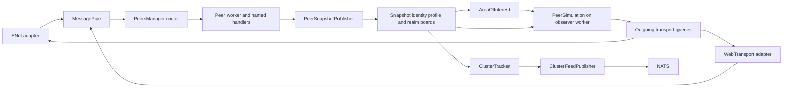
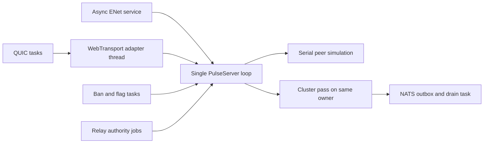

# Pulse to Rust migration guide

Preserve Pulse's conceptual structure while expressing ownership, concurrency and resource lifetime in Rust. A developer who knows `HandshakeHandler`, `PeerSnapshotPublisher`, `PeerSimulation` or `ClusterTracker` should be able to find the corresponding Rust responsibility by name and follow the same data flow. Learning the implementation should require a small C# to Rust vocabulary, not learning a replacement architecture.

The destination is the existing `catalyst-comms` crate and its `pulse` module. Evolve that implementation in place. Keep Pulse running as `catalyst pulse` in a separate process, and keep the gatekeeper's responsibilities outside it. This guide specifies migration work; the proposed worker decomposition below is not the current runtime and is not an implementation or deployment verdict.

For navigation, start with the [responsibility map](#functional-responsibility-map), then read [threading](#threading-and-scheduling), [shared state](#shared-state-and-rust-ownership), [accepted differences](#accepted-differences-that-a-mechanical-port-must-respect) and the [migration sequence](#migration-sequence-and-evidence).

## Sources and scope

The source baseline is [decentraland/Pulse at `91e44f89dd5a857e4ebe08259bec5fc808ae797b`](https://github.com/decentraland/Pulse/tree/91e44f89dd5a857e4ebe08259bec5fc808ae797b). The companion gatekeeper reference is [decentraland/comms-gatekeeper at `edcaebbd9ff9cfa95d9a88d9b2cb76043eae9786`](https://github.com/decentraland/comms-gatekeeper/tree/edcaebbd9ff9cfa95d9a88d9b2cb76043eae9786). Resolve client release pins, private fixtures and runtime acceptance evidence from the current records supplied for the task. Re-verify destination paths at the target revision. Source links are immutable; destination links open repository files. A source inspection is not runtime acceptance.

Use three distinct categories throughout implementation:

| Category | Meaning | Migration rule |
| --- | --- | --- |
| Upstream behavior | What the pinned C# source implements | Preserve its behavior unless an accepted dcl-one decision explicitly differs. |
| Existing Rust behavior | What the destination implements now | Reuse it after checking the source contract; existing code alone does not prove parity. |
| Proposed migration structure | The decomposition and concurrency described below | Implement in reviewable steps, recording architectural choices through the repository's design process before changing runtime ownership. |

The [architecture guide][up-architecture], [interest consistency contract][up-interest], [clustering contract][up-clustering] and [assignment recovery contract][up-recovery] are the primary source explanations. Check their claims against the linked code when migrating a component.

The pinned infrastructure determines the migration baseline:

- Pulse implements scene listeners and retained room takeover recovery.
- Pulse's HTTP service exposes `/health`, `/about` and `/metrics`; `/realms`, parcel presence and `/comms` aliases are not baseline Pulse routes.
- Proposed presence feeds and client-heartbeat retirement require their own approved contracts and consumer evidence. Recheck actual consumer versions before rollout.

This guide covers avatar synchronization, both transports, authentication and defenses, scene listeners, interest management, snapshots, clustering, feed/recovery integration, configuration, observability and verification. Scene simulation, LiveKit token issuance, room moderation and the connector's WebSocket delivery remain separate responsibilities.

## Start here if you know the C# code

The current Rust implementation lives in [`comms/src/pulse`](../../comms/src/pulse/mod.rs). Its familiar types are already present, but several responsibilities are combined in [`PulseServer`](../../comms/src/pulse/server/mod.rs). Start with this reading order:

1. [`env.rs`](../../comms/src/pulse/env.rs) assembles the service: the closest equivalent of `Program.cs`.
2. [`server/mod.rs`](../../comms/src/pulse/server/mod.rs) owns lifecycle and dispatch today: responsibilities spread across `PeersManager` and named handlers in C#.
3. [`snapshot.rs`](../../comms/src/pulse/snapshot.rs) already contains `PeerSnapshotPublisher` and the boards. [`interest.rs`](../../comms/src/pulse/interest.rs) and [`simulation/mod.rs`](../../comms/src/pulse/simulation/mod.rs) hold interest selection and observer delivery.
4. [`cluster/mod.rs`](../../comms/src/pulse/cluster/mod.rs), [`feed.rs`](../../comms/src/pulse/cluster/feed.rs) and [`nats.rs`](../../comms/src/pulse/cluster/nats.rs) derive clusters and hand off the feed.
5. [`transport`](../../comms/src/pulse/transport/mod.rs) owns protocol transport details. Shared protobuf types live in [`comms::protocol::pulse`](../../comms/src/protocol/pulse/mod.rs).

Rust naming changes are mechanical: `PublishFromPlayerState` becomes `publish_from_player_state`; the type remains `PeerSnapshotPublisher`. An interface becomes a trait without the `I` prefix when it still earns an abstraction. A class with state becomes a `struct` plus `impl`; a stateless helper can be a function in its named module.

Keep a short source-equivalence sentence in each module's `//!` documentation, such as “Validates and publishes movement input; corresponds to Pulse's PlayerStateInputHandler.” Keep the migration rationale here, and the runtime invariant beside the code that enforces it.

## Functional responsibility map

The C# column is rooted at `src/DCLPulse/` unless another project is named. The Rust column is rooted at `comms/src/pulse/` unless qualified. Existing locations are navigation aids, not a declaration that every behavior is already equivalent.

| C# responsibility | Existing Rust location | Instruction for the migration |
| --- | --- | --- |
| `Program.cs`, option binding, hosted-service lifetime | `env.rs`, `server/mod.rs` | Keep composition in `env`; construct dependencies explicitly. Make the server a supervisor as worker responsibilities move out. |
| `Transport/ENetHostedService`, `DCLPulse.Transport` | `transport/host.rs`, `packet.rs`, `peer.rs` | Preserve one owner of the ENet host, control/data channel semantics, service/flush ordering and disconnect reasons. |
| `WebTransportHostedService`, stream/datagram framing | `transport/webtransport/{host,quic,framing,config}.rs` | Keep WebTransport as a second adapter into the same peer pipeline. Preserve reliable stream framing, datagram sequence rejection and size/TLS rules. |
| `MessagePipe`, `MessagePipeTransport`, `ITransport` | transport events plus dispatch/send paths in `server/mod.rs` and `transport/multi.rs` | Recover a named messaging seam with ordered incoming events and owner-routed sends/disconnects. The C# `ITransport` itself only requests disconnect; do not invent a large transport framework to mirror it. |
| `PeerIndexAllocator`, `PeerIndex`, `WorkerShard` | IDs and transport ranges in `server/mod.rs`, `transport/multi.rs` | Make logical slot allocation, transport routing and worker selection explicit. Do not confuse transport-local IDs with a global peer slot. |
| `PeersManager`, `PeerStateFactory`, `PeerState` | `server/mod.rs`, `simulation::PeerState` | Introduce fixed peer workers; move each peer's mutable state and observer views into its owner. Keep connection-state transitions named. |
| `DCLAuth`, `HandshakeHandlerBase`, `HandshakeHandler` | `handshake.rs`, `server/mod.rs`, shared `dcl-auth` | Reuse shared auth primitives. Keep auth-chain verification separate from admission, duplicate-wallet handling and initial-state publication. |
| `SceneListenerHandshakeHandler`, `SceneListenerUpdateHandler`, listener state/cell mapper | listener paths in `server/mod.rs`, `interest.rs`, `simulation/mod.rs` | Keep a listener as a distinct peer role, with atomic full-descriptor replacement and no visible player snapshot or cluster membership. |
| `PlayerStateInputHandler`, `TeleportHandler` | `server/mod.rs` dispatch and publication helpers | Extract named handlers while preserving validation, rate-limit order and publication effects. |
| `EmoteStartHandler`, `EmoteStopHandler`, `EmoteCompleter` | `server/mod.rs`, `simulation/mod.rs` | Keep input acceptance separate from timed completion; only the subject owner publishes completion and allocates its sequence. |
| `ProfileAnnouncementHandler`, `ResyncRequestHandler` | `server/mod.rs`, `simulation/mod.rs`, `snapshot.rs` | Keep profile updates and pending resync requests recognizable; observers resolve resync through the same accepted target as normal delivery. |
| `PeerSnapshotPublisher` | `snapshot::PeerSnapshotPublisher`, called from `server/mod.rs` | Retain this existing named component; adapt its mutable board/grid borrows to worker-owned publication without duplicating snapshot construction. |
| `SnapshotBoard`, `IdentityBoard`, `ProfileBoard` | `snapshot.rs` | Keep the three responsibilities and their lifetimes visible; change their synchronization before sharing them across threads. |
| `RealmSpatialGrids`, `SpatialGrid`, `ParcelEncoder` | `realm_grids.rs`, `interest.rs`, `quantize.rs` | Preserve realm partitioning, cell membership and parcel coordinate rules. Grid candidates are not proof of visibility. |
| `IAreaOfInterest`, `IInterestCollector`, `InterestSnapshotReader` | `interest.rs`, simulation target reads | Preserve accepted sequence, registration and tier together, deduplicate once, then resolve that exact target. |
| `PeerSimulation`, `PeerToPeerView`, `PeerViewDiff` | `simulation/mod.rs` | Keep orchestration readable as named phases. Store observer views on the observer's worker; retain event collapse, tier pacing and resync semantics. |
| Transport admission, IP/corrupt-packet limits | `hardening.rs`, `ip_limiter.rs`, transport/server admission paths | Apply checks at the same trust boundary across both transports; release reservations exactly once. |
| Field/rate/replay validation, bans and polling | `hardening.rs`, `handshake.rs`, `bans.rs` | Keep named policies; use immutable snapshots for readers and explicit owner commands for active-peer eviction. |
| `ClusterTracker`, `ClusterBoard`, `ClusterSession` | `cluster/mod.rs`, `cluster/feed.rs` | Preserve deterministic `run_pass`, sticky IDs and debounce; move CPU work off the peer workers and async I/O executor. |
| `NatsPublisher`, `IClusterFeedPublisher` | `cluster/nats.rs`, `cluster/feed.rs`, `comms::protocol::bus` | Preserve fast local handoff, per-wallet coalescing, topology snapshot and reconnection; keep the accepted dcl-one bus contract. |
| `RoomRecoveryLedger`, `RoomRecoveryInbox` | `cluster/feed.rs`: `CurrentAssignments`, `RecoveryRecord`; `cluster/nats.rs`: completion subscription | Keep unfinished takeovers and token floors in Pulse until exact gatekeeper completion. Lossy hints are delivery aids, never the recovery authority. Use dcl-one's internal change/lookup/completion subjects. |
| Recovery consumer in `comms-gatekeeper` | `comms::gatekeeper::admission::cluster::{subscriber, safety, fence}`; existing `gatekeeper::removal` | Gatekeeper owns shared PostgreSQL wallet fences, immutable RPC attempts and logical takeover receipts, plus LiveKit removal, exact completion and token signing. Primary alone dispatches; replicas verify Pulse/shared SQL for signed refresh. Revalidate the original stamp, exact committed fence, current post-lock policy/freshness and token validity at refresh/dequeue. Unknown never retries/expires. These durable/replica capabilities are approved destination extensions, not pinned upstream behavior. Pulse must not import these modules or persist assignment state. |
| Feature flag provider/poller and configuration precedence | `flags.rs`, `env.rs`, `ip_limiter.rs` | Preserve the configuration responsibility, with the explicit four-setting remote override boundary. |
| `HttpService`, metrics collectors/formatter, console dashboard | `metrics.rs`, process metrics serving in `env.rs` | Keep accepted internal operations: loopback exporter and `pulse_*` series, without C#'s health/about/bearer surface. Account for console/developer tooling separately. |
| `Protocol/Generated`, bitwise plugin | `comms::protocol::pulse`, `quantize.rs`, `messages.rs` | Keep generated wire types separate from domain snapshots; reproduce quantization and field presence through fixtures. |
| `DCLPulseTests`, test client, benchmarks and room recovery harness | module tests plus `services/catalyst/tests/pulse_*.rs` | Port behavioral cases, retain an external client/broker path, and measure equivalent workloads. A Rust unit test with a familiar name is not sufficient evidence. |

Rust batching, dormant application-relay support and connector control-position paths are destination extensions. Public Pulse V4 and Archipelago `/ws/v4`/negotiated V4 authentication are separate proposed capabilities, deferred pending a separate user verdict. Preserve ordinary signed `/ws` authentication and its shared ownership/fencing independently. Do not present the extensions as translations of an upstream C# module or enable deferred authentication during structural work.

## Abstractions and layering

Keep these layers inside the existing crate; a layer is a responsibility and dependency direction, not a new Cargo package. This follows [the repository layout ADR](../../../../docs/adr/2026-10-19-organizing-library-services-folders.md), [the module ownership guide](comms-crate.md) and the current architecture constraints.

This is the target dependency direction. Current internal backreferences include simulation reading feature constants from `server`, batching reading WebTransport configuration, and `cluster` implementing a `PulseServer` method. Move shared constants/data and composition glue to their proper owner as those responsibilities are extracted; do not claim the existing modules already enforce this layering.

| Layer | Owns | May use | Must not own |
| --- | --- | --- | --- |
| Wire and adapters | Generated schemas, framing, socket/session handles, transport IDs | Shared protocol, metrics, admission policies, event/sender handles | Peer simulation, cluster policy, LiveKit credentials |
| Peer lifecycle and handlers | Authentication transition, per-peer ordering, validation and state mutation | Auth, policies, owner-local peer state, snapshot publisher | Direct mutation of another worker's peer |
| State and interest | Snapshot history, identity registration, profiles, realm grids and eligibility | Value types, clock and bounded storage primitives | Network I/O or token issuance |
| Simulation | Observer views, history scans, reliable events and deltas | Interest results, board read APIs, outgoing sender | Owning sockets, choosing cluster membership |
| Cluster and integrations | Cluster derivation, assignments, feed publication and operational readers | Published boards, protocol bus, clock, feed seam | Writing worker state or reading gatekeeper internals |
| Composition | Configuration, construction, task/thread supervision and shutdown | All of the above | Per-message business rules |

The arrows below show data flow; they do not authorize reverse module imports. Define channel message types at the shared messaging boundary so transport and worker modules do not depend on each other's concrete implementations.



Suggested final navigation, introduced gradually within `pulse/`:

```text
env.rs                         composition and configuration
server/                        supervisor and existing relay integration
transport/                     existing ENet and WebTransport adapters
messaging/                     message_pipe and named message handlers
peers/                         peers_manager, worker_shard, peer_index, lifecycle
snapshot/                      boards and peer_snapshot_publisher
interest.rs, realm_grids.rs     existing spatial responsibilities
simulation/                    peer_simulation, observer views and diffs
cluster/                       tracker, board, feed and NATS integration
hardening.rs, ip_limiter.rs     policies and shared admission accounting
handshake.rs, bans.rs, flags.rs auth primitives and background configuration
metrics.rs, quantize.rs         existing operational and encoding primitives
```

This is a proposed navigation map, not a scaffold to create in one commit. First extract named functions/types into existing modules; create a folder when there are cohesive files to put in it. A physical folder/layout change requires the repository ADR and ownership updates. Do not add forwarding modules solely to imitate a C# namespace or move shared protobuf/auth types back into Pulse.

Retain abstractions that have a concrete reason:

- `AreaOfInterest` can be a trait for the spatial implementation and deterministic test/null implementations.
- `ClusterFeedPublisher` already separates derivation from asynchronous broker I/O. Keep its handoff non-blocking with respect to the broker.
- A clock seam earns its place through deterministic expiry, rate-limit and tick tests. Separate monotonic elapsed time from UTC/epoch timestamps.
- A transport command sender hides socket ownership. Workers send commands; they never borrow the host.
- A closed protobuf `oneof` can dispatch through `match` to named handlers. Do not reproduce a dictionary of boxed handler objects unless runtime replacement is actually needed.
- A concrete `PeerSnapshotPublisher` can receive a dependency bundle or direct references. Avoid a trait for every helper, per-field closures, service locators and generic parameters used by only one implementation.

## Threading and scheduling

### What the source does

[`PeersManager`][up-peers] has one async router and fixed dedicated worker threads. It routes by `PeerIndex.Value % workerCount`. Each worker owns its peer dictionary and its own `PeerSimulation`, including observer views. It drains its FIFO events, completes expired emotes, runs a simulation tick if due, then waits for either incoming work or the next tick deadline.

[`MessagePipe`][up-pipe] combines lifecycle and parsed data into one incoming queue. Each transport writes a peer's connect event before its first data event. The router preserves that order into one worker queue. Outgoing data and disconnect commands share the owning transport's FIFO, so rejection/control output is enqueued before disconnect. The implementation currently parses protobuf synchronously inside `OnDataReceived`, called from the transport loop; do not infer a separate parser task from the class summary.

ENet and the C# WebTransport adapter have dedicated loops. WebTransport's Rust library performs async QUIC work behind that adapter. [`ClusterTracker`][up-tracker] runs a separate dedicated pass. NATS, HTTP and configuration polling perform asynchronous I/O outside the simulation workers.

### What the destination currently does

Rust `PulseServer` owns the peer map, boards, grid and simulation through ordinary mutable fields. Its cooperative loop handles transport activity, simulation and clustering; `PeerSimulation::simulate_tick` iterates the observers serially. The cluster module explicitly relies on this same-task access. ENet's current `Host::service` asynchronously waits for socket readiness or a poll timer. WebTransport already has a named adapter thread backed by a QUIC runtime and session tasks; NATS has a separate drain task. Those background activities do not make peer processing sharded.



The current boards are safe because access is serialized. Adding `tokio::spawn` around existing calls is not a migration of the source threading design. The owner model and publication APIs must change first.

### Target execution model

| Activity | Rust execution context | Owned state and communication |
| --- | --- | --- |
| ENet service and flush | Independent owner task for the current async adapter; dedicated `std::thread` only for a blocking host implementation | Sole host owner, separate from peer CPU work; emits owned events and drains its outgoing FIFO. |
| QUIC/WebTransport I/O | Existing adapter thread and supervised Tokio session tasks | Sessions/streams stay with their adapter; serialize each peer's lifecycle/data ingress before the router. |
| `PeersManager` router | One task or one thread, selected with the channel bridge | Sole dispatcher to worker queues; no peer business state. |
| `PeerWorker[i]` | One named dedicated `std::thread` per fixed shard | Owns `PeerState`, `PeerSimulation`, observer views, temporary buffers and all writes for its slots. |
| `ClusterTracker` | One dedicated thread with a pass deadline | Owns cluster inheritance/debounce state and publishes immutable passes; reads boards, never worker maps. |
| NATS, bans, flags, operational HTTP, relay authority I/O | Tokio tasks | I/O state and immutable read projections; outcomes requiring peer mutation return through the router. |
| Process supervisor | Async root plus retained thread handles | Startup readiness, cancellation, failure reporting and joins. |

Choose worker count once at startup. Preserve `maximum > 0 ? min(maximum, available parallelism) : available parallelism`: the source's default maximum is zero, meaning use the available CPUs. Use a positive fallback when querying CPU availability fails; do not resize shards while peers are live. `available_parallelism()` is a starting point, not a promise of identical .NET container quota behavior. Record and test the effective worker count in the deployment environment.

The essential threading symmetry is dedicated peer workers, independent transport ownership and independent cluster CPU work. An async ENet owner is the Rust-specific equivalent of the C# polling thread when it performs no blocking work; it is not permission to put simulation back into that task.

Prefer dedicated threads for permanent CPU/blocking loops. Tokio's [`spawn_blocking` documentation](https://docs.rs/tokio/latest/tokio/task/fn.spawn_blocking.html) recommends threads for long-lived work and explains that a started blocking task cannot be aborted. Use ordinary async tasks for I/O, not for permanent blocking simulation loops.

Preserve these scheduling details:

1. **Ordering is per peer.** Keep lifecycle, gameplay and owner-directed commands serialized. If parsing is moved out of the adapter for performance, preserve connect-before-data and packet order; independent parser tasks must not reorder results.
2. **The worker is the writer.** Async auth/authority results, bans and cross-worker replacement requests carry a connection/registration fence and return to the owner. A resumed async operation must not mutate a replaced connection.
3. **No tick catch-up burst.** In the source, one due pass increments the tick counter once; the next deadline is the sampled `now + BaseTickMs`. Do not use Tokio interval's default catch-up behavior or add skipped logical ticks. Preserve the distinction between simulation ticks and elapsed time.
4. **No I/O during mutation.** A handler or simulation pass must not `.await` while holding a peer borrow or a board guard. Perform I/O separately and apply a typed outcome later.
5. **Preserve the worker iteration.** Drain events, complete one-shot emotes, run a due tick, wait. The source drains all available events, so continuous load can delay ticks. A drain budget would be a deliberate overload-policy change, not a harmless translation.
6. **Wakeups cannot be lost.** Prefer a channel receive with a timeout to the next deadline. For a condition variable, check the queue/shutdown predicate in a loop. Do not hand-translate the reset/set event sequence without a race test.
7. **Completion ownership stays visible.** A task that performs I/O reports its own typed result. The owner applies it; it does not reconstruct success by comparing two collections after the fact.

### Queue policy

The C# ingress, worker and transport queues are unbounded. The NATS assignment outbox is separately bounded and coalesces by wallet. Those are different contracts.

Start the differential migration with the same event ordering and delivery behavior. Record queue depth, bytes, age and tick lag. Before production acceptance, specify capacities and the overload action for every queue. A bounded replacement must be reviewed as a behavior change: it can block a transport loop, drop an event or alter disconnect timing.

Never silently drop connect/disconnect, authentication results, teleports, emote events or reliable control output. Never discard an old movement item without proving that snapshot sequences, discrete-event ordering and resync still work. If capacity requires refusal/disconnection, define the reason, metric and reservation cleanup. Keep reliable sends and disconnect in an ordering domain that cannot let disconnect overtake the final response. A separate high-priority lifecycle queue is not automatically equivalent.

## Shared state and Rust ownership

Use `&mut` ownership for a worker's local state and a narrow shared publication API for readers. `Arc<T>` shares ownership of a value; it does not make arbitrary mutation safe. A whole-service `Arc<Mutex<PulseServer>>` would serialize the work again and hide the intended ownership.

| State | Writer | Readers | Rust implementation direction |
| --- | --- | --- | --- |
| Peer state, throttle state, resync requests | Peer's worker | Same worker | Ordinary structs/maps moved into the thread. No lock. |
| Observer views and scratch buffers | Observer's worker | Same worker | Owned by that worker's `PeerSimulation`; reuse allocated capacity. |
| Snapshot history and active bit | Subject's worker | All workers and tracker | A per-slot publication boundary with a safe ring implementation and owned/copyable read results. |
| Identity registration and wallet binding | Registration/cleanup operations coordinated across owners | Interest, simulation, tracker, lookup | Publish wallet/session/generation as one immutable record. Protect the wallet index with atomic checked operations or a short lock. |
| Profile version | Subject's worker | Observer workers | Small synchronized value tied to the same registration lifetime. |
| Realm cell membership | Subject owners through grid API | Interest and tracker | Short mutation critical sections plus immutable retained cell views; validate candidates against snapshots. |
| Cluster computation/debounce | Tracker thread | Tracker only | Ordinary local collections. |
| Completed cluster pass and configuration | Tracker/poller | Feed, operational APIs and workers | Immutable `Arc` snapshot behind an existing lock; evaluate atomic pointer publication only if measurements require it. |
| Admission allocation/accounting | Transport/lifecycle coordination | Both adapters and owner cleanup | One coordinated authority, idempotent reservations/releases; never separate pools accidentally claiming the same slot. |

### Snapshot publication

Do not translate the C# seqlock into `UnsafeCell<PeerSnapshot>` plus volatile reads and a version counter. Concurrent non-atomic payload reads/writes are data races in Rust even if the reader retries after detecting a changed version. [`UnsafeCell` and atomics do not exempt code from Rust's data-race rules](https://doc.rust-lang.org/nomicon/races.html).

Use a safe per-slot `RwLock` around the preallocated ring as the initial implementation, with these constraints: copy/clone the needed snapshot under a short guard, release it before network work or iteration over other subjects, and never hold several slot locks while changing a peer. Prefer cheap immutable shared strings for realm/emote identifiers over allocating strings for every fan-out read. Preserve one writer per slot even though the lock permits more.

This preserves the observable board contract but changes its contention characteristics. Benchmark it at dense fan-out and with a popular subject before release; do not describe it as lock-free. If it misses the agreed performance budget, replace the board internals with a reviewed publication mechanism while retaining the API and tests. [`ArcSwap`](https://docs.rs/arc-swap/latest/arc_swap/) is a candidate for read-mostly immutable configuration or cluster passes; allocating a new snapshot/ring per movement publication is not a free hot-path optimization. It is not currently a required dependency.

Preserve all of the board contract, not just “read latest”:

- Bounded history indexed by sequence; exact historical reads fail after eviction.
- Null/absent realm and emote intent inherit the previous ledger value; an emote stop marker is transient.
- Active-state and registration checks reject disconnect/reuse during resolution.
- An accepted `InterestEntry` contains subject, tier, sequence and registration from the same acceptance. First acceptance wins when stale cell views produce duplicates.
- Normal resolution reads that exact sequence, not a later snapshot. History scans and resync stop at the resolved target.
- If the target was evicted while the registration remains current, preserve the named hard fallback and its counter. Player fallback checks realm, not a fresh distance/tier calculation; listener fallback checks its announced realm/parcels. Resolve before aliasing and tier skipping.
- A realm-changing teleport removes the old grid placement before publication and destination placement. This is not a global atomic snapshot across all peers; readers must still validate candidates.

### Identity and cleanup

Keep three concepts separate: a recycled peer slot, an authenticated wallet/session, and a particular registration of that connection. A same-wallet, same-session reconnect is still a new registration. Wallet equality or repeated sequence zero cannot establish continuity.

In C#, `PeerIndex` equality/hashing uses only the slot; its transport is a routing tag. Rust's automatic `derive(Eq, Hash)` over both fields would change that rule. Prefer a `PeerIndex(u32)` key with transport routing in its connection record, or implement the same slot-only equality deliberately. Convert transport-local IDs into this global key at the adapter boundary.

Use an explicit registration generation or immutable registration identity for read fences. Keep counter exhaustion a checked invariant, and check the expected registration again before applying delayed results. Pre-auth events also need an allocation/connection fence if they can outlive their slot; an auth registration does not exist yet at that point.

Preserve two-phase disconnect:

1. A requested disconnect stops further gameplay handling and travels through the owning transport's ordered output.
2. The transport's disconnect event reaches the owner behind previously queued input. The owner marks disconnecting, clears active visibility and removes grid membership.
3. After cleanup grace, the owner clears snapshot/identity/profile state and releases the allocator slot. Wallet removal is conditional on the expected binding so old cleanup cannot erase its replacement.

Observer retirement is counted in simulation ticks; recycling and transport timeouts use elapsed time. The source's nominal stale-view bound is about four seconds at its defaults and cleanup grace is five seconds. Overruns can invert that order. Registration fences remain necessary even with those defaults.

Use RAII (`Drop`) to release owned buffers and handles, but do not use object destruction as a substitute for the protocol-visible disconnect state machine. A dropped `Arc` does not tell the client that a player left.

## Preserve behavior through complete flows

### Connect and authenticate

Follow the same recognizable path: transport admission -> connected event -> owning worker -> handshake validation -> identity registration -> optional initial-state publication -> authenticated response. Validate the chain, delegation/signing address, expiry and signed `connect:/` payload through the shared auth implementation. Keep replay/attempt policies and bans at their current boundaries. The baseline includes the timestamp in that signed payload but has no independent freshness-window check; dcl-one intentionally applies a 60-second window and durable replay journal (`pulse-6` below). The verifier's window is inclusive; the journal also rejects future timestamps. Do not describe legacy auth as server-bound or conflate it with deferred V4 authentication.

Duplicate-wallet handling must target the incumbent owner through the coordination path. Never mutate another worker's peer map. If authentication or authority checking becomes async, preserve a pending state and fence its result against a replaced connection. Keep rejection-before-disconnect output ordering.

The optional initial player state must contain a valid realm. Without it, the player remains invisible until a teleport supplies a realm. Resumed emotes backdate their start from elapsed offset without unsigned underflow. A listener follows its separate handshake and never becomes a player subject.

### Input to observer output

The movement handler validates fields before suppressing duplicate quantized input, then calls the snapshot publisher for an accepted change. The first movement after teleport still publishes. Pointing requires the flag and all three optional coordinates. The publisher allocates the next sequence, preserves quantized wire values, resolves the ledger and updates the spatial index. It is the single place for these effects. Profile announcements require a nonnegative version strictly greater than the previous version and bypass the teleport/emote budget. Emote IDs have no separate 512-character cap; whole-packet and duration limits still apply.

On the observer worker, interest selects the exact target; simulation resolves it, handles registration/realm lifecycle, scans retained events through that target, and sends reliable events followed by permitted deltas. Collapse each discrete event type to its latest occurrence in the batch. Teleport and emote start suppress that pass's unreliable delta; emote stop permits it. State flags remain present because boolean transitions drive animation. Movement continues to be accepted during emotes; Pulse relays client state rather than enforcing an emote movement lock.

Preserve the default full-state resync and the optional delta mode. A delta baseline must still be retained and strictly precede the resolved target. Equal, future or evicted baselines fall back to full state. Unreliable state uses the last sent baseline, not an invented acknowledgement protocol. Self mirror bypasses spatial collection but still requires a realm.

### Scene listeners

Validate unique realms and inclusive parcel rectangles, including the cumulative realm/rectangle budget. A valid update replaces the complete subscription on the next tick; invalid input cannot partially apply it. Re-evaluate the live whitelist, preserving structural and authentication checks even when budget exemptions apply. After listener authentication, only resync and listener-update messages are accepted.

Listeners receive positional/emote output without player profile announcements and contribute no visible snapshot or cluster member. Removed subjects follow stale-view grace. Apply dcl-one's accepted listener authorization requirement separately from this shared behavior; verify scoped authority separately from baseline behavior.

### Clusters and assignments

Keep `ClusterTracker::run_pass` deterministic and independently testable. Read realm grids and currently bound registrations; union occupied cells with their eight neighbors per realm. Preserve transitive components, uncapped size, centroid/radius calculation, sticky-ID overlap/tie rules and the separation between computed and published assignments. A cluster is not a visibility set.

Keep dwell debounce and its first-assignment, teleport, realm-change and deleted-old-cluster exceptions. Preserve post-debounce assignment lookup. A teleport marker can be overwritten by later movement; do not turn a best-effort bypass into a promised guarantee without changing the contract. Boot-scoped IDs avoid room-name reuse; they do not make recovery state durable.

Feed handoff must not wait on the broker. Keep topology as latest-wins, pending assignment changes as latest-per-wallet, and the explicit distinct-wallet capacity policy. Core NATS offers at-most-once delivery; local publication success does not prove consumer receipt. Lookup silence remains unknown, not proof that a wallet has no owner. Keep retries bounded and preserve reconnection after recoverable broker failures.

Keep recovery state separate from that lossy handoff. Pulse's `CurrentAssignments` retains unfinished predecessor cleanup until exact completion and gives ready assignments a token-validity floor. Gatekeeper commits a shared PostgreSQL wallet hazard and immutable removal attempt before the remote call, replays confirmed completion without removing again, and preserves unknown admission closure across restart. It never retries or expires an unknown operation. Incarnation, version, wallet, session and owner registration fence the round trip. After the final authority lookup, refresh and queued delivery check shared generation/floor, the original committed fence, post-lock database-clock owner freshness and policy, then local ownership and actual token `nbf`; an earlier check cannot authorize a later send. Pulse current/pending/floor authority remains in memory. Durable gatekeeper safety neither settles uncertain remote effects nor reconstructs lost Pulse authority, so arbitrary Pulse loss/unknown dispatch still requires controlled maintenance.

Pulse currently owns its own `async-nats` client. The accepted future shared-bus work  has separate prerequisites and live-broker checks; using shared protocol definitions does not mean that migration has already happened.

## Accepted differences that a mechanical port must respect

These are constraints from the destination's [ownership guide](comms-crate.md) and the supplied architecture decisions. They explain where a former Pulse developer must look for a responsibility that is intentionally different. Reopening one requires a new user verdict and a verified decision record update; do not change it implicitly as part of naming or threading work.

| Responsibility | Source behavior | Destination instruction |
| --- | --- | --- |
| Crate boundary | Separate.NET projects and hosted services | Keep one `catalyst-comms` crate and evolve the existing code. `catalyst pulse` remains a separate process; do not create a parallel Rust Pulse implementation. |
| Internal protocols | Independently deployed feed producers and consumers | Preserve client-facing wire contracts; monorepo internal bus changes update both ends atomically through `comms::protocol::bus`. Do not add dual-publish compatibility paths by default. |
| Room recovery | Retained pending takeovers, exact completion and token floor | Pulse retains unfinished work; gatekeeper alone applies LiveKit cleanup, acknowledges it and mints credentials under the floor. Preserve internal dcl-one subject names and update both ends together. |
| Durable admission safety | Pinned infrastructure retains Pulse recovery; shared SQL hazards and replica island-refresh are destination extensions | Keep Pulse nonpersistent. Gatekeeper persists wallet-wide admission fences, immutable attempts and logical receipts; only primary removes, all serves verify for refresh. Confirmed fenced cleanup can recover; unknown never retries/expires and requires controlled maintenance. Every queued credential keeps its original stamp and exact committed fence. |
| Authentication | Baseline client authentication | Keep public Pulse V4 and native/negotiated Archipelago V4 authentication deferred. Ordinary signed `/ws` and shared ownership/fencing remain active. |
| Profile and emote handling | Every authenticated profile announcement; no separate emote-ID length cap | Keep nonnegative, strictly increasing profile versions outside the teleport/emote budget. Keep emote-ID validation bounded by the packet, without the extra 512-character cap. |
| Shared ENet | Native ENet channel 1 is sequenced unreliable with per-packet throttle bypass | Use the shared pinned source in `library/vendor/rusty_enet` for Pulse and native Bevy. Keep independent drivers and apply bypass explicitly to channel 1; do not disable throttling globally. |
| Native receive limits | No pinned upstream 64 KiB/256 receive-allocation policy | Pulse-only 8192 payload/65536 charged queued bytes/256 commands, typed terminal early reason 16 for valid oversized declarations, exact accounting release and unchanged client/outgoing defaults. Aggregate refusal is nonterminal. This is approved destination resource policy; deterministic/source evidence does not establish full client/runtime, final-head CI or measured capacity. |
| Presence authority | Iteration-2 plans propose a separate parcel presence feed | Social online derives from complete Pulse wallet topology; room occupancy/capacity has a distinct LiveKit authority. Do not merge these data sources merely to match a newer plan. |
| Bans | Upstream ban polling/enforcement | Keep the destination's conditional moderator HTTP snapshot and common policy; do not add another ban bus. |
| Remote configuration | Broad upstream remote configuration/provider and operational representation | Keep the four permitted remote IP-limit settings and the destination's full-lifetime connection accounting. Other upstream settings do not become remotely writable. |
| Scene-listener authority | Baseline listener accepts a valid authentication chain | Require listener authority scoped to the authoritative address and parcels, and verify that boundary in the private acceptance review. |

Preserve these accepted behavior constraints during structural work:

- keep the destination's 60-second signed-timestamp window and durable consumed-handshake journal. Source replay protection is an in-memory TTL cache. Do not remove the journal under a blanket claim that Pulse has no persistence; it is distinct from avatar/room state.
- keep the internal loopback Prometheus exporter, `pulse_*` names and the absence of the upstream public health/about/bearer surface. The configuration contract defines the full IP limiter and bounded remote flags within that operational choice.
- retained destination wire extensions require explicit capability negotiation and schema-number checks. The authentication capabilities deferred capabilities require an activation verdict and reviewed field allocations.

The application relay and its room-authority response are a dcl-one addition. Only the gatekeeper holds the LiveKit secret and mints/verifies the admission proof. Pulse neither imports gatekeeper internals nor persists room policy. Preserve that isolation when extracting handlers or supervisors.

## Technology translation

Prefer dependencies already pinned in `services/catalyst/Cargo.toml` and `Cargo.lock`. A language migration is not a reason to replace working network libraries or add an ECS.

| C#/.NET mechanism | Rust counterpart in this repository | Practical rule |
| --- | --- | --- |
| Generic Host, DI container, `BackgroundService` | `env` composition, explicit constructors, supervisor | Construct long-lived components once; retain task/thread handles and make readiness/failure visible. |
| Dedicated `LongRunning` worker | `std::thread::Builder` and owner-local state | Name the worker; move ownership into it; use a wakeable deadline wait. |
| Channels and event unions | Existing Tokio channels or a synchronous channel bridge; Rust enums | Select a bridge that does not block the async executor. Preserve FIFO and specify full/closed behavior. |
| `Task` for I/O | Tokio futures/tasks | A future does nothing until polled. A spawned task is not a dedicated OS thread and may move between runtime threads. |
| `CancellationToken`, `Dispose` | `tokio_util` cancellation plus explicit thread stop/wakeup, `Drop` | Cancellation requests termination; it does not join a task or complete protocol cleanup. |
| `Google.Protobuf` and generated partial helpers | Existing `prost` types and `quantize`/message helpers | Preserve tags, `oneof`, enum values, optional presence, signedness and unknown-message handling. |
| ENet binding/native wrapper | Shared pinned [`rusty_enet`](../../../../library/vendor/rusty_enet/README.md) and separate native client/server adapters | Preserve the reviewed per-packet bypass patch, license, provenance and both workspace resolutions. Keep driver lifecycle and application admission with each consumer; prove behavior with real clients. |
| Rust WebTransport reached through .NET FFI | Existing `web-transport-quinn` adapter | Use the Rust API directly while retaining the framing protocol and ownership seam. |
| RustEthereum signature verifier | Existing `dcl-auth` and crypto dependencies | Reuse verification logic; do not port the managed FFI wrapper back into Rust. |
| NATS .NET client | Existing `async-nats` | Keep the application outbox contract separate from SDK buffering and broker delivery. |
| HTTP client/service and JSON | Existing `reqwest`, `axum`, `serde` | Preserve named field shapes and error/status behavior for the selected destination contract. |
| ILogger, meters and Prometheus formatter | `tracing`, `metrics`, existing exporter | Preserve units, cardinality and operational meaning; avoid peer/wallet labels and hot-path string formatting. |
| NUnit and mocks | Rust unit/integration tests, small test doubles, `proptest` where useful | Test the boundary behavior, not private class layout. |

A `T?` usually becomes `Option<T>`, not a sentinel value. An operation whose failure matters becomes `Result<T, Error>`, with a named enum when callers branch on the reason and `anyhow` at process/operational boundaries. An outgoing union should be `Send { ... }` or `Disconnect { ... }`, eliminating the C# null message sentinel for disconnect.

Borrowing replaces temporary shared access: `&T` reads and `&mut T` provides exclusive mutation. Use `Arc<T>` for genuinely shared ownership and `Bytes` or owned buffers at cross-task boundaries. Do not enqueue a borrowed packet slice whose transport buffer is immediately reused. Restrict `Send`/`Sync` requirements to real thread boundaries; never add unsafe implementations to silence a compiler error.

Define integer behavior explicitly. Sequence/tick arithmetic, the “no previous sequence” sentinel, elapsed emote offsets and epoch discovery timestamps have different semantics. Use wrapping or saturating operations where the source contract calls for them, and test rollover; do not rely on release-build overflow. Keep quantized codes as integers until decoding is required. Ordinary Rust rounding must not replace the source quantizer's tie/clamp/sign rules without differential vectors.

### Configuration translation

Treat configuration as part of the migration contract. The source layers JSON, environment, command line and remote overrides; the destination exposes a documented `PULSE_*` environment contract and restricted remote flags. Do not copy values by position or assume similarly named defaults agree.

| C# configuration | Existing Rust setting or gap | Action |
| --- | --- | --- |
| `Transport:BindHost`, `Transport:Port` | `PULSE_BIND` | Translate host and port explicitly. Checked-in C# configuration uses UDP 7777; Rust defaults to 9000. Keep deployment routing consistent with the advertised endpoint. |
| `WebTransport:Enabled`, host/port and size limits | `PULSE_WT_ENABLED`, `PULSE_WT_BIND`, `PULSE_WT_MAX_MESSAGE_BYTES`, `PULSE_WT_MAX_DATAGRAM_BYTES` | Preserve disabled-by-default behavior, TLS inputs and effective frame/datagram limits. |
| `Peers:MaxWorkerThreads` | No current worker-count environment setting | Introduce/document it with sharding, preserving zero/nonpositive as automatic selection. |
| `Peers:SnapshotHistoryCapacity` | `DEFAULT_RING_CAPACITY` in `server` | Source class defaults to 10 but checked-in JSON sets 20; Rust uses the effective value 20. Preserve event fallback when the exact history target is no longer retained. |
| `Peers:SimulationSteps` | `DEFAULT_SIMULATION_STEPS` and the process tick interval | Verify both pacing and tier divisors; matching the array alone does not establish matching missed-tick behavior. |
| `Transport:MaxPeers` | Separate `ENET_CAPACITY` and `WT_CAPACITY` ranges | Source shares a 4095-slot pool; current Rust allocates ranges of 4095 and 4096. Resolve total capacity and allocation semantics explicitly when adding logical slots. |
| `SpatialHashAreaOfInterest` radii, `SceneListener:MaxParcels` | `PULSE_AOI_*`, `PULSE_SCENE_LISTENER_MAX_PARCELS` | Verify units, allowed ranges and listener exemptions. |
| `Clusters:*`, `Nats:*` | `PULSE_CLUSTERS_*`, `PULSE_NATS_*` | Translate cadence, debounce, prefix and outbox capacity. Preserve the retained recovery bounds and internal lookup/completion contract; an outbox limit cannot discard unfinished cleanup. |
| `Transport:Hardening:IpLimiter:*` | `PULSE_IP_LIMITER_*` and the restricted flag document | Preserve defaults, zero-as-unlimited, live accounting and last-good refresh behavior under the reviewed configuration contract. |

Remaining options need the same explicit disposition: mapped, fixed by the destination, intentionally different under an accepted decision, or missing work. Include metrics, replay persistence, ban polling, timeouts, self mirror and resync mode in that inventory before release.

## Apply the bevy-explorer guidance selectively

The project's validated [code style](../../../../rendering/bevy-explorer/docs/guidelines/code-style.md), [scheduling](../../../../rendering/bevy-explorer/docs/guidelines/scheduling.md), [contributing](../../../../rendering/bevy-explorer/docs/guidelines/contributing.md) and [security guidance](../../../../rendering/bevy-explorer/docs/guidelines/security.md) provide the following transferable rules:

| bevy-explorer principle | Pulse application |
| --- | --- |
| State belongs to the entity/lifetime it describes | Peer state and views belong to their worker/registration; session tasks and channel ends belong to their session. Do not keep them in immortal caches. |
| Structural cleanup | Own resources under a supervisor/connection and close/join them explicitly. Keep protocol disconnect grace as its own state machine. |
| Reuse the existing scheduling and ownership | Preserve Pulse's named phases and source worker ownership. Do not import Bevy schedules, ECS components, marker entities or `IoTaskPool` into this server. |
| Wire types convert into domain types | Keep generated protobuf types at the boundary; use validated snapshots/peer state for simulation. Reuse schemas instead of declaring a second wire model. |
| I/O cannot block the simulation path | Use Tokio for I/O and return typed outcomes through channels. Place cancellation around interruptible waits, not around an entire state mutation that could be left half-applied. |
| The worker that knows an outcome reports it | Return explicit per-item results; preserve request association and registration fences. |
| Named errors; no panic on untrusted input | Reject or ignore malformed input according to the protocol, with a typed reason and metric. `unwrap`/`expect` must not turn client input into process failure. |
| Privilege comes from a trusted boundary | Use verified wallet/session identity and adapter-stamped connection metadata; never trust a claimed identity in a payload. Keep LiveKit secrets with the gatekeeper. |
| Small changes and behavior tests | Extract one responsibility at a time; keep diagrams and a source-to-target map in the review. Avoid unrelated restyling. |
| Formatting, linting and deliberate dependencies | Use `rustfmt`, clippy with warnings denied, workspace dependencies and locked validation. Avoid broad dependency updates; Bevy's detailed lock-edit procedure is specific to its separate workspace. |

Keep the source hot-path discipline: reuse buffers and collections, avoid per-observer allocation and boxing, and keep debug formatting out of packet/tick loops. Measure allocation and contention rather than assuming Rust makes the port faster. Existing destination batching/caches need their own behavior and performance evidence after worker partitioning.

Preserve transport details through explicit fixtures. ENet channel 0 is reliable control/events and channel 1 is unreliable sequenced movement/deltas with explicit local sender-throttle bypass; channel 2 is declared unsequenced and unused by the baseline. The shared dependency preserves these independent packet properties without adding a wire flag. Pulse also enforces its incoming-only native allocation policy before reassembly; preserve ordinary/connected local event adapters and stale-generation identity checks. Pulse applies its application envelope before decoding: up to 4096 bytes accepted, 4097–8192 dropped through the corruption budget, and larger packets disconnected immediately with reason 16 and lifecycle cleanup. WebTransport reliable frames carry a four-byte big-endian length. Client-to-server datagrams carry a channel byte and big-endian sequence header, while server-to-client datagrams carry the raw payload. Do not make the two datagram directions symmetric as a cleanup.

## Shutdown and failure handling

Retain task and thread ownership in the supervisor. A worker panic or unexpected exit must be observable; do not leave a permanently missing shard while the process appears healthy. Malformed input is a recoverable result, not a panic. Do not copy C# catch-and-continue blocks into blanket `catch_unwind` around possibly inconsistent Rust state.

Use an explicit shutdown sequence:

1. Stop new admission and stop new background requests that can generate peer work.
2. Request connection closure while transport owners, the router and workers can still process the resulting events/output.
3. Allow a bounded cleanup/output window, keeping per-peer FIFO order. Report any unfinished work; the source has no guaranteed graceful restart drain.
4. Stop producers, close ingress, wake blocked workers, stop the tracker and let the remaining bounded output complete.
5. Cancel/join I/O tasks and join dedicated threads, then release transport hosts and buffers.

Make each wait bounded or explicitly wakeable. Avoid a shutdown cycle where transport disposal waits for workers while workers wait for transport disconnect events. Follow Tokio's [detect, signal and wait shutdown model](https://tokio.rs/tokio/topics/shutdown), adapted to the dedicated threads. Restart drops connections and in-memory avatar/cluster authority. Preserve gatekeeper PostgreSQL safety facts and any separately owned replay journal; shutdown must not clear an unknown dispatch. Durable wallet hazards survive gatekeeper restart but do not reconstruct Pulse state or establish transparent recovery from uncertain effects. This sequence provides no zero-downtime handover guarantee.

## Migration sequence and evidence

Follow the [implementation pipeline](implementation-pipeline.md). The stages below describe work packages; they are not a request to execute them as part of writing this guide. Keep architectural choices distinct from accepted decisions and include proposed decision and change-request updates in the task report.

| Stage | Change | Evidence required before moving on |
| --- | --- | --- |
| 1. Freeze the contract | Pin upstream Pulse, its generated schemas/quantizer, destination, client fixtures and the accepted exception list. Inventory effective config, not only class defaults. | Every functional row above has an owner, target location and behavior cases. Source-vs-target exceptions are explicit. |
| 2. Make responsibilities visible | Extract named handlers from `PulseServer`, retaining the existing `snapshot::PeerSnapshotPublisher`; preserve calls, recovery authority and shared legacy fences. Keep public V4 authentication deferred. | Existing focused Rust tests remain green; no new runtime/threading, wire or policy differences. |
| 3. Establish the owner boundary | Introduce unified incoming/outgoing enums, logical peer identity and the router/worker API. Run one worker first through the full transport-to-output path. | Connect/data/disconnect FIFO, mixed transports, rejection flush and slot reuse pass end to end. |
| 4. Make publication safe | Replace exclusively borrowed boards with safe per-slot publication/read APIs; retain registration and exact-sequence semantics. | Concurrent read/write/recycle cases and target-eviction tests pass; no unsound custom seqlock. |
| 5. Implement fixed worker shards from Pulse | Move peer maps and observer views to dedicated workers; route all external mutations through their queues. | Two peers on different workers exercise teleport, resync, disconnect and same-wallet reconnect under controlled scheduling. One-worker and multiworker traces agree within the documented concurrency semantics. |
| 6. Isolate cluster derivation | Run the tracker separately over published boards; preserve the feed seam and accepted lookup contract. | Sticky IDs/debounce/realm behavior and broker-disconnected operation pass; tracker load cannot stall peer processing. |
| 7. Complete operational mapping | Verify flags, bans, health/about/metrics ownership, limits, task supervision and shutdown. Document translated environment/config keys. | Linux/Windows start/stop and effective configuration checks pass; output shapes/auth follow the chosen contract. |
| 8. Measure and release | Run equivalent workload and client/broker tests; follow the repository's separate rollout gates. | Protocol parity/accepted exceptions, concurrency correctness, performance budget and operator readiness are evidenced at the final revision. |

Do not combine stage 2's file decomposition with an overload-policy change, a quantization change, a new batching format or a new transport. When comparing traces, control the clock, event order, peer allocation and cluster boot seed. Compare per-peer behavior and defined subjects; neither protobuf map ordering nor cross-peer thread scheduling is a global deterministic wire order.

### Behavior coverage

Use the source tests as scenarios to translate, not as tests to mechanically rewrite line by line:

| Contract | C# scenarios to preserve | Existing Rust starting point and required additions |
| --- | --- | --- |
| Router/worker ownership | `WorkerAsyncTests`, `DrainPeerLifeCycleEventsTests`, `MessagePipeRoutingTests`, `MessagePipeDisconnectTests` | `server` and transport tests; add explicit multiworker/FIFO/cross-worker command cases when sharding is introduced. |
| Identity and reuse | `PeerIndexTests`, `PeerIndexAllocatorTests`, `IdentityBoardSessionTests`, simulation lifecycle/realm race tests | `snapshot`, `server`, `simulation` tests; add same-wallet/session/sequence ABA and late async-result fencing across workers. |
| Interest target consistency | `InterestCollectorTests`, `SpatialHashAreaOfInterestTests`, `InterestSnapshots`, `InterestSequenceFallback`, `ReviewRegressions` | `interest` and simulation tests; explicitly cover retained target, eviction fallback, skipped tiers, disconnect and recycled registration. |
| Movement/events/resync | Snapshot realm/publisher tests, simulation emote/teleport/intermediate snapshot/resync tests | `snapshot`, `simulation`, `pulse_loopback`, `pulse_quantize_differential`; port missing source cases and byte/semantic fixtures. |
| Scene listeners | Handshake/update/policy/real-scene tests | `server/tests/scene_listener.rs`, `simulation/tests/scene_listener.rs`; verify the accepted authorization requirement separately. |
| Transports and defenses | ENet shutdown, WebTransport hosted service, stream/datagram framing, limiter/admission lifecycle tests | `pulse_webtransport_wire`, `pulse_webtransport_loopback`, `pulse_application_transport`, transport and hardening unit tests. |
| Clusters and broker failure | `ClusterTrackerTests`, `NatsPublisherTests`, assignment recovery/ledger tests | `cluster/tests.rs`, `pulse_nats_live`, `pulse_cluster_lookup`, `archipelago_nats_recovery`; exercise real Pulse, isolated NATS, production gatekeeper and signed `/ws` through lost hints, exact completion, takeover and final credential delivery. |
| Operations | Configuration precedence, flag provider, metrics/RTT/loop timing tests | `env`, `flags`, `ip_limiter`, `metrics` tests; add explicit route/body/auth cases for operational surfaces that are retained. |

Concurrency tests must arrange the contested interleaving with barriers/channels or a controllable scheduler. Do not use arbitrary sleeps as proof of a race being fixed. For custom synchronization, consider a focused model-checking harness; adding tooling is a separate dependency choice. Stress tests supplement deterministic cases but do not prove absence of races.

### Commands for implementation work

Run from `services/catalyst` using its pinned toolchain. These are verification commands for future implementation changes, not claims that migration acceptance has already passed:

```sh
cargo fmt --all -- --check
cargo clippy --locked -p catalyst-comms --all-targets -- -D warnings
cargo test --locked -p catalyst-comms --lib pulse::
cargo test --locked -p catalyst --test pulse_quantize_differential
cargo test --locked -p catalyst --test pulse_loopback
cargo test --locked -p catalyst --test pulse_webtransport_wire
cargo test --locked -p catalyst --test pulse_webtransport_loopback
cargo test --locked -p catalyst --test pulse_application_transport
cargo test --locked -p catalyst --test pulse_batch_bandwidth
```

Batch the relevant targets into one Cargo invocation when changing several of these boundaries. For `pulse_cluster_lookup` and broker restart cases, set `PULSE_NATS_SERVER_BIN` to an isolated broker executable. The cross-service `archipelago_nats_recovery` and `archipelago_control_extensions_websocket` cases also need `ARCHIPELAGO_NATS_SERVER_BIN` and disposable `CATALYST_TEST_DATABASE_URL`; use `--features catalyst-comms/test-support` for the real tracker fixture. Basic `pulse_nats_live` cases also support `PULSE_NATS_TEST_URL` pointing at a scratch broker. An environment-skipped case does not establish integration compatibility. Include `comms_v4_assignment_fence` when changing registration/assignment flow: its retained name covers shared legacy ownership, not enabled public V4 authentication. Run the wider required CI tiers and module-DAG checks when the actual change demands them. The upstream C# comparison uses `dotnet test src/DCLPulse/DCLPulse.sln -p:GenerateProto=false` from a separately pinned reference checkout. The destination build must remain self-contained and must not depend on that sibling checkout.

The repository-root command `nix develop --command bash tooling/dev-test.sh rust` supplies disposable PostgreSQL and isolated NATS for the workspace suite. Its [regression manifest](../../../../tooling/dev-regressions.json) and [guard](../../../../tooling/dev-regressions.py) check test inventories, prerequisites and the unfiltered runtime invocation. Shared ENet provenance and deterministic regressions run separately. Read the current workflows and record exact commands, revisions, results and omitted scopes in the task report; historical CI results do not establish final-revision acceptance.

Generate protobuf from the pinned schema source through the existing documented Rust generation process in `comms::protocol::pulse`; do not hand-edit generated Rust or C#. Test optional zero versus absent, enum/oneof values, unknown fields/messages, framing and quantization boundaries. Byte assertions are appropriate where encoding is contractually fixed; otherwise decode and compare semantic fields so harmless field/map serialization order does not cause false failures.

For performance, compare source and destination on the same hardware, release configuration, peer count, realm density, movement/event mix and transport. Include dense O(N²) fan-out, sparse/multi-realm loads, scene listeners, reconnect churn and broker outage. Record tick p50/p95/p99 and overruns, input-to-send latency, CPU, memory/allocation, queue age/depth, board contention and outbound bytes. Agree the acceptance budget from the source measurements before claiming the safe board or worker design is fast enough. Tracker-only microbenchmarks do not establish full synchronization capacity.

## Completion criteria for the migration

The migration is ready for a former Pulse developer to review when:

- Each functional map row leads to a named Rust responsibility or an explicit accepted destination owner.
- The developer can trace handshake, movement, resync, listener update, disconnect and cluster assignment using the same conceptual steps as in C#.
- A code reader can identify each state owner, each reader and every cross-thread message without following a global lock or an implicit async mutation.
- Fixed worker sharding, separate cluster work, per-peer FIFO and generation fencing are demonstrated by tests, rather than inferred from the use of Tokio.
- Wire and behavior fixtures cover both transports, concurrency/lifetime cases and accepted deviations; operational surfaces and effective configuration are accounted for.
- Performance and failure evidence belongs to the final implementation revision, including the synchronization strategy actually shipped.

A useful final review exercise is to hand this guide and the Rust tree to a Pulse maintainer and ask them to locate the movement publisher, the accepted interest target, the owner of a disconnect, the cluster debounce state and the token issuer. All five should have direct, unambiguous answers. If they need to learn a new service architecture to answer, the structural migration has not met its goal.

[up-architecture]: https://github.com/decentraland/Pulse/blob/91e44f89dd5a857e4ebe08259bec5fc808ae797b/docs/ai-agent-context.md
[up-interest]: https://github.com/decentraland/Pulse/blob/91e44f89dd5a857e4ebe08259bec5fc808ae797b/docs/interest-snapshot-consistency.md
[up-clustering]: https://github.com/decentraland/Pulse/blob/91e44f89dd5a857e4ebe08259bec5fc808ae797b/docs/clustering-on-aoi.md
[up-recovery]: https://github.com/decentraland/Pulse/blob/91e44f89dd5a857e4ebe08259bec5fc808ae797b/docs/cluster-assignment-recovery.md
[up-peers]: https://github.com/decentraland/Pulse/blob/91e44f89dd5a857e4ebe08259bec5fc808ae797b/src/DCLPulse/Peers/PeersManager.cs
[up-pipe]: https://github.com/decentraland/Pulse/blob/91e44f89dd5a857e4ebe08259bec5fc808ae797b/src/DCLPulse/Messaging/MessagePipe.cs
[up-tracker]: https://github.com/decentraland/Pulse/blob/91e44f89dd5a857e4ebe08259bec5fc808ae797b/src/DCLPulse/Clusters/ClusterTracker.cs
